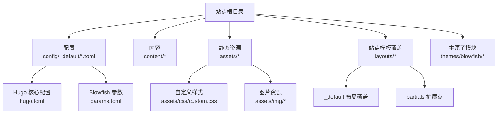
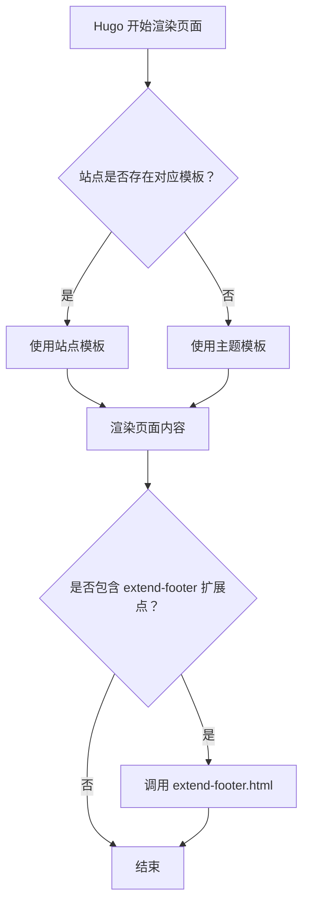
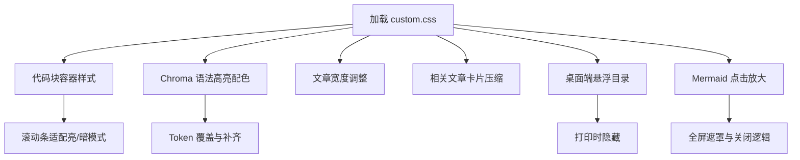
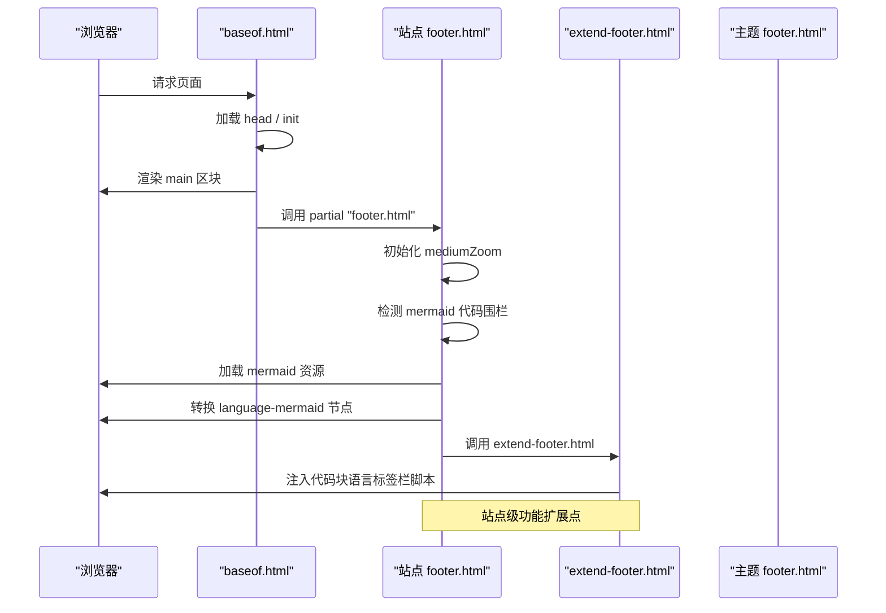
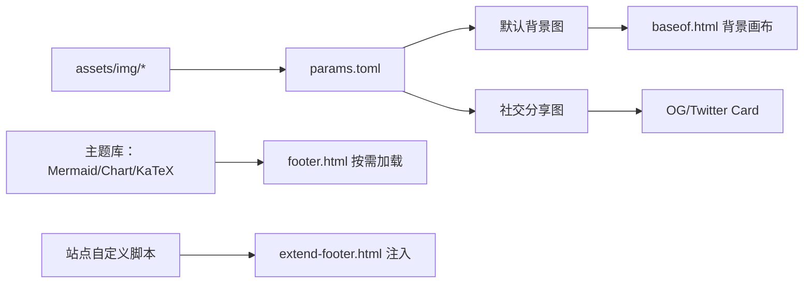
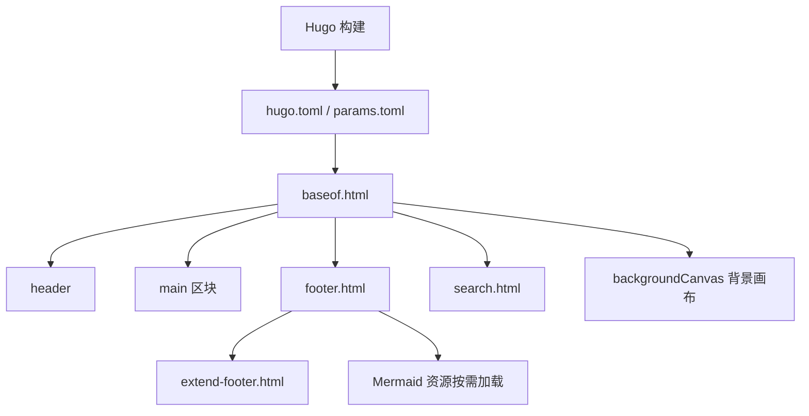

# 主题定制

<cite>
**本文引用的文件**   
- [README.md](file://README.md)
- [hugo.toml](file://config/_default/hugo.toml)
- [params.toml](file://config/_default/params.toml)
- [custom.css](file://assets/css/custom.css)
- [single.md](file://layouts/_default/single.md)
- [footer.html（站点覆盖）](file://layouts/partials/footer.html)
- [extend-footer.html](file://layouts/partials/extend-footer.html)
- [baseof.html（主题）](file://themes/blowfish/layouts/_default/baseof.html)
- [footer.html（主题）](file://themes/blowfish/layouts/partials/footer.html)
</cite>

## 目录
1. [引言](#引言)
2. [项目结构与定制边界](#项目结构与定制边界)
3. [非侵入式模板覆盖原理](#非侵入式模板覆盖原理)
4. [CSS 自定义与样式体系](#css-自定义与样式体系)
5. [Partial 模板覆盖机制](#partial-模板覆盖机制)
6. [资源管理策略](#资源管理策略)
7. [常见定制示例与实现路径](#常见定制示例与实现路径)
8. [依赖关系与渲染流程](#依赖关系与渲染流程)
9. [性能优化建议](#性能优化建议)
10. [故障排查指南](#故障排查指南)
11. [结论](#结论)

## 引言
本指南面向希望在不修改 Blowfish 主题源码的前提下，对基于 Hugo + Blowfish 的个人博客进行个性化定制的用户。文档重点说明：
- 如何通过 `layouts`、`assets`、`config` 等目录实现非侵入式定制；
- 如何理解并复用主题的 partials 扩展点；
- 如何使用 CSS 变量和 Tailwind 语义类名完成代码块美化、响应式调整、深色模式适配；
- 如何组织图片、字体、图标等资源，并在升级主题时保持可维护性；
- 如何结合现有站点实践，快速落地常见定制需求。

## 项目结构与定制边界
当前站点采用“站点层 + 主题层”分离结构：
- 站点层负责内容、配置、非侵入式模板覆盖和自定义样式；
- 主题层通过 git submodule 引入，不应直接修改，以保证升级安全。

**图表来源**
- [README.md:14-39](file://README.md#L14-L39)
- [hugo.toml:1-10](file://config/_default/hugo.toml#L1-L10)
- [params.toml:1-20](file://config/_default/params.toml#L1-L20)

**章节来源**
- [README.md:14-39](file://README.md#L14-L39)
- [hugo.toml:1-10](file://config/_default/hugo.toml#L1-L10)
- [params.toml:1-20](file://config/_default/params.toml#L1-L20)

## 非侵入式模板覆盖原理
Hugo 在渲染页面时，会优先查找站点层的模板；若未找到，再回退到主题层模板。Blowfish 主题提供了多个明确的扩展点，例如：
- `layouts/_default/single.md`：用于输出单页 Markdown 正文；
- `layouts/partials/footer.html`：覆盖页脚逻辑；
- `layouts/partials/extend-footer.html`：作为页脚扩展钩子，由主题或站点覆盖的 footer 调用。

站点 README 明确建议：所有站点级定制放在独立位置，避免修改主题 submodule。

**图表来源**
- [README.md:131-138](file://README.md#L131-L138)
- [single.md:1-5](file://layouts/_default/single.md#L1-L5)
- [footer.html（站点覆盖）:200-203](file://layouts/partials/footer.html#L200-L203)
- [footer.html（主题）:63-66](file://themes/blowfish/layouts/partials/footer.html#L63-L66)

**章节来源**
- [README.md:131-138](file://README.md#L131-L138)
- [single.md:1-5](file://layouts/_default/single.md#L1-L5)
- [footer.html（站点覆盖）:200-203](file://layouts/partials/footer.html#L200-L203)
- [footer.html（主题）:63-66](file://themes/blowfish/layouts/partials/footer.html#L63-L66)

## CSS 自定义与样式体系
站点将自定义样式集中在 `assets/css/custom.css`，主要覆盖以下方面：

- 代码块容器与滚动条
  - 使用 `.highlight-wrapper` 包裹代码区域，设置边框、阴影、内边距与横向滚动；
  - 针对亮色与深色模式分别定义滚动条颜色，提升可读性。

- 行号与语言标签栏
  - 行号列 `.chroma .ln` 固定宽度、右对齐、禁用选择；
  - 语言标签栏 `.codeblock-title` 模拟 VS Code 标题栏，配合 JS 注入语言名称与窗口圆点。

- 复制按钮交互
  - 默认隐藏，悬停或聚焦时显示；
  - 亮色与深色模式分别定义背景与文字颜色，保证对比度。

- 语法高亮配色
  - 覆盖 Chroma 输出的 `.chroma` 各类 token，提供 Light+ 与 Dark+ 两套配色；
  - 补齐遗漏 token，防止回落到主题内置 GitHub 配色。

- 文章宽度与相关文章卡片
  - 将文章主体最大宽度从主题默认的 prose 宽度放宽到 `120ch`；
  - 压缩相关文章卡片高度，隐藏分类/标签胶囊以减少换行。

- 桌面端悬浮目录
  - 在 `lg` 及以上断点下，将目录面板改为固定定位，不挤占阅读宽度；
  - 展开时限制面板高度，内部滚动；打印时隐藏。

- Mermaid 图表点击放大
  - 为 `.mermaid` 添加 hover 提示图标；
  - 通过遮罩层展示完整分辨率 SVG，避免缩放模糊；
  - 支持 ESC 关闭、点击空白处关闭、链接目标不触发放大。

**图表来源**
- [custom.css:1-207](file://assets/css/custom.css#L1-L207)
- [custom.css:241-309](file://assets/css/custom.css#L241-L309)
- [custom.css:311-397](file://assets/css/custom.css#L311-L397)

**章节来源**
- [custom.css:1-207](file://assets/css/custom.css#L1-L207)
- [custom.css:241-309](file://assets/css/custom.css#L241-L309)
- [custom.css:311-397](file://assets/css/custom.css#L311-L397)

## Partial 模板覆盖机制
Blowfish 主题在 `baseof.html` 中统一加载头部、主体、页脚与搜索组件，并在页脚中预留扩展点。站点可通过覆盖 `layouts/partials/footer.html` 来增强功能，同时保留 `extend-footer.html` 作为二次扩展入口。

站点覆盖的页脚实现了两项重要能力：
- 兼容 zoom 库：等待 DOM 解析完成后初始化 mediumZoom，避免 head 中 defer 加载导致的时序问题；
- 兼容 Mermaid 代码围栏：检测文章内容是否包含 `language-mermaid`，动态加载 Mermaid 资源并转换节点，随后由主题外观脚本自动渲染；
- 提供 Mermaid 点击放大遮罩：监听点击事件，克隆 SVG 到遮罩层，支持键盘 ESC 关闭与 MutationObserver 兜底。

**图表来源**
- [baseof.html（主题）:22-40](file://themes/blowfish/layouts/_default/baseof.html#L22-L40)
- [footer.html（站点覆盖）:63-99](file://layouts/partials/footer.html#L63-L99)
- [footer.html（站点覆盖）:100-199](file://layouts/partials/footer.html#L100-L199)
- [footer.html（站点覆盖）:200-203](file://layouts/partials/footer.html#L200-L203)
- [extend-footer.html:1-63](file://layouts/partials/extend-footer.html#L1-L63)
- [footer.html（主题）:63-66](file://themes/blowfish/layouts/partials/footer.html#L63-L66)

**章节来源**
- [baseof.html（主题）:22-40](file://themes/blowfish/layouts/_default/baseof.html#L22-L40)
- [footer.html（站点覆盖）:63-99](file://layouts/partials/footer.html#L63-L99)
- [footer.html（站点覆盖）:100-199](file://layouts/partials/footer.html#L100-L199)
- [footer.html（站点覆盖）:200-203](file://layouts/partials/footer.html#L200-L203)
- [extend-footer.html:1-63](file://layouts/partials/extend-footer.html#L1-L63)
- [footer.html（主题）:63-66](file://themes/blowfish/layouts/partials/footer.html#L63-L66)

## 资源管理策略
站点的资源组织遵循“主题资源不可改、站点资源可覆盖”的原则：

- 图片资源
  - 作者头像、社交分享图、站点背景存放在 `assets/img/`；
  - 通过 `params.toml` 中的 `defaultBackgroundImage` 与 `defaultSocialImage` 引用；
  - 主题在 `baseof.html` 中根据 `backgroundCanvas` 参数决定是否渲染全局背景画布。

- 字体与图标
  - 主题使用 Tailwind CSS 与 FontAwesome 6 图标；
  - 站点无需替换字体即可通过 CSS 变量与 Tailwind 语义类名调整视觉；
  - 如需自定义图标，建议在站点 assets 中新增并通过主题 icon partial 或自定义 partial 引用。

- 脚本与第三方库
  - Mermaid、Chart.js、KaTeX 等库由主题提供；
  - 站点通过 `footer.html` 按需加载 Mermaid 资源，避免无图场景浪费带宽；
  - 自定义脚本建议放入 `assets/js/`，并通过 partial 或 extend-footer 注入。

**图表来源**
- [params.toml:15-20](file://config/_default/params.toml#L15-L20)
- [baseof.html（主题）:42-62](file://themes/blowfish/layouts/_default/baseof.html#L42-L62)
- [footer.html（站点覆盖）:78-99](file://layouts/partials/footer.html#L78-L99)

**章节来源**
- [params.toml:15-20](file://config/_default/params.toml#L15-L20)
- [baseof.html（主题）:42-62](file://themes/blowfish/layouts/_default/baseof.html#L42-L62)
- [footer.html（站点覆盖）:78-99](file://layouts/partials/footer.html#L78-L99)

## 常见定制示例与实现路径
以下为常见定制需求及对应的实现路径，均不修改主题源码：

- 代码块美化
  - 修改 `assets/css/custom.css` 中的 `.highlight-wrapper`、`.codeblock-title`、`.copy-button` 等样式；
  - 通过 `extend-footer.html` 注入语言标签栏脚本，自动为代码块添加 VS Code 风格标题栏。

- 深色模式适配
  - 使用 `.dark` 前缀覆盖样式，如滚动条、代码区背景、复制按钮；
  - 确保 Chroma token 在亮色与深色模式下均有对应配色。

- 响应式设计调整
  - 使用 Tailwind 断点类名调整布局，如 `sm:`、`md:`、`lg:`；
  - 桌面端悬浮目录仅在 `lg` 及以上生效，移动端保持原布局。

- Mermaid 图表增强
  - 在 `footer.html` 中检测 `language-mermaid` 并加载 Mermaid 资源；
  - 通过 CSS 与 JS 实现点击放大遮罩，支持 ESC 关闭与 MutationObserver 兜底。

- 文章宽度与阅读体验
  - 调整 `#single_header`、`.article-content`、`article > footer` 的最大宽度；
  - 压缩相关文章卡片高度，隐藏分类/标签胶囊。

- 下载本文功能
  - 通过 `layouts/_default/single.md` 输出带中文标题的 Markdown 正文；
  - 该模板仅用于生成 MD 输出格式，不影响 HTML 渲染。

**章节来源**
- [custom.css:1-207](file://assets/css/custom.css#L1-L207)
- [custom.css:241-309](file://assets/css/custom.css#L241-L309)
- [custom.css:311-397](file://assets/css/custom.css#L311-L397)
- [extend-footer.html:1-63](file://layouts/partials/extend-footer.html#L1-L63)
- [footer.html（站点覆盖）:78-99](file://layouts/partials/footer.html#L78-L99)
- [single.md:1-5](file://layouts/_default/single.md#L1-L5)

## 依赖关系与渲染流程
站点渲染流程的关键依赖如下：

- Hugo 核心配置
  - `hugo.toml` 指定主题、语言、分页、相关索引、输出格式等；
  - `params.toml` 控制 Blowfish 主题行为，如首页布局、深色模式、目录、评论、相关文章等。

- 模板渲染
  - `baseof.html` 加载 head、init、header、main、footer、search；
  - 站点覆盖的 `footer.html` 在主题 footer 基础上增强功能；
  - `extend-footer.html` 作为扩展钩子，注入站点级脚本。

- 资源加载
  - Mermaid 资源按需加载，避免无图场景开销；
  - 背景画布由 `backgroundCanvas` 参数控制。

**图表来源**
- [hugo.toml:1-10](file://config/_default/hugo.toml#L1-L10)
- [params.toml:1-20](file://config/_default/params.toml#L1-L20)
- [baseof.html（主题）:22-40](file://themes/blowfish/layouts/_default/baseof.html#L22-L40)
- [footer.html（站点覆盖）:78-99](file://layouts/partials/footer.html#L78-L99)

**章节来源**
- [hugo.toml:1-10](file://config/_default/hugo.toml#L1-L10)
- [params.toml:1-20](file://config/_default/params.toml#L1-L20)
- [baseof.html（主题）:22-40](file://themes/blowfish/layouts/_default/baseof.html#L22-L40)
- [footer.html（站点覆盖）:78-99](file://layouts/partials/footer.html#L78-L99)

## 性能优化建议
- 避免在 `assets/css/custom.css` 中重复定义主题已提供的样式，尽量使用 Tailwind 语义类名与 CSS 变量；
- 按需加载 Mermaid 资源，仅在检测到 `language-mermaid` 时注入脚本；
- 使用 `resources.Minify` 与 `resources.Fingerprint` 对脚本进行压缩与指纹化；
- 控制背景画布尺寸与质量，避免大图导致首屏延迟；
- 合理使用 `partialCached` 减少重复渲染开销；
- 避免在 extend-footer 中注入重型脚本，必要时拆分到独立 JS 文件并通过 partial 引入。

[本节为通用性能指导，不直接分析具体文件]

## 故障排查指南
- Mermaid 未渲染
  - 检查文章内容是否包含 `language-mermaid`；
  - 确认 `footer.html` 中 Mermaid 资源加载逻辑未被覆盖或删除；
  - 查看控制台是否有 JS 错误，特别是 MutationObserver 与事件委托部分。

- 代码块语言标签未显示
  - 确认 `extend-footer.html` 存在且被 `footer.html` 调用；
  - 检查 `.highlight-wrapper` 与 `.codeblock-title` 是否正确注入；
  - 验证 `data-lang` 属性是否存在于 code 元素。

- 深色模式样式异常
  - 检查 `.dark` 前缀规则是否生效；
  - 确认 Chroma token 在深色模式下有对应配色；
  - 避免使用硬编码颜色，优先使用 CSS 变量。

- 背景画布不显示
  - 检查 `params.toml` 中 `defaultBackgroundImage` 与 `backgroundCanvas`；
  - 确认 `baseof.html` 中背景画布逻辑未被覆盖。

**章节来源**
- [footer.html（站点覆盖）:78-99](file://layouts/partials/footer.html#L78-L99)
- [extend-footer.html:1-63](file://layouts/partials/extend-footer.html#L1-L63)
- [custom.css:172-206](file://assets/css/custom.css#L172-L206)
- [params.toml:15-20](file://config/_default/params.toml#L15-L20)
- [baseof.html（主题）:42-62](file://themes/blowfish/layouts/_default/baseof.html#L42-L62)

## 结论
通过 Hugo 的非侵入式模板覆盖机制与 Blowfish 主题提供的扩展点，用户可以在不修改主题源码的前提下完成丰富的个性化定制。推荐实践包括：
- 将样式集中在 `assets/css/custom.css`，使用 Tailwind 与 CSS 变量；
- 通过 `layouts/partials/footer.html` 与 `extend-footer.html` 扩展功能；
- 使用 `params.toml` 控制主题行为，避免硬编码；
- 按需加载资源，保持站点性能与可维护性。

[本节为总结性内容，不直接分析具体文件]