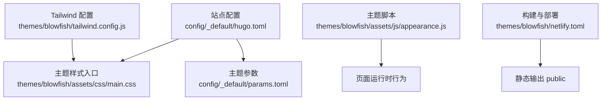
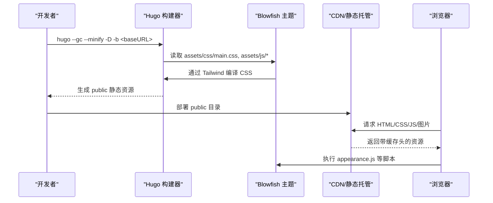
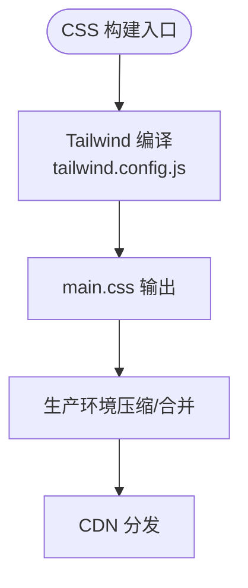
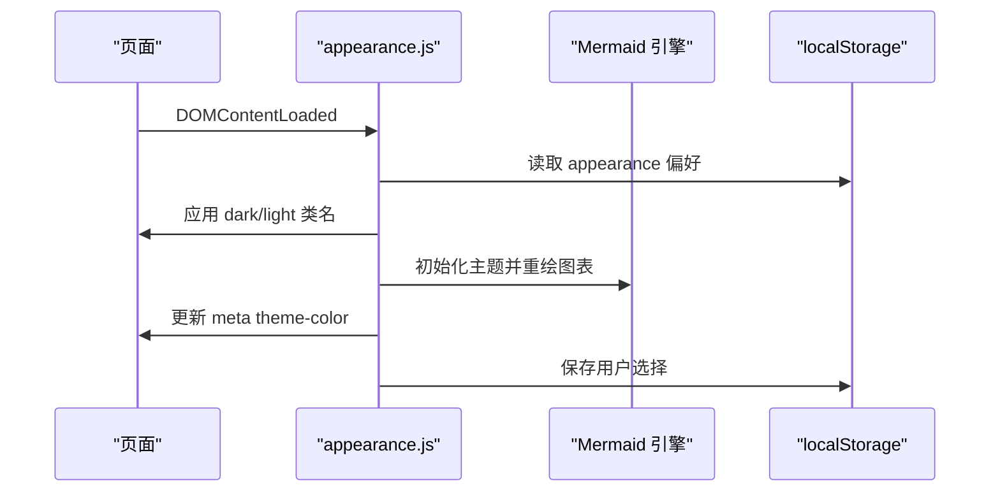
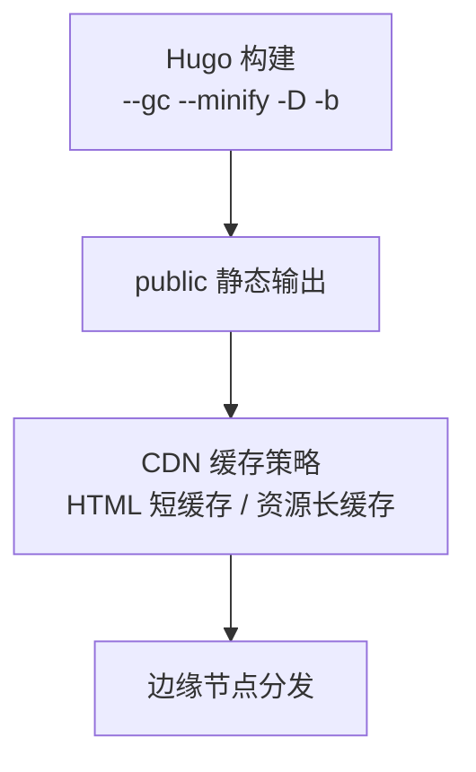
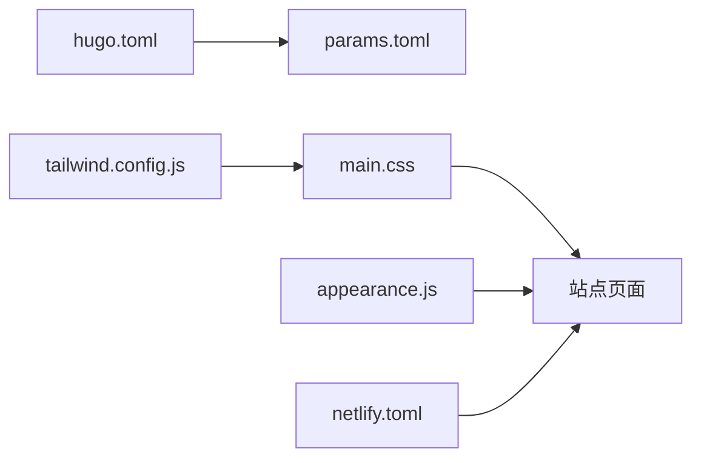

# 性能优化

<cite>
**本文引用的文件**   
- [hugo.toml](file://config/_default/hugo.toml)
- [params.toml](file://config/_default/params.toml)
- [tailwind.config.js](file://themes/blowfish/tailwind.config.js)
- [main.css](file://themes/blowfish/assets/css/main.css)
- [appearance.js](file://themes/blowfish/assets/js/appearance.js)
- [netlify.toml](file://themes/blowfish/netlify.toml)
</cite>

## 目录
1. [简介](#简介)
2. [项目结构](#项目结构)
3. [核心组件](#核心组件)
4. [架构总览](#架构总览)
5. [详细组件分析](#详细组件分析)
6. [依赖关系分析](#依赖关系分析)
7. [性能考量](#性能考量)
8. [故障排查指南](#故障排查指南)
9. [结论](#结论)
10. [附录](#附录)

## 简介
本指南面向使用 Hugo + Blowfish 主题进行站点定制与发布的开发者，聚焦“在主题定制过程中保持优秀性能”。内容覆盖：
- CSS/JS 优化策略（压缩、合并、按需加载）
- 图片优化最佳实践（WebP、响应式、懒加载）
- 构建期优化（Hugo 参数、资源缓存、CDN）
- 性能监控与分析（Lighthouse、PageSpeed Insights）
- 常见问题诊断与解决方案

## 项目结构
本项目采用标准 Hugo 布局，主题使用 Blowfish。关键路径与职责如下：
- 站点配置：config/_default/hugo.toml、config/_default/params.toml
- 主题样式：themes/blowfish/assets/css/main.css（基于 Tailwind）
- 主题脚本：themes/blowfish/assets/js/appearance.js（外观切换、Mermaid 主题适配等）
- 构建与部署：themes/blowfish/netlify.toml（示例构建命令与环境）
- 主题样式扩展：themes/blowfish/tailwind.config.js

**图表来源**
- [hugo.toml:1-78](file://config/_default/hugo.toml#L1-L78)
- [params.toml:1-88](file://config/_default/params.toml#L1-L88)
- [tailwind.config.js:1-179](file://themes/blowfish/tailwind.config.js#L1-L179)
- [main.css:1-505](file://themes/blowfish/assets/css/main.css#L1-L505)
- [appearance.js:1-168](file://themes/blowfish/assets/js/appearance.js#L1-L168)
- [netlify.toml:1-9](file://themes/blowfish/netlify.toml#L1-L9)

**章节来源**
- [hugo.toml:1-78](file://config/_default/hugo.toml#L1-L78)
- [params.toml:1-88](file://config/_default/params.toml#L1-L88)
- [tailwind.config.js:1-179](file://themes/blowfish/tailwind.config.js#L1-L179)
- [main.css:1-505](file://themes/blowfish/assets/css/main.css#L1-L505)
- [appearance.js:1-168](file://themes/blowfish/assets/js/appearance.js#L1-L168)
- [netlify.toml:1-9](file://themes/blowfish/netlify.toml#L1-L9)

## 核心组件
- Hugo 站点配置：定义基础 URL、主题、语言、分页、索引、相关度、媒体类型与输出格式等。
- 主题参数：控制外观、搜索、导航、文章展示、列表、分类等主题行为。
- 样式系统：通过 Tailwind 编译生成 main.css，包含组件层、工具类、打印样式、滚动条等。
- 运行脚本：处理深色模式、自动跟随系统主题、Mermaid 主题同步、Logo 切换等。
- 构建与部署：示例 Netlify 构建命令启用 Hugo 的垃圾回收与压缩，并指定版本与主题目录。

**章节来源**
- [hugo.toml:1-78](file://config/_default/hugo.toml#L1-L78)
- [params.toml:1-88](file://config/_default/params.toml#L1-L88)
- [main.css:1-505](file://themes/blowfish/assets/css/main.css#L1-L505)
- [appearance.js:1-168](file://themes/blowfish/assets/js/appearance.js#L1-L168)
- [netlify.toml:1-9](file://themes/blowfish/netlify.toml#L1-L9)

## 架构总览
下图展示了从配置到构建再到运行的整体流程，以及各模块之间的依赖关系。

**图表来源**
- [netlify.toml:1-9](file://themes/blowfish/netlify.toml#L1-L9)
- [main.css:1-505](file://themes/blowfish/assets/css/main.css#L1-L505)
- [appearance.js:1-168](file://themes/blowfish/assets/js/appearance.js#L1-L168)

## 详细组件分析

### CSS 优化策略
- 使用 Tailwind 原子化 CSS，配合主题自定义 tailwind.config.js，减少冗余样式。
- main.css 作为入口，按层组织组件与工具类，避免重复定义。
- 针对移动端与打印场景提供专用样式，减少不必要的渲染开销。
- 建议：
  - 在生产构建中启用 Hugo 的 minify 与资源哈希（结合 CDN）。
  - 将非首屏样式按需拆分或延迟加载（例如仅在需要时注入）。
  - 谨慎使用复杂动画与大量阴影，优先使用 transform 与 opacity。

**图表来源**
- [tailwind.config.js:1-179](file://themes/blowfish/tailwind.config.js#L1-L179)
- [main.css:1-505](file://themes/blowfish/assets/css/main.css#L1-L505)

**章节来源**
- [tailwind.config.js:1-179](file://themes/blowfish/tailwind.config.js#L1-L179)
- [main.css:1-505](file://themes/blowfish/assets/css/main.css#L1-L505)

### JavaScript 优化策略
- appearance.js 负责：
  - 根据站点默认外观与用户偏好设置深色模式
  - 监听系统主题变化并动态切换
  - 与 Mermaid 主题联动，确保图表在深浅色下正确渲染
  - 更新 meta theme-color 与 Logo 资源
- 建议：
  - 对第三方库（如 Mermaid）使用异步加载或事件触发加载，避免阻塞首屏。
  - 将非关键交互脚本标记为 defer 或 async，降低主线程压力。
  - 避免在 DOMContentLoaded 中进行重型计算，必要时分片执行。

**图表来源**
- [appearance.js:1-168](file://themes/blowfish/assets/js/appearance.js#L1-L168)

**章节来源**
- [appearance.js:1-168](file://themes/blowfish/assets/js/appearance.js#L1-L168)

### 图片优化最佳实践
- 使用 WebP/AVIF 等现代格式，结合浏览器特性检测回退。
- 使用响应式图片（srcset/sizes），在不同设备尺寸下加载合适分辨率。
- 对长列表与视窗外图片实现懒加载（loading="lazy"），减少初始负载。
- 利用 Hugo 的图像处理管道生成多尺寸缩略图，并在模板中引用对应尺寸。
- 注意：
  - 避免在首屏区域放置大图；若必须，使用占位符与渐进式加载。
  - 合理设置图片宽高属性，避免布局抖动（CLS）。

[本节为通用指导，不直接分析具体文件]

### 构建时的性能优化
- Hugo 构建参数：
  - 启用垃圾回收与压缩：--gc --minify
  - 指定 baseURL 以生成正确的相对路径与缓存键
  - 可开启资源哈希（Hugo 默认会基于内容生成唯一文件名）
- 环境变量与版本管理：
  - 固定 Hugo 版本，保证构建一致性
  - 明确主题目录与主题名称，避免构建歧义
- 缓存策略：
  - 对静态资源（CSS/JS/图片）设置长期缓存头（Cache-Control: immutable 或 long-lived）
  - 对 HTML 设置较短缓存时间，便于快速发布
- CDN 配置：
  - 启用 HTTP/2 或 HTTP/3
  - 开启 Brotli/Gzip 压缩
  - 配置边缘缓存与预取策略

**图表来源**
- [netlify.toml:1-9](file://themes/blowfish/netlify.toml#L1-L9)

**章节来源**
- [netlify.toml:1-9](file://themes/blowfish/netlify.toml#L1-L9)

### 主题参数与功能开关对性能的影响
- params.toml 中的开关会影响渲染体积与运行时开销：
  - enableSearch：开启全文搜索可能引入额外 JS 与索引
  - enableCodeCopy：代码复制按钮增加少量 DOM 与事件
  - showTableOfContents、showRelatedContent：影响侧边栏与相关内容的渲染
- 建议：
  - 关闭未使用的功能以减少 JS/CSS 体积与渲染成本
  - 按需启用目录、相关文章、评论等模块

**章节来源**
- [params.toml:1-88](file://config/_default/params.toml#L1-L88)

## 依赖关系分析
- Hugo 配置驱动主题行为与输出格式
- Tailwind 配置决定生成的 CSS 规模与主题变量
- main.css 依赖 Tailwind 编译产物，承载组件与工具类
- appearance.js 依赖 DOM API、localStorage 与 Mermaid 全局对象
- netlify.toml 定义构建命令与环境变量，影响最终产出与缓存

**图表来源**
- [hugo.toml:1-78](file://config/_default/hugo.toml#L1-L78)
- [params.toml:1-88](file://config/_default/params.toml#L1-L88)
- [tailwind.config.js:1-179](file://themes/blowfish/tailwind.config.js#L1-L179)
- [main.css:1-505](file://themes/blowfish/assets/css/main.css#L1-L505)
- [appearance.js:1-168](file://themes/blowfish/assets/js/appearance.js#L1-L168)
- [netlify.toml:1-9](file://themes/blowfish/netlify.toml#L1-L9)

**章节来源**
- [hugo.toml:1-78](file://config/_default/hugo.toml#L1-L78)
- [params.toml:1-88](file://config/_default/params.toml#L1-L88)
- [tailwind.config.js:1-179](file://themes/blowfish/tailwind.config.js#L1-L179)
- [main.css:1-505](file://themes/blowfish/assets/css/main.css#L1-L505)
- [appearance.js:1-168](file://themes/blowfish/assets/js/appearance.js#L1-L168)
- [netlify.toml:1-9](file://themes/blowfish/netlify.toml#L1-L9)

## 性能考量
- CSS
  - 使用 Tailwind 原子化样式，避免手写冗余规则
  - 控制动画与过渡复杂度，优先使用 transform/opacity
  - 分离首屏与次屏样式，必要时延迟加载
- JavaScript
  - 将非关键脚本延迟加载，避免阻塞渲染
  - 避免在首屏执行重型任务，必要时分片或节流
  - 合理使用 localStorage，避免频繁读写
- 图片
  - 优先使用 WebP/AVIF，并提供回退
  - 使用 srcset/sizes 提供响应式图片
  - 懒加载视窗外图片，减少初始网络负载
- 构建与部署
  - 始终启用 Hugo 的 --gc --minify
  - 固定 Hugo 版本，确保构建可重现
  - 配置 CDN 缓存策略：HTML 短缓存、资源长缓存
  - 启用 Brotli/Gzip 压缩与 HTTP/2/HTTP/3

[本节为通用指导，不直接分析具体文件]

## 故障排查指南
- 构建问题
  - 现象：构建失败或输出异常
  - 排查：检查 netlify.toml 中的构建命令与 HUGO_VERSION/HUGO_THEMESDIR/HUGO_THEME 是否正确
  - 参考：[netlify.toml:1-9](file://themes/blowfish/netlify.toml#L1-L9)
- 样式异常
  - 现象：颜色、排版或暗色模式异常
  - 排查：确认 tailwind.config.js 与 main.css 是否被正确编译；检查 params.toml 中的外观开关
  - 参考：[tailwind.config.js:1-179](file://themes/blowfish/tailwind.config.js#L1-L179)、[main.css:1-505](file://themes/blowfish/assets/css/main.css#L1-L505)、[params.toml:1-88](file://config/_default/params.toml#L1-L88)
- 脚本行为异常
  - 现象：深色模式不生效、Mermaid 主题错乱
  - 排查：检查 appearance.js 中 localStorage 读取与 Mermaid 重绘逻辑；确认 DOMContentLoaded 事件触发时机
  - 参考：[appearance.js:1-168](file://themes/blowfish/assets/js/appearance.js#L1-L168)
- 性能瓶颈定位
  - 使用 Lighthouse 与 PageSpeed Insights 分析首屏渲染、资源大小与缓存命中
  - 关注 Largest Contentful Paint、Cumulative Layout Shift、Total Blocking Time 等指标
  - 针对低分项逐项优化：图片压缩、字体子集化、JS 延迟加载、CDN 缓存

**章节来源**
- [netlify.toml:1-9](file://themes/blowfish/netlify.toml#L1-L9)
- [tailwind.config.js:1-179](file://themes/blowfish/tailwind.config.js#L1-L179)
- [main.css:1-505](file://themes/blowfish/assets/css/main.css#L1-L505)
- [params.toml:1-88](file://config/_default/params.toml#L1-L88)
- [appearance.js:1-168](file://themes/blowfish/assets/js/appearance.js#L1-L168)

## 结论
通过在 Hugo 构建阶段启用压缩与垃圾回收、在主题层使用 Tailwind 原子化 CSS 与按需加载 JS、在图片层面采用现代格式与响应式策略，并结合 CDN 的缓存与压缩能力，可以在主题定制过程中显著提升站点性能。同时，借助 Lighthouse 与 PageSpeed Insights 持续监控关键指标，能够快速定位并解决性能瓶颈，确保用户体验稳定优秀。

[本节为总结性内容，不直接分析具体文件]

## 附录
- 常用命令
  - 本地开发：hugo server
  - 生产构建：hugo --gc --minify -D -b https://yourdomain.com
- 推荐工具
  - Lighthouse、PageSpeed Insights、WebPageTest
  - 图片转换：cwebp、sharp
  - 静态分析：stylelint、eslint

[本节为补充信息，不直接分析具体文件]