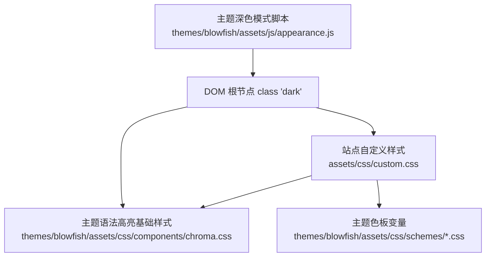
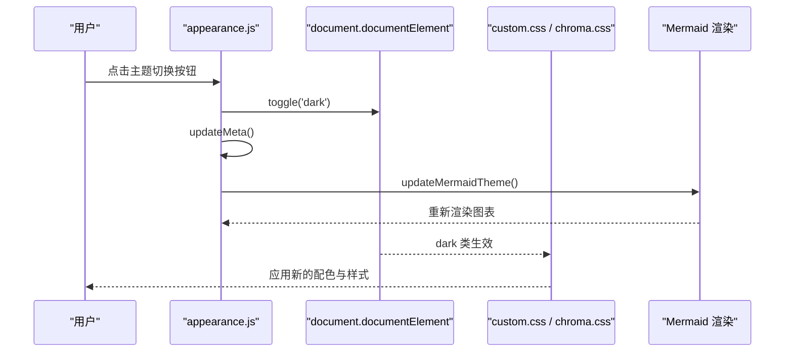
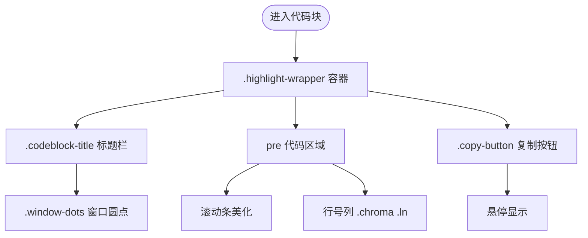
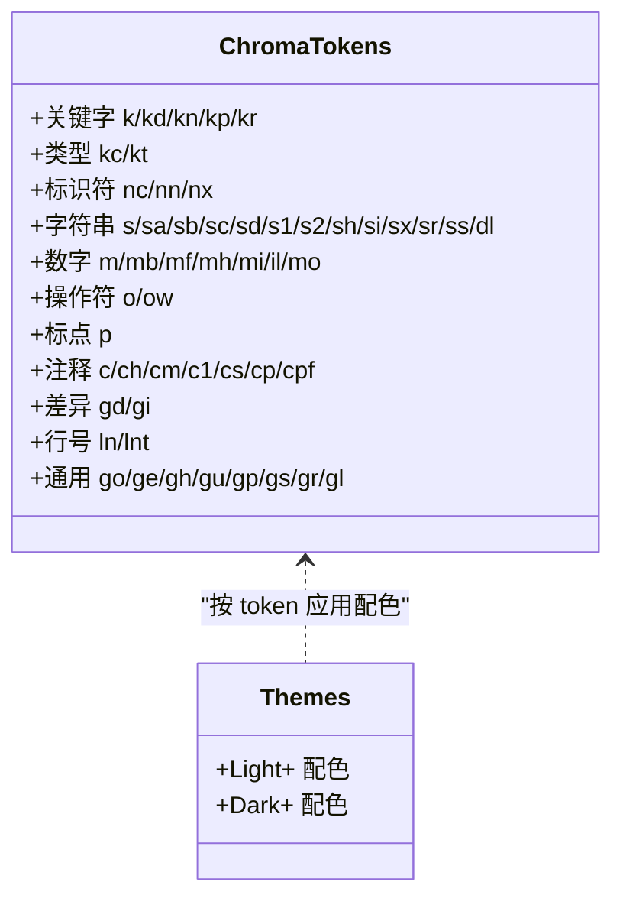
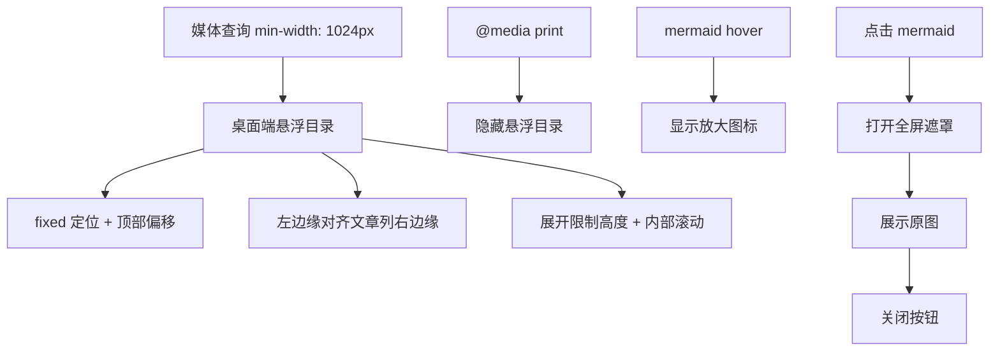
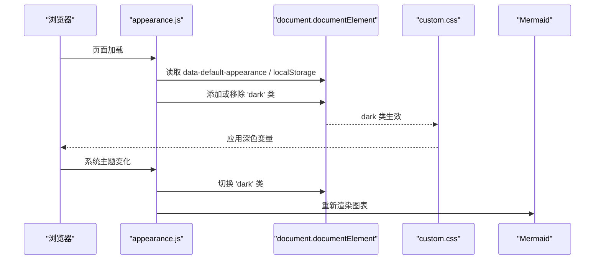
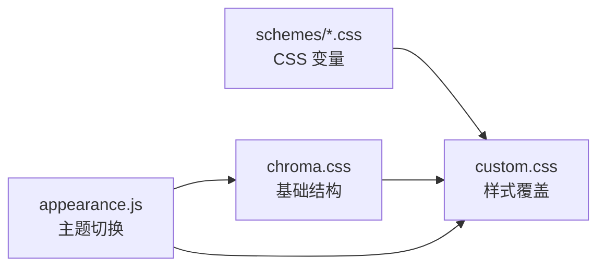

# 样式定制

<cite>
**本文引用的文件**   
- [assets/css/custom.css](file://assets/css/custom.css)
- [themes/blowfish/assets/css/components/chroma.css](file://themes/blowfish/assets/css/components/chroma.css)
- [themes/blowfish/assets/js/appearance.js](file://themes/blowfish/assets/js/appearance.js)
- [themes/blowfish/assets/css/schemes/blowfish.css](file://themes/blowfish/assets/css/schemes/blowfish.css)
- [themes/blowfish/assets/css/schemes/one-light.css](file://themes/blowfish/assets/css/schemes/one-light.css)
</cite>

## 目录
1. [引言](#引言)
2. [项目结构](#项目结构)
3. [核心组件](#核心组件)
4. [架构总览](#架构总览)
5. [详细组件分析](#详细组件分析)
6. [依赖关系分析](#依赖关系分析)
7. [性能与优化建议](#性能与优化建议)
8. [故障排查指南](#故障排查指南)
9. [结论](#结论)
10. [附录：常见定制示例清单](#附录常见定制示例清单)

## 引言
本指南聚焦通过站点级自定义样式文件 assets/css/custom.css 对站点外观进行个性化定制，重点覆盖以下能力：
- 代码块美化：VS Code 风格的编辑器窗口、语言标签栏、复制按钮、行号列、横向滚动与滚动条美化。
- 语法高亮配色：Light+ 与 Dark+ 两套 VS Code 风格配色方案，并补齐遗漏 token，避免回落到主题默认 GitHub 配色。
- 字体设置：优先本地等宽字体，未安装时回退系统等宽字体。
- 响应式设计与移动端适配：断点控制、桌面端悬浮目录面板、打印隐藏、Mermaid 图表点击放大预览。
- 深色模式支持：CSS 变量体系、主题切换逻辑、颜色适配与 Mermaid 主题同步。
- 实用样式示例：自定义滚动条、按钮样式、卡片效果等（以可复用的选择器与变量为参考）。
- 性能优化：减少重绘重排、合理使用 CSS 变量、避免过度阴影与复杂动画。

## 项目结构
本项目基于 Hugo + Blowfish 主题，站点级自定义样式位于 assets/css/custom.css；主题内置的语法高亮基础样式位于 themes/blowfish/assets/css/components/chroma.css；主题色板定义在 themes/blowfish/assets/css/schemes/*.css；深色模式切换逻辑由 themes/blowfish/assets/js/appearance.js 提供。

**图示来源**
- [assets/css/custom.css:1-397](file://assets/css/custom.css#L1-L397)
- [themes/blowfish/assets/css/components/chroma.css:1-208](file://themes/blowfish/assets/css/components/chroma.css#L1-L208)
- [themes/blowfish/assets/js/appearance.js:1-168](file://themes/blowfish/assets/js/appearance.js#L1-L168)
- [themes/blowfish/assets/css/schemes/blowfish.css:1-38](file://themes/blowfish/assets/css/schemes/blowfish.css#L1-L38)
- [themes/blowfish/assets/css/schemes/one-light.css:1-36](file://themes/blowfish/assets/css/schemes/one-light.css#L1-L36)

**章节来源**
- [assets/css/custom.css:1-397](file://assets/css/custom.css#L1-L397)
- [themes/blowfish/assets/css/components/chroma.css:1-208](file://themes/blowfish/assets/css/components/chroma.css#L1-L208)
- [themes/blowfish/assets/js/appearance.js:1-168](file://themes/blowfish/assets/js/appearance.js#L1-L168)
- [themes/blowfish/assets/css/schemes/blowfish.css:1-38](file://themes/blowfish/assets/css/schemes/blowfish.css#L1-L38)
- [themes/blowfish/assets/css/schemes/one-light.css:1-36](file://themes/blowfish/assets/css/schemes/one-light.css#L1-L36)

## 核心组件
- 代码块容器与标题栏：实现 VS Code 风格的窗口边框、圆角、阴影、标题栏与红黄绿圆点装饰。
- 语法高亮配色：Light+ 与 Dark+ 两套配色，覆盖关键字、字符串、注释、数字、操作符、类名、函数名等 token，并补齐遗漏项。
- 行号列与复制按钮：行号列固定宽度、不可选中；复制按钮悬停显示，使用主题色变量。
- 滚动条美化：统一使用主题中性色变量，区分明暗主题。
- 文章宽度与相关文章卡片：放宽正文最大宽度，压缩相关文章摘要高度，隐藏分类/标签胶囊。
- 桌面端悬浮目录：lg 断点以上固定定位，右侧对齐文章列，展开限制高度并在内部滚动。
- Mermaid 图表增强：hover 提示放大图标，点击打开全屏遮罩查看原图。
- 深色模式联动：appearance.js 管理 root 元素 dark 类，更新 meta theme-color，切换 Mermaid 主题。

**章节来源**
- [assets/css/custom.css:1-397](file://assets/css/custom.css#L1-L397)
- [themes/blowfish/assets/js/appearance.js:1-168](file://themes/blowfish/assets/js/appearance.js#L1-L168)

## 架构总览
站点样式定制遵循“主题基础样式 + 站点自定义覆盖”的分层策略：
- 主题层：chroma.css 提供代码块结构与基础配色（GitHub Light/Dark），schemes/*.css 提供 CSS 变量色板。
- 站点层：custom.css 覆盖主题默认配色为 VS Code 风格，补充缺失 token，并对 UI 细节进行增强（滚动条、复制按钮、目录悬浮、Mermaid 放大等）。
- 交互层：appearance.js 负责深色模式切换、Meta 主题色更新、Mermaid 主题同步与 Logo 切换。

**图示来源**
- [themes/blowfish/assets/js/appearance.js:53-119](file://themes/blowfish/assets/js/appearance.js#L53-L119)
- [themes/blowfish/assets/js/appearance.js:123-128](file://themes/blowfish/assets/js/appearance.js#L123-L128)
- [themes/blowfish/assets/js/appearance.js:25-51](file://themes/blowfish/assets/js/appearance.js#L25-L51)
- [assets/css/custom.css:138-239](file://assets/css/custom.css#L138-L239)

## 详细组件分析

### 代码块美化与 VS Code 风格
- 容器与标题栏：
  - .highlight-wrapper 提供细边框、圆角与极浅阴影，模拟编辑器窗口。
  - .codeblock-title 作为标题栏，包含语言标签与窗口圆点装饰。
  - .window-dots 与 .window-dot-* 实现红黄绿三圆点。
- 代码区与滚动条：
  - pre 内边距与 overflow-x auto 保证长代码可横向滚动。
  - 滚动条使用主题中性色变量，区分明暗主题。
- 行号列：
  - .chroma .ln 固定最小宽度、右对齐、不可选中，颜色使用中性色变量。
- 复制按钮：
  - .copy-button 默认隐藏，悬停显示；背景与文字颜色使用中性色与主色变量，区分明暗主题。

**图示来源**
- [assets/css/custom.css:13-130](file://assets/css/custom.css#L13-L130)

**章节来源**
- [assets/css/custom.css:13-130](file://assets/css/custom.css#L13-L130)

### 语法高亮配色（Light+ 与 Dark+）
- 亮色 Light+：
  - 背景 #ffffff，文本 #000000。
  - 关键字、类型、标识符、字符串、数字、注释、差异标记等均有明确配色。
- 深色 Dark+：
  - 背景 #1e1e1e，文本 #d4d4d4。
  - 对应 token 采用 VS Code Dark+ 配色，包括错误、删除、插入、通用输出等。
- 补齐遗漏 token：
  - Name 基础/其他、NameAttribute、Literal/LiteralDate、lnt、Background、Generic 系列等，确保不回落至主题默认的 GitHub 配色。

**图示来源**
- [assets/css/custom.css:138-239](file://assets/css/custom.css#L138-L239)
- [themes/blowfish/assets/css/components/chroma.css:51-126](file://themes/blowfish/assets/css/components/chroma.css#L51-L126)
- [themes/blowfish/assets/css/components/chroma.css:127-207](file://themes/blowfish/assets/css/components/chroma.css#L127-L207)

**章节来源**
- [assets/css/custom.css:138-239](file://assets/css/custom.css#L138-L239)
- [themes/blowfish/assets/css/components/chroma.css:1-208](file://themes/blowfish/assets/css/components/chroma.css#L1-L208)

### 字体设置
- 代码字体优先级：ui-monospace > Cascadia Code > JetBrains Mono > Fira Code > SFMono-Regular > Consolas > Liberation Mono > Menlo > monospace。
- 作用范围：.highlight-wrapper, .highlight-wrapper code, .highlight-wrapper pre。

**章节来源**
- [assets/css/custom.css:5-11](file://assets/css/custom.css#L5-L11)

### 响应式设计与移动端适配
- 桌面端悬浮目录：
  - 仅在 lg 断点（≥1024px）生效，fixed 定位，顶部偏移与主题一致。
  - 左边缘对齐文章列右边缘，窄屏夹紧到视口内，避免面板被裁切。
  - details.toc-right[open] 限制最大高度，内部滚动。
- 打印隐藏：
  - @media print 下隐藏悬浮目录面板。
- Mermaid 图表点击放大：
  - mermaid::after 显示放大提示图标，hover 时可见。
  - .mermaid-zoom-overlay 全屏遮罩，.mermaid-zoom-box 承载原图，.mermaid-zoom-close 关闭按钮。
  - .mermaid-zoom-body 自适应视口尺寸，允许滚动。

**图示来源**
- [assets/css/custom.css:277-309](file://assets/css/custom.css#L277-L309)
- [assets/css/custom.css:317-393](file://assets/css/custom.css#L317-L393)

**章节来源**
- [assets/css/custom.css:277-309](file://assets/css/custom.css#L277-L309)
- [assets/css/custom.css:317-393](file://assets/css/custom.css#L317-L393)

### 深色模式支持机制
- CSS 变量体系：
  - schemes/blowfish.css 与 schemes/one-light.css 定义 --color-neutral/*、--color-primary/*、--color-secondary/* 等变量。
  - custom.css 广泛使用 rgb(var(--color-...)) 与 rgba(var(--color-...), alpha) 进行颜色适配。
- 主题切换逻辑：
  - appearance.js 根据 data-default-appearance、localStorage 与 prefers-color-scheme 自动设置 root 元素的 dark 类。
  - 监听系统主题变化事件，动态切换 dark 类。
  - 切换时更新 meta[name="theme-color"] 与 Mermaid 主题。
- 颜色适配：
  - 滚动条、复制按钮、悬浮目录、Mermaid 遮罩等均使用中性色与主色变量，确保明暗主题一致性。

**图示来源**
- [themes/blowfish/assets/js/appearance.js:1-23](file://themes/blowfish/assets/js/appearance.js#L1-L23)
- [themes/blowfish/assets/js/appearance.js:53-119](file://themes/blowfish/assets/js/appearance.js#L53-L119)
- [themes/blowfish/assets/js/appearance.js:123-128](file://themes/blowfish/assets/js/appearance.js#L123-L128)
- [themes/blowfish/assets/css/schemes/blowfish.css:1-38](file://themes/blowfish/assets/css/schemes/blowfish.css#L1-L38)
- [themes/blowfish/assets/css/schemes/one-light.css:1-36](file://themes/blowfish/assets/css/schemes/one-light.css#L1-L36)

**章节来源**
- [themes/blowfish/assets/js/appearance.js:1-168](file://themes/blowfish/assets/js/appearance.js#L1-L168)
- [themes/blowfish/assets/css/schemes/blowfish.css:1-38](file://themes/blowfish/assets/css/schemes/blowfish.css#L1-L38)
- [themes/blowfish/assets/css/schemes/one-light.css:1-36](file://themes/blowfish/assets/css/schemes/one-light.css#L1-L36)
- [assets/css/custom.css:29-43](file://assets/css/custom.css#L29-L43)
- [assets/css/custom.css:109-129](file://assets/css/custom.css#L109-L129)
- [assets/css/custom.css:287-296](file://assets/css/custom.css#L287-L296)
- [assets/css/custom.css:361-383](file://assets/css/custom.css#L361-L383)

### 文章布局与组件增强
- 文章宽度：
  - #single_header、.article-content、article > footer 最大宽度放宽至 120ch，提升阅读体验。
- 相关文章卡片：
  - 摘要截断为 2 行，隐藏分类/标签胶囊以减少高度。
- giscus 评论框：
  - 宽度 100%，与文章内容列对齐。

**章节来源**
- [assets/css/custom.css:241-270](file://assets/css/custom.css#L241-L270)

## 依赖关系分析
- custom.css 依赖主题提供的 HTML 结构类名（如 .highlight-wrapper、.chroma、.codeblock-title、.copy-button、.mermaid 等）。
- custom.css 通过 CSS 变量与 schemes/*.css 耦合，确保主题色板变更时样式自动适配。
- appearance.js 通过 DOM 类名切换影响所有基于 .dark 的选择器，形成全局主题联动。

**图示来源**
- [themes/blowfish/assets/css/schemes/blowfish.css:1-38](file://themes/blowfish/assets/css/schemes/blowfish.css#L1-L38)
- [themes/blowfish/assets/css/schemes/one-light.css:1-36](file://themes/blowfish/assets/css/schemes/one-light.css#L1-L36)
- [themes/blowfish/assets/css/components/chroma.css:1-208](file://themes/blowfish/assets/css/components/chroma.css#L1-L208)
- [assets/css/custom.css:1-397](file://assets/css/custom.css#L1-L397)
- [themes/blowfish/assets/js/appearance.js:1-168](file://themes/blowfish/assets/js/appearance.js#L1-L168)

**章节来源**
- [assets/css/custom.css:1-397](file://assets/css/custom.css#L1-L397)
- [themes/blowfish/assets/css/components/chroma.css:1-208](file://themes/blowfish/assets/css/components/chroma.css#L1-L208)
- [themes/blowfish/assets/js/appearance.js:1-168](file://themes/blowfish/assets/js/appearance.js#L1-L168)
- [themes/blowfish/assets/css/schemes/blowfish.css:1-38](file://themes/blowfish/assets/css/schemes/blowfish.css#L1-L38)
- [themes/blowfish/assets/css/schemes/one-light.css:1-36](file://themes/blowfish/assets/css/schemes/one-light.css#L1-L36)

## 性能与优化建议
- 使用 CSS 变量而非硬编码颜色，减少重复计算与提高可维护性。
- 避免在高频交互元素上使用复杂 box-shadow 与 backdrop-filter，必要时降低阴影层级或使用纯色边框替代。
- 滚动条美化仅作用于预定义容器，避免全局滚动条样式导致额外重绘。
- Mermaid 放大遮罩使用 fixed 定位与简单背景，避免复杂动画；关闭按钮使用纯 CSS 伪元素与 mask，减少图片资源。
- 按需启用特性：如悬浮目录仅在 lg 断点生效，打印时隐藏，减少无关渲染。
- 保持代码块标题栏与容器的圆角与阴影层级一致，避免不必要的 z-index 堆叠。

[本节为通用指导，无需具体文件引用]

## 故障排查指南
- 代码块配色异常或回落到 GitHub 配色：
  - 检查 custom.css 是否覆盖了 .chroma 相关 token，特别是 n/nx、na、l/ld、lnt、go/ge/gh/gu/gp/gs/gr/gl 等补齐项。
  - 确认 .dark .chroma 规则是否正确生效。
- 深色模式下滚动条或按钮颜色不正确：
  - 检查 .dark 选择器下的滚动条与按钮样式是否使用了正确的中性色变量。
- Mermaid 图表在深色模式下未正确渲染：
  - 确认 appearance.js 中 updateMermaidTheme 已调用，且 mermaid.run() 被执行。
  - 检查 mermaid 元素是否带有 data-processed 属性，必要时清理并重渲染。
- 悬浮目录在窄屏被裁切：
  - 检查 left 计算逻辑与 max-width 约束，确保在窄屏下夹紧到视口内。
- 打印时目录仍显示：
  - 确认 @media print 下 .lg\:max-w-2xs 是否 display:none。

**章节来源**
- [assets/css/custom.css:208-239](file://assets/css/custom.css#L208-L239)
- [assets/css/custom.css:29-43](file://assets/css/custom.css#L29-L43)
- [assets/css/custom.css:109-129](file://assets/css/custom.css#L109-L129)
- [themes/blowfish/assets/js/appearance.js:25-51](file://themes/blowfish/assets/js/appearance.js#L25-L51)
- [assets/css/custom.css:277-309](file://assets/css/custom.css#L277-L309)

## 结论
通过 assets/css/custom.css 与主题提供的 chroma.css、schemes/*.css 以及 appearance.js，站点实现了完整的代码块美化、VS Code 风格语法高亮、响应式布局增强与深色模式支持。建议在后续定制中优先使用 CSS 变量与主题类名，保持与主题升级的兼容性，同时关注性能与可访问性。

[本节为总结性内容，无需具体文件引用]

## 附录：常见定制示例清单
以下为可在 custom.css 中扩展的常见样式需求方向（以现有选择器与变量为参考）：
- 自定义滚动条：
  - 使用 ::-webkit-scrollbar 与 scrollbar-color 配合主题中性色变量，区分明暗主题。
- 按钮样式：
  - 复用 .copy-button 的悬停态与明暗主题变量，扩展通用按钮类。
- 卡片效果：
  - 基于 .highlight-wrapper 的边框、圆角与阴影模式，创建通用卡片容器。
- 链接与强调：
  - 使用 --color-primary-* 变量统一强调色，保持品牌一致性。
- 列表与表格：
  - 复用主题中性色变量，统一边框与背景，确保明暗主题一致。

[本节为概念性示例，无需具体文件引用]