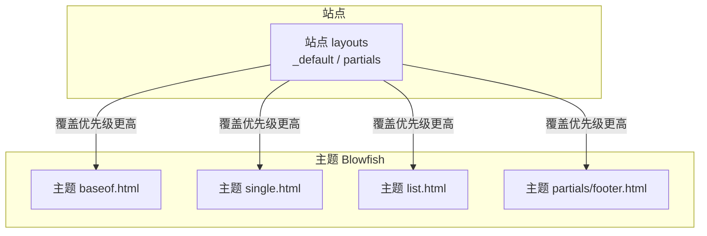
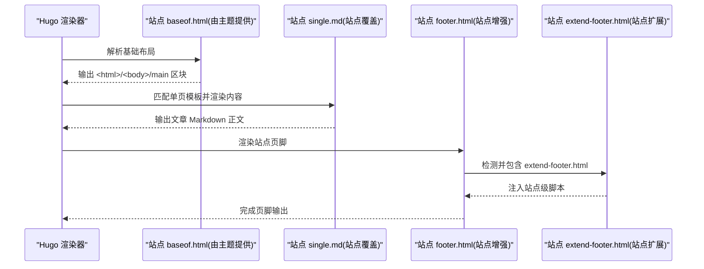
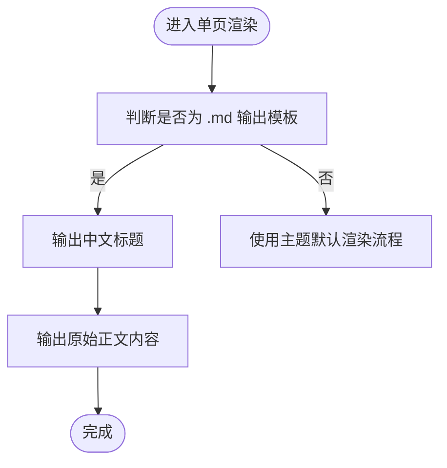
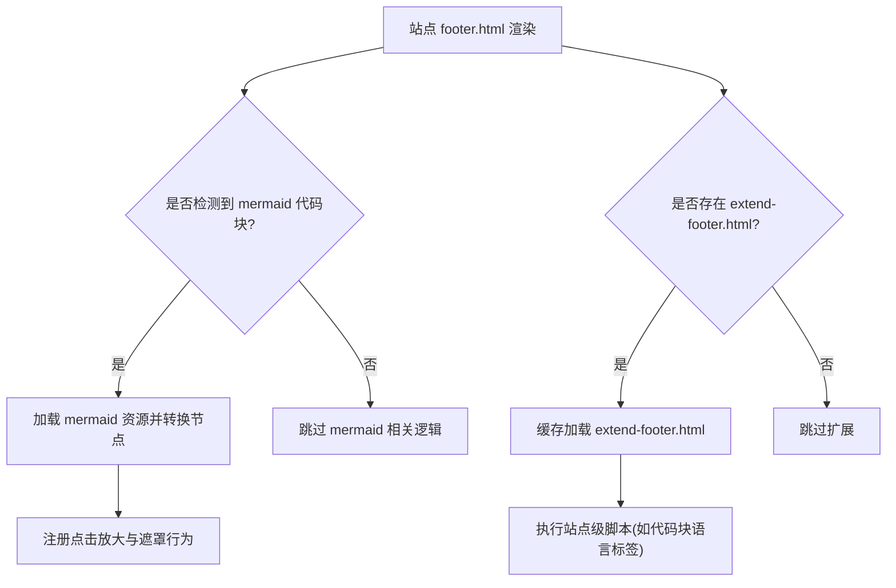
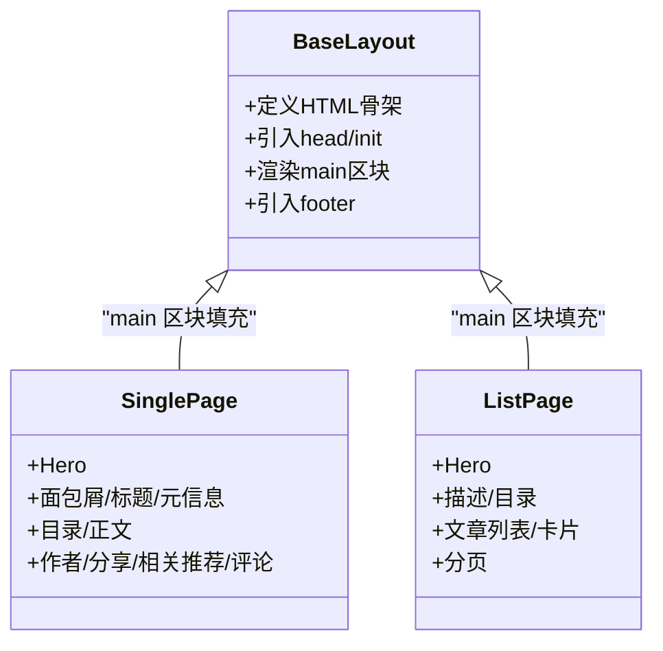
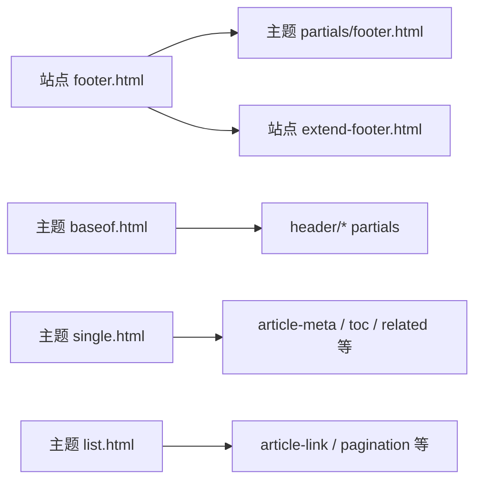

# 模板覆盖

<cite>
**本文引用的文件**   
- [站点级单页 Markdown 输出模板](file://layouts/_default/single.md)
- [站点级页脚扩展模板](file://layouts/partials/extend-footer.html)
- [站点级页脚模板](file://layouts/partials/footer.html)
- [主题基础布局模板](file://themes/blowfish/layouts/_default/baseof.html)
- [主题文章页面模板](file://themes/blowfish/layouts/_default/single.html)
- [主题列表页面模板](file://themes/blowfish/layouts/_default/list.html)
- [主题页脚模板](file://themes/blowfish/layouts/partials/footer.html)
</cite>

## 目录
1. [引言](#引言)
2. [项目结构](#项目结构)
3. [核心组件](#核心组件)
4. [架构总览](#架构总览)
5. [详细组件分析](#详细组件分析)
6. [依赖关系分析](#依赖关系分析)
7. [性能与可维护性](#性能与可维护性)
8. [故障排查指南](#故障排查指南)
9. [结论](#结论)
10. [附录：非侵入式覆盖清单](#附录非侵入式覆盖清单)

## 引言
本指南面向使用 Hugo 的站点作者，聚焦 Blowfish 主题的“非侵入式模板覆盖”机制。你将了解：
- 如何通过站点级 `layouts` 目录覆盖主题默认模板；
- 如何使用 partials（局部模板）进行细粒度定制；
- 如何安全地扩展页脚、注入第三方脚本或增强代码块显示；
- 模板继承与关键模板的职责边界；
- 覆盖示例、最佳实践与升级注意事项。

## 项目结构
Blowfish 主题将默认模板放在 `themes/blowfish/layouts` 下，站点自定义模板放在站点根目录的 `layouts` 下。Hugo 在渲染时优先查找站点级模板，若不存在则回退到主题模板。这种“站点优先、主题兜底”的规则是“非侵入式覆盖”的基础。

**图表来源**
- [主题基础布局模板:1-78](file://themes/blowfish/layouts/_default/baseof.html#L1-L78)
- [主题文章页面模板:1-139](file://themes/blowfish/layouts/_default/single.html#L1-L139)
- [主题列表页面模板:1-144](file://themes/blowfish/layouts/_default/list.html#L1-L144)
- [主题页脚模板:1-68](file://themes/blowfish/layouts/partials/footer.html#L1-L68)

**章节来源**
- [主题基础布局模板:1-78](file://themes/blowfish/layouts/_default/baseof.html#L1-L78)
- [主题文章页面模板:1-139](file://themes/blowfish/layouts/_default/single.html#L1-L139)
- [主题列表页面模板:1-144](file://themes/blowfish/layouts/_default/list.html#L1-L144)
- [主题页脚模板:1-68](file://themes/blowfish/layouts/partials/footer.html#L1-L68)

## 核心组件
- 站点级单页 Markdown 输出模板：用于在不修改主题的情况下，为每篇单页文章生成以中文标题开头的 Markdown 正文，便于“下载本文”等外部功能消费。
- 站点级页脚扩展模板：通过主题预留的钩子，在页脚中注入站点级脚本，例如为代码块自动添加语言标签和窗口圆点装饰。
- 站点级页脚模板：对主题页脚进行站点级增强，包括 Mermaid 支持、图片缩放、以及调用站点级 extend-footer.html。
- 主题基础布局模板：定义 HTML 骨架、头部初始化、主体区块、滚动到顶部、全局背景画布、以及引入主题页脚。
- 主题文章页面模板：负责文章 Hero、面包屑、标题、元信息、目录、正文、作者、分享、相关推荐与评论等。
- 主题列表页面模板：负责列表页 Hero、描述、目录、文章卡片/列表、分页等。

**章节来源**
- [站点级单页 Markdown 输出模板:1-5](file://layouts/_default/single.md#L1-L5)
- [站点级页脚扩展模板:1-63](file://layouts/partials/extend-footer.html#L1-L63)
- [站点级页脚模板:1-205](file://layouts/partials/footer.html#L1-L205)
- [主题基础布局模板:1-78](file://themes/blowfish/layouts/_default/baseof.html#L1-L78)
- [主题文章页面模板:1-139](file://themes/blowfish/layouts/_default/single.html#L1-L139)
- [主题列表页面模板:1-144](file://themes/blowfish/layouts/_default/list.html#L1-L144)

## 架构总览
下图展示了一次典型的文章渲染流程，体现“站点优先”的模板解析顺序与 partials 的调用链。

**图表来源**
- [主题基础布局模板:1-78](file://themes/blowfish/layouts/_default/baseof.html#L1-L78)
- [站点级单页 Markdown 输出模板:1-5](file://layouts/_default/single.md#L1-L5)
- [站点级页脚模板:1-205](file://layouts/partials/footer.html#L1-L205)
- [站点级页脚扩展模板:1-63](file://layouts/partials/extend-footer.html#L1-L63)

## 详细组件分析

### 非侵入式模板覆盖机制
- 覆盖规则：站点 `layouts` 下的同名模板会覆盖主题对应模板。例如站点 `layouts/_default/single.md` 会覆盖主题 `_default/single.html` 的同名路径逻辑（按 Hugo 模板解析规则）。
- 钩子优先：主题内部大量使用 `templates.Exists` 判断是否存在站点级 partials，存在则加载，否则使用主题默认实现。这保证了主题升级不影响站点自定义。

关键模式举例：
- 动态选择 header 样式：根据配置构造 partial 名称，若站点存在同名 partial 则优先使用。
- 条件加载 extend-head / extend-footer：在 head 与 footer 中预留扩展点，站点只需创建同名 partial 即可注入脚本或标记。

**章节来源**
- [主题基础布局模板:22-29](file://themes/blowfish/layouts/_default/baseof.html#L22-L29)
- [主题页脚模板:63-66](file://themes/blowfish/layouts/partials/footer.html#L63-L66)

### 站点级单页 Markdown 输出模板
- 作用：为每篇文章输出不含 front matter 的 Markdown 正文，并以中文标题开头，供“下载本文”等功能消费。
- 优点：不改动主题源码，仅通过站点级模板实现输出格式定制。

**图表来源**
- [站点级单页 Markdown 输出模板:1-5](file://layouts/_default/single.md#L1-L5)

**章节来源**
- [站点级单页 Markdown 输出模板:1-5](file://layouts/_default/single.md#L1-L5)

### 站点级页脚与 extend-footer.html
- 站点级 `footer.html`：在主题页脚基础上增加 Mermaid 支持、图片缩放、以及按需加载站点级 `extend-footer.html`。
- 站点级 `extend-footer.html`：通过 DOM 操作为代码块自动添加语言标签栏与窗口圆点，无需修改主题。

**图表来源**
- [站点级页脚模板:78-199](file://layouts/partials/footer.html#L78-L199)
- [站点级页脚模板:200-203](file://layouts/partials/footer.html#L200-L203)
- [站点级页脚扩展模板:1-63](file://layouts/partials/extend-footer.html#L1-L63)

**章节来源**
- [站点级页脚模板:1-205](file://layouts/partials/footer.html#L1-L205)
- [站点级页脚扩展模板:1-63](file://layouts/partials/extend-footer.html#L1-L63)

### 模板继承与核心模板职责
- baseof.html：HTML 骨架、初始化、头部、主体区块、滚动到顶部、背景画布、引入主题页脚。
- single.html：文章页面的 Hero、面包屑、标题、元信息、目录、正文、作者、分享、相关推荐与评论。
- list.html：列表页 Hero、描述、目录、文章列表/卡片、分页。

**图表来源**
- [主题基础布局模板:1-78](file://themes/blowfish/layouts/_default/baseof.html#L1-L78)
- [主题文章页面模板:1-139](file://themes/blowfish/layouts/_default/single.html#L1-L139)
- [主题列表页面模板:1-144](file://themes/blowfish/layouts/_default/list.html#L1-L144)

**章节来源**
- [主题基础布局模板:1-78](file://themes/blowfish/layouts/_default/baseof.html#L1-L78)
- [主题文章页面模板:1-139](file://themes/blowfish/layouts/_default/single.html#L1-L139)
- [主题列表页面模板:1-144](file://themes/blowfish/layouts/_default/list.html#L1-L144)

### 具体覆盖示例与实践建议
- 添加自定义功能
  - 在站点 `layouts/partials/extend-footer.html` 中注入站点级脚本，例如为代码块添加语言标签与窗口圆点。
  - 在站点 `layouts/partials/footer.html` 中增强主题页脚，如启用 Mermaid 支持、图片缩放等。
- 修改页面布局
  - 通过覆盖 `layouts/_default/single.md` 调整单页输出格式（例如导出 Markdown）。
  - 如需更深层布局变化，可在站点 `layouts/_default` 下创建与主题同名的 `.html` 模板进行覆盖。
- 集成第三方服务
  - 利用主题预留的 `extend-head.html` / `extend-footer.html` 钩子，注入统计、聊天、广告等第三方脚本。
  - 确保脚本仅在需要时加载，避免影响首屏性能。

最佳实践
- 优先使用站点级 partials 钩子，避免直接修改主题源码。
- 保持站点模板尽量薄：只写必要逻辑，复杂逻辑下沉到站点级 partials。
- 命名清晰：站点级 partials 与主题保持一致命名，便于升级对照。
- 谨慎覆盖整页模板：仅在确实需要时才覆盖 `single.html` / `list.html`，优先复用主题 partials。
- 升级前对比：每次主题升级后，检查站点覆盖模板是否与新版主题兼容。

**章节来源**
- [站点级页脚扩展模板:1-63](file://layouts/partials/extend-footer.html#L1-L63)
- [站点级页脚模板:1-205](file://layouts/partials/footer.html#L1-L205)
- [站点级单页 Markdown 输出模板:1-5](file://layouts/_default/single.md#L1-L5)

## 依赖关系分析
- 站点级 `footer.html` 依赖主题 `partials/footer.html` 提供的结构与样式，并在其基础上扩展 Mermaid 与 extend-footer 钩子。
- 站点级 `extend-footer.html` 依赖主题渲染后的 DOM 结构（如 `.highlight-wrapper`、`.codeblock-title`），因此应在 DOM 就绪后运行。
- 主题 `baseof.html` 通过 `templates.Exists` 动态加载 header partial，体现了“站点优先”的覆盖策略。
- 主题 `single.html` / `list.html` 通过 partials 组合页面元素，便于站点侧通过覆盖 partials 进行细粒度定制。

**图表来源**
- [站点级页脚模板:1-205](file://layouts/partials/footer.html#L1-L205)
- [主题基础布局模板:22-29](file://themes/blowfish/layouts/_default/baseof.html#L22-L29)
- [主题文章页面模板:1-139](file://themes/blowfish/layouts/_default/single.html#L1-L139)
- [主题列表页面模板:1-144](file://themes/blowfish/layouts/_default/list.html#L1-L144)

**章节来源**
- [站点级页脚模板:1-205](file://layouts/partials/footer.html#L1-L205)
- [主题基础布局模板:22-29](file://themes/blowfish/layouts/_default/baseof.html#L22-L29)
- [主题文章页面模板:1-139](file://themes/blowfish/layouts/_default/single.html#L1-L139)
- [主题列表页面模板:1-144](file://themes/blowfish/layouts/_default/list.html#L1-L144)

## 性能与可维护性
- 使用 `partialCached` 减少重复渲染开销（例如 extend-footer）。
- 按需加载第三方脚本：仅在检测到相关内容（如 mermaid 代码块）时加载对应资源。
- 将站点级脚本置于 `extend-footer.html`，避免污染主题源码，提升可维护性与可升级性。
- 控制样式与脚本的作用域：通过限定选择器与作用容器，降低与其他组件的冲突风险。

[本节为通用指导，不直接分析具体文件]

## 故障排查指南
- 站点级 extend-footer.html 未生效
  - 确认站点 `layouts/partials/extend-footer.html` 存在且语法正确。
  - 检查站点级 `footer.html` 是否正确调用 `templates.Exists` 与 `partialCached`。
- Mermaid 图表未渲染
  - 检查站点级 `footer.html` 是否检测到文章内容包含 mermaid 代码块。
  - 确认资源加载与 DOM 处理逻辑未被其他脚本阻塞。
- 图片缩放无效
  - 检查站点级 `footer.html` 中 mediumZoom 初始化逻辑是否在 DOM 就绪后执行。
- 第三方脚本未加载
  - 确认已使用主题预留的 extend-head / extend-footer 钩子。
  - 检查浏览器控制台是否有资源加载错误或 CSP 限制。

**章节来源**
- [站点级页脚模板:78-199](file://layouts/partials/footer.html#L78-L199)
- [站点级页脚模板:200-203](file://layouts/partials/footer.html#L200-L203)
- [站点级页脚扩展模板:1-63](file://layouts/partials/extend-footer.html#L1-L63)

## 结论
通过站点的 `layouts` 目录与主题预留的 partials 钩子，可以在完全不修改主题源码的前提下，实现模板的非侵入式覆盖与扩展。推荐优先使用站点级 partials（如 `extend-footer.html`）进行脚本与样式注入，仅在必要时覆盖整页模板。这样既能满足个性化需求，又能保证主题升级的安全性与可维护性。

[本节为总结性内容，不直接分析具体文件]

## 附录：非侵入式覆盖清单
- 站点级单页输出：`layouts/_default/single.md`
- 站点级页脚扩展：`layouts/partials/extend-footer.html`
- 站点级页脚增强：`layouts/partials/footer.html`
- 主题基础布局：`themes/blowfish/layouts/_default/baseof.html`
- 主题文章页面：`themes/blowfish/layouts/_default/single.html`
- 主题列表页面：`themes/blowfish/layouts/_default/list.html`
- 主题页脚模板：`themes/blowfish/layouts/partials/footer.html`

**章节来源**
- [站点级单页 Markdown 输出模板:1-5](file://layouts/_default/single.md#L1-L5)
- [站点级页脚扩展模板:1-63](file://layouts/partials/extend-footer.html#L1-L63)
- [站点级页脚模板:1-205](file://layouts/partials/footer.html#L1-L205)
- [主题基础布局模板:1-78](file://themes/blowfish/layouts/_default/baseof.html#L1-L78)
- [主题文章页面模板:1-139](file://themes/blowfish/layouts/_default/single.html#L1-L139)
- [主题列表页面模板:1-144](file://themes/blowfish/layouts/_default/list.html#L1-L144)
- [主题页脚模板:1-68](file://themes/blowfish/layouts/partials/footer.html#L1-L68)