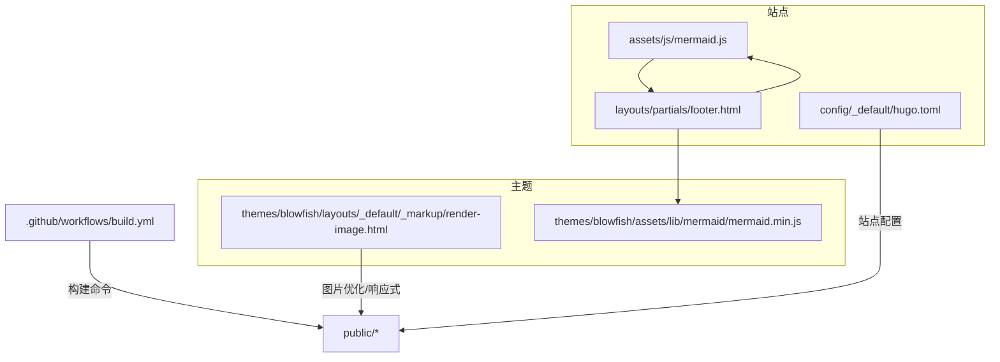
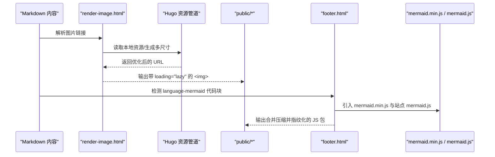
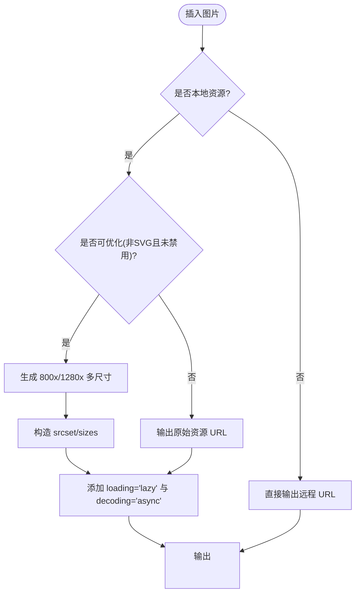
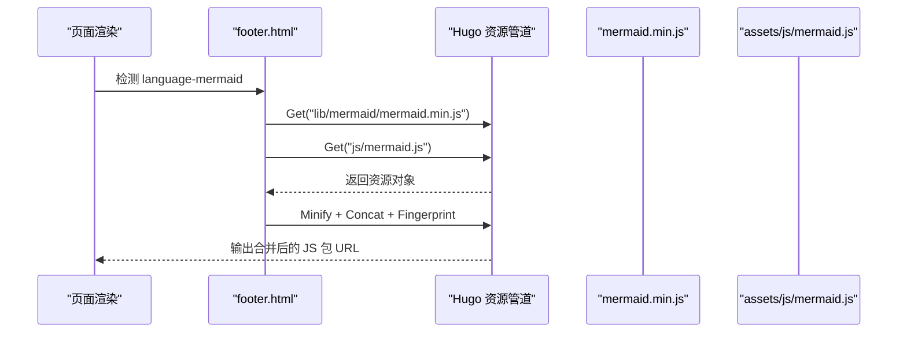
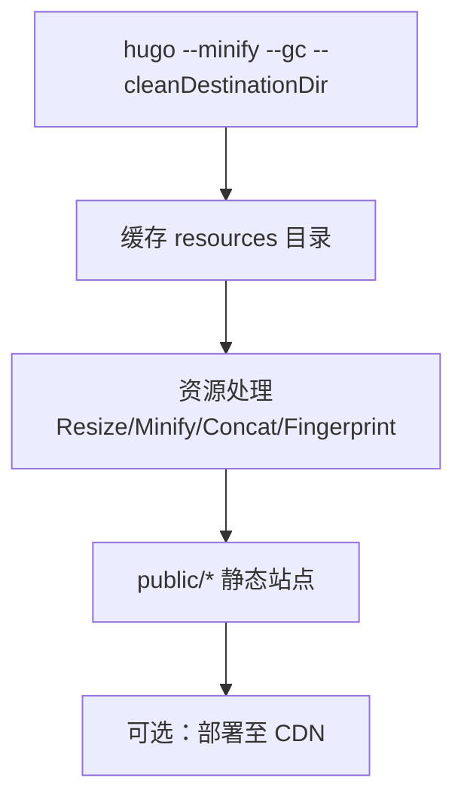
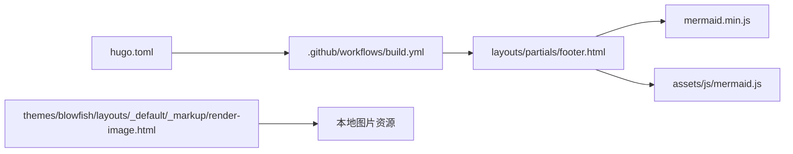

# 资源管理

<cite>
**本文引用的文件**   
- [hugo.toml](file://config/_default/hugo.toml)
- [mermaid.js](file://assets/js/mermaid.js)
- [footer.html](file://layouts/partials/footer.html)
- [render-image.html](file://themes/blowfish/layouts/_default/_markup/render-image.html)
- [build.yml](file://.github/workflows/build.yml)
</cite>

## 目录
1. [引言](#引言)
2. [项目结构](#项目结构)
3. [核心组件](#核心组件)
4. [架构总览](#架构总览)
5. [详细组件分析](#详细组件分析)
6. [依赖关系分析](#依赖关系分析)
7. [性能考量](#性能考量)
8. [故障排查指南](#故障排查指南)
9. [结论](#结论)
10. [附录](#附录)

## 引言
本指南面向使用 Hugo + Blowfish 主题的项目，聚焦“如何有效组织与管理站点静态资源”，覆盖图片、JavaScript、Hugo 资源管道、压缩与缓存、CDN 接入、懒加载与脚本异步加载等实践，并给出性能监控建议。文档结合仓库现有实现，提供可落地的最佳实践与排错要点。

## 项目结构
本项目采用“站点资产 + 主题资产”的双层结构：
- 站点级资源位于 assets 目录，用于覆盖或扩展主题行为（如自定义 mermaid 配置）。
- 主题级资源位于 themes/blowfish/assets，包含样式、脚本、第三方库与模板渲染逻辑。
- 构建产物输出到 public 目录，由 CI 执行 hugo --minify --gc --cleanDestinationDir 生成最终静态站点。

**图表来源**
- [hugo.toml:1-78](file://config/_default/hugo.toml#L1-L78)
- [mermaid.js:1-48](file://assets/js/mermaid.js#L1-L48)
- [footer.html:78-99](file://layouts/partials/footer.html#L78-L99)
- [render-image.html:1-115](file://themes/blowfish/layouts/_default/_markup/render-image.html#L1-L115)
- [build.yml:21-39](file://.github/workflows/build.yml#L21-L39)

**章节来源**
- [hugo.toml:1-78](file://config/_default/hugo.toml#L1-L78)
- [build.yml:21-39](file://.github/workflows/build.yml#L21-L39)

## 核心组件
- 图片处理与响应式输出：通过主题的 render-image.html 模板统一处理本地图片的优化、尺寸裁剪、srcset/sizes 与懒加载策略。
- Mermaid 图表资源管线：在 footer.html 中按需引入 mermaid.min.js 与站点级 mermaid.js 配置，进行合并、压缩与指纹化。
- 构建与缓存：CI 使用 hugo --minify --gc --cleanDestinationDir 构建，并在 GitHub Actions 中缓存 resources 目录以加速后续构建。
- 站点配置：hugo.toml 定义基础站点信息、图像锚点、媒体类型与输出格式等。

**章节来源**
- [render-image.html:1-115](file://themes/blowfish/layouts/_default/_markup/render-image.html#L1-L115)
- [footer.html:78-99](file://layouts/partials/footer.html#L78-L99)
- [build.yml:21-39](file://.github/workflows/build.yml#L21-L39)
- [hugo.toml:1-78](file://config/_default/hugo.toml#L1-L78)

## 架构总览
下图展示从 Markdown 图片到最终 HTML 的资源流转路径，以及 Mermaid 脚本的注入流程。

**图表来源**
- [render-image.html:1-115](file://themes/blowfish/layouts/_default/_markup/render-image.html#L1-L115)
- [footer.html:78-99](file://layouts/partials/footer.html#L78-L99)

## 详细组件分析

### 图片资源最佳实践
- 命名规范
  - 使用语义化英文小写命名，连字符分隔，避免空格与中文。
  - 按业务模块分目录，例如 assets/img/features/、assets/img/diagrams/。
- 目录结构
  - 站点级图片放 assets/img；主题级通用图片放 themes/blowfish/assets/img。
  - 若图片仅被某页面引用，也可放在 content/<section>/<page>/ 下，配合相对路径引用。
- 格式选择
  - 照片类优先 WebP/AVIF；矢量图用 SVG；简单图标用 SVG 或内联 SVG。
  - 透明背景且非动画 GIF 时优先考虑 PNG；动图保留 GIF/WebP 动图。
- 尺寸优化
  - 使用 Hugo 资源管道自动裁剪与生成 srcset，减少传输体积。
  - 合理设置 sizes，使浏览器根据视口选择合适分辨率。
- 懒加载与解码
  - 默认启用 loading="lazy" 与 decoding="async"，降低首屏压力。
  - 首屏关键图片可调整 fetchpriority 为 auto 以提升优先级。
- 缩放与交互
  - 主题支持点击放大（mediumZoom），大图可通过 data-zoom-src 指定原图。

**图表来源**
- [render-image.html:1-115](file://themes/blowfish/layouts/_default/_markup/render-image.html#L1-L115)

**章节来源**
- [render-image.html:1-115](file://themes/blowfish/layouts/_default/_markup/render-image.html#L1-L115)

### JavaScript 文件组织与第三方库管理
- 站点级脚本
  - 将站点自定义脚本放入 assets/js，便于覆盖主题行为。
  - 示例：assets/js/mermaid.js 用于覆盖主题默认的 mermaid 初始化参数，提升字号与节点间距。
- 第三方库
  - 主题自带 lib 目录存放第三方库，如 themes/blowfish/assets/lib/mermaid/mermaid.min.js。
  - 站点侧通过 footer.html 按需引入，并进行合并、压缩与指纹化。
- 按需加载与条件渲染
  - 仅在检测到 language-mermaid 代码块时才注入 Mermaid 相关脚本，减少无关开销。
- 脚本合并与指纹
  - 使用 resources.Concat 合并多个脚本，resources.Minify 压缩，resources.Fingerprint 生成哈希文件名，利于长期缓存。

**图表来源**
- [footer.html:78-99](file://layouts/partials/footer.html#L78-L99)
- [mermaid.js:1-48](file://assets/js/mermaid.js#L1-L48)

**章节来源**
- [footer.html:78-99](file://layouts/partials/footer.html#L78-L99)
- [mermaid.js:1-48](file://assets/js/mermaid.js#L1-L48)

### Hugo 资源管道机制与构建优化
- 资源获取与处理
  - 通过 resources.Get 获取资源对象，支持 Resize、Format、Minify、Concat、Fingerprint 等操作。
  - 图片模板对本地资源进行 Resize 生成多尺寸，并结合 srcset/sizes 实现响应式。
- 压缩与清理
  - CI 构建命令 hugo --minify --gc --cleanDestinationDir 会压缩输出并清理旧产物。
- 缓存策略
  - GitHub Actions 缓存 resources 目录，基于 config/** 哈希键值，显著缩短二次构建时间。
- CDN 接入建议
  - 当前仓库未显式配置 CDN baseURL 或资源前缀。接入 CDN 时，可在 hugo.toml 中设置 baseURL 指向 CDN 域名，或将静态资源部署至 CDN 并更新 baseURL。
  - 注意：若使用子路径部署，需同步调整 baseURL 与资源引用路径。

**图表来源**
- [build.yml:21-39](file://.github/workflows/build.yml#L21-L39)
- [footer.html:78-99](file://layouts/partials/footer.html#L78-L99)
- [render-image.html:1-115](file://themes/blowfish/layouts/_default/_markup/render-image.html#L1-L115)

**章节来源**
- [build.yml:21-39](file://.github/workflows/build.yml#L21-L39)
- [footer.html:78-99](file://layouts/partials/footer.html#L78-L99)
- [render-image.html:1-115](file://themes/blowfish/layouts/_default/_markup/render-image.html#L1-L115)

### 字体与脚本优化
- 字体子集化
  - 当前仓库未直接使用外部字体文件；若引入字体，建议使用工具生成子集，仅包含所需字形，减小体积。
- 脚本异步加载
  - Mermaid 脚本仅在需要时注入，并通过 defer 或按需执行避免阻塞渲染。
  - 评论等第三方脚本可使用 data-loading="lazy" 延迟加载。

**章节来源**
- [footer.html:78-99](file://layouts/partials/footer.html#L78-L99)

## 依赖关系分析
- 模板与资源
  - footer.html 依赖主题提供的 mermaid.min.js 与站点级 mermaid.js。
  - render-image.html 依赖 Hugo 资源管道能力，对本地图片进行优化与响应式输出。
- 构建与缓存
  - build.yml 驱动 Hugo 构建，并使用 actions/cache 缓存 resources 目录。
- 站点配置
  - hugo.toml 定义站点基础信息与输出格式，影响资源路径与输出产物。

**图表来源**
- [hugo.toml:1-78](file://config/_default/hugo.toml#L1-L78)
- [build.yml:21-39](file://.github/workflows/build.yml#L21-L39)
- [footer.html:78-99](file://layouts/partials/footer.html#L78-L99)
- [render-image.html:1-115](file://themes/blowfish/layouts/_default/_markup/render-image.html#L1-L115)

**章节来源**
- [hugo.toml:1-78](file://config/_default/hugo.toml#L1-L78)
- [build.yml:21-39](file://.github/workflows/build.yml#L21-L39)
- [footer.html:78-99](file://layouts/partials/footer.html#L78-L99)
- [render-image.html:1-115](file://themes/blowfish/layouts/_default/_markup/render-image.html#L1-L115)

## 性能考量
- 图片
  - 使用 WebP/AVIF 替代大体积 JPEG/PNG。
  - 利用 Hugo 资源管道生成多尺寸，结合 srcset/sizes 精准下发。
  - 保持 loading="lazy" 与 decoding="async"，首屏关键图适当提高 fetchpriority。
- JavaScript
  - 按需注入 Mermaid 脚本，避免全局加载。
  - 合并、压缩与指纹化，提升缓存命中率。
- 构建与缓存
  - 启用 hugo --minify --gc，CI 缓存 resources 目录。
- CDN
  - 将静态资源部署至 CDN，缩短网络延迟；确保 baseURL 与资源路径一致。
- 监控
  - 使用 Lighthouse、WebPageTest、Chrome DevTools Network 面板识别瓶颈。
  - 关注 TTFB、FCP、LCP、CLS、TBT 等指标，定位慢资源与阻塞脚本。

[本节为通用指导，不直接分析具体文件]

## 故障排查指南
- Mermaid 图表未渲染
  - 检查 Markdown 是否使用 language-mermaid 代码围栏，确保 footer.html 能检测到并注入脚本。
  - 确认 assets/js/mermaid.js 已正确覆盖主题默认配置。
- 图片未优化或未显示
  - 确认图片为本地资源且未被 disableImageOptimizationMD 禁用。
  - 检查 render-image.html 是否正确生成 srcset 与 lazy 属性。
- 构建缓慢
  - 确认 GitHub Actions 已缓存 resources 目录，并检查缓存键是否随配置变更而失效。
- 脚本未生效
  - 检查 footer.html 中 Mermaid 脚本是否被合并压缩与指纹化，URL 是否正确。
  - 查看控制台是否有 CSP 或 integrity 校验失败。

**章节来源**
- [footer.html:78-99](file://layouts/partials/footer.html#L78-L99)
- [render-image.html:1-115](file://themes/blowfish/layouts/_default/_markup/render-image.html#L1-L115)
- [build.yml:21-39](file://.github/workflows/build.yml#L21-L39)

## 结论
通过合理利用 Hugo 资源管道与主题模板，本项目实现了图片响应式优化、Mermaid 脚本按需注入与压缩指纹化，并在 CI 中启用构建压缩与资源缓存。遵循本文的图片命名与目录规范、脚本按需加载与 CDN 接入建议，可进一步提升站点性能与可维护性。

[本节为总结性内容，不直接分析具体文件]

## 附录
- 常用命令
  - 本地构建：hugo --minify --gc --cleanDestinationDir
  - 预览：hugo server
- 关键路径参考
  - 站点配置：config/_default/hugo.toml
  - Mermaid 站点脚本：assets/js/mermaid.js
  - Mermaid 注入与打包：layouts/partials/footer.html
  - 图片优化模板：themes/blowfish/layouts/_default/_markup/render-image.html
  - 构建流水线：.github/workflows/build.yml

**章节来源**
- [hugo.toml:1-78](file://config/_default/hugo.toml#L1-L78)
- [mermaid.js:1-48](file://assets/js/mermaid.js#L1-L48)
- [footer.html:78-99](file://layouts/partials/footer.html#L78-L99)
- [render-image.html:1-115](file://themes/blowfish/layouts/_default/_markup/render-image.html#L1-L115)
- [build.yml:21-39](file://.github/workflows/build.yml#L21-L39)