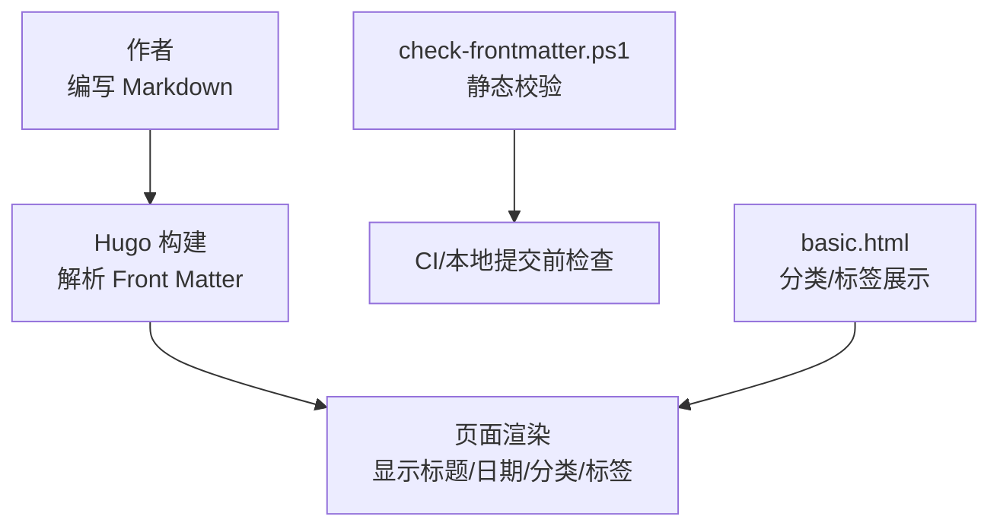
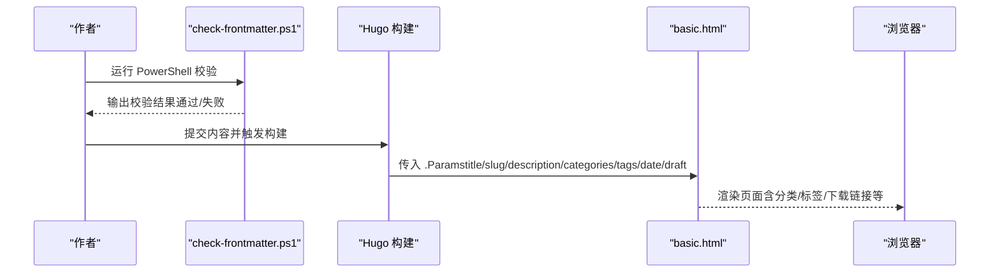
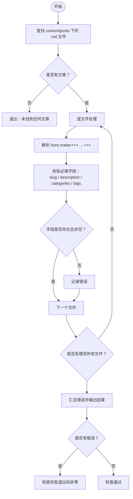
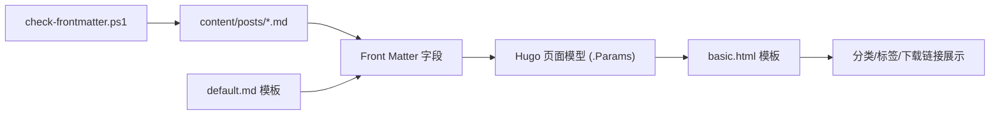

# Front Matter 规范

<cite>
**本文引用的文件**   
- [check-frontmatter.ps1](file://scripts/check-frontmatter.ps1)
- [default.md](file://archetypes/default.md)
- [API路由命名规范.md](file://content/posts/API路由命名规范.md)
- [Java开发者快速上手.NET10指南.md](file://content/posts/Java开发者快速上手.NET10指南.md)
- [物化视图：数据库性能优化的利器.md](file://content/posts/物化视图：数据库性能优化的利器.md)
- [basic.html](file://layouts/partials/article-meta/basic.html)
</cite>

## 目录
1. [引言](#引言)
2. [项目结构](#项目结构)
3. [核心字段与必填项](#核心字段与必填项)
4. [架构总览](#架构总览)
5. [详细字段说明](#详细字段说明)
6. [元数据验证流程](#元数据验证流程)
7. [依赖关系分析](#依赖关系分析)
8. [性能与 SEO 影响](#性能与-seo-影响)
9. [常见问题与解决方案](#常见问题与解决方案)
10. [结论](#结论)
11. [附录：完整示例与最佳实践](#附录完整示例与最佳实践)

## 引言
本规范面向使用 Hugo + Blowfish 主题的内容作者，明确 Front Matter（文章头部元数据）的必填与可选字段、格式要求、校验方式以及这些元数据对 SEO、内容搜索、分类展示等功能的实际影响。通过统一规范与自动化检查脚本，确保站点内容质量稳定、可维护性高。

## 项目结构
本项目采用 Hugo 标准内容组织方式：
- 文章内容位于 content/posts 目录，每篇文章为独立 Markdown 文件。
- 默认模板位于 archetypes/default.md，用于生成新文章的初始 Front Matter。
- 元数据校验脚本位于 scripts/check-frontmatter.ps1，扫描 posts 下所有文章并校验必填字段。
- 文章页渲染时，分类与标签由 layouts/partials/article-meta/basic.html 负责展示。

图表来源
- [check-frontmatter.ps1:1-37](file://scripts/check-frontmatter.ps1#L1-L37)
- [basic.html:115-146](file://layouts/partials/article-meta/basic.html#L115-L146)

章节来源
- [default.md:1-10](file://archetypes/default.md#L1-L10)
- [check-frontmatter.ps1:1-37](file://scripts/check-frontmatter.ps1#L1-L37)

## 核心字段与必填项
根据项目内脚本与模板约定，posts 下的文章必须包含以下字段且非空：
- slug：英文 URL 友好标识符；缺失时 URL 回退为中文文件名。
- description：文章描述，SEO 常用字段。
- categories：分类数组，至少一项。
- tags：标签数组，至少一项。

基础字段建议始终提供：
- date：文章发布日期（ISO 8601）。
- draft：草稿标记（true/false），控制是否发布。
- title：文章标题。

上述字段在默认模板中已预置，便于新建文章时保持一致性。

章节来源
- [check-frontmatter.ps1:4-9](file://scripts/check-frontmatter.ps1#L4-L9)
- [default.md:1-10](file://archetypes/default.md#L1-L10)

## 架构总览
Front Matter 在本项目中的关键作用如下：
- 构建期：Hugo 读取 Front Matter，生成页面元数据、URL、分类与标签索引。
- 渲染期：模板从 .Params 获取字段值，决定页面展示内容与 SEO 信息。
- 校验期：PowerShell 脚本扫描 posts 目录，确保必填字段存在且非空。

图表来源
- [check-frontmatter.ps1:11-36](file://scripts/check-frontmatter.ps1#L11-L36)
- [basic.html:77-95](file://layouts/partials/article-meta/basic.html#L77-L95)
- [basic.html:115-146](file://layouts/partials/article-meta/basic.html#L115-L146)

## 详细字段说明

### slug（URL 友好标识符）
- 类型：字符串
- 必填：是
- 用途：
  - 作为 URL 的友好标识，避免中文路径带来的兼容性问题。
  - 模板中使用 slug 作为 Markdown 原文下载的默认文件名。
- 格式建议：
  - 使用小写英文字母、数字和短横线（kebab-case）。
  - 避免特殊字符与空格。
  - 保持语义清晰、简短易记。
- 注意事项：
  - 若未设置或为空，URL 将回退到中文文件名，可能导致访问不稳定。
  - 修改 slug 后需考虑旧链接重定向（可使用 aliases 字段）。

章节来源
- [check-frontmatter.ps1:5](file://scripts/check-frontmatter.ps1#L5)
- [basic.html:83-95](file://layouts/partials/article-meta/basic.html#L83-L95)

### description（SEO 描述）
- 类型：字符串
- 必填：是
- 用途：
  - 搜索引擎摘要与社交分享预览的关键文本。
  - 提升点击率与可读性。
- 格式建议：
  - 长度适中（通常 120–160 字符）。
  - 准确概括文章内容，避免堆砌关键词。
  - 自然语言为主，兼顾 SEO。

章节来源
- [check-frontmatter.ps1:6](file://scripts/check-frontmatter.ps1#L6)

### categories（分类数组）
- 类型：字符串数组
- 必填：是
- 用途：
  - 文章归类，便于分类页聚合与导航。
  - 模板中按 taxonomy 渲染分类徽章与链接。
- 格式建议：
  - 使用简洁明确的分类名（如“后端开发”“数据库”）。
  - 避免同义重复分类，保持分类体系一致。
  - 每个文章至少一个分类。

章节来源
- [check-frontmatter.ps1:7](file://scripts/check-frontmatter.ps1#L7)
- [basic.html:124-130](file://layouts/partials/article-meta/basic.html#L124-L130)

### tags（标签数组）
- 类型：字符串数组
- 必填：是
- 用途：
  - 细粒度标注文章主题，支持标签云与标签页聚合。
  - 模板中按 taxonomy 渲染标签徽章与链接。
- 格式建议：
  - 使用具体、可检索的关键词（如“.NET”“ASP.NET Core”“PostgreSQL”）。
  - 避免过长短语，尽量名词化。
  - 每个文章至少一个标签。

章节来源
- [check-frontmatter.ps1:8](file://scripts/check-frontmatter.ps1#L8)
- [basic.html:131-136](file://layouts/partials/article-meta/basic.html#L131-L136)

### date（发布日期）
- 类型：ISO 8601 时间戳（带时区）
- 必填：建议始终提供
- 用途：
  - 排序、归档、RSS 订阅、SEO 时间信号。
  - 模板中根据配置决定是否显示。
- 格式建议：
  - 使用带时区的 ISO 8601 格式（例如 “YYYY-MM-DDTHH:mm:ss+08:00”）。
  - 保持时区一致性。

章节来源
- [default.md:2](file://archetypes/default.md#L2)
- [basic.html:18-34](file://layouts/partials/article-meta/basic.html#L18-L34)

### draft（草稿标记）
- 类型：布尔值
- 必填：建议始终提供
- 用途：
  - 控制文章是否参与构建与发布。
  - 模板中可显示“草稿”徽章。
- 格式建议：
  - 写作阶段设为 true，发布前改为 false。
  - 避免遗漏导致意外发布或未发布。

章节来源
- [default.md:3](file://archetypes/default.md#L3)
- [basic.html:77-80](file://layouts/partials/article-meta/basic.html#L77-L80)

### title（标题）
- 类型：字符串
- 必填：建议始终提供
- 用途：
  - 页面标题、列表展示、SEO 标题。
  - 模板中用于生成下载文件名与面包屑等。
- 格式建议：
  - 简洁明确，避免过长。
  - 与 slug 语义一致但允许更自然的表达。

章节来源
- [default.md:4](file://archetypes/default.md#L4)

## 元数据验证流程
check-frontmatter.ps1 的工作流程如下：
- 目标目录：content/posts。
- 遍历所有 .md 文件。
- 解析 front matter（以 +++ 包裹）。
- 校验必填字段：slug、description、categories、tags。
- 若任一字段缺失或为空（包括空数组 []），则记录错误。
- 汇总错误并输出检查结果；全部通过则返回成功。

图表来源
- [check-frontmatter.ps1:11-36](file://scripts/check-frontmatter.ps1#L11-L36)

章节来源
- [check-frontmatter.ps1:1-37](file://scripts/check-frontmatter.ps1#L1-L37)

## 依赖关系分析
- 模板依赖 Front Matter 字段：
  - basic.html 使用 .Params.slug 判断是否显示“下载 Markdown 原文”链接。
  - basic.html 通过 Site.Taxonomies 渲染 categories 与 tags。
- 脚本依赖 posts 目录结构：
  - check-frontmatter.ps1 固定扫描 content/posts/*.md。
- 默认模板提供字段骨架：
  - default.md 预设 date、draft、title、slug、description、categories、tags。

图表来源
- [basic.html:83-95](file://layouts/partials/article-meta/basic.html#L83-L95)
- [basic.html:115-146](file://layouts/partials/article-meta/basic.html#L115-L146)
- [check-frontmatter.ps1:11-28](file://scripts/check-frontmatter.ps1#L11-L28)
- [default.md:1-10](file://archetypes/default.md#L1-L10)

章节来源
- [basic.html:77-95](file://layouts/partials/article-meta/basic.html#L77-L95)
- [basic.html:115-146](file://layouts/partials/article-meta/basic.html#L115-L146)
- [check-frontmatter.ps1:11-28](file://scripts/check-frontmatter.ps1#L11-L28)
- [default.md:1-10](file://archetypes/default.md#L1-L10)

## 性能与 SEO 影响
- SEO 影响：
  - description 直接影响搜索引擎摘要与社交分享预览，应准确且具吸引力。
  - title 与 slug 共同构成页面的标题与 URL，影响排名与可读性。
  - date 提供时间信号，有助于时效性内容的排序与展示。
- 内容搜索与分类展示：
  - categories 与 tags 被模板渲染为可点击的分类/标签徽章，形成内容聚合与导航。
  - 合理的分类与标签体系能显著提升站内检索效率与用户体验。
- 构建与渲染：
  - 正确的 Front Matter 可减少构建异常与渲染分支判断开销。
  - 统一的字段规范有利于模板逻辑简化与维护。

[本节为通用指导，不直接分析具体代码文件]

## 常见问题与解决方案
- 问题：缺少 slug
  - 现象：URL 回退为中文文件名，可能不稳定。
  - 解决：为每篇文章添加英文 slug，遵循 kebab-case。
- 问题：description 为空
  - 现象：SEO 摘要缺失，社交分享预览不佳。
  - 解决：补充简洁准确的 description。
- 问题：categories 为空数组
  - 现象：分类无法聚合，分类页无内容。
  - 解决：至少添加一个分类，保持分类体系一致。
- 问题：tags 为空数组
  - 现象：标签页无内容，检索维度不足。
  - 解决：至少添加一个标签，使用具体关键词。
- 问题：date 格式不正确
  - 现象：排序异常或时间显示不一致。
  - 解决：使用 ISO 8601 带时区的时间戳。
- 问题：draft 未设置或误设
  - 现象：文章意外发布或未发布。
  - 解决：写作阶段设为 true，发布前改为 false。

章节来源
- [check-frontmatter.ps1:21-27](file://scripts/check-frontmatter.ps1#L21-L27)
- [basic.html:83-95](file://layouts/partials/article-meta/basic.html#L83-L95)
- [basic.html:115-146](file://layouts/partials/article-meta/basic.html#L115-L146)

## 结论
通过统一 Front Matter 字段规范与自动化校验脚本，本项目实现了内容质量的可控性与一致性。slug、description、categories、tags 等关键字段不仅影响 SEO 与内容展示，也决定了分类与标签体系的可用性。建议在写作流程中始终遵循本规范，并在提交前运行 check-frontmatter.ps1 进行校验，以确保站点构建与渲染的稳定性和可维护性。

[本节为总结性内容，不直接分析具体代码文件]

## 附录：完整示例与最佳实践

### 示例一：常规技术文章
- 场景：后端开发类文章
- 关键字段：
  - slug：api-route-naming-conventions
  - description：RESTful API 路由命名原则与实践
  - categories：后端开发
  - tags：API, RESTful, Java, Spring Boot, 开发规范
- 参考文件：[API路由命名规范.md](file://content/posts/API路由命名规范.md)

章节来源
- [API路由命名规范.md:1-10](file://content/posts/API路由命名规范.md#L1-L10)

### 示例二：跨平台技术对比
- 场景：Java 与 .NET 对比指南
- 关键字段：
  - slug：java-developer-quickstart-dotnet10
  - description：面向 Java 开发者的 .NET 10 快速上手指南
  - categories：后端开发
  - tags：.NET, ASP.NET Core, Java, C#, 后端开发
- 参考文件：[Java开发者快速上手.NET10指南.md](file://content/posts/Java开发者快速上手.NET10指南.md)

章节来源
- [Java开发者快速上手.NET10指南.md:1-10](file://content/posts/Java开发者快速上手.NET10指南.md#L1-L10)

### 示例三：数据库优化专题
- 场景：数据库性能优化
- 关键字段：
  - slug：materialized-views-database-performance
  - description：物化视图在复杂查询与报表中的应用
  - categories：数据库
  - tags：数据库, 物化视图, 性能优化, PostgreSQL, MySQL, ClickHouse
- 参考文件：[物化视图：数据库性能优化的利器.md](file://content/posts/物化视图：数据库性能优化的利器.md)

章节来源
- [物化视图：数据库性能优化的利器.md:1-10](file://content/posts/物化视图：数据库性能优化的利器.md#L1-L10)

### 最佳实践清单
- 始终提供 slug，并使用 kebab-case。
- description 控制在 120–160 字符，准确概括内容。
- categories 与 tags 至少各一项，保持术语一致。
- date 使用 ISO 8601 带时区格式。
- draft 在写作阶段为 true，发布前改为 false。
- 提交前运行 check-frontmatter.ps1 进行校验。

[本节为通用指导，不直接分析具体代码文件]