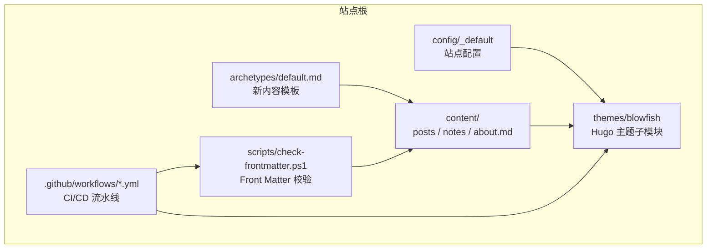
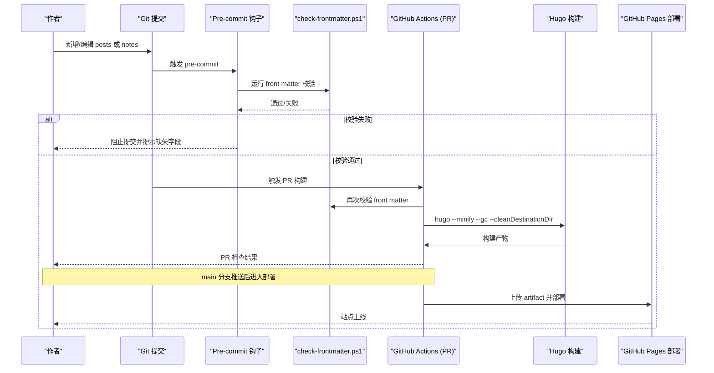
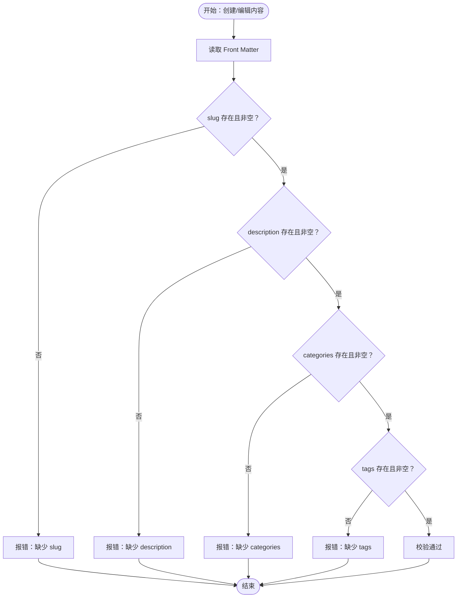
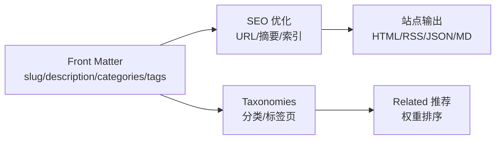
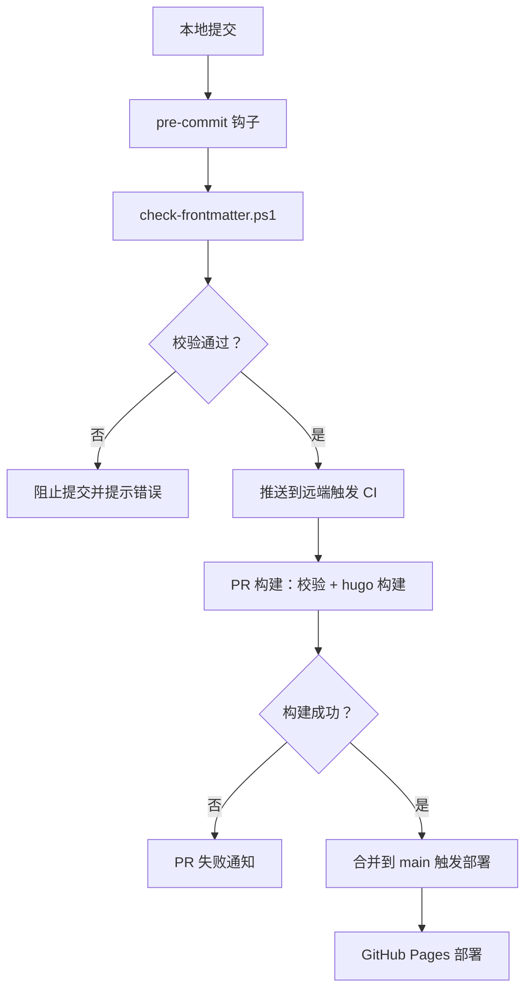
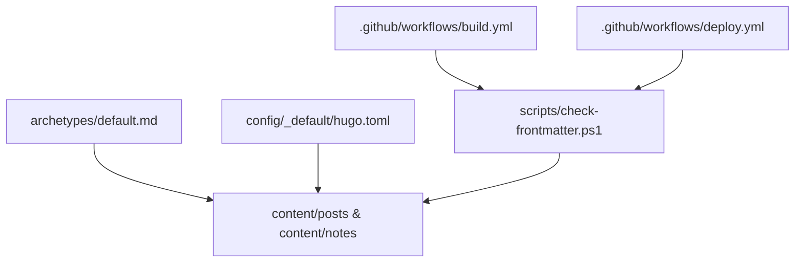

# 内容管理

<cite>
**本文引用的文件**   
- [README.md](file://README.md)
- [hugo.toml](file://config/_default/hugo.toml)
- [default.md](file://archetypes/default.md)
- [check-frontmatter.ps1](file://scripts/check-frontmatter.ps1)
- [build.yml](file://.github/workflows/build.yml)
- [deploy.yml](file://.github/workflows/deploy.yml)
- [API路由命名规范.md](file://content/posts/API路由命名规范.md)
- [_index.md（备忘）](file://content/notes/_index.md)
- [新电脑开荒备忘录.md](file://content/notes/新电脑开荒备忘录.md)
</cite>

## 目录
1. [引言](#引言)
2. [项目结构](#项目结构)
3. [核心组件](#核心组件)
4. [架构总览](#架构总览)
5. [详细组件分析](#详细组件分析)
6. [依赖关系分析](#依赖关系分析)
7. [性能与质量保障](#性能与质量保障)
8. [常见问题与排错](#常见问题与排错)
9. [结论](#结论)
10. [附录：Front Matter 字段规范与最佳实践](#附录front-matter-字段规范与最佳实践)

## 引言
本文件面向博客作者与技术笔记维护者，系统化说明基于 Hugo 与 Blowfish 主题的内容管理体系。重点覆盖：
- posts 与 notes 两种内容类型的定位、区别与用途
- Front Matter 元数据规范与必填字段（slug、description、categories、tags）
- SEO 与内容组织策略（分类、标签、别名、URL 设计）
- 内容创作最佳实践（命名、分类、标签、草稿发布流程）
- 自动化质量检查（pre-commit 钩子与 CI 构建校验）
- 常见问题与解决方案，帮助高效管理与维护博客内容

## 项目结构
仓库采用“站点配置 + 主题子模块 + 内容资源”的清晰分层：
- 站点配置位于 config/_default，定义语言、主题、分页、相关度索引、Sitemap 等
- 主题通过 git submodule 引入 themes/blowfish，避免直接修改主题代码
- 内容集中在 content 目录，posts 用于正式博客文章，notes 用于备忘与随手记录
- 脚本与自动化在 scripts 与 .github/workflows 中，提供 front matter 校验与 GitHub Pages 部署

**图表来源**
- [hugo.toml:1-78](file://config/_default/hugo.toml#L1-L78)
- [default.md:1-10](file://archetypes/default.md#L1-L10)
- [check-frontmatter.ps1:1-37](file://scripts/check-frontmatter.ps1#L1-L37)
- [build.yml:1-40](file://.github/workflows/build.yml#L1-L40)
- [deploy.yml:1-64](file://.github/workflows/deploy.yml#L1-L64)

**章节来源**
- [README.md:14-40](file://README.md#L14-L40)

## 核心组件
- 内容类型与目录
  - posts：正式博客文章，适合系统性技术分享、方法论总结
  - notes：备忘与随手记录，适合碎片化知识、清单、工具安装指南
- Front Matter 模板
  - archetypes/default.md 为新内容生成默认元数据，包含 draft、title、slug、description、categories、tags
- 站点配置
  - hugo.toml 定义 taxonomies（tag、category、author、series）、related 索引权重、输出格式（HTML、RSS、JSON、Markdown）
- 质量检查
  - scripts/check-frontmatter.ps1 强制校验 slug、description、categories、tags 非空
- 自动化
  - .github/workflows/build.yml 在 PR 时执行 front matter 校验与构建
  - .github/workflows/deploy.yml 在 main 分支推送时构建并部署到 GitHub Pages

**章节来源**
- [default.md:1-10](file://archetypes/default.md#L1-L10)
- [hugo.toml:23-78](file://config/_default/hugo.toml#L23-L78)
- [check-frontmatter.ps1:1-37](file://scripts/check-frontmatter.ps1#L1-L37)
- [build.yml:34-39](file://.github/workflows/build.yml#L34-L39)
- [deploy.yml:41-46](file://.github/workflows/deploy.yml#L41-L46)

## 架构总览
下图展示从内容创建到发布的完整链路：作者使用 Hugo 命令生成内容 → 本地 pre-commit 钩子触发校验 → PR 阶段 CI 再次校验并构建 → main 分支自动部署至 GitHub Pages。

**图表来源**
- [check-frontmatter.ps1:1-37](file://scripts/check-frontmatter.ps1#L1-L37)
- [build.yml:34-39](file://.github/workflows/build.yml#L34-L39)
- [deploy.yml:41-64](file://.github/workflows/deploy.yml#L41-L64)

## 详细组件分析

### 内容类型：posts vs notes
- posts（博客文章）
  - 用途：系统性技术文章、方法论与实践总结
  - 特点：通常具备更完整的分类与标签体系，便于长期检索与系列化
  - 示例参考：[API路由命名规范.md](file://content/posts/API路由命名规范.md)
- notes（备忘/笔记）
  - 用途：个人备忘、工具清单、环境搭建步骤等碎片化内容
  - 特点：轻量、快速记录，同样遵循 Front Matter 规范
  - 示例参考：[新电脑开荒备忘录.md](file://content/notes/新电脑开荒备忘录.md)

两者在内容组织上的差异主要体现在目录位置与内容体量；在元数据规范、SEO 策略与自动化校验上保持一致。

**章节来源**
- [API路由命名规范.md:1-10](file://content/posts/API路由命名规范.md#L1-L10)
- [新电脑开荒备忘录.md:1-10](file://content/notes/新电脑开荒备忘录.md#L1-L10)

### Front Matter 元数据规范
- 必填字段
  - slug：英文 URL 标识，避免中文文件名导致 URL 不友好
  - description：文章描述，SEO 摘要，提升搜索引擎可读性
  - categories：分类，用于内容聚合与导航
  - tags：标签，细粒度内容标记，增强相关性推荐
- 可选字段
  - aliases：旧链接重定向，保证历史链接可用
  - date/draft/title：基础信息，由模板自动生成或手动填写
- 模板与默认值
  - archetypes/default.md 提供默认结构，新建内容时自动填充
- 校验规则
  - scripts/check-frontmatter.ps1 会检查上述必填字段是否存在且非空，否则阻断提交或构建

**图表来源**
- [check-frontmatter.ps1:4-28](file://scripts/check-frontmatter.ps1#L4-L28)

**章节来源**
- [default.md:1-10](file://archetypes/default.md#L1-L10)
- [check-frontmatter.ps1:1-37](file://scripts/check-frontmatter.ps1#L1-L37)

### SEO 与内容组织
- URL 与 slug
  - 使用英文 slug 生成稳定、可读的 URL，避免中文路径带来的兼容性问题
- 描述与摘要
  - description 作为 SEO 摘要，建议简洁明确，突出文章核心价值
- 分类与标签
  - categories 用于宏观内容分组（如后端开发、效率工具）
  - tags 用于微观关键词（如 API、RESTful、Java、Spring Boot）
- 相关度与推荐
  - hugo.toml 中 related.indices 对 tags、categories、series、authors、date 设置权重，影响相关文章推荐
- Sitemap 与输出
  - sitemap.xml 启用，page 输出包含 HTML 与 Markdown，便于下载原文

**图表来源**
- [hugo.toml:23-78](file://config/_default/hugo.toml#L23-L78)

**章节来源**
- [hugo.toml:23-78](file://config/_default/hugo.toml#L23-L78)

### 内容创作最佳实践
- 命名规范
  - 标题简洁明确，slug 使用英文短横线命名（kebab-case），避免特殊字符
  - 文件名建议使用中文便于本地管理，但 URL 由 slug 控制
- 分类策略
  - 保持分类层级扁平，优先使用 categories 进行大类划分
  - 避免过度细分导致分类页面内容过少
- 标签使用
  - 标签应具体且可复用，避免过于宽泛或临时性词汇
  - 同一篇文章建议 3-5 个标签，聚焦核心主题
- 草稿与发布
  - 新建内容为草稿（draft = true），完成后再改为 draft = false
  - 发布前确保 Front Matter 必填字段齐全并通过校验
- 历史链接
  - 若变更 slug，建议在 aliases 中保留旧链接，保证外部引用与书签有效

**章节来源**
- [README.md:75-112](file://README.md#L75-L112)
- [API路由命名规范.md:1-10](file://content/posts/API路由命名规范.md#L1-L10)

### 质量检查机制：pre-commit 与 CI
- pre-commit 钩子
  - 通过 scripts/setup-hooks.ps1 启用仓库内 git hooks
  - 提交前自动运行 check-frontmatter.ps1，未通过则阻止提交
- CI 构建检查（PR）
  - .github/workflows/build.yml 在 PR 时执行 front matter 校验与 hugo 构建
  - 使用缓存加速构建，统一 Hugo 版本（extended）
- 部署流水线（main）
  - .github/workflows/deploy.yml 在 main 分支推送时构建并部署到 GitHub Pages
  - 支持 workflow_dispatch 手动触发

**图表来源**
- [check-frontmatter.ps1:1-37](file://scripts/check-frontmatter.ps1#L1-L37)
- [build.yml:34-39](file://.github/workflows/build.yml#L34-L39)
- [deploy.yml:41-64](file://.github/workflows/deploy.yml#L41-L64)

**章节来源**
- [README.md:59-65](file://README.md#L59-L65)
- [README.md:114-128](file://README.md#L114-L128)
- [build.yml:1-40](file://.github/workflows/build.yml#L1-L40)
- [deploy.yml:1-64](file://.github/workflows/deploy.yml#L1-L64)

## 依赖关系分析
- 内容与模板
  - 新内容依赖 archetypes/default.md 提供的 Front Matter 模板
- 内容与站点配置
  - 内容中的 categories/tags 受 hugo.toml 中 taxonomies 定义约束
  - related 索引依赖 categories/tags/series/authors/date 等字段
- 自动化与内容
  - scripts/check-frontmatter.ps1 扫描 content/posts 下所有 .md 文件，校验必填字段
  - CI 工作流调用该脚本并在构建前后执行

**图表来源**
- [default.md:1-10](file://archetypes/default.md#L1-L10)
- [hugo.toml:23-78](file://config/_default/hugo.toml#L23-L78)
- [check-frontmatter.ps1:1-37](file://scripts/check-frontmatter.ps1#L1-L37)
- [build.yml:34-39](file://.github/workflows/build.yml#L34-L39)
- [deploy.yml:41-46](file://.github/workflows/deploy.yml#L41-L46)

**章节来源**
- [default.md:1-10](file://archetypes/default.md#L1-L10)
- [hugo.toml:23-78](file://config/_default/hugo.toml#L23-L78)
- [check-frontmatter.ps1:1-37](file://scripts/check-frontmatter.ps1#L1-L37)
- [build.yml:1-40](file://.github/workflows/build.yml#L1-L40)
- [deploy.yml:1-64](file://.github/workflows/deploy.yml#L1-L64)

## 性能与质量保障
- 构建优化
  - CI 中使用 hugo --minify --gc --cleanDestinationDir 压缩与清理，减少产物体积
  - 使用 actions/cache 缓存 Hugo resources，提升构建速度
- 版本一致性
  - 使用 peaceiris/actions-hugo@v3 并开启 extended 模式，版本由 .hugo-version 锁定
- 内容质量
  - pre-commit 与 CI 双重校验 Front Matter 必填字段，确保内容元数据完整性
  - 建议作者在本地先运行 scripts/check-frontmatter.ps1 自检，减少 CI 失败

**章节来源**
- [build.yml:21-39](file://.github/workflows/build.yml#L21-L39)
- [deploy.yml:28-46](file://.github/workflows/deploy.yml#L28-L46)
- [check-frontmatter.ps1:1-37](file://scripts/check-frontmatter.ps1#L1-L37)

## 常见问题与排错
- 提交被阻止：Front Matter 缺失必填字段
  - 现象：pre-commit 或 CI 报出 slug/description/categories/tags 缺失或为空
  - 处理：在 Front Matter 中补充对应字段并确保非空
  - 参考：[check-frontmatter.ps1:4-28](file://scripts/check-frontmatter.ps1#L4-L28)
- 构建失败：Hugo 版本不一致或缺少扩展功能
  - 现象：CI 构建时报错或主题功能不可用
  - 处理：确认已安装 Hugo extended 版本，并与 .hugo-version 一致
  - 参考：[build.yml:21-25](file://.github/workflows/build.yml#L21-L25)
- 链接失效：变更 slug 后旧链接无法访问
  - 现象：外部引用或书签返回 404
  - 处理：在 Front Matter 中添加 aliases 指向旧路径
  - 参考：[API路由命名规范.md:1-10](file://content/posts/API路由命名规范.md#L1-L10)
- 分类/标签无效：未在站点显示
  - 现象：分类页或标签页无内容
  - 处理：确认 hugo.toml 中 taxonomies 定义与 Front Matter 字段一致
  - 参考：[hugo.toml:23-27](file://config/_default/hugo.toml#L23-L27)

**章节来源**
- [check-frontmatter.ps1:1-37](file://scripts/check-frontmatter.ps1#L1-L37)
- [build.yml:21-39](file://.github/workflows/build.yml#L21-L39)
- [API路由命名规范.md:1-10](file://content/posts/API路由命名规范.md#L1-L10)
- [hugo.toml:23-27](file://config/_default/hugo.toml#L23-L27)

## 结论
本仓库通过清晰的目录结构、严格的 Front Matter 规范与自动化质量检查，构建了稳定高效的博客内容管理体系。posts 与 notes 分别承担正式文章与备忘记录的角色，二者共享统一的元数据规范与 SEO 策略。借助 pre-commit 钩子与 GitHub Actions，内容质量在本地与 CI 两端得到保障，最终实现一键构建与部署到 GitHub Pages。作者只需遵循命名、分类、标签的最佳实践，即可高效地创作与维护高质量内容。

## 附录：Front Matter 字段规范与最佳实践
- 必填字段
  - slug：英文 URL 标识，建议使用 kebab-case
  - description：SEO 摘要，简洁明确
  - categories：分类，宏观内容分组
  - tags：标签，细粒度关键词
- 可选字段
  - aliases：旧链接重定向，保证历史链接可用
  - date/draft/title：基础信息，由模板自动生成或手动填写
- 模板与默认值
  - archetypes/default.md 提供默认结构，新建内容时自动填充
- 校验规则
  - scripts/check-frontmatter.ps1 会检查上述必填字段是否存在且非空，否则阻断提交或构建
- 示例参考
  - posts 示例：[API路由命名规范.md](file://content/posts/API路由命名规范.md)
  - notes 示例：[新电脑开荒备忘录.md](file://content/notes/新电脑开荒备忘录.md)
  - notes 列表页：[content/notes/_index.md](file://content/notes/_index.md)

**章节来源**
- [default.md:1-10](file://archetypes/default.md#L1-L10)
- [check-frontmatter.ps1:1-37](file://scripts/check-frontmatter.ps1#L1-L37)
- [API路由命名规范.md:1-10](file://content/posts/API路由命名规范.md#L1-L10)
- [新电脑开荒备忘录.md:1-10](file://content/notes/新电脑开荒备忘录.md#L1-L10)
- [_index.md（备忘）:1-5](file://content/notes/_index.md#L1-L5)