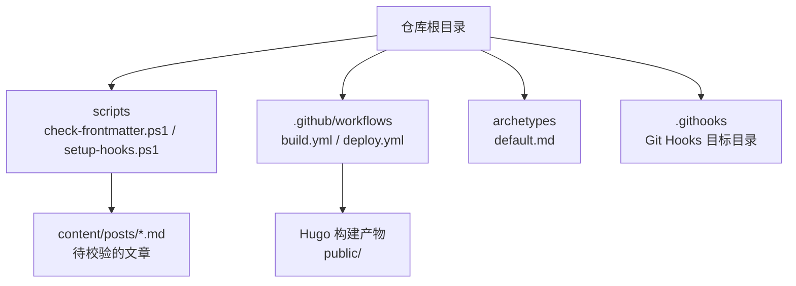
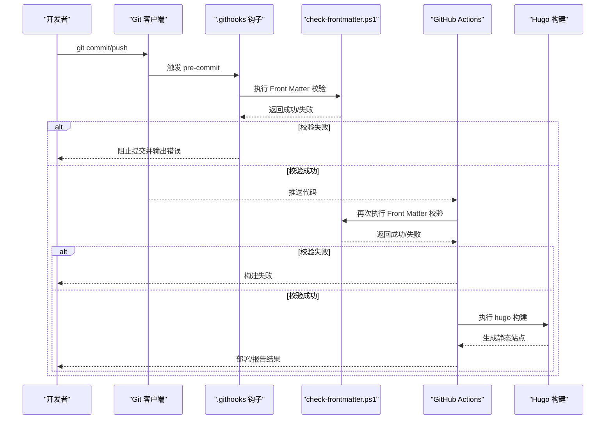
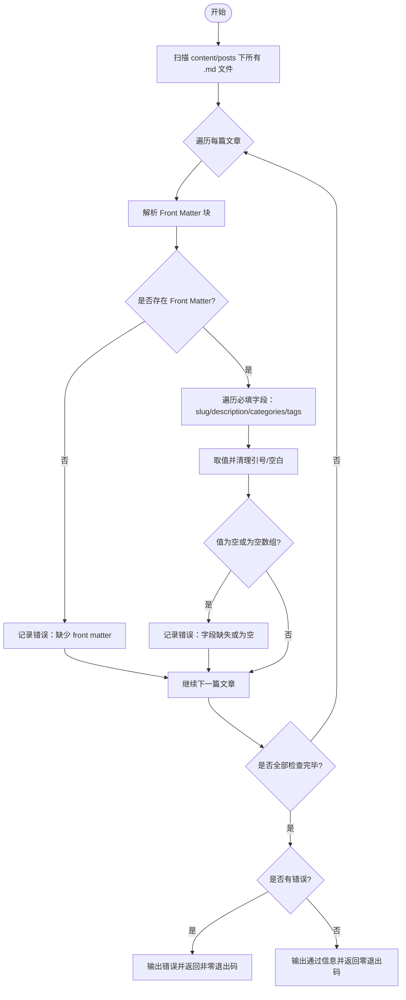
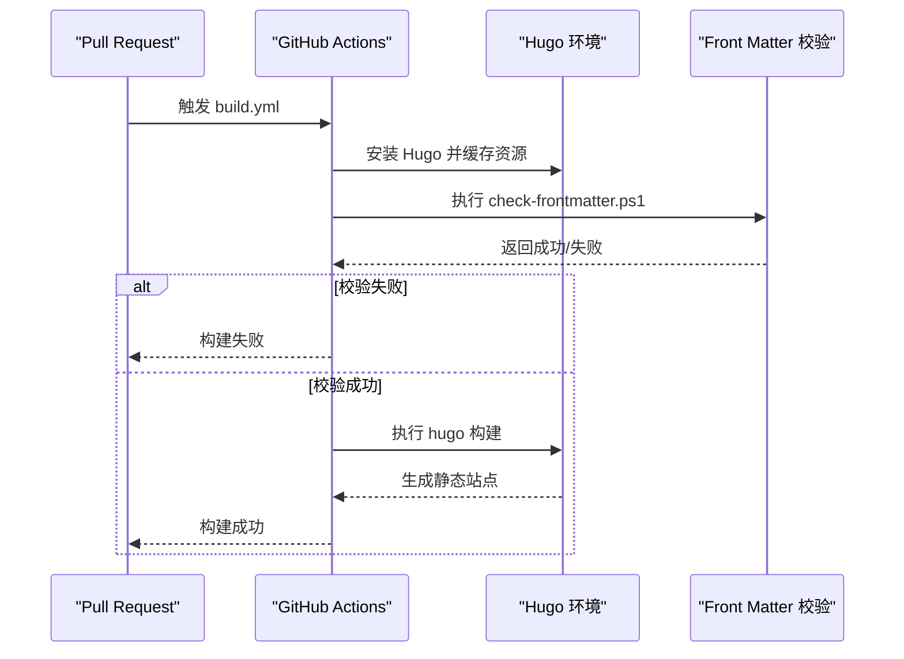
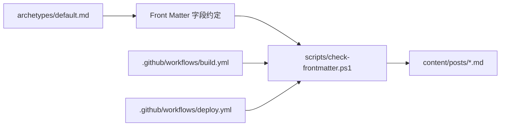

# 内容质量检查

<cite>
**本文引用的文件**   
- [scripts/check-frontmatter.ps1](file://scripts/check-frontmatter.ps1)
- [scripts/setup-hooks.ps1](file://scripts/setup-hooks.ps1)
- [.github/workflows/build.yml](file://.github/workflows/build.yml)
- [.github/workflows/deploy.yml](file://.github/workflows/deploy.yml)
- [archetypes/default.md](file://archetypes/default.md)
</cite>

## 目录
1. [简介](#简介)
2. [项目结构](#项目结构)
3. [核心组件](#核心组件)
4. [架构总览](#架构总览)
5. [详细组件分析](#详细组件分析)
6. [依赖关系分析](#依赖关系分析)
7. [性能与稳定性考虑](#性能与稳定性考虑)
8. [故障排除指南](#故障排除指南)
9. [结论](#结论)
10. [附录：规则与标准](#附录规则与标准)

## 简介
本文件面向贡献者与自动化流水线维护者，系统化说明本项目的内容质量保障机制。重点包括：
- Git Hooks 的安装与启用流程
- Front Matter 字段校验脚本的功能与规则
- GitHub Actions 构建/部署流水线如何集成内容质量检查
- 本地测试与调试方法
- 常见失败原因与排错建议

## 项目结构
与内容质量相关的核心位置如下：
- scripts：包含 Front Matter 校验脚本与 Git Hooks 安装脚本
- .github/workflows：GitHub Actions 的构建与部署流水线
- archetypes：Hugo 文章模板，定义默认 Front Matter 字段
- .githooks：Git Hooks 目标目录（由安装脚本配置）

图表来源
- [scripts/check-frontmatter.ps1:1-37](file://scripts/check-frontmatter.ps1#L1-L37)
- [scripts/setup-hooks.ps1:1-5](file://scripts/setup-hooks.ps1#L1-L5)
- [.github/workflows/build.yml:1-40](file://.github/workflows/build.yml#L1-L40)
- [.github/workflows/deploy.yml:1-64](file://.github/workflows/deploy.yml#L1-L64)
- [archetypes/default.md:1-10](file://archetypes/default.md#L1-L10)

章节来源
- [scripts/check-frontmatter.ps1:1-37](file://scripts/check-frontmatter.ps1#L1-L37)
- [scripts/setup-hooks.ps1:1-5](file://scripts/setup-hooks.ps1#L1-L5)
- [.github/workflows/build.yml:1-40](file://.github/workflows/build.yml#L1-L40)
- [.github/workflows/deploy.yml:1-64](file://.github/workflows/deploy.yml#L1-L64)
- [archetypes/default.md:1-10](file://archetypes/default.md#L1-L10)

## 核心组件
- Front Matter 校验脚本：对 content/posts 下的 Markdown 文章进行必填字段与非空校验，不通过则返回非零退出码，阻断提交或构建。
- Git Hooks 安装脚本：将 Git 钩子路径指向仓库内的 .githooks 目录，实现本地钩子生效。
- GitHub Actions 流水线：在 PR 构建与 main 分支部署前执行 Front Matter 校验，确保合并与发布内容符合规范。
- Hugo 文章模板：提供默认 Front Matter 字段，帮助作者快速生成符合规范的元数据。

章节来源
- [scripts/check-frontmatter.ps1:1-37](file://scripts/check-frontmatter.ps1#L1-L37)
- [scripts/setup-hooks.ps1:1-5](file://scripts/setup-hooks.ps1#L1-L5)
- [.github/workflows/build.yml:34-36](file://.github/workflows/build.yml#L34-L36)
- [.github/workflows/deploy.yml:41-43](file://.github/workflows/deploy.yml#L41-L43)
- [archetypes/default.md:1-10](file://archetypes/default.md#L1-L10)

## 架构总览
下图展示从本地开发到 CI 构建、部署的质量检查闭环：

图表来源
- [scripts/check-frontmatter.ps1:1-37](file://scripts/check-frontmatter.ps1#L1-L37)
- [.github/workflows/build.yml:34-39](file://.github/workflows/build.yml#L34-L39)
- [.github/workflows/deploy.yml:41-46](file://.github/workflows/deploy.yml#L41-L46)

## 详细组件分析

### Front Matter 校验脚本（check-frontmatter.ps1）
该脚本扫描 content/posts 下的所有 Markdown 文件，解析 Front Matter，并对以下必填字段进行存在性与非空校验：
- slug：英文 slug，用于生成英文 URL（缺失时 URL 回退为中文文件名）
- description：文章描述（SEO 约定）
- categories：分类
- tags：标签

处理逻辑要点：
- 使用正则匹配 Front Matter 块（以 +++ 包裹），若未找到则视为缺少 Front Matter。
- 对每个必填键，提取其值并去除引号与空白；空字符串或空数组 [] 均视为无效。
- 收集所有错误信息，任一失败即输出红色错误列表并以非零状态码退出，从而阻断后续步骤。

图表来源
- [scripts/check-frontmatter.ps1:1-37](file://scripts/check-frontmatter.ps1#L1-L37)

章节来源
- [scripts/check-frontmatter.ps1:1-37](file://scripts/check-frontmatter.ps1#L1-L37)

### Git Hooks 安装与启用（setup-hooks.ps1）
- 作用：将 Git 的 hooks 路径设置为仓库内的 .githooks 目录，使本地提交触发预提交钩子。
- 用法：在仓库根目录执行一次即可，随后每次提交都会运行 .githooks 中的钩子脚本。
- 注意：.githooks 目录当前为空，实际钩子脚本需自行添加（例如调用 check-frontmatter.ps1）。

章节来源
- [scripts/setup-hooks.ps1:1-5](file://scripts/setup-hooks.ps1#L1-L5)

### GitHub Actions 流水线集成
- build.yml（PR 构建检查）：
  - 在拉取请求触发时执行 checkout、设置 Hugo、缓存资源、执行 Front Matter 校验、最后执行 hugo 构建。
  - 若 Front Matter 校验失败，构建直接失败，阻止合并。
- deploy.yml（main 分支构建与部署）：
  - 在推送到 main 分支或手动触发时执行相同的前置校验与构建，并将 public 目录上传至 GitHub Pages。

图表来源
- [.github/workflows/build.yml:1-40](file://.github/workflows/build.yml#L1-L40)
- [.github/workflows/deploy.yml:1-64](file://.github/workflows/deploy.yml#L1-L64)

章节来源
- [.github/workflows/build.yml:1-40](file://.github/workflows/build.yml#L1-L40)
- [.github/workflows/deploy.yml:1-64](file://.github/workflows/deploy.yml#L1-L64)

### Hugo 文章模板（archetypes/default.md）
- 提供默认 Front Matter 字段：date、draft、title、slug、description、categories、tags。
- 作者新建文章时可基于此模板快速补齐必要字段，减少遗漏。

章节来源
- [archetypes/default.md:1-10](file://archetypes/default.md#L1-L10)

## 依赖关系分析
- 脚本与数据源：
  - check-frontmatter.ps1 依赖 content/posts 下的 Markdown 文件作为输入。
  - 校验规则（必填字段集合）集中在脚本中，便于统一维护。
- 流水线与脚本：
  - build.yml 与 deploy.yml 均通过 pwsh 调用 check-frontmatter.ps1，保证本地与 CI 行为一致。
- 模板与校验：
  - archetypes/default.md 定义了默认字段，与脚本校验字段保持一致，降低人为遗漏概率。

图表来源
- [archetypes/default.md:1-10](file://archetypes/default.md#L1-L10)
- [scripts/check-frontmatter.ps1:1-37](file://scripts/check-frontmatter.ps1#L1-L37)
- [.github/workflows/build.yml:34-36](file://.github/workflows/build.yml#L34-L36)
- [.github/workflows/deploy.yml:41-43](file://.github/workflows/deploy.yml#L41-L43)

章节来源
- [scripts/check-frontmatter.ps1:1-37](file://scripts/check-frontmatter.ps1#L1-L37)
- [.github/workflows/build.yml:34-36](file://.github/workflows/build.yml#L34-L36)
- [.github/workflows/deploy.yml:41-43](file://.github/workflows/deploy.yml#L41-L43)
- [archetypes/default.md:1-10](file://archetypes/default.md#L1-L10)

## 性能与稳定性考虑
- 校验范围限定于 content/posts，避免对无关文件造成额外开销。
- 使用正则解析 Front Matter，复杂度与文章数量线性相关，适合中小型站点。
- CI 中先执行轻量级校验再执行 Hugo 构建，尽早失败，缩短反馈时间。
- 建议在本地也启用 Git Hooks，减少不必要的远程构建。

[本节为通用指导，不涉及具体文件分析]

## 故障排除指南
常见问题与解决思路：
- 报错“缺少 front matter”
  - 现象：文章未以 +++ 包裹 Front Matter 块。
  - 处理：在文件顶部添加 Front Matter 块，并确保包含必填字段。
- 报错“字段缺失或为空”
  - 现象：slug、description、categories、tags 任一为空或为空数组。
  - 处理：填写有效值；分类与标签建议使用数组形式且至少包含一个元素。
- 本地未触发钩子
  - 现象：git commit 未执行任何检查。
  - 处理：执行 scripts/setup-hooks.ps1 以启用 .githooks；确认 .githooks 中存在对应钩子脚本。
- CI 构建失败但本地通过
  - 现象：本地未安装或启用钩子，CI 仍会执行校验。
  - 处理：优先修复 Front Matter 问题；如需跳过，请修正内容而非绕过检查。
- PowerShell 环境问题
  - 现象：pwsh 命令不可用或权限不足。
  - 处理：确保系统已安装 PowerShell Core；在支持 pwsh 的环境执行脚本。

章节来源
- [scripts/check-frontmatter.ps1:1-37](file://scripts/check-frontmatter.ps1#L1-L37)
- [scripts/setup-hooks.ps1:1-5](file://scripts/setup-hooks.ps1#L1-L5)
- [.github/workflows/build.yml:34-36](file://.github/workflows/build.yml#L34-L36)
- [.github/workflows/deploy.yml:41-43](file://.github/workflows/deploy.yml#L41-L43)

## 结论
本项目通过“本地 Git Hooks + 脚本校验 + CI 流水线”三层保障，确保内容质量稳定可控。Front Matter 校验脚本明确了必填字段与格式要求，结合 Hugo 模板与 GitHub Actions，形成从开发到发布的完整质量闭环。建议团队在本地启用钩子并在提交前自检，以减少 CI 失败与返工成本。

[本节为总结性内容，不涉及具体文件分析]

## 附录：规则与标准
- 必填字段
  - slug：英文 slug，用于生成英文 URL（缺失时 URL 回退为中文文件名）
  - description：文章描述（SEO 约定）
  - categories：分类（建议非空数组）
  - tags：标签（建议非空数组）
- 命名与结构
  - 文章存放于 content/posts 目录下，扩展名为 .md。
  - 标题与 slug 应简洁明确，避免特殊字符与过长名称。
- 元数据完整性
  - 所有文章必须包含完整的 Front Matter 块，且必填字段不得为空。
  - 使用 archetypes/default.md 作为新文章模板，可显著降低遗漏风险。

章节来源
- [scripts/check-frontmatter.ps1:1-37](file://scripts/check-frontmatter.ps1#L1-L37)
- [archetypes/default.md:1-10](file://archetypes/default.md#L1-L10)