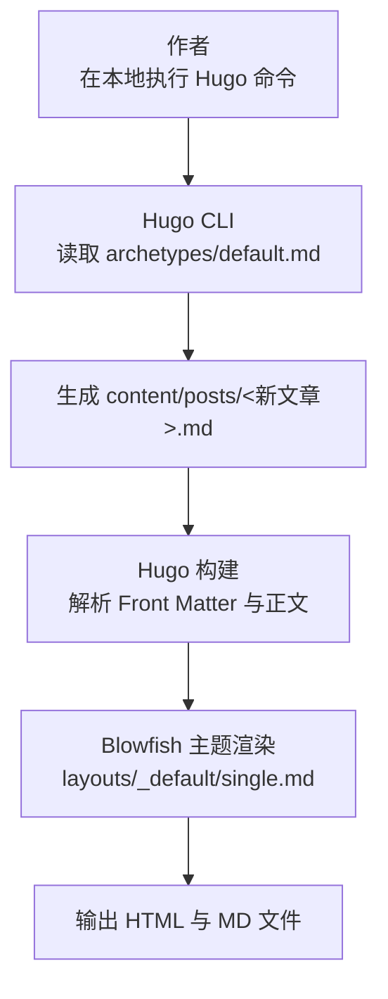
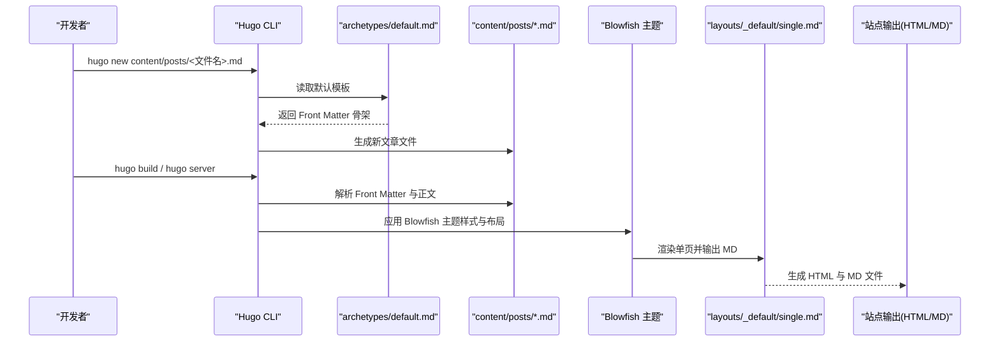
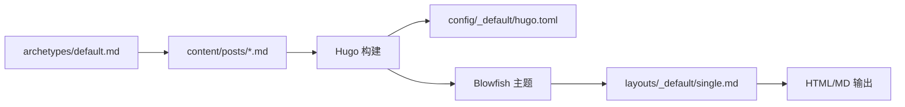

# 博客文章管理

<cite>
**本文引用的文件**   
- [archetypes/default.md](file://archetypes/default.md)
- [config/_default/hugo.toml](file://config/_default/hugo.toml)
- [layouts/_default/single.md](file://layouts/_default/single.md)
- [content/posts/API路由命名规范.md](file://content/posts/API路由命名规范.md)
- [content/posts/Java开发者快速上手.NET10指南.md](file://content/posts/Java开发者快速上手.NET10指南.md)
</cite>

## 目录
1. [简介](#简介)
2. [项目结构](#项目结构)
3. [核心组件](#核心组件)
4. [架构总览](#架构总览)
5. [详细组件分析](#详细组件分析)
6. [依赖关系分析](#依赖关系分析)
7. [性能与构建特性](#性能与构建特性)
8. [故障排查指南](#故障排查指南)
9. [结论](#结论)
10. [附录：写作清单与示例路径](#附录写作清单与示例路径)

## 简介
本文面向使用 Hugo + Blowfish 主题的技术博客作者，聚焦 content/posts 目录下的技术文章创作与管理流程。内容涵盖：
- 如何使用 Hugo 命令创建新文章（含 posts 分类）
- 文章标准结构：Front Matter、正文 Markdown、图片引用方式
- 写作最佳实践：标题命名、段落组织、代码块标注、链接管理
- 草稿与发布流程：draft = true/false 的作用机制
- 分类、标签、系列等元数据的实际用法与组织建议

本仓库采用 Hugo 静态站点生成器，Blowfish 为主题；文章以 Markdown 编写，通过 Front Matter 控制元数据与发布状态。

## 项目结构
与“博客文章管理”直接相关的目录与文件如下：
- archetypes/default.md：Hugo 默认文章模板，定义新建文章的 Front Matter 骨架
- config/_default/hugo.toml：站点配置，包含语言、主题、分页、媒体类型、输出格式、相关度索引等
- layouts/_default/single.md：单页输出模板，用于导出“下载本文”的纯 Markdown 正文
- content/posts/*.md：已发布的中文技术文章示例，体现真实文章结构与写法



图表来源
- [archetypes/default.md:1-10](file://archetypes/default.md#L1-L10)
- [config/_default/hugo.toml:34-47](file://config/_default/hugo.toml#L34-L47)
- [layouts/_default/single.md:1-5](file://layouts/_default/single.md#L1-L5)

章节来源
- [archetypes/default.md:1-10](file://archetypes/default.md#L1-L10)
- [config/_default/hugo.toml:1-78](file://config/_default/hugo.toml#L1-L78)
- [layouts/_default/single.md:1-5](file://layouts/_default/single.md#L1-L5)

## 核心组件
- 文章模板（Archetype）
  - 提供新建文章的 Front Matter 骨架，包括日期、草稿标记、标题、slug、描述、分类、标签等字段。
- 站点配置（hugo.toml）
  - 定义主题、语言、摘要长度、机器人、Git 信息、分页、图像锚点、分类法（tags/categories/authors/series）、Sitemap、媒体类型与输出格式、相关文章权重等。
- 单页模板（single.md）
  - 为每篇文章额外输出一份 Markdown 原文（不含 Front Matter），供“下载本文”功能使用。
- 示例文章
  - content/posts 下的多篇文章展示了标准的 Front Matter、正文结构、表格、代码块、链接等写法。

章节来源
- [archetypes/default.md:1-10](file://archetypes/default.md#L1-L10)
- [config/_default/hugo.toml:1-78](file://config/_default/hugo.toml#L1-L78)
- [layouts/_default/single.md:1-5](file://layouts/_default/single.md#L1-L5)
- [content/posts/API路由命名规范.md:1-10](file://content/posts/API路由命名规范.md#L1-L10)
- [content/posts/Java开发者快速上手.NET10指南.md:1-10](file://content/posts/Java开发者快速上手.NET10指南.md#L1-L10)

## 架构总览
下图展示从“创建文章”到“站点输出”的关键步骤与组件交互：



图表来源
- [archetypes/default.md:1-10](file://archetypes/default.md#L1-L10)
- [layouts/_default/single.md:1-5](file://layouts/_default/single.md#L1-L5)
- [config/_default/hugo.toml:34-47](file://config/_default/hugo.toml#L34-L47)

## 详细组件分析

### 1. 使用 Hugo 命令创建新文章
- 推荐命令
  - hugo new content/posts/<文章名>.md
  - 说明：该命令会在 content/posts 目录下生成一篇新文章，并使用 archetypes/default.md 作为 Front Matter 模板。
- 本地预览
  - hugo server
  - 说明：启动本地开发服务器，实时预览站点。
- 构建站点
  - hugo build
  - 说明：生成最终静态文件，便于部署。

章节来源
- [archetypes/default.md:1-10](file://archetypes/default.md#L1-L10)

### 2. 文章标准结构：Front Matter 元数据
- 关键字段与建议
  - date：文章发布日期（ISO 8601）。
  - draft：草稿开关。true 表示草稿，false 表示发布。
  - title：文章标题。
  - slug：URL 友好标识（建议使用英文短横线命名）。
  - aliases：旧链接别名，便于 SEO 与迁移。
  - description：文章摘要或 SEO 描述。
  - categories：分类数组，如 ["后端开发"]。
  - tags：标签数组，如 ["API", "RESTful", "Java"]。
- 模板来源
  - archetypes/default.md 定义了默认 Front Matter 骨架，新建文章时自动填充。

章节来源
- [archetypes/default.md:1-10](file://archetypes/default.md#L1-L10)
- [content/posts/API路由命名规范.md:1-10](file://content/posts/API路由命名规范.md#L1-L10)
- [content/posts/Java开发者快速上手.NET10指南.md:1-10](file://content/posts/Java开发者快速上手.NET10指南.md#L1-L10)

### 3. 正文内容与图片引用
- 正文格式
  - 使用标准 Markdown：标题、列表、表格、代码块、链接、强调等。
  - 示例文章展示了大量表格与代码块，适合技术教程类文章。
- 图片引用
  - 站点 assets/img 目录可用于存放图片资源。
  - 在文章中通过相对路径或 Hugo 的资源管道引用图片（例如使用图床或本地路径）。
  - 若需要响应式图片与优化，可结合 Hugo 的图片处理与主题提供的 shortcode（如 figure）。
- 注意事项
  - 保持图片路径一致且可访问，避免硬编码绝对路径。
  - 对大图进行压缩与懒加载以提升性能。

章节来源
- [config/_default/hugo.toml:20-22](file://config/_default/hugo.toml#L20-L22)
- [content/posts/API路由命名规范.md:12-153](file://content/posts/API路由命名规范.md#L12-L153)
- [content/posts/Java开发者快速上手.NET10指南.md:14-753](file://content/posts/Java开发者快速上手.NET10指南.md#L14-L753)

### 4. 写作最佳实践
- 标题命名规范
  - 使用简洁明确的中文标题，必要时在 Front Matter 中设置英文 slug，保证 URL 可读性与 SEO。
- 段落组织
  - 按逻辑分节，使用二级/三级标题组织内容；长文建议配合目录（TOC）与摘要。
- 代码块标注
  - 使用 fenced code block 并指定语言（如 ```java、```csharp、```json），便于语法高亮。
  - 示例文章包含多种语言的代码块，可作为参考。
- 链接管理
  - 外部链接使用绝对地址；内部链接使用相对路径或 Hugo 的 relref/ref 函数。
  - 使用 aliases 字段维护旧链接，避免死链。
- 分类与标签
  - 分类（categories）用于宏观归类（如“后端开发”），标签（tags）用于细粒度检索（如“API”“RESTful”）。
  - 建议在 hugo.toml 中统一分类法名称，确保全站一致。

章节来源
- [config/_default/hugo.toml:23-27](file://config/_default/hugo.toml#L23-L27)
- [content/posts/API路由命名规范.md:12-153](file://content/posts/API路由命名规范.md#L12-L153)
- [content/posts/Java开发者快速上手.NET10指南.md:14-753](file://content/posts/Java开发者快速上手.NET10指南.md#L14-L753)

### 5. 草稿与发布流程（draft 机制）
- draft = true
  - 表示草稿，默认不会被构建输出（除非启用 buildDrafts）。
- draft = false
  - 表示正式发布，会被 Hugo 构建并输出到站点。
- 工作流建议
  - 新建文章时保留 draft = true，完成初稿后改为 false 再提交。
  - 使用 Git 钩子或脚本校验 Front Matter 完整性（仓库 scripts/check-frontmatter.ps1 可作为参考）。

章节来源
- [archetypes/default.md:1-10](file://archetypes/default.md#L1-L10)
- [config/_default/hugo.toml:12-13](file://config/_default/hugo.toml#L12-L13)

### 6. 分类、标签、系列的使用
- 分类（categories）
  - 用于文章的大类划分，如“后端开发”。
- 标签（tags）
  - 用于关键词检索，如“API”“RESTful”“Java”。
- 系列（series）
  - 用于将多篇文章组织成系列阅读体验（如教程系列）。
- 相关度索引
  - hugo.toml 中配置了 related.indices，按 tags、categories、series、authors、date、fragmentrefs 计算相关文章。

章节来源
- [config/_default/hugo.toml:23-27](file://config/_default/hugo.toml#L23-L27)
- [config/_default/hugo.toml:49-77](file://config/_default/hugo.toml#L49-L77)
- [content/posts/API路由命名规范.md:1-10](file://content/posts/API路由命名规范.md#L1-L10)
- [content/posts/Java开发者快速上手.NET10指南.md:1-10](file://content/posts/Java开发者快速上手.NET10指南.md#L1-L10)

### 7. “下载本文”功能与单页输出
- 功能说明
  - 站点为每篇单页文章额外输出一份 Markdown 原文（不含 Front Matter），供“下载本文”功能使用。
- 实现位置
  - layouts/_default/single.md 负责输出带中文标题的 Markdown 正文。
- 输出格式
  - hugo.toml 中定义了 mediaTypes 与 outputFormats，并在 outputs.page 中启用 MD 输出。

章节来源
- [layouts/_default/single.md:1-5](file://layouts/_default/single.md#L1-L5)
- [config/_default/hugo.toml:34-47](file://config/_default/hugo.toml#L34-L47)

## 依赖关系分析
- 文章与模板
  - 新建文章依赖 archetypes/default.md 的 Front Matter 骨架。
- 文章与站点配置
  - 分类法名称（tags/categories/authors/series）由 hugo.toml 统一定义。
  - 输出格式（HTML/MD）由 hugo.toml 控制。
- 文章与主题
  - 主题 Blowfish 提供布局与样式；单页输出由 layouts/_default/single.md 定制。



图表来源
- [archetypes/default.md:1-10](file://archetypes/default.md#L1-L10)
- [config/_default/hugo.toml:34-47](file://config/_default/hugo.toml#L34-L47)
- [layouts/_default/single.md:1-5](file://layouts/_default/single.md#L1-L5)

章节来源
- [archetypes/default.md:1-10](file://archetypes/default.md#L1-L10)
- [config/_default/hugo.toml:1-78](file://config/_default/hugo.toml#L1-L78)
- [layouts/_default/single.md:1-5](file://layouts/_default/single.md#L1-L5)

## 性能与构建特性
- 摘要长度
  - summaryLength 控制列表页摘要长度，影响首页与列表页的渲染性能与可读性。
- 图像锚点
  - imaging.anchor 控制图片裁剪锚点，有助于统一封面图显示效果。
- 输出格式
  - 同时输出 HTML 与 MD，便于“下载本文”与二次消费。
- 相关度索引
  - 通过 related.indices 提升相关文章推荐质量，但需注意索引字段过多可能增加构建时间。

章节来源
- [config/_default/hugo.toml:8-10](file://config/_default/hugo.toml#L8-L10)
- [config/_default/hugo.toml:20-22](file://config/_default/hugo.toml#L20-L22)
- [config/_default/hugo.toml:34-47](file://config/_default/hugo.toml#L34-L47)
- [config/_default/hugo.toml:49-77](file://config/_default/hugo.toml#L49-L77)

## 故障排查指南
- 文章未出现在站点
  - 检查 Front Matter 中 draft 是否为 false。
  - 确认 hugo.toml 中 buildDrafts 未被开启（默认关闭）。
- 链接失效
  - 检查 aliases 是否配置正确，确保旧链接重定向到新路径。
- 图片不显示
  - 检查图片路径是否正确，是否在 assets/img 或 static 目录。
  - 确认 Hugo 构建时能访问该资源。
- 代码块无高亮
  - 确认 fenced code block 的语言标注正确（如 java、csharp、json）。
- “下载本文”不可用
  - 确认 layouts/_default/single.md 存在且未被覆盖。
  - 确认 hugo.toml 中 mediaTypes 与 outputFormats 配置正确。

章节来源
- [config/_default/hugo.toml:12-13](file://config/_default/hugo.toml#L12-L13)
- [layouts/_default/single.md:1-5](file://layouts/_default/single.md#L1-L5)
- [config/_default/hugo.toml:34-47](file://config/_default/hugo.toml#L34-L47)

## 结论
通过 Hugo 与 Blowfish 主题，本仓库提供了清晰的博客文章创作与管理流程。借助 archetypes/default.md 与 hugo.toml 的配置，作者可以高效地创建、组织并发布技术文章；通过 drafts 机制与 aliases 管理，保障草稿与历史链接的稳定性；通过 single.md 与输出格式配置，支持“下载本文”等增强功能。遵循本文的最佳实践，可显著提升文章的可读性、可维护性与 SEO 表现。

## 附录：写作清单与示例路径
- 新建文章
  - 命令：hugo new content/posts/<文章名>.md
  - 模板：archetypes/default.md
- 本地预览
  - 命令：hugo server
- 构建站点
  - 命令：hugo build
- 示例文章（参考结构与写法）
  - [content/posts/API路由命名规范.md](file://content/posts/API路由命名规范.md)
  - [content/posts/Java开发者快速上手.NET10指南.md](file://content/posts/Java开发者快速上手.NET10指南.md)
- 关键配置
  - [config/_default/hugo.toml](file://config/_default/hugo.toml)
- 单页输出
  - [layouts/_default/single.md](file://layouts/_default/single.md)

章节来源
- [archetypes/default.md:1-10](file://archetypes/default.md#L1-L10)
- [config/_default/hugo.toml:1-78](file://config/_default/hugo.toml#L1-L78)
- [layouts/_default/single.md:1-5](file://layouts/_default/single.md#L1-L5)
- [content/posts/API路由命名规范.md:1-455](file://content/posts/API路由命名规范.md#L1-L455)
- [content/posts/Java开发者快速上手.NET10指南.md:1-753](file://content/posts/Java开发者快速上手.NET10指南.md#L1-L753)