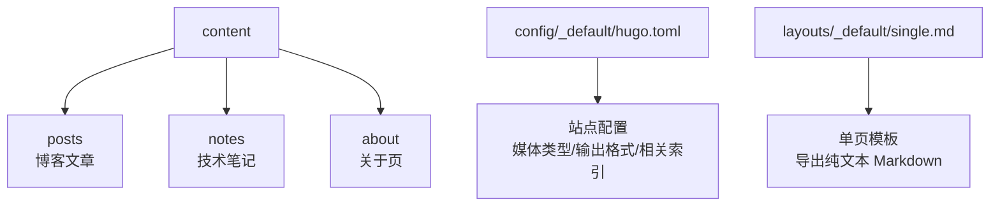
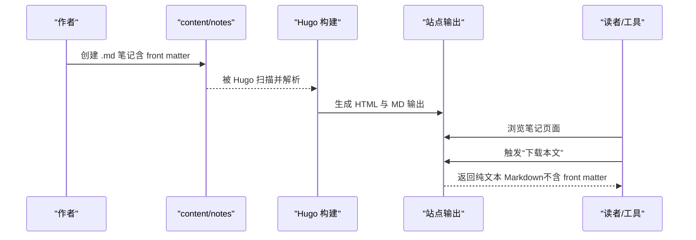
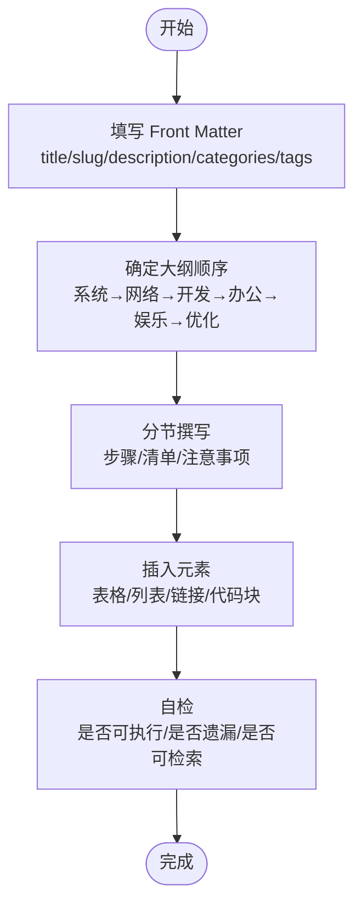
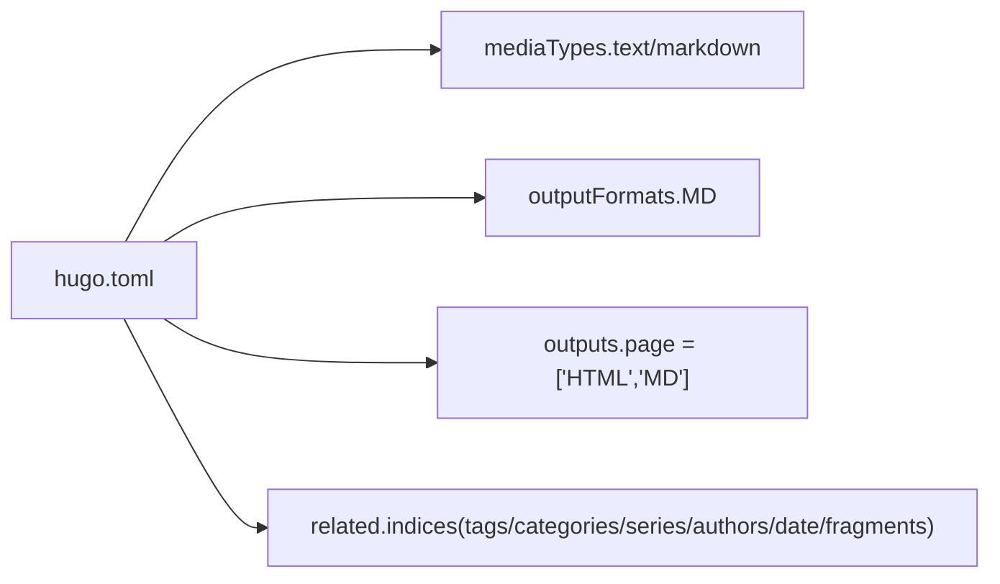
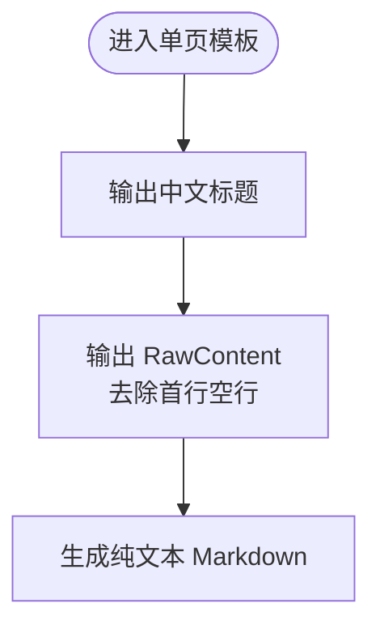
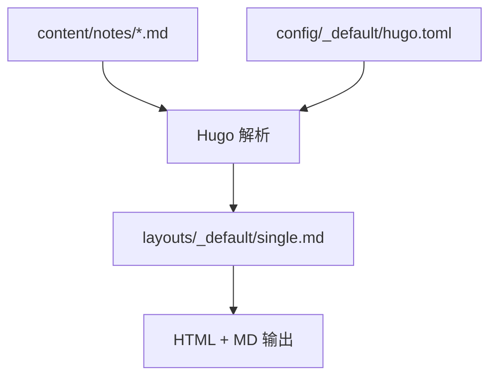

# 技术笔记管理

<cite>
**本文引用的文件**   
- [content/notes/_index.md](file://content/notes/_index.md)
- [content/notes/新电脑开荒备忘录.md](file://content/notes/新电脑开荒备忘录.md)
- [config/_default/hugo.toml](file://config/_default/hugo.toml)
- [layouts/_default/single.md](file://layouts/_default/single.md)
</cite>

## 目录
1. [引言](#引言)
2. [项目结构](#项目结构)
3. [核心组件](#核心组件)
4. [架构总览](#架构总览)
5. [详细组件分析](#详细组件分析)
6. [依赖关系分析](#依赖关系分析)
7. [性能与可维护性建议](#性能与可维护性建议)
8. [故障排查指南](#故障排查指南)
9. [结论](#结论)
10. [附录：写作规范与示例清单](#附录写作规范与示例清单)

## 引言
本技术笔记管理文档面向 notes 目录下的“备忘”类内容，目标是帮助读者理解并高效使用个人技术笔记。与技术博客文章相比，笔记更偏向个人记录、快速备忘和碎片化知识整理；博客文章则更注重完整性、可读性与对外传播价值。

在 Hugo 站点中，notes 目录用于承载轻量级、实用性的备忘条目，强调简洁、直接、可检索。通过统一的命名规范、标签体系与 Markdown 语法，笔记可以形成稳定的个人知识库，便于后续复用与迁移。

## 项目结构
在本仓库中，内容位于 content 目录下，其中：
- content/posts：博客文章（完整、系统、适合对外发布）
- content/notes：技术笔记（碎片化、个人备忘、快速记录）
- content/about：关于页面

**图示来源**
- [config/_default/hugo.toml:35-47](file://config/_default/hugo.toml#L35-L47)
- [layouts/_default/single.md:1-5](file://layouts/_default/single.md#L1-L5)

**章节来源**
- [config/_default/hugo.toml:1-78](file://config/_default/hugo.toml#L1-L78)

## 核心组件
- 笔记入口页：content/notes/_index.md 作为“备忘”列表的标题与描述。
- 笔记正文：content/notes/*.md 为具体笔记条目，采用标准 Markdown + Front Matter。
- 站点配置：config/_default/hugo.toml 定义媒体类型、输出格式和相关索引策略。
- 单页模板：layouts/_default/single.md 将每篇单页以中文标题开头输出纯文本 Markdown，支持“下载本文”。

这些组件共同支撑了“创建—组织—渲染—导出”的笔记工作流。

**章节来源**
- [content/notes/_index.md:1-5](file://content/notes/_index.md#L1-L5)
- [content/notes/新电脑开荒备忘录.md:1-10](file://content/notes/新电脑开荒备忘录.md#L1-L10)
- [config/_default/hugo.toml:35-47](file://config/_default/hugo.toml#L35-L47)
- [layouts/_default/single.md:1-5](file://layouts/_default/single.md#L1-L5)

## 架构总览
下图展示了从“编写笔记”到“生成站点”的关键路径，以及“下载本文”功能的实现位置。

**图示来源**
- [content/notes/_index.md:1-5](file://content/notes/_index.md#L1-L5)
- [content/notes/新电脑开荒备忘录.md:1-10](file://content/notes/新电脑开荒备忘录.md#L1-L10)
- [config/_default/hugo.toml:35-47](file://config/_default/hugo.toml#L35-L47)
- [layouts/_default/single.md:1-5](file://layouts/_default/single.md#L1-L5)

## 详细组件分析

### 笔记入口页：content/notes/_index.md
- 作用：为“备忘”栏目提供标题与描述，作为笔记列表的入口。
- 特点：极简结构，仅包含必要的元数据，避免冗余信息。
- 建议：保持标题与描述清晰，便于导航与 SEO。

**章节来源**
- [content/notes/_index.md:1-5](file://content/notes/_index.md#L1-L5)

### 笔记正文：content/notes/新电脑开荒备忘录.md
- 结构：Front Matter + 正文。正文按“系统 → 网络 → 开发 → 办公 → 娱乐 → 优化”的顺序展开，体现“流程化清单”的写作模式。
- 元素：
  - 表格：用于软件清单与用途说明，便于对比与筛选。
  - 列表：步骤化记录，提升可操作性。
  - 链接：指向外部工具或资源，增强实用性。
- 元数据：title、slug、description、categories、tags 等字段完善，利于分类与检索。
- 风格：简洁、务实、可直接执行，符合“备忘”定位。

**图示来源**
- [content/notes/新电脑开荒备忘录.md:1-10](file://content/notes/新电脑开荒备忘录.md#L1-L10)
- [content/notes/新电脑开荒备忘录.md:12-191](file://content/notes/新电脑开荒备忘录.md#L12-L191)

**章节来源**
- [content/notes/新电脑开荒备忘录.md:1-191](file://content/notes/新电脑开荒备忘录.md#L1-L191)

### 站点配置：config/_default/hugo.toml
- 媒体类型与输出格式：
  - 启用 text/markdown 媒体类型，并定义 MD 输出格式，使每篇单页同时输出 HTML 与 MD。
- 输出目标：
  - page 输出包含 HTML 与 MD，满足“下载本文”需求。
- 相关索引：
  - 基于 tags、categories、series、authors、date、fragments 的相关文章索引，有助于跨内容发现。

**图示来源**
- [config/_default/hugo.toml:35-47](file://config/_default/hugo.toml#L35-L47)
- [config/_default/hugo.toml:49-77](file://config/_default/hugo.toml#L49-L77)

**章节来源**
- [config/_default/hugo.toml:35-77](file://config/_default/hugo.toml#L35-L77)

### 单页模板：layouts/_default/single.md
- 作用：为每篇单页输出以中文标题开头的纯文本 Markdown，不包含 front matter，便于“下载本文”功能直接使用。
- 行为：RawContent 即原始 Markdown 正文，配合 TrimLeft 去除多余换行。

**图示来源**
- [layouts/_default/single.md:1-5](file://layouts/_default/single.md#L1-L5)

**章节来源**
- [layouts/_default/single.md:1-5](file://layouts/_default/single.md#L1-L5)

## 依赖关系分析
- 内容与模板：
  - content/notes 下的 .md 文件由 Hugo 解析，并通过 layouts/_default/single.md 渲染为 HTML 与 MD。
- 配置与输出：
  - config/_default/hugo.toml 决定媒体类型、输出格式及相关索引策略，直接影响“下载本文”与内容关联能力。
- 主题与布局：
  - 站点使用 blowfish 主题，但本仓库对单页 MD 输出做了站点级覆盖，确保“下载本文”体验一致。

**图示来源**
- [config/_default/hugo.toml:35-47](file://config/_default/hugo.toml#L35-L47)
- [layouts/_default/single.md:1-5](file://layouts/_default/single.md#L1-L5)

**章节来源**
- [config/_default/hugo.toml:35-47](file://config/_default/hugo.toml#L35-L47)
- [layouts/_default/single.md:1-5](file://layouts/_default/single.md#L1-L5)

## 性能与可维护性建议
- 控制单篇长度：笔记应聚焦单一主题，避免过长导致阅读与维护成本上升。
- 合理使用表格与列表：结构化表达能显著提升可检索性与可执行性。
- 统一元数据：title、slug、description、categories、tags 保持一致性，便于搜索与聚合。
- 图片与附件：尽量使用相对路径，避免外链不稳定；必要时在笔记内注明来源与版本。
- 定期清理与归档：将过时或合并后的笔记进行归档，保持 notes 目录整洁。

[本节为通用建议，不直接分析具体文件]

## 故障排查指南
- “下载本文”无法获取 MD：
  - 检查 config/_default/hugo.toml 中的 mediaTypes 与 outputFormats.MD 是否启用。
  - 确认 outputs.page 包含 MD。
- 单页标题非中文：
  - 检查 layouts/_default/single.md 是否正确输出 .Title。
- 笔记未出现在“备忘”列表：
  - 确认 content/notes/_index.md 存在且未被标记为 draft。
  - 确认笔记文件的 front matter 中 draft=false。

**章节来源**
- [config/_default/hugo.toml:35-47](file://config/_default/hugo.toml#L35-L47)
- [layouts/_default/single.md:1-5](file://layouts/_default/single.md#L1-L5)
- [content/notes/_index.md:1-5](file://content/notes/_index.md#L1-L5)

## 结论
notes 目录下的技术笔记以“个人备忘、快速记录、碎片化知识”为核心定位，强调简洁实用与高可检索性。通过统一的 Front Matter、Markdown 语法与标签体系，结合 Hugo 的输出能力，笔记既能服务于个人知识沉淀，也能便捷地导出与分享。建议在写作时坚持“流程化清单、结构化表达、元数据完备”的原则，持续积累高质量的技术笔记。

[本节为总结性内容，不直接分析具体文件]

## 附录：写作规范与示例清单

### 笔记与博客的区别
- 笔记：个人记录、快速备忘、碎片化知识整理，强调可执行性与可检索性。
- 博客：完整叙述、逻辑严密、可读性强，适合对外传播与深度阅读。

[本节为概念性内容，不直接分析具体文件]

### 创建流程与命名规范
- 创建流程：
  1) 在 content/notes 下新建 .md 文件。
  2) 填写 Front Matter：title、slug、description、categories、tags。
  3) 按“问题/场景 → 步骤/清单 → 注意事项/参考”的结构撰写。
  4) 插入必要元素：表格、列表、链接、代码块、截图。
  5) 自检：是否可执行、是否遗漏关键步骤、是否便于检索。
- 命名规范：
  - title：简明扼要，突出主题。
  - slug：英文小写+连字符，便于 URL 稳定。
  - description：一句话概括用途或范围。
  - categories：按领域划分（如“效率工具”“系统配置”）。
  - tags：关键词集合，便于检索与聚合。

**章节来源**
- [content/notes/新电脑开荒备忘录.md:1-10](file://content/notes/新电脑开荒备忘录.md#L1-L10)

### Markdown 语法与元素使用
- 标题层级：用 h2/h3 组织小节，保持层次清晰。
- 列表：步骤化记录优先使用有序/无序列表。
- 表格：用于软件清单、参数对照、选项对比。
- 链接：引用官方文档、工具主页或内部参考。
- 代码片段：标注语言、精简片段、附注释说明关键点。
- 截图：本地图片使用相对路径，必要时在图注中说明来源与版本。

**章节来源**
- [content/notes/新电脑开荒备忘录.md:12-191](file://content/notes/新电脑开荒备忘录.md#L12-L191)

### 组织与检索建议
- 文件夹结构：
  - content/notes：所有笔记集中存放，便于统一管理与检索。
- 命名约定：
  - 文件名使用 slug 对应，避免中文路径带来的兼容性问题。
- 关键词标记：
  - 充分利用 tags 与 categories，建立一致的词表，避免同义多词。
- 交叉引用：
  - 在笔记中引用其他笔记或外部资源，形成知识网络。

**章节来源**
- [config/_default/hugo.toml:49-77](file://config/_default/hugo.toml#L49-L77)

### 实际笔记示例（不同类型）
- 清单型笔记：如“新电脑开荒备忘录”，按流程分节，辅以表格与列表，强调可执行性。
- 要点型笔记：针对某个技术点，列出关键步骤、注意事项与参考链接。
- 排障型笔记：记录问题现象、根因分析与解决步骤，便于复现与回溯。

**章节来源**
- [content/notes/新电脑开荒备忘录.md:12-191](file://content/notes/新电脑开荒备忘录.md#L12-L191)