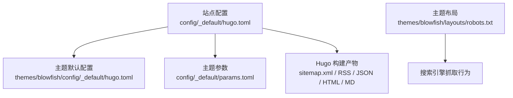
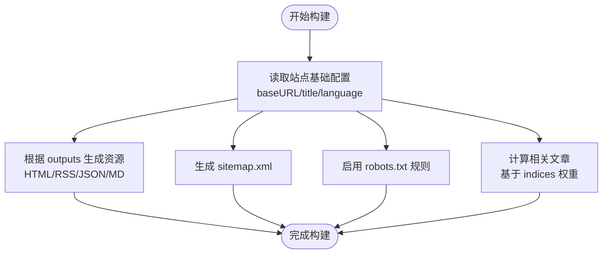
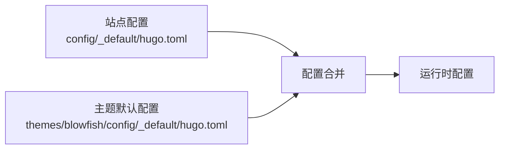

# Hugo 核心配置

<cite>
**本文引用的文件**   
- [config/_default/hugo.toml](file://config/_default/hugo.toml)
- [themes/blowfish/config/_default/hugo.toml](file://themes/blowfish/config/_default/hugo.toml)
- [config/_default/params.toml](file://config/_default/params.toml)
- [themes/blowfish/layouts/robots.txt](file://themes/blowfish/layouts/robots.txt)
</cite>

## 目录
1. [简介](#简介)
2. [项目结构](#项目结构)
3. [核心组件](#核心组件)
4. [架构总览](#架构总览)
5. [详细组件分析](#详细组件分析)
6. [依赖关系分析](#依赖关系分析)
7. [性能与构建优化](#性能与构建优化)
8. [故障排查指南](#故障排查指南)
9. [结论](#结论)
10. [附录：常用配置模板](#附录常用配置模板)

## 简介
本文件面向希望系统掌握 Hugo 核心配置的读者，围绕站点根目录下的 config/_default/hugo.toml 展开，结合主题默认配置与布局中的 robots.txt，全面说明以下能力：
- 站点基础设置（如 baseURL、title、languageCode）
- SEO 相关（meta 标签、sitemap、robots.txt）
- 输出格式（rss、json、html、markdown）
- 相关文章算法（related 与 newIndexes/indices）
- 各配置项的作用、默认值、可选值与最佳实践
- 验证方法与性能优化建议

## 项目结构
本项目采用“站点配置 + 主题配置”的分层方式：
- 站点级核心配置位于 config/_default/hugo.toml
- 主题默认配置位于 themes/blowfish/config/_default/hugo.toml
- 主题参数位于 config/_default/params.toml
- robots.txt 由主题提供，位于 themes/blowfish/layouts/robots.txt

图表来源
- [config/_default/hugo.toml:1-78](file://config/_default/hugo.toml#L1-L78)
- [themes/blowfish/config/_default/hugo.toml:1-70](file://themes/blowfish/config/_default/hugo.toml#L1-L70)
- [config/_default/params.toml:1-88](file://config/_default/params.toml#L1-L88)
- [themes/blowfish/layouts/robots.txt:1-8](file://themes/blowfish/layouts/robots.txt#L1-L8)

章节来源
- [config/_default/hugo.toml:1-78](file://config/_default/hugo.toml#L1-L78)
- [themes/blowfish/config/_default/hugo.toml:1-70](file://themes/blowfish/config/_default/hugo.toml#L1-L70)
- [config/_default/params.toml:1-88](file://config/_default/params.toml#L1-L88)
- [themes/blowfish/layouts/robots.txt:1-8](file://themes/blowfish/layouts/robots.txt#L1-L8)

## 核心组件
本节聚焦 hugo.toml 中与“核心功能”直接相关的配置段：
- 站点基础：baseURL、title、theme、defaultContentLanguage、enableRobotsTXT、summaryLength、hasCJKLanguage、enableGitInfo、buildDrafts、buildFuture、enableEmoji
- 分页与图像：[pagination]、[imaging]
- 分类法：[taxonomies]
- 站点地图：[sitemap]
- 媒体类型与输出格式：[mediaTypes]、[outputFormats]、[outputs]
- 相关文章：[related] 与 [[related.indices]]

章节来源
- [config/_default/hugo.toml:1-78](file://config/_default/hugo.toml#L1-L78)

## 架构总览
下图展示从配置到产物的关键路径：站点基础信息驱动页面渲染；sitemap 与 robots.txt 影响搜索引擎收录；outputs 决定生成哪些资源；related 控制文章关联推荐。

图表来源
- [config/_default/hugo.toml:29-47](file://config/_default/hugo.toml#L29-L47)
- [themes/blowfish/layouts/robots.txt:1-8](file://themes/blowfish/layouts/robots.txt#L1-L8)

## 详细组件分析

### 站点基础设置
- baseURL：站点根地址，SEO 与链接生成的基础。务必与实际部署域名一致。
- title：站点标题，用于页面 <title> 与部分 meta。
- theme：当前使用的主题名称。
- defaultContentLanguage：默认内容语言代码（如 zh-cn）。
- enableRobotsTXT：是否启用 robots.txt 生成。
- summaryLength：摘要长度（字符数），影响列表页摘要显示。
- hasCJKLanguage：是否为中日韩语言，影响分词与摘要统计。
- enableGitInfo：是否启用 Git 信息（作者、提交时间等）。
- buildDrafts/buildFuture：是否构建草稿或未来发布的内容。
- enableEmoji：是否启用 Emoji 支持。

最佳实践
- 生产环境关闭 buildDrafts 与 buildFuture，避免泄露未发布内容。
- 使用 hasCJKLanguage = true 提升中文摘要质量。
- 开启 enableGitInfo 便于在文章中显示作者与更新时间。

章节来源
- [config/_default/hugo.toml:1-16](file://config/_default/hugo.toml#L1-L16)

### SEO 优化配置（meta、sitemap、robots.txt）
- sitemap：控制站点地图的更新频率、文件名与优先级。
- robots.txt：由主题提供，生产环境允许抓取并声明 sitemap 地址，开发环境禁止抓取。

注意
- 若需自定义 robots.txt，可在站点 layouts 下覆盖主题同名文件。
- sitemap 的 filename 可自定义，但需确保与 robots.txt 中声明一致。

章节来源
- [config/_default/hugo.toml:29-32](file://config/_default/hugo.toml#L29-L32)
- [themes/blowfish/layouts/robots.txt:1-8](file://themes/blowfish/layouts/robots.txt#L1-L8)

### 输出格式配置（rss、json、html、md）
- mediaTypes：为 text/markdown 定义后缀 md，使 Markdown 源可作为独立输出。
- outputFormats：定义 MD 输出格式的属性（纯文本、非替代格式等）。
- outputs：
  - home：首页输出 HTML、RSS、JSON
  - page：文章输出 HTML、MD

最佳实践
- 如需下载原文，保留 page 的 MD 输出。
- 若不需要 RSS/JSON，可移除对应输出以缩短构建时间。

章节来源
- [config/_default/hugo.toml:35-47](file://config/_default/hugo.toml#L35-L47)

### 相关文章算法（related 与 newIndexes/indices）
- related.threshold：相似度阈值，0 表示不限制。
- related.toLower：是否将关键词转为小写。
- related.indices：定义索引字段及其权重，常见字段包括 tags、categories、series、authors、date、fragmentrefs（片段引用）。

权重策略
- 高权重字段（如 tags/categories）优先匹配，低权重字段（如 date）作为补充。
- fragmentrefs 通过 applyFilter=false 参与计算，增强基于文档片段的相关性。

章节来源
- [config/_default/hugo.toml:49-78](file://config/_default/hugo.toml#L49-L78)

### 分页与图像
- pagination.pagerSize：每页条目数。
- imaging.anchor：图片裁剪锚点（Center 居中）。

章节来源
- [config/_default/hugo.toml:17-22](file://config/_default/hugo.toml#L17-L22)

### 分类法（taxonomies）
- tag/category/author/series：映射 front matter 中的分类键名到 URL 路径。

章节来源
- [config/_default/hugo.toml:23-28](file://config/_default/hugo.toml#L23-L28)

## 依赖关系分析
站点配置与主题默认配置存在合并关系：站点 hugo.toml 会覆盖主题同名配置。例如：
- outputs.home：站点定义为 ["HTML","RSS","JSON"]，主题默认为 ["HTML","RSS","JSON"]，两者一致。
- related.indices：站点与主题均定义了相似的多字段权重，站点配置生效。

图表来源
- [config/_default/hugo.toml:38-47](file://config/_default/hugo.toml#L38-L47)
- [themes/blowfish/config/_default/hugo.toml:38-40](file://themes/blowfish/config/_default/hugo.toml#L38-L40)

章节来源
- [config/_default/hugo.toml:38-47](file://config/_default/hugo.toml#L38-L47)
- [themes/blowfish/config/_default/hugo.toml:38-40](file://themes/blowfish/config/_default/hugo.toml#L38-L40)

## 性能与构建优化
- 关闭不必要的输出：若无需 RSS/JSON，可从 outputs.home 中移除以减少构建开销。
- 控制摘要长度：summaryLength 越大，摘要生成越慢；合理设置以提升列表页渲染速度。
- 禁用草稿与未来内容：确保 buildDrafts=false、buildFuture=false。
- 合理使用 related.indices：减少无关字段或降低权重，可降低相关性计算成本。
- 图片处理：imaging.anchor 固定为 Center，避免复杂裁剪逻辑带来的额外开销。

## 故障排查指南
- robots.txt 未生效
  - 确认 enableRobotsTXT=true。
  - 检查主题是否提供 layouts/robots.txt，必要时在站点 layouts 下覆盖。
- sitemap 未生成或路径错误
  - 核对 [sitemap].filename 与 robots.txt 中 Sitemap 声明一致。
- 相关文章为空或结果不理想
  - 检查 front matter 是否正确声明 tags/categories/series/authors。
  - 调整 related.indices 的权重与 threshold。
- 输出格式不符合预期
  - 核对 [outputs] 与 [outputFormats] 的定义，确保需要的格式已启用。

章节来源
- [themes/blowfish/layouts/robots.txt:1-8](file://themes/blowfish/layouts/robots.txt#L1-L8)
- [config/_default/hugo.toml:29-47](file://config/_default/hugo.toml#L29-L47)
- [config/_default/hugo.toml:49-78](file://config/_default/hugo.toml#L49-L78)

## 结论
通过对 hugo.toml 的系统梳理，可以清晰理解站点基础、SEO、输出格式与相关文章算法的配置要点。结合主题默认配置与 robots.txt，能够在保证 SEO 的同时，灵活控制构建产物与性能表现。建议在真实环境中逐步调优，并通过构建日志与产物校验来验证配置效果。

## 附录：常用配置模板
以下为常见场景的配置思路与要点（不直接粘贴具体配置内容，仅给出结构与建议）：

- 最小化站点配置
  - 仅启用必要的 outputs（如只保留 HTML）。
  - 关闭 RSS/JSON 输出以加速构建。
  - 保持 sitemap 与 robots.txt 默认即可。

- 多语言站点
  - 设置 defaultContentLanguage 为默认语言。
  - 在各语言目录下提供对应的 content 与菜单配置。
  - 确保 baseURL 指向实际部署域名。

- 强化 SEO
  - 启用 enableRobotsTXT。
  - 配置 [sitemap] 的 changefreq 与 priority。
  - 在主题参数中完善 OG/Twitter Card 的默认社交图。

- 相关文章优化
  - 提高 tags/categories 权重，降低 date 权重。
  - 对 fragmentrefs 启用 type=fragments 并设置较低权重。
  - 调整 threshold 以过滤低相关度结果。

章节来源
- [config/_default/hugo.toml:1-78](file://config/_default/hugo.toml#L1-L78)
- [themes/blowfish/config/_default/hugo.toml:1-70](file://themes/blowfish/config/_default/hugo.toml#L1-L70)
- [config/_default/params.toml:1-88](file://config/_default/params.toml#L1-L88)
- [themes/blowfish/layouts/robots.txt:1-8](file://themes/blowfish/layouts/robots.txt#L1-L8)