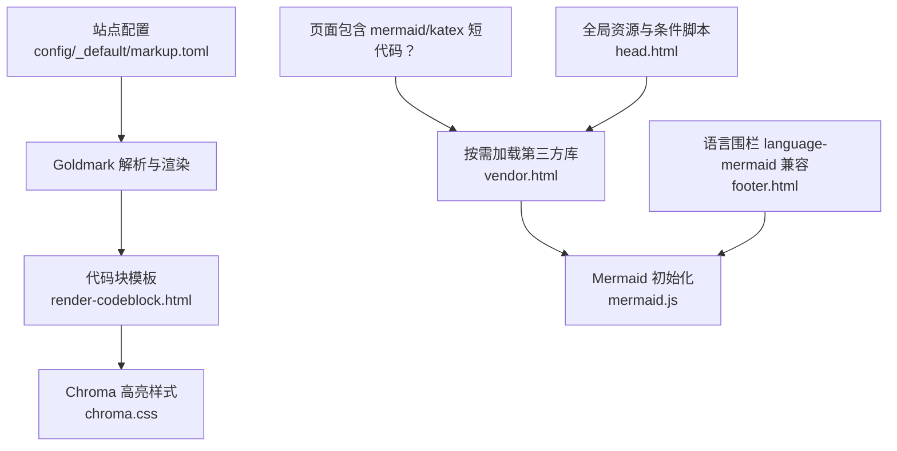
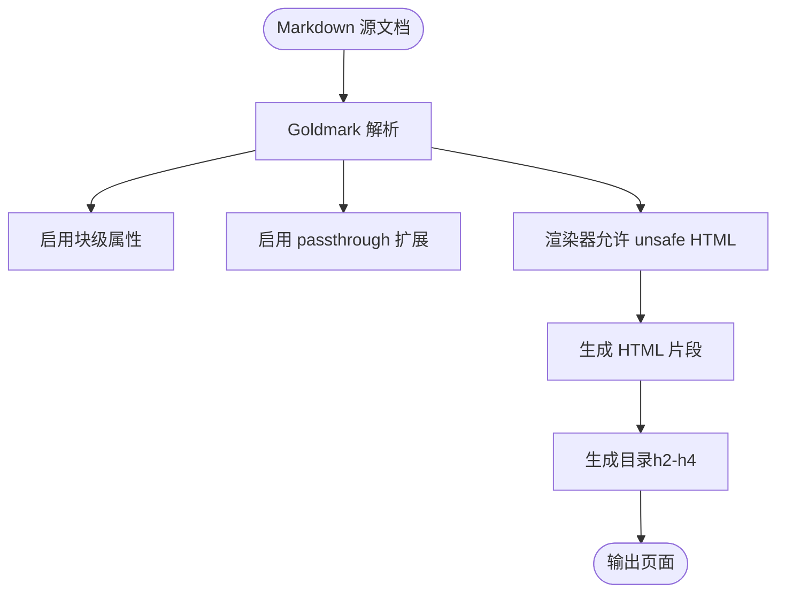
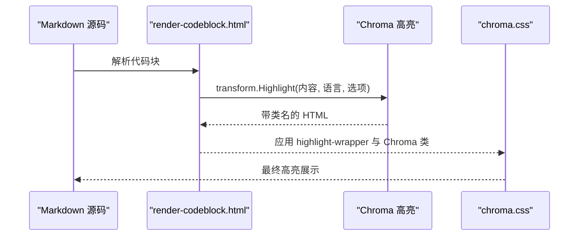
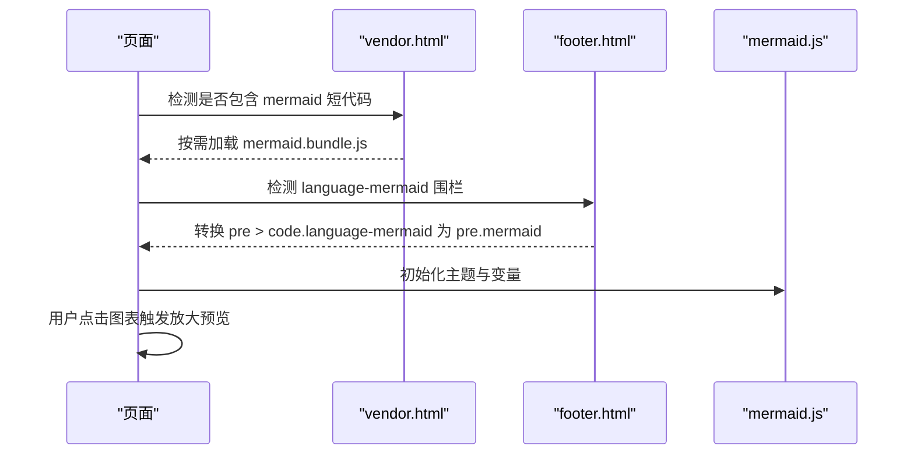
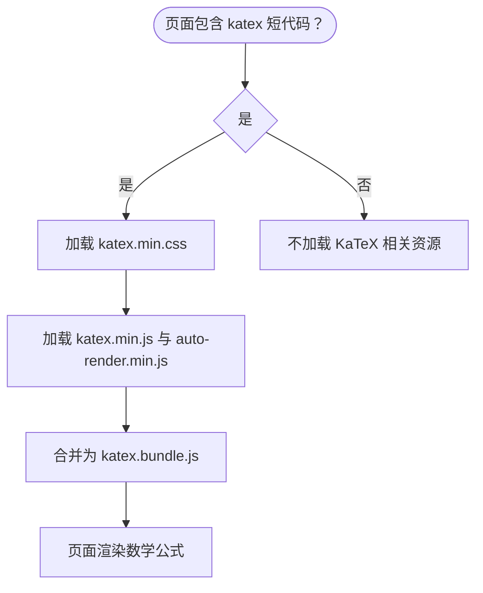
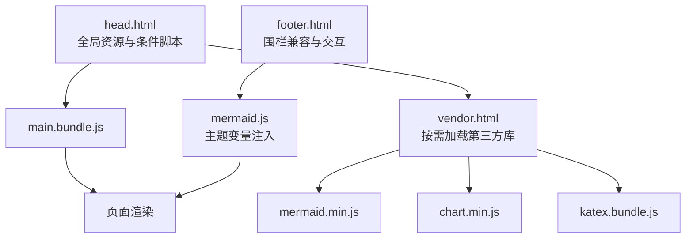

# Markdown 渲染配置

<cite>
**本文引用的文件**   
- [config/_default/markup.toml](file://config/_default/markup.toml)
- [themes/blowfish/assets/js/mermaid.js](file://themes/blowfish/assets/js/mermaid.js)
- [themes/blowfish/layouts/_default/_markup/render-codeblock.html](file://themes/blowfish/layouts/_default/_markup/render-codeblock.html)
- [themes/blowfish/assets/css/components/chroma.css](file://themes/blowfish/assets/css/components/chroma.css)
- [themes/blowfish/layouts/partials/vendor.html](file://themes/blowfish/layouts/partials/vendor.html)
- [layouts/partials/footer.html](file://layouts/partials/footer.html)
- [themes/blowfish/layouts/partials/head.html](file://themes/blowfish/layouts/partials/head.html)
</cite>

## 目录
1. [简介](#简介)
2. [项目结构与定位](#项目结构与定位)
3. [核心渲染配置总览](#核心渲染配置总览)
4. [Goldmark 渲染器详解](#goldmark-渲染器详解)
5. [代码高亮与主题](#代码高亮与主题)
6. [Mermaid 图表渲染配置](#mermaid-图表渲染配置)
7. [数学公式支持（KaTeX）](#数学公式支持katex)
8. [富文本编辑与写作最佳实践](#富文本编辑与写作最佳实践)
9. [依赖关系与加载流程](#依赖关系与加载流程)
10. [性能优化建议](#性能优化建议)
11. [常见问题排查](#常见问题排查)
12. [结论](#结论)

## 简介
本文围绕仓库中的 Markdown 渲染配置，系统性说明 markup.toml 中 Goldmark 渲染器的各项设置，并扩展讲解代码高亮、Mermaid 图表、数学公式、交互能力与性能优化。目标是帮助开发者在 Hugo + Blowfish 主题环境下，获得稳定、高性能且体验良好的 Markdown 写作与阅读效果。

## 项目结构与定位
本项目的 Markdown 渲染由以下部分共同完成：
- 站点级渲染配置位于 config/_default/markup.toml，定义 Goldmark 解析、渲染、扩展以及代码高亮行为。
- 代码块渲染模板位于 themes/blowfish/layouts/_default/_markup/render-codeblock.html，负责包装标题与调用语法高亮。
- 代码高亮样式位于 themes/blowfish/assets/css/components/chroma.css，提供明暗两套 Chroma 主题样式。
- Mermaid 图表初始化逻辑位于 themes/blowfish/assets/js/mermaid.js，并根据主题变量动态适配明暗模式。
- 按需加载第三方库（Mermaid、KaTeX 等）的逻辑位于 themes/blowfish/layouts/partials/vendor.html。
- 对 language-mermaid 围栏的兼容处理与放大预览逻辑位于 layouts/partials/footer.html。
- 全局资源加载与条件脚本注入位于 themes/blowfish/layouts/partials/head.html。



**图示来源**  
- [config/_default/markup.toml:1-31](file://config/_default/markup.toml#L1-L31)
- [themes/blowfish/layouts/_default/_markup/render-codeblock.html:1-11](file://themes/blowfish/layouts/_default/_markup/render-codeblock.html#L1-L11)
- [themes/blowfish/assets/css/components/chroma.css:1-208](file://themes/blowfish/assets/css/components/chroma.css#L1-L208)
- [themes/blowfish/layouts/partials/vendor.html:1-49](file://themes/blowfish/layouts/partials/vendor.html#L1-L49)
- [themes/blowfish/assets/js/mermaid.js:1-34](file://themes/blowfish/assets/js/mermaid.js#L1-L34)
- [layouts/partials/footer.html:78-199](file://layouts/partials/footer.html#L78-L199)
- [themes/blowfish/layouts/partials/head.html:178-211](file://themes/blowfish/layouts/partials/head.html#L178-L211)

**章节来源**  
- [config/_default/markup.toml:1-31](file://config/_default/markup.toml#L1-L31)
- [themes/blowfish/layouts/_default/_markup/render-codeblock.html:1-11](file://themes/blowfish/layouts/_default/_markup/render-codeblock.html#L1-L11)
- [themes/blowfish/assets/css/components/chroma.css:1-208](file://themes/blowfish/assets/css/components/chroma.css#L1-L208)
- [themes/blowfish/layouts/partials/vendor.html:1-49](file://themes/blowfish/layouts/partials/vendor.html#L1-L49)
- [themes/blowfish/assets/js/mermaid.js:1-34](file://themes/blowfish/assets/js/mermaid.js#L1-L34)
- [layouts/partials/footer.html:78-199](file://layouts/partials/footer.html#L78-L199)
- [themes/blowfish/layouts/partials/head.html:178-211](file://themes/blowfish/layouts/partials/head.html#L178-L211)

## 核心渲染配置总览
- Goldmark 解析器：关闭将独立图片包裹进段落的行为；启用块级属性；开启 passthrough 扩展以支持自定义数学公式定界符。
- Goldmark 渲染器：允许 unsafe HTML，便于嵌入外部内容或复杂结构。
- 代码高亮：使用 Chroma，开启行号，采用内联行号而非表格行号以避免长代码被裁切。
- 目录生成：默认从二级标题到四级标题生成目录。

这些设置在 config/_default/markup.toml 中集中管理，是后续所有渲染能力的基石。

**章节来源**  
- [config/_default/markup.toml:4-27](file://config/_default/markup.toml#L4-L27)

## Goldmark 渲染器详解
### 解析器选项
- wrapStandAloneImageWithinParagraph=false：避免自动把独立图片包裹进段落，保持语义清晰。
- parser.attribute.block=true：启用块级属性，为高级排版和样式控制提供基础。
- extensions.passthrough.enable=true：启用 passthrough 扩展，配合自定义 block/inline 定界符，实现更灵活的数学公式与扩展语法。

### 渲染器选项
- renderer.unsafe=true：允许 unsafe HTML，适合需要嵌入复杂 HTML 结构的场景。若需严格安全策略，可关闭此选项并改用受控的 shortcode 或组件。

### 目录生成
- tableOfContents.startLevel=2、endLevel=4：目录从二级标题开始，到四级标题结束，平衡可读性与信息密度。



**图示来源**  
- [config/_default/markup.toml:4-20](file://config/_default/markup.toml#L4-L20)
- [config/_default/markup.toml:28-31](file://config/_default/markup.toml#L28-L31)

**章节来源**  
- [config/_default/markup.toml:4-20](file://config/_default/markup.toml#L4-L20)
- [config/_default/markup.toml:28-31](file://config/_default/markup.toml#L28-L31)

## 代码高亮与主题
### 高亮引擎与行号
- 使用 Chroma 进行语法高亮。
- lineNos=true：开启行号显示。
- lineNumbersInTable=false：使用内联行号，避免表格模式下 .lntable{overflow:hidden} 导致长代码被裁切。
- noClasses=false：保留 Chroma 生成的类名，便于通过 CSS 定制样式。

### 代码块模板
- render-codeblock.html 负责：
  - 读取代码块的 title 属性作为标题。
  - 使用 transform.Highlight 调用 Chroma 高亮。
  - 用 highlight-wrapper 容器统一样式，支持标题栏与阴影圆角。

### 主题与样式
- chroma.css 提供明暗两套 Chroma 主题样式，分别对应 github 与 github-dark 风格。
- 可通过覆盖 chroma.css 或使用 assets/css/custom.css 追加样式，实现自定义主题色、字体、行高、边框等。



**图示来源**  
- [themes/blowfish/layouts/_default/_markup/render-codeblock.html:1-11](file://themes/blowfish/layouts/_default/_markup/render-codeblock.html#L1-L11)
- [themes/blowfish/assets/css/components/chroma.css:1-208](file://themes/blowfish/assets/css/components/chroma.css#L1-L208)

**章节来源**  
- [config/_default/markup.toml:21-27](file://config/_default/markup.toml#L21-L27)
- [themes/blowfish/layouts/_default/_markup/render-codeblock.html:1-11](file://themes/blowfish/layouts/_default/_markup/render-codeblock.html#L1-L11)
- [themes/blowfish/assets/css/components/chroma.css:1-208](file://themes/blowfish/assets/css/components/chroma.css#L1-L208)

## Mermaid 图表渲染配置
### 初始化与主题
- mermaid.js 提供两个初始化函数：
  - initMermaidLight：使用 base 主题，并通过 CSS 变量注入主题色、边框色、背景色、字体族与字号。
  - initMermaidDark：使用 dark 主题，同样注入字体族与字号。
- 通过 getComputedStyle 读取 CSS 变量，确保图表颜色与站点主题一致。

### 按需加载
- vendor.html 检测页面是否包含 mermaid 短代码，若包含则合并 mermaid.min.js 与 mermaid.js 并生成 bundle，延迟加载。
- footer.html 额外支持 ```language-mermaid 围栏语法，无需 shortcode 也能渲染。

### 交互功能
- 点击放大预览：footer.html 中对 pre.mermaid 添加点击事件，打开全屏遮罩查看完整分辨率 SVG，并在明暗切换或重渲染时自动关闭遮罩。
- 无障碍与键盘支持：遮罩层具备 role="dialog" 与 aria-label，支持 Escape 键关闭。



**图示来源**  
- [themes/blowfish/layouts/partials/vendor.html:1-12](file://themes/blowfish/layouts/partials/vendor.html#L1-L12)
- [layouts/partials/footer.html:78-199](file://layouts/partials/footer.html#L78-L199)
- [themes/blowfish/assets/js/mermaid.js:1-34](file://themes/blowfish/assets/js/mermaid.js#L1-L34)

**章节来源**  
- [themes/blowfish/assets/js/mermaid.js:1-34](file://themes/blowfish/assets/js/mermaid.js#L1-L34)
- [themes/blowfish/layouts/partials/vendor.html:1-12](file://themes/blowfish/layouts/partials/vendor.html#L1-L12)
- [layouts/partials/footer.html:78-199](file://layouts/partials/footer.html#L78-L199)

## 数学公式支持（KaTeX）
### 定界符与扩展
- markup.toml 中启用 goldmark.extensions.passthrough，并定义 block 与 inline 定界符：
  - block: ['\[', '\]'], ['$$', '$$']
  - inline: ['\(', '\)']
- 这为 KaTeX 渲染提供了灵活的可扩展入口。

### 按需加载
- vendor.html 检测页面是否包含 katex 短代码，若包含则加载 katex.min.css、katex.min.js 与 auto-render.min.js，并合并为 katex.bundle.js。
- head.html 始终引入 katex-render.js，用于页面级别的公式渲染协调。



**图示来源**  
- [config/_default/markup.toml:14-19](file://config/_default/markup.toml#L14-L19)
- [themes/blowfish/layouts/partials/vendor.html:27-49](file://themes/blowfish/layouts/partials/vendor.html#L27-L49)
- [themes/blowfish/layouts/partials/head.html:194-194](file://themes/blowfish/layouts/partials/head.html#L194-L194)

**章节来源**  
- [config/_default/markup.toml:14-19](file://config/_default/markup.toml#L14-L19)
- [themes/blowfish/layouts/partials/vendor.html:27-49](file://themes/blowfish/layouts/partials/vendor.html#L27-L49)
- [themes/blowfish/layouts/partials/head.html:194-194](file://themes/blowfish/layouts/partials/head.html#L194-L194)

## 富文本编辑与写作最佳实践
- 代码块：
  - 使用代码围栏并指定语言以获得最佳高亮效果。
  - 如需标题，可在代码围栏中添加 title 属性，模板会自动渲染标题栏。
  - 行号已开启，注意长代码建议使用内联行号（当前已配置），避免表格模式下的裁剪问题。
- 图表：
  - 推荐使用  短代码，或在代码围栏中使用 ```language-mermaid。
  - 图表主题会自动跟随站点明暗模式，无需手动切换。
- 数学公式：
  - 使用 $$...$$ 或 \[...\] 表示块级公式，使用 $...$ 或 \(...\) 表示行内公式。
  - 仅在页面包含 katex 短代码时才会加载 KaTeX 资源，减少首屏体积。
- 目录与导航：
  - 合理组织 h2-h4 标题层级，以获得清晰的目录结构。
- 安全性：
  - 若不需要 unsafe HTML，可将 renderer.unsafe 设为 false，并尽量使用主题提供的 shortcode 与组件。

[本节为通用实践建议，不直接分析具体文件]

## 依赖关系与加载流程
- head.html 负责：
  - 根据站点参数决定是否加载搜索、复制按钮、RTL、阅读进度等脚本。
  - 始终引入 katex-render.js。
  - 将多个脚本合并为 main.bundle.js 并延迟加载。
- vendor.html 负责：
  - 检测页面是否包含特定短代码（mermaid、chart、katex、typeit、gallery、carousel/timeline、youtubeLite、tabs 等）。
  - 按需加载对应库与样式，并进行压缩与指纹化。
- footer.html 负责：
  - 兼容 language-mermaid 围栏语法。
  - 提供图表点击放大与无障碍支持。



**图示来源**  
- [themes/blowfish/layouts/partials/head.html:178-211](file://themes/blowfish/layouts/partials/head.html#L178-L211)
- [themes/blowfish/layouts/partials/vendor.html:1-49](file://themes/blowfish/layouts/partials/vendor.html#L1-L49)
- [layouts/partials/footer.html:78-199](file://layouts/partials/footer.html#L78-L199)
- [themes/blowfish/assets/js/mermaid.js:1-34](file://themes/blowfish/assets/js/mermaid.js#L1-L34)

**章节来源**  
- [themes/blowfish/layouts/partials/head.html:178-211](file://themes/blowfish/layouts/partials/head.html#L178-L211)
- [themes/blowfish/layouts/partials/vendor.html:1-49](file://themes/blowfish/layouts/partials/vendor.html#L1-L49)
- [layouts/partials/footer.html:78-199](file://layouts/partials/footer.html#L78-L199)

## 性能优化建议
- 按需加载：
  - 仅当页面包含相应短代码时才加载 Mermaid、KaTeX、Chart 等库，避免不必要的体积。
- 资源压缩与指纹：
  - vendor.html 对所有第三方库进行 minify 与 fingerprint，提升缓存命中率与安全性。
- 延迟加载：
  - 非关键脚本使用 defer 加载，减少阻塞渲染。
- 目录与内容体量：
  - 合理使用标题层级，避免过深目录导致 DOM 过大。
- 代码块优化：
  - 避免超长代码块影响首屏渲染；必要时拆分或外链托管。
- 明暗模式切换：
  - Mermaid 与 KaTeX 的重渲染逻辑已在模板中考虑，避免重复初始化带来的性能损耗。

[本节为通用性能建议，不直接分析具体文件]

## 常见问题排查
- 代码高亮未生效：
  - 检查代码围栏是否正确标注语言。
  - 确认 render-codeblock.html 正常调用 transform.Highlight。
  - 检查 chroma.css 是否被正确引入。
- 行号异常或被裁切：
  - 确认 lineNumbersInTable=false，使用内联行号。
  - 检查 highlight-wrapper 与 .chroma .lntable 的样式冲突。
- Mermaid 图表不显示：
  - 确认页面包含 mermaid 短代码或 ```language-mermaid 围栏。
  - 检查 vendor.html 是否按需加载了 mermaid.bundle.js。
  - 检查 mermaid.js 是否正确初始化主题变量。
- 数学公式不渲染：
  - 确认页面包含 katex 短代码。
  - 检查 vendor.html 是否加载了 katex.bundle.js。
  - 检查定界符是否与 markup.toml 中 passthrough 配置一致。
- 图表点击放大无效：
  - 检查 footer.html 中 pre.mermaid 的事件委托逻辑。
  - 确认遮罩层未被其他样式覆盖。

**章节来源**  
- [themes/blowfish/layouts/_default/_markup/render-codeblock.html:1-11](file://themes/blowfish/layouts/_default/_markup/render-codeblock.html#L1-L11)
- [themes/blowfish/assets/css/components/chroma.css:1-208](file://themes/blowfish/assets/css/components/chroma.css#L1-L208)
- [themes/blowfish/layouts/partials/vendor.html:1-49](file://themes/blowfish/layouts/partials/vendor.html#L1-L49)
- [themes/blowfish/assets/js/mermaid.js:1-34](file://themes/blowfish/assets/js/mermaid.js#L1-L34)
- [layouts/partials/footer.html:78-199](file://layouts/partials/footer.html#L78-L199)
- [config/_default/markup.toml:14-19](file://config/_default/markup.toml#L14-L19)

## 结论
通过 config/_default/markup.toml 的 Goldmark 配置、Chroma 代码高亮、Mermaid 图表与 KaTeX 数学公式的按需加载与主题适配，本项目实现了稳定、高性能且体验良好的 Markdown 渲染体系。开发者可根据业务需求调整 Goldmark 解析与渲染选项、代码高亮主题、图表交互与公式定界符，并结合本文的最佳实践与故障排查指南，持续优化写作与阅读体验。

[本节为总结性内容，不直接分析具体文件]