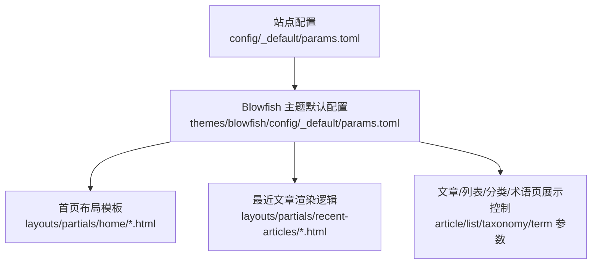
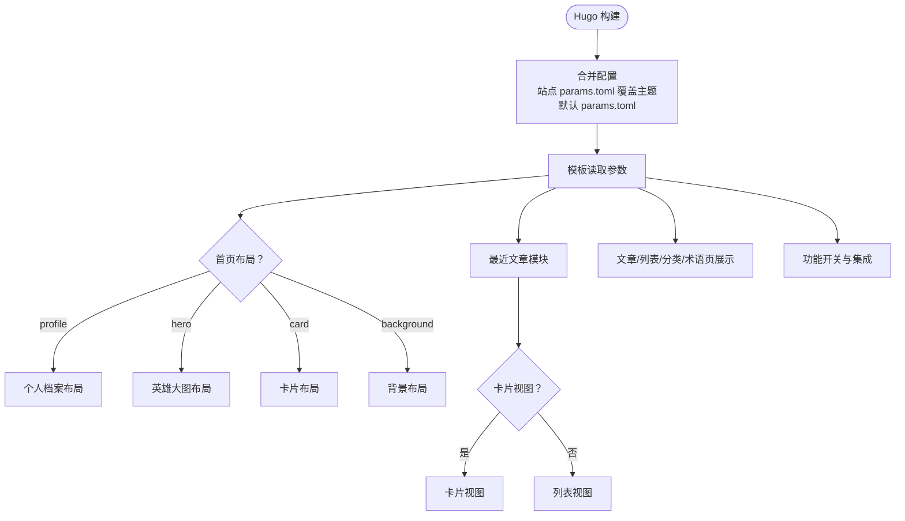
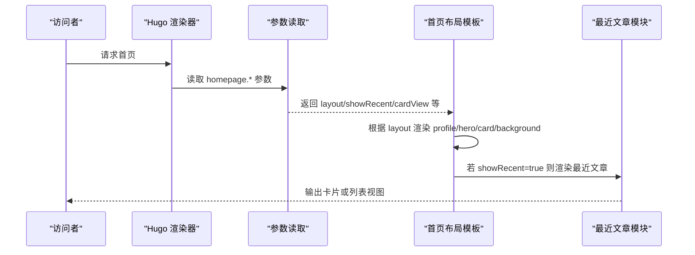
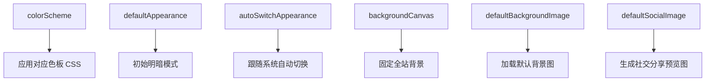
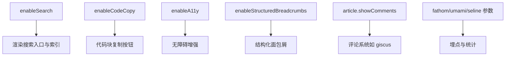
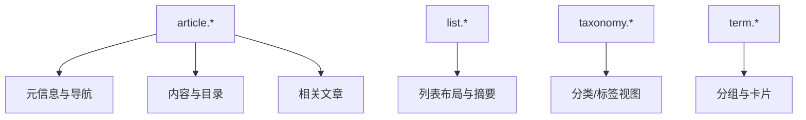
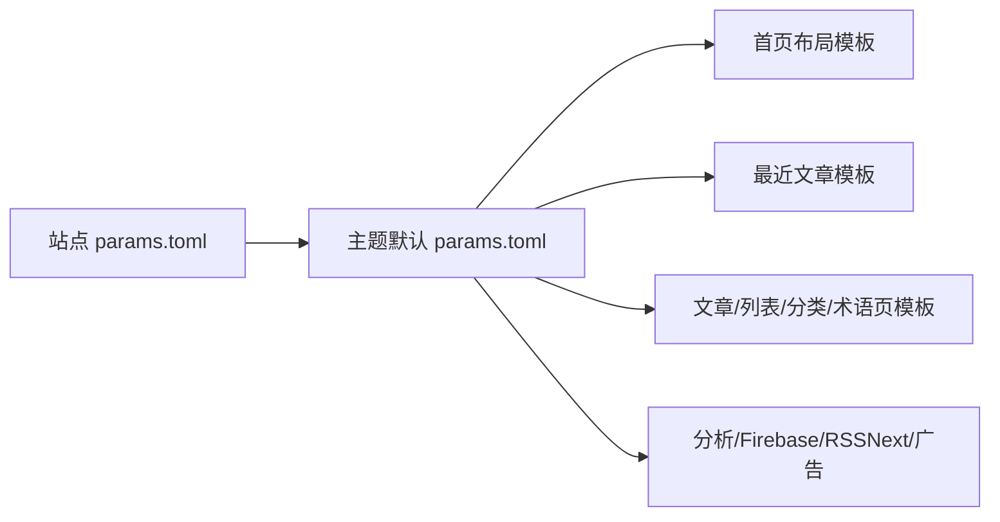

# 主题参数配置

<cite>
**本文引用的文件**   
- [项目主题参数配置文件](file://config/_default/params.toml)
- [Blowfish 主题默认参数模板](file://themes/blowfish/config/_default/params.toml)
- [首页个人档案布局模板](file://themes/blowfish/layouts/partials/home/profile.html)
- [首页英雄大图布局模板](file://themes/blowfish/layouts/partials/home/hero.html)
- [首页卡片布局模板](file://themes/blowfish/layouts/partials/home/card.html)
- [首页背景布局模板](file://themes/blowfish/layouts/partials/home/background.html)
- [首页最近文章主渲染逻辑](file://themes/blowfish/layouts/partials/recent-articles/main.html)
- [首页最近文章卡片视图模板](file://themes/blowfish/layouts/partials/recent-articles/cardview.html)
- [首页最近文章列表视图模板](file://themes/blowfish/layouts/partials/recent-articles/list.html)
</cite>

## 目录
1. [引言](#引言)
2. [项目结构](#项目结构)
3. [核心组件](#核心组件)
4. [架构总览](#架构总览)
5. [详细组件分析](#详细组件分析)
6. [依赖关系分析](#依赖关系分析)
7. [性能与体验建议](#性能与体验建议)
8. [故障排查指南](#故障排查指南)
9. [结论](#结论)
10. [附录：常用配置示例](#附录常用配置示例)

## 引言
本文面向使用 Blowfish 主题的站点维护者，系统梳理并解释 `params.toml` 中与主题行为、外观配色、功能开关相关的配置项。重点覆盖：
- 首页布局配置：`homepage.layout`、`homepage.showRecent`、`homepage.showRecentItems`、`homepage.cardView`、`homepage.cardViewScreenWidth`、`homepage.showMoreLink`、`homepage.showMoreLinkDest`
- 外观与配色：`colorScheme`、`defaultAppearance`、`autoSwitchAppearance`、`backgroundCanvas`、`defaultBackgroundImage`、`defaultSocialImage`
- 功能开关：`enableSearch`、`enableCodeCopy`、`enableA11y`、`enableStructuredBreadcrumbs`、`highlightCurrentMenuArea`、`smartTOC`、`smartTOCHideUnfocusedChildren`
- 文章与列表展示：`article.*`、`list.*`、`taxonomy.*`、`term.*`
- 集成与扩展：语言重定向、SEO、Firebase、各类分析工具、RSSNext、广告等

说明：
- 站点级配置位于 `config/_default/params.toml`，会覆盖主题默认值。
- 主题默认值位于 `themes/blowfish/config/_default/params.toml`，用于提供可参考的完整参数清单。

**章节来源**
- [项目主题参数配置文件:1-88](file://config/_default/params.toml#L1-L88)
- [Blowfish 主题默认参数模板:1-206](file://themes/blowfish/config/_default/params.toml#L1-L206)

## 项目结构
本项目的主题相关配置集中在两处：
- 站点配置：`config/_default/params.toml`（推荐在此处进行个性化定制）
- 主题默认配置：`themes/blowfish/config/_default/params.toml`（提供完整参数清单与默认值）

**图表来源**
- [项目主题参数配置文件:1-88](file://config/_default/params.toml#L1-L88)
- [Blowfish 主题默认参数模板:1-206](file://themes/blowfish/config/_default/params.toml#L1-L206)

**章节来源**
- [项目主题参数配置文件:1-88](file://config/_default/params.toml#L1-L88)
- [Blowfish 主题默认参数模板:1-206](file://themes/blowfish/config/_default/params.toml#L1-L206)

## 核心组件
本节聚焦与“主题参数”直接相关的核心能力，按功能域划分：

- 首页布局与内容组织
  - `homepage.layout`：选择内置或自定义首页布局
  - `homepage.showRecent` / `showRecentItems`：是否显示最近文章及数量
  - `homepage.cardView` / `cardViewScreenWidth`：最近文章以卡片或列表形式展示
  - `homepage.showMoreLink` / `showMoreLinkDest`：更多文章跳转链接
  - `homepage.homepageImage` / `disableHeroImageFilter` / `layoutBackgroundBlur`：首页图片与视觉特效

- 外观与配色
  - `colorScheme`：主题色板名称
  - `defaultAppearance` / `autoSwitchAppearance`：默认明暗模式与自动切换
  - `backgroundCanvas` / `defaultBackgroundImage` / `defaultSocialImage`：全站背景图与社交分享图

- 功能开关
  - `enableSearch` / `enableCodeCopy` / `enableA11y` / `enableStructuredBreadcrumbs`
  - `highlightCurrentMenuArea` / `smartTOC` / `smartTOCHideUnfocusedChildren`

- 文章与列表展示
  - `article.*`：文章页元信息、导航、目录、阅读进度、评论、相关文章等
  - `list.*`：列表页头图、摘要、卡片、分组、排序等
  - `taxonomy.*` / `term.*`：分类与标签页展示选项

- 集成与扩展
  - `languageRedirect.*`：多语言客户端跳转
  - `seo.*`：SEO 描述优先级
  - `firebase.*`、`fathomAnalytics.*`、`umamiAnalytics.*`、`selineAnalytics.*`、`rssnext.*`、`advertisement.*` 等

**章节来源**
- [项目主题参数配置文件:1-88](file://config/_default/params.toml#L1-L88)
- [Blowfish 主题默认参数模板:1-206](file://themes/blowfish/config/_default/params.toml#L1-L206)

## 架构总览
Blowfish 的主题参数通过 Hugo 的配置合并机制生效：站点配置覆盖主题默认配置；模板在渲染时读取这些参数，决定 UI 结构与交互。

**图表来源**
- [项目主题参数配置文件:1-88](file://config/_default/params.toml#L1-L88)
- [Blowfish 主题默认参数模板:1-206](file://themes/blowfish/config/_default/params.toml#L1-L206)
- [首页个人档案布局模板:1-47](file://themes/blowfish/layouts/partials/home/profile.html#L1-L47)
- [首页英雄大图布局模板:1-129](file://themes/blowfish/layouts/partials/home/hero.html#L1-L129)
- [首页卡片布局模板:1-47](file://themes/blowfish/layouts/partials/home/card.html#L1-L47)
- [首页背景布局模板:1-130](file://themes/blowfish/layouts/partials/home/background.html#L1-L130)
- [首页最近文章主渲染逻辑:1-31](file://themes/blowfish/layouts/partials/recent-articles/main.html#L1-L31)
- [首页最近文章卡片视图模板:1-12](file://themes/blowfish/layouts/partials/recent-articles/cardview.html#L1-L12)
- [首页最近文章列表视图模板:1-10](file://themes/blowfish/layouts/partials/recent-articles/list.html#L1-L10)

## 详细组件分析

### 首页布局配置（homepage）
- `homepage.layout`
  - 作用：选择首页布局类型
  - 可选值：`page`、`profile`、`hero`、`card`、`background`、`landing`、`custom`
  - 默认值：主题默认为 `profile`
  - 使用场景：
    - `profile`：适合个人博客主页，展示头像、简介与社交链接
    - `hero`：大图背景+标题+简介，适合品牌或个人形象展示
    - `card`：图文左右分栏，适合介绍性页面
    - `background`：全屏背景图+居中内容，适合沉浸式封面
    - `page`：普通内容页
    - `landing`：落地页风格
    - `custom`：自定义布局

- `homepage.showRecent` / `homepage.showRecentItems`
  - 作用：是否在首页显示最近文章区块，以及显示数量
  - 默认值：主题默认为 `false`，站点配置中可设为 `true`
  - 使用场景：快速展示最新内容，提升内容曝光

- `homepage.cardView` / `homepage.cardViewScreenWidth`
  - 作用：最近文章以卡片网格还是列表形式展示；后者在全宽模式下启用卡片网格
  - 默认值：主题默认为 `false`，站点配置中可设为 `true`
  - 使用场景：根据内容量与版面偏好选择更紧凑或更清晰的展示方式

- `homepage.showMoreLink` / `homepage.showMoreLinkDest`
  - 作用：是否在最近文章区块底部显示“查看更多”按钮及其目标路径
  - 默认值：主题默认为 `false`，站点配置中可设为 `true`，目标路径通常为 `/posts/`
  - 使用场景：引导用户浏览更多内容

- `homepage.homepageImage` / `homepage.disableHeroImageFilter` / `homepage.layoutBackgroundBlur`
  - 作用：首页图片与视觉特效
    - `homepageImage`：覆盖全局默认背景图，仅对 hero/card/background 等布局有效
    - `disableHeroImageFilter`：禁用 hero 布局的图片滤镜叠加
    - `layoutBackgroundBlur`：为 background 布局添加滚动模糊效果
  - 默认值：主题默认未启用，站点可根据需要开启

**图表来源**
- [首页个人档案布局模板:1-47](file://themes/blowfish/layouts/partials/home/profile.html#L1-L47)
- [首页英雄大图布局模板:1-129](file://themes/blowfish/layouts/partials/home/hero.html#L1-L129)
- [首页卡片布局模板:1-47](file://themes/blowfish/layouts/partials/home/card.html#L1-L47)
- [首页背景布局模板:1-130](file://themes/blowfish/layouts/partials/home/background.html#L1-L130)
- [首页最近文章主渲染逻辑:1-31](file://themes/blowfish/layouts/partials/recent-articles/main.html#L1-L31)
- [首页最近文章卡片视图模板:1-12](file://themes/blowfish/layouts/partials/recent-articles/cardview.html#L1-L12)
- [首页最近文章列表视图模板:1-10](file://themes/blowfish/layouts/partials/recent-articles/list.html#L1-L10)

**章节来源**
- [项目主题参数配置文件:37-45](file://config/_default/params.toml#L37-L45)
- [Blowfish 主题默认参数模板:67-79](file://themes/blowfish/config/_default/params.toml#L67-L79)
- [首页个人档案布局模板:1-47](file://themes/blowfish/layouts/partials/home/profile.html#L1-L47)
- [首页英雄大图布局模板:1-129](file://themes/blowfish/layouts/partials/home/hero.html#L1-L129)
- [首页卡片布局模板:1-47](file://themes/blowfish/layouts/partials/home/card.html#L1-L47)
- [首页背景布局模板:1-130](file://themes/blowfish/layouts/partials/home/background.html#L1-L130)
- [首页最近文章主渲染逻辑:1-31](file://themes/blowfish/layouts/partials/recent-articles/main.html#L1-L31)
- [首页最近文章卡片视图模板:1-12](file://themes/blowfish/layouts/partials/recent-articles/cardview.html#L1-L12)
- [首页最近文章列表视图模板:1-10](file://themes/blowfish/layouts/partials/recent-articles/list.html#L1-L10)

### 外观与配色设置（colorSchemes、appearanceMode）
- `colorScheme`
  - 作用：选择主题色板
  - 可选值：例如 `blowfish`、`ocean`、`forest`、`neon`、`slate`、`one-light` 等（具体以主题提供的 CSS 方案为准）
  - 默认值：主题默认为 `blowfish`
  - 使用场景：统一全站色彩风格，匹配品牌或个人审美

- `defaultAppearance` / `autoSwitchAppearance`
  - 作用：默认明暗模式与是否跟随系统自动切换
  - 可选值：`light`、`dark`；自动切换为布尔值
  - 默认值：主题默认为 `light`，自动切换为 `true`
  - 使用场景：提升夜间阅读体验，减少眼睛疲劳

- `backgroundCanvas` / `defaultBackgroundImage` / `defaultSocialImage`
  - 作用：
    - `backgroundCanvas`：将默认背景图固定为全站背景
    - `defaultBackgroundImage`：全站默认背景图资源路径
    - `defaultSocialImage`：社交分享默认图（Open Graph/Twitter Card）
  - 默认值：主题默认未启用背景画布，站点配置中已设置默认背景图与社交分享图
  - 使用场景：增强品牌识别度与社交传播效果

**图表来源**
- [项目主题参数配置文件:4-19](file://config/_default/params.toml#L4-L19)
- [Blowfish 主题默认参数模板:8-31](file://themes/blowfish/config/_default/params.toml#L8-L31)

**章节来源**
- [项目主题参数配置文件:4-19](file://config/_default/params.toml#L4-L19)
- [Blowfish 主题默认参数模板:8-31](file://themes/blowfish/config/_default/params.toml#L8-L31)

### 功能开关配置（comments、search、analytics）
- 搜索与辅助功能
  - `enableSearch`：启用站内搜索
  - `enableCodeCopy`：代码块复制按钮
  - `enableA11y`：无障碍支持
  - `enableStructuredBreadcrumbs`：结构化面包屑
  - 默认值：站点配置中已启用搜索、代码复制、无障碍与结构化面包屑

- 导航与目录
  - `highlightCurrentMenuArea`：高亮当前菜单区域
  - `smartTOC`：智能目录
  - `smartTOCHideUnfocusedChildren`：非聚焦子目录隐藏
  - 默认值：站点配置中已启用当前区域高亮与智能目录

- 文章评论
  - `article.showComments`：是否显示文章评论（如 giscus）
  - 默认值：主题默认未启用，站点配置中已启用

- 分析工具（analytics）
  - 主题提供多个分析工具的参数段：`fathomAnalytics`、`umamiAnalytics`、`selineAnalytics`
  - 使用方式：在对应参数段填写平台提供的标识符或域名
  - 默认值：主题默认未启用任何分析工具

**图表来源**
- [项目主题参数配置文件:8-11,21-24,63-64:8-11](file://config/_default/params.toml#L8-L11)
- [项目主题参数配置文件:21-24](file://config/_default/params.toml#L21-L24)
- [项目主题参数配置文件:63-64](file://config/_default/params.toml#L63-L64)
- [Blowfish 主题默认参数模板:12-15,171-184:12-15](file://themes/blowfish/config/_default/params.toml#L12-L15)
- [Blowfish 主题默认参数模板:171-184](file://themes/blowfish/config/_default/params.toml#L171-L184)

**章节来源**
- [项目主题参数配置文件:8-11,21-24,63-64:8-11](file://config/_default/params.toml#L8-L11)
- [Blowfish 主题默认参数模板:12-15,171-184:12-15](file://themes/blowfish/config/_default/params.toml#L12-L15)

### 文章与列表展示（article、list、taxonomy、term）
- 文章页（article）
  - 关键参数：`showDate`、`showDateUpdated`、`showAuthor`、`showHero`、`showBreadcrumbs`、`showDraftLabel`、`showHeadingAnchors`、`showPagination`、`showReadingTime`、`showReadingProgress`、`showZenMode`、`showTableOfContents`、`showTaxonomies`、`showCategories`、`showTags`、`showWordCount`、`showComments`、`showRelatedContent`、`relatedContentLimit`、`seriesOpened`
  - 作用：控制文章元信息、导航、目录、阅读进度、评论、相关文章、系列文章等展示
  - 默认值：主题默认部分关闭，站点配置中启用了日期、更新日、面包屑、锚点、分页、阅读时间、阅读进度、目录、分类/标签、字数、评论、相关文章等

- 列表页（list）
  - 关键参数：`showBreadcrumbs`、`showCards`、`showSummary`、`groupByYear`、`cardView`、`orderByWeight`、`featureImageHover`
  - 作用：控制列表页的面包屑、卡片模式、摘要、年份分组、排序、缩略图悬停效果
  - 默认值：站点配置中启用了卡片模式、摘要、年份分组与缩略图悬停

- 分类与术语页（taxonomy、term）
  - 关键参数：`showTermCount`、`cardView`、`showTableOfContents`、`groupByYear`
  - 作用：控制分类/标签计数、卡片模式、目录、年份分组
  - 默认值：站点配置中启用了分类计数、卡片模式与术语页年份分组

**图表来源**
- [项目主题参数配置文件:46-88](file://config/_default/params.toml#L46-L88)
- [Blowfish 主题默认参数模板:80-160](file://themes/blowfish/config/_default/params.toml#L80-L160)

**章节来源**
- [项目主题参数配置文件:46-88](file://config/_default/params.toml#L46-L88)
- [Blowfish 主题默认参数模板:80-160](file://themes/blowfish/config/_default/params.toml#L80-L160)

### 集成与扩展（languageRedirect、seo、firebase、analytics、rssnext、advertisement）
- 语言重定向（languageRedirect）
  - 作用：多语言站点的客户端语言跳转策略
  - 关键参数：`enabled`、`storageKey`、`fallbackLanguage`、`browserRedirectHomeOnly`、`storedLanguageRedirect`
  - 默认值：主题默认未启用

- SEO（seo）
  - 作用：HTML meta description 的回退优先级顺序
  - 关键参数：`metaDescriptionOrder`
  - 默认值：主题默认未设置

- Firebase（firebase）
  - 作用：接入 Firebase 服务（如统计、存储等）
  - 关键参数：`apiKey`、`authDomain`、`projectId`、`storageBucket`、`messagingSenderId`、`appId`、`measurementId`
  - 默认值：主题默认未配置

- 分析工具（fathomAnalytics、umamiAnalytics、selineAnalytics）
  - 作用：接入不同分析平台
  - 关键参数：各平台提供的 site/domain/token/websiteid 等
  - 默认值：主题默认未启用

- RSSNext（rssnext）
  - 作用：接入 RSSNext 订阅服务
  - 关键参数：`feedId`、`userId`
  - 默认值：主题默认未配置

- 广告（advertisement）
  - 作用：接入广告平台（如 AdSense）
  - 关键参数：`adsense`
  - 默认值：主题默认未配置

**章节来源**
- [Blowfish 主题默认参数模板:46-51](file://themes/blowfish/config/_default/params.toml#L46-L51)
- [Blowfish 主题默认参数模板:53-55](file://themes/blowfish/config/_default/params.toml#L53-L55)
- [Blowfish 主题默认参数模板:162-206](file://themes/blowfish/config/_default/params.toml#L162-L206)

## 依赖关系分析
- 配置层
  - 站点 `config/_default/params.toml` 覆盖主题默认 `themes/blowfish/config/_default/params.toml`
- 渲染层
  - 首页布局模板根据 `homepage.layout` 选择对应 partial
  - 最近文章模块根据 `homepage.showRecent`、`cardView`、`cardViewScreenWidth` 选择卡片或列表视图
  - 文章/列表/分类/术语页根据各自参数段控制展示细节
- 外部依赖
  - 分析工具、Firebase、RSSNext、广告等平台通过对应参数段接入

**图表来源**
- [项目主题参数配置文件:1-88](file://config/_default/params.toml#L1-L88)
- [Blowfish 主题默认参数模板:1-206](file://themes/blowfish/config/_default/params.toml#L1-L206)

**章节来源**
- [项目主题参数配置文件:1-88](file://config/_default/params.toml#L1-L88)
- [Blowfish 主题默认参数模板:1-206](file://themes/blowfish/config/_default/params.toml#L1-L206)

## 性能与体验建议
- 图片优化
  - 可通过 `disableImageOptimization` 与 `disableImageOptimizationMD` 控制图片优化行为
  - 合理设置 `thumbnailAspectRatio` 与 `imagePosition`，避免裁剪失真
- 背景图与画布
  - 启用 `backgroundCanvas` 会在全站渲染固定背景，注意图片体积与加载性能
  - `homepage.layoutBackgroundBlur` 会增加 JS 处理开销，仅在必要时启用
- 目录与交互
  - `smartTOC` 与 `smartTOCHideUnfocusedChildren` 提升可读性，但可能增加 DOM 复杂度
- 搜索与代码复制
  - `enableSearch` 会引入搜索索引与脚本，按需启用
  - `enableCodeCopy` 提升用户体验，但对大量代码块的页面有轻微性能影响

[本节为通用指导，不直接分析具体文件]

## 故障排查指南
- 首页布局不生效
  - 检查 `homepage.layout` 是否为支持的内置布局或自定义布局
  - 确认 `homepage.homepageImage` 路径正确且可访问
- 最近文章未显示
  - 检查 `homepage.showRecent` 是否为 `true`
  - 确认 `mainSections` 包含目标分区（如 `posts`、`notes`）
- 卡片视图异常
  - 检查 `homepage.cardView` 与 `homepage.cardViewScreenWidth` 的组合是否符合预期
- 评论未显示
  - 检查 `article.showComments` 是否为 `true`
  - 确认评论系统（如 giscus）已在后端配置完成
- 分析数据未上报
  - 检查对应分析平台的参数段是否已填写正确的标识符或域名
  - 确认浏览器未拦截第三方脚本

**章节来源**
- [项目主题参数配置文件:13-19,37-45,63-64:13-19](file://config/_default/params.toml#L13-L19)
- [Blowfish 主题默认参数模板:67-79,171-184:67-79](file://themes/blowfish/config/_default/params.toml#L67-L79)

## 结论
通过 `params.toml`，Blowfish 主题提供了高度可定制的首页布局、外观配色与功能开关。建议在站点配置中优先覆盖必要参数，保持主题默认配置的完整性以便后续升级与维护。结合本文的示例与最佳实践，可以快速实现符合个人品牌与阅读体验的网站风格。

[本节为总结性内容，不直接分析具体文件]

## 附录：常用配置示例
以下为常见主题效果的配置思路（不直接粘贴代码，仅提供配置要点与位置）：

- 个人档案型首页 + 最近文章卡片视图
  - 设置 `homepage.layout = 'profile'`
  - 设置 `homepage.showRecent = true`、`homepage.showRecentItems = 6`
  - 设置 `homepage.cardView = true`
  - 设置 `homepage.showMoreLink = true`、`homepage.showMoreLinkDest = '/posts/'`
  - 参考位置：[项目主题参数配置文件:37-45](file://config/_default/params.toml#L37-L45)

- 深色主题 + 自动切换 + 全站背景图
  - 设置 `colorScheme = 'blowfish'`（或选择其他色板）
  - 设置 `defaultAppearance = 'dark'`、`autoSwitchAppearance = true`
  - 设置 `backgroundCanvas = false`（或根据需求启用）
  - 设置 `defaultBackgroundImage = 'img/site-background.svg'`
  - 参考位置：[项目主题参数配置文件:4-19](file://config/_default/params.toml#L4-L19)

- 启用搜索、代码复制、无障碍与结构化面包屑
  - 设置 `enableSearch = true`、`enableCodeCopy = true`、`enableA11y = true`、`enableStructuredBreadcrumbs = true`
  - 参考位置：[项目主题参数配置文件:8-11](file://config/_default/params.toml#L8-L11)

- 文章页启用评论与相关文章
  - 设置 `article.showComments = true`
  - 设置 `article.showRelatedContent = true`、`article.relatedContentLimit = 2`
  - 参考位置：[项目主题参数配置文件:63-67](file://config/_default/params.toml#L63-L67)

- 列表页启用卡片模式与年份分组
  - 设置 `list.showCards = true`、`list.groupByYear = true`、`list.cardView = true`
  - 参考位置：[项目主题参数配置文件:71-78](file://config/_default/params.toml#L71-L78)

- 分类与术语页启用卡片模式与计数
  - 设置 `taxonomy.showTermCount = true`、`taxonomy.cardView = true`
  - 设置 `term.showTableOfContents = false`、`term.cardView = true`、`term.groupByYear = true`
  - 参考位置：[项目主题参数配置文件:80-88](file://config/_default/params.toml#L80-L88)

- 接入分析工具（以 Umami 为例）
  - 在 `umamiAnalytics` 参数段填写 `websiteid`、`domain` 等
  - 参考位置：[Blowfish 主题默认参数模板:175-180](file://themes/blowfish/config/_default/params.toml#L175-L180)

**章节来源**
- [项目主题参数配置文件:4-19,8-11,37-45,63-67,71-88:4-19](file://config/_default/params.toml#L4-L19)
- [Blowfish 主题默认参数模板:175-180](file://themes/blowfish/config/_default/params.toml#L175-L180)