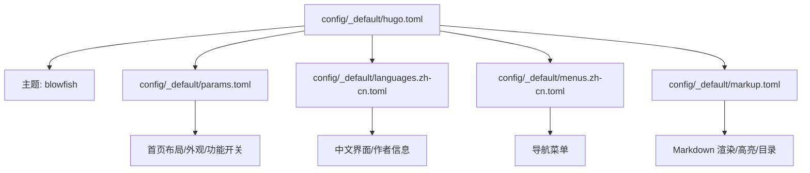
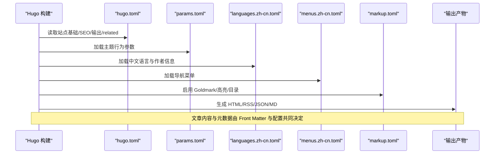
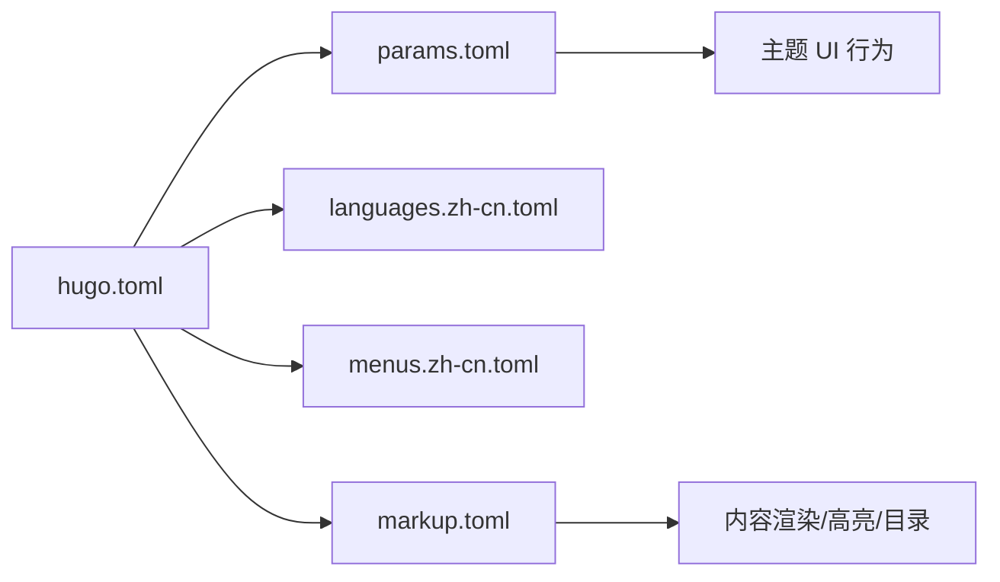

# 站点配置

<cite>
**本文引用的文件**   
- [hugo.toml](file://config/_default/hugo.toml)
- [params.toml](file://config/_default/params.toml)
- [languages.zh-cn.toml](file://config/_default/languages.zh-cn.toml)
- [menus.zh-cn.toml](file://config/_default/menus.zh-cn.toml)
- [markup.toml](file://config/_default/markup.toml)
</cite>

## 目录
1. [简介](#简介)
2. [项目结构](#项目结构)
3. [核心配置总览](#核心配置总览)
4. [架构与数据流](#架构与数据流)
5. [详细配置说明](#详细配置说明)
6. [依赖关系分析](#依赖关系分析)
7. [性能与构建特性](#性能与构建特性)
8. [配置验证与排错](#配置验证与排错)
9. [最佳实践](#最佳实践)
10. [结论](#结论)

## 简介
本文件面向使用 Hugo 与 Blowfish 主题的个人站点，系统化梳理并解释以下配置：
- hugo.toml：Hugo 核心站点基础设置、SEO 相关输出、内容索引与“相关文章”算法、输出格式等。
- params.toml：Blowfish 主题行为参数，包括首页布局、外观配色、功能开关、文章与列表展示细节等。
- languages.zh-cn.toml：中文语言包与作者信息、本地化显示名称、日期格式等。
- menus.zh-cn.toml：顶部导航与页脚菜单的中文界面配置。
- markup.toml：Markdown 渲染（Goldmark）、数学公式、代码高亮、目录生成等。

目标是通过清晰的结构化说明、图示与示例路径，帮助读者快速理解、定制并验证站点行为与外观。

## 项目结构
本项目采用 Hugo 标准配置组织方式，站点级配置集中在 config/_default 目录下，主题通过 theme = 'blowfish' 引入。关键配置文件如下：
- config/_default/hugo.toml：站点全局配置
- config/_default/params.toml：主题参数
- config/_default/languages.zh-cn.toml：中文语言与作者信息
- config/_default/menus.zh-cn.toml：中文菜单
- config/_default/markup.toml：Markdown 渲染与语法高亮

图表来源
- [hugo.toml:1-10](file://config/_default/hugo.toml#L1-L10)
- [params.toml:1-10](file://config/_default/params.toml#L1-L10)
- [languages.zh-cn.toml:1-10](file://config/_default/languages.zh-cn.toml#L1-L10)
- [menus.zh-cn.toml:1-10](file://config/_default/menus.zh-cn.toml#L1-L10)
- [markup.toml:1-10](file://config/_default/markup.toml#L1-L10)

章节来源
- [hugo.toml:1-10](file://config/_default/hugo.toml#L1-L10)

## 核心配置总览
- 站点基础：站点标题、默认语言、机器人协议、摘要长度、CJK 支持、Git 信息等。
- SEO 与输出：Sitemap、RSS、JSON、Markdown 原文输出、分页、媒体类型与输出格式。
- 相关内容算法：基于标签、分类、系列、作者、日期与片段引用（fragments）的相关度权重。
- 主题行为：首页布局、外观配色、搜索、无障碍、目录、头部/底部样式、文章与列表展示开关。
- 本地化：简体中文语言包、作者信息与链接、日期格式。
- 菜单：顶部导航与页脚菜单项。
- Markdown 渲染：Goldmark 解析器、HTML 安全策略、数学公式分隔符、代码高亮行号、目录层级。

章节来源
- [hugo.toml:1-78](file://config/_default/hugo.toml#L1-L78)
- [params.toml:1-88](file://config/_default/params.toml#L1-L88)
- [languages.zh-cn.toml:1-21](file://config/_default/languages.zh-cn.toml#L1-L21)
- [menus.zh-cn.toml:1-39](file://config/_default/menus.zh-cn.toml#L1-L39)
- [markup.toml:1-31](file://config/_default/markup.toml#L1-L31)

## 架构与数据流
下图展示了从站点配置到页面输出的关键流程：Hugo 读取 hugo.toml 与主题参数，结合语言与菜单配置，按输出格式生成 HTML、RSS、JSON 与 Markdown 原文；同时根据 related.indices 计算相关文章，并在文章页展示。

图表来源
- [hugo.toml:1-78](file://config/_default/hugo.toml#L1-L78)
- [params.toml:1-88](file://config/_default/params.toml#L1-L88)
- [languages.zh-cn.toml:1-21](file://config/_default/languages.zh-cn.toml#L1-L21)
- [menus.zh-cn.toml:1-39](file://config/_default/menus.zh-cn.toml#L1-L39)
- [markup.toml:1-31](file://config/_default/markup.toml#L1-L31)

## 详细配置说明

### Hugo 核心配置（hugo.toml）
- 站点基础
  - 站点地址、标题、主题、默认语言、机器人协议、摘要长度、CJK 语言支持、Git 信息、草稿与未来文章构建开关、表情符号支持、分页大小、图片锚点、分类法别名、Sitemap 频率/文件名/优先级。
- 输出格式与媒体类型
  - 新增 text/markdown 媒体类型，并定义 MD 输出格式；home 输出 HTML/RSS/JSON，page 输出 HTML/MD，用于“下载本文”等场景。
- 相关内容算法（related）
  - threshold=0 表示不限制最小相似度；toLower=false 保持大小写敏感。
  - indices 权重：tags=100、categories=100、series=50、authors=20、date=10、fragments=10。
  - 该配置直接影响文章页“相关文章”模块的排序与数量（主题侧 showRelatedContent 与 relatedContentLimit 控制展示）。

章节来源
- [hugo.toml:1-78](file://config/_default/hugo.toml#L1-L78)

### 主题参数（params.toml）
- 外观与交互
  - colorScheme、defaultAppearance、autoSwitchAppearance 控制主题色板与明暗模式。
  - enableSearch、enableCodeCopy、enableA11y、enableStructuredBreadcrumbs 开启搜索、代码复制、无障碍与结构化面包屑。
- 首页与导航
  - mainSections 限定主要栏目；header.layout/mobileMenuStyle 控制头部布局与移动端菜单；highlightCurrentMenuArea/smartTOC 控制导航高亮与智能目录。
- 背景与社交分享图
  - defaultBackgroundImage/backgroundCanvas 控制全站背景；defaultSocialImage 作为 OG/Twitter Card 默认图。
- 文章与列表展示
  - article.* 控制文章页是否显示日期、更新时间、作者、Hero、面包屑、目录、阅读时间/进度、禅模式、分类/标签、字数、评论、相关文章及数量。
  - list.* 控制列表页卡片视图、分组、摘要、排序、悬停效果等。
  - taxonomy/term 控制分类与术语页的计数、卡片视图与分组。
- 页脚
  - footer.* 控制菜单、版权、主题署名、外观切换器、回到顶部按钮的显示。

章节来源
- [params.toml:1-88](file://config/_default/params.toml#L1-L88)

### 中文语言与作者信息（languages.zh-cn.toml）
- locale/label/weight 指定语言标识与权重。
- params.displayName/isoCode/rtl/dateFormat 控制显示名、ISO 代码、RTL 支持与日期格式。
- params.description 为站点描述，常用于 SEO。
- params.author 包含作者名、头像、头衔、简介与外链（GitHub、RSS）。

章节来源
- [languages.zh-cn.toml:1-21](file://config/_default/languages.zh-cn.toml#L1-L21)

### 中文菜单（menus.zh-cn.toml）
- [[main]] 定义顶部导航：首页、文章、备忘、分类、标签、关于，含 pageRef 与 weight。
- [[footer]] 定义页脚菜单：RSS 链接与权重。

章节来源
- [menus.zh-cn.toml:1-39](file://config/_default/menus.zh-cn.toml#L1-L39)

### Markdown 渲染与语法高亮（markup.toml）
- Goldmark 解析器
  - wrapStandAloneImageWithinParagraph=false 避免独立图片被包裹在段落中。
  - parser.attribute.block=true 允许块级属性。
  - renderer.unsafe=true 允许 HTML（注意安全风险）。
  - extensions.passthrough 启用自定义分隔符以支持数学公式（块级与行内）。
- 代码高亮
  - noClasses=false 保留类名以便主题样式生效。
  - lineNos=true 开启行号；lineNumbersInTable=false 避免表格模式下长代码被裁切。
- 目录
  - tableOfContents.startLevel/endLevel 控制目录生成的起始与结束层级。

章节来源
- [markup.toml:1-31](file://config/_default/markup.toml#L1-L31)

## 依赖关系分析
- hugo.toml 是入口配置，驱动输出格式、Sitemap、分页、分类法、related 算法等。
- params.toml 依赖 hugo.toml 中的主题启用，提供主题行为开关与 UI 表现。
- languages.zh-cn.toml 与 menus.zh-cn.toml 受默认语言影响，提供中文界面与导航。
- markup.toml 影响内容渲染质量与可读性，并与主题 CSS/JS 协同工作。

图表来源
- [hugo.toml:1-78](file://config/_default/hugo.toml#L1-L78)
- [params.toml:1-88](file://config/_default/params.toml#L1-L88)
- [languages.zh-cn.toml:1-21](file://config/_default/languages.zh-cn.toml#L1-L21)
- [menus.zh-cn.toml:1-39](file://config/_default/menus.zh-cn.toml#L1-L39)
- [markup.toml:1-31](file://config/_default/markup.toml#L1-L31)

## 性能与构建特性
- 构建优化
  - buildDrafts=false、buildFuture=false 可避免构建草稿与未来文章，减少构建体积与时间。
  - summaryLength=20 控制摘要长度，影响列表页渲染性能。
- 输出优化
  - home 输出 JSON/RSS，便于外部消费或集成；page 输出 MD 便于“下载本文”。
  - Sitemap changefreq=daily、priority=0.5 有助于搜索引擎抓取。
- 内容与渲染
  - Goldmark unsafe=true 提升灵活性但需关注 XSS 风险。
  - 代码高亮开启行号可能增加 DOM 节点数量，建议在长文档中权衡。

[本节为通用指导，不直接分析具体文件]

## 配置验证与排错

### 常见问题与解决方案
- 相关文章未显示或数量异常
  - 检查 hugo.toml 的 related.indices 权重与阈值；确认文章具有 tags/categories/series/authors/date 等字段。
  - 检查 params.toml 的 article.showRelatedContent 与 relatedContentLimit。
- 无法下载 Markdown 原文
  - 确认 hugo.toml 已定义 mediaTypes.text/markdown 与 outputFormats.MD，且 outputs.page 包含 MD。
- 目录层级不符合预期
  - 调整 markup.toml 的 tableOfContents.startLevel/endLevel。
- 代码高亮行号导致表格溢出
  - 确保 markup.toml 中 lineNumbersInTable=false。
- 数学公式未渲染
  - 确认 markup.toml 的 goldmark.extensions.passthrough.delimiters 已配置块级与行内分隔符。
- 中文显示或日期格式不正确
  - 检查 languages.zh-cn.toml 的 locale、dateFormat 与 displayName。
- 导航菜单未生效
  - 检查 menus.zh-cn.toml 的 name/pageRef/url 与 weight 顺序。

章节来源
- [hugo.toml:34-78](file://config/_default/hugo.toml#L34-L78)
- [params.toml:46-88](file://config/_default/params.toml#L46-L88)
- [markup.toml:14-31](file://config/_default/markup.toml#L14-L31)
- [languages.zh-cn.toml:1-21](file://config/_default/languages.zh-cn.toml#L1-L21)
- [menus.zh-cn.toml:1-39](file://config/_default/menus.zh-cn.toml#L1-L39)

### 配置验证步骤
- 运行 Hugo 构建命令，观察是否有配置错误或警告。
- 检查站点根目录是否生成 sitemap.xml、index.xml、index.json 与每篇文章的 .md 文件。
- 打开浏览器控制台，确认主题 JS/CSS 正常加载，搜索、代码复制、外观切换等功能可用。
- 在文章页验证目录、阅读进度、相关文章、评论模块是否正常显示。

[本节为通用指导，不直接分析具体文件]

## 最佳实践
- 明确站点边界
  - 使用 mainSections 限定主要栏目，避免无关内容进入首页与列表。
- 合理设置 SEO
  - 完善 site description、author 信息、social image；合理使用 Sitemap 与 robots.txt。
- 谨慎开启 unsafe HTML
  - 仅在必要时启用 renderer.unsafe=true，并确保内容可信。
- 优化相关内容
  - 为文章添加 tags/categories/series 等元数据，提升 related 匹配质量。
- 控制输出体积
  - 按需关闭不必要的输出格式；合理使用分页与摘要长度。
- 统一本地化
  - 所有用户可见文案尽量通过 i18n 或菜单/主题参数管理，避免硬编码。

[本节为通用指导，不直接分析具体文件]

## 结论
通过对 hugo.toml、params.toml、languages.zh-cn.toml、menus.zh-cn.toml 与 markup.toml 的系统梳理，可以全面掌控站点的核心行为与外观。建议在生产环境中优先保证 SEO、输出完整性与渲染稳定性，再逐步扩展主题特性与个性化配置。

[本节为总结性内容，不直接分析具体文件]