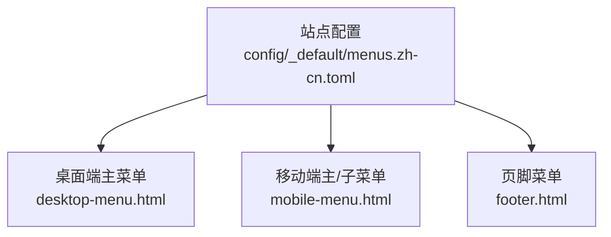
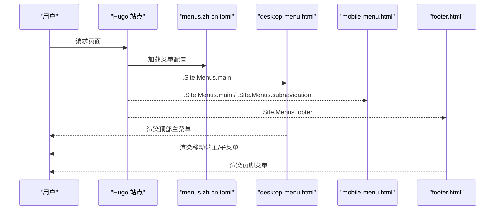
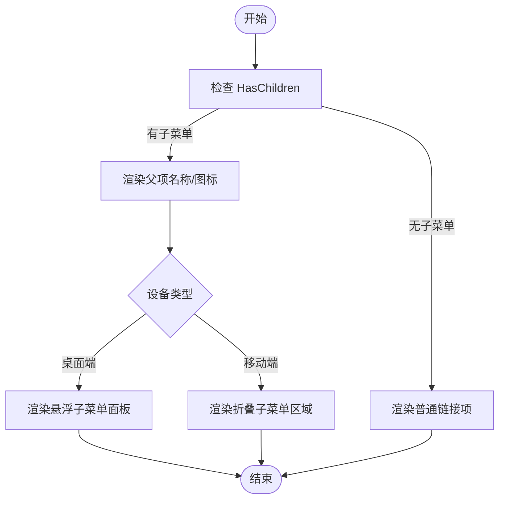
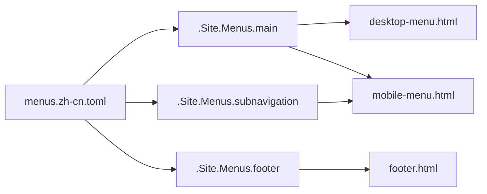
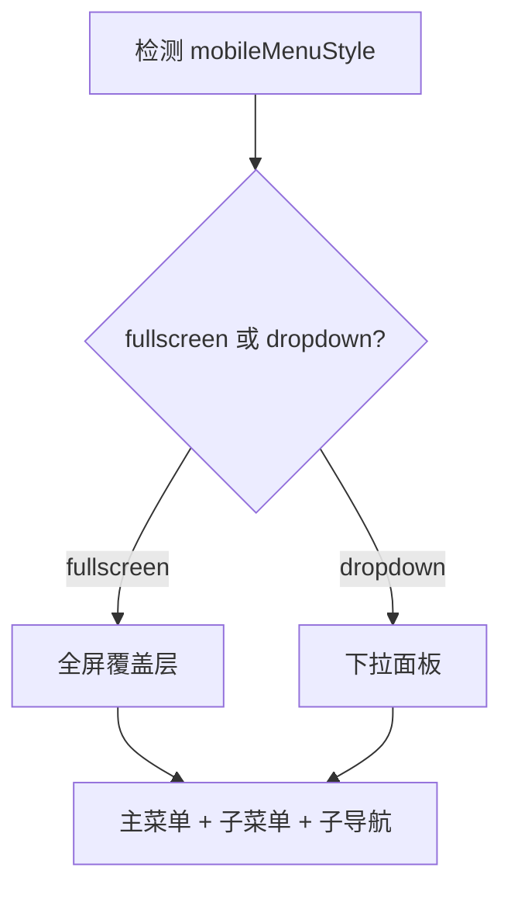

# 菜单配置

<cite>
**本文引用的文件**   
- [menus.zh-cn.toml](file://config/_default/menus.zh-cn.toml)
- [desktop-menu.html](file://themes/blowfish/layouts/partials/header/components/desktop-menu.html)
- [mobile-menu.html](file://themes/blowfish/layouts/partials/header/components/mobile-menu.html)
- [footer.html](file://layouts/partials/footer.html)
</cite>

## 目录
1. [简介](#简介)
2. [项目结构](#项目结构)
3. [核心组件](#核心组件)
4. [架构总览](#架构总览)
5. [详细组件分析](#详细组件分析)
6. [依赖关系分析](#依赖关系分析)
7. [性能与可访问性](#性能与可访问性)
8. [样式定制与响应式适配](#样式定制与响应式适配)
9. [常见问题排查](#常见问题排查)
10. [结论](#结论)

## 简介
本文件面向使用 Blowfish 主题的 Hugo 站点，聚焦于中文语言下的导航菜单配置。文档基于仓库中的菜单配置文件与主题渲染模板，系统说明主菜单、页脚菜单的配置方法，解释菜单项字段（name、url、weight、identifier、pageRef、Pre 等）、嵌套菜单实现、图标显示、外部链接处理，并提供多场景示例与样式定制建议，帮助你构建直观易用的导航系统。

## 项目结构
- 站点级菜单定义位于：`config/_default/menus.zh-cn.toml`
- 桌面端主菜单渲染逻辑位于主题模板：`themes/blowfish/layouts/partials/header/components/desktop-menu.html`
- 移动端主/子导航渲染逻辑位于主题模板：`themes/blowfish/layouts/partials/header/components/mobile-menu.html`
- 页脚菜单渲染逻辑位于站点模板：`layouts/partials/footer.html`

**图表来源**
- [menus.zh-cn.toml:1-39](file://config/_default/menus.zh-cn.toml#L1-L39)
- [desktop-menu.html:1-126](file://themes/blowfish/layouts/partials/header/components/desktop-menu.html#L1-L126)
- [mobile-menu.html:1-179](file://themes/blowfish/layouts/partials/header/components/mobile-menu.html#L1-L179)
- [footer.html:1-35](file://layouts/partials/footer.html#L1-L35)

**章节来源**
- [menus.zh-cn.toml:1-39](file://config/_default/menus.zh-cn.toml#L1-L39)
- [desktop-menu.html:1-126](file://themes/blowfish/layouts/partials/header/components/desktop-menu.html#L1-L126)
- [mobile-menu.html:1-179](file://themes/blowfish/layouts/partials/header/components/mobile-menu.html#L1-L179)
- [footer.html:1-35](file://layouts/partials/footer.html#L1-L35)

## 核心组件
- 主菜单（main）
  - 用于顶部导航栏的入口项
  - 支持嵌套子菜单（HasChildren）
  - 支持图标（Pre）和外部链接自动新窗口打开
- 页脚菜单（footer）
  - 用于站点底部的辅助链接集合
  - 支持图标（Pre）与名称（Name）
- 子导航（subnavigation）
  - 在移动端作为附加标签式导航展示
  - 常用于“分类”“标签”等聚合页面快捷入口

**章节来源**
- [desktop-menu.html:48-125](file://themes/blowfish/layouts/partials/header/components/desktop-menu.html#L48-L125)
- [mobile-menu.html:84-168](file://themes/blowfish/layouts/partials/header/components/mobile-menu.html#L84-L168)
- [footer.html:1-35](file://layouts/partials/footer.html#L1-L35)

## 架构总览
Blowfish 主题通过 Hugo 的 `.Site.Menus` 接口读取站点配置的菜单数据，并在不同模板中渲染为桌面端下拉菜单、移动端全屏/下拉菜单以及页脚菜单。

**图表来源**
- [menus.zh-cn.toml:1-39](file://config/_default/menus.zh-cn.toml#L1-L39)
- [desktop-menu.html:2-6](file://themes/blowfish/layouts/partials/header/components/desktop-menu.html#L2-L6)
- [mobile-menu.html:33-81](file://themes/blowfish/layouts/partials/header/components/mobile-menu.html#L33-L81)
- [footer.html:3-35](file://layouts/partials/footer.html#L3-L35)

## 详细组件分析

### 菜单项结构定义
- name：菜单显示名称，支持 Markdown 语法
- url：目标地址；若以 http/https 开头，将被视为外部链接并在新窗口打开
- weight：排序权重，数值越小越靠前
- identifier：唯一标识符，用于生成锚点或子菜单展开 ID
- pageRef：Hugo 内置引用，指向站点内容路径，最终会被解析为 URL
- Pre：图标名，调用 partial "icon.html" 渲染对应图标

上述字段由主题模板统一消费：
- 桌面端主菜单：渲染 Name、URL、Pre，检测 HasChildren 决定是否显示下拉
- 移动端主菜单：同样渲染 Name、URL、Pre，并使用 Identifier 生成子菜单展开 ID
- 页脚菜单：渲染 Name、URL、Pre，并根据是否仅含图标调整布局

**章节来源**
- [desktop-menu.html:48-125](file://themes/blowfish/layouts/partials/header/components/desktop-menu.html#L48-L125)
- [mobile-menu.html:84-148](file://themes/blowfish/layouts/partials/header/components/mobile-menu.html#L84-L148)
- [footer.html:17-31](file://layouts/partials/footer.html#L17-L31)

### 主菜单（main）
- 作用：顶部导航的主入口
- 特性：
  - 支持多级嵌套（HasChildren），桌面端以悬浮面板展示子项
  - 支持图标（Pre）
  - 外部链接自动 target="_blank"
  - 支持无障碍属性（aria-*）
- 典型用法：首页、文章列表、分类、标签、关于等

参考当前站点配置中的 main 菜单项，包含多个静态页面入口，如首页、文章、备忘、分类、标签、关于等。

**章节来源**
- [menus.zh-cn.toml:3-31](file://config/_default/menus.zh-cn.toml#L3-L31)
- [desktop-menu.html:48-125](file://themes/blowfish/layouts/partials/header/components/desktop-menu.html#L48-L125)
- [mobile-menu.html:84-148](file://themes/blowfish/layouts/partials/header/components/mobile-menu.html#L84-L148)

### 页脚菜单（footer）
- 作用：站点底部辅助链接
- 特性：
  - 支持图标（Pre）与名称（Name）
  - 当所有项均无 Name 时，采用横向滚动布局
  - 支持外部链接自动新窗口打开
- 当前站点示例：RSS 订阅链接

**章节来源**
- [menus.zh-cn.toml:35-39](file://config/_default/menus.zh-cn.toml#L35-L39)
- [footer.html:3-35](file://layouts/partials/footer.html#L3-L35)

### 子导航（subnavigation）
- 作用：移动端附加的标签式导航，常用于聚合类页面（如分类、标签）
- 特性：
  - 在移动端以圆角标签形式展示
  - 支持图标（Pre）与名称（Name）
  - 不直接出现在桌面端主菜单中

**章节来源**
- [mobile-menu.html:151-168](file://themes/blowfish/layouts/partials/header/components/mobile-menu.html#L151-L168)

### 嵌套菜单的实现
- 条件判断：HasChildren 为真时，表示存在子菜单
- 桌面端：
  - 父项显示箭头图标，点击后展开悬浮面板
  - 子项支持图标与名称
- 移动端：
  - 父项右侧出现展开按钮
  - 子项以缩进列表呈现
  - 使用 Identifier 或 Name 生成唯一展开 ID

**图表来源**
- [desktop-menu.html:48-103](file://themes/blowfish/layouts/partials/header/components/desktop-menu.html#L48-L103)
- [mobile-menu.html:105-148](file://themes/blowfish/layouts/partials/header/components/mobile-menu.html#L105-L148)

**章节来源**
- [desktop-menu.html:48-103](file://themes/blowfish/layouts/partials/header/components/desktop-menu.html#L48-L103)
- [mobile-menu.html:105-148](file://themes/blowfish/layouts/partials/header/components/mobile-menu.html#L105-L148)

### 图标的使用
- 通过 Pre 字段指定图标名
- 模板调用 partial "icon.html" 渲染
- 支持在父项与子项上分别设置图标

**章节来源**
- [desktop-menu.html:66-70](file://themes/blowfish/layouts/partials/header/components/desktop-menu.html#L66-L70)
- [desktop-menu.html:90-94](file://themes/blowfish/layouts/partials/header/components/desktop-menu.html#L90-L94)
- [mobile-menu.html:96-100](file://themes/blowfish/layouts/partials/header/components/mobile-menu.html#L96-L100)
- [mobile-menu.html:133-137](file://themes/blowfish/layouts/partials/header/components/mobile-menu.html#L133-L137)
- [footer.html:23-27](file://layouts/partials/footer.html#L23-L27)

### 外部链接的处理
- 当 URL 以 http:// 或 https:// 开头时，模板会添加 target="_blank"
- 适用于主菜单、子菜单与页脚菜单

**章节来源**
- [desktop-menu.html:55-57](file://themes/blowfish/layouts/partials/header/components/desktop-menu.html#L55-L57)
- [desktop-menu.html:85-87](file://themes/blowfish/layouts/partials/header/components/desktop-menu.html#L85-L87)
- [desktop-menu.html:107-109](file://themes/blowfish/layouts/partials/header/components/desktop-menu.html#L107-L109)
- [mobile-menu.html:92-94](file://themes/blowfish/layouts/partials/header/components/mobile-menu.html#L92-L94)
- [mobile-menu.html:129-131](file://themes/blowfish/layouts/partials/header/components/mobile-menu.html#L129-L131)
- [footer.html:21-22](file://layouts/partials/footer.html#L21-L22)

### 常用配置示例（场景化）
以下为常见场景的配置思路与要点（不直接粘贴代码，仅提供结构与字段说明）：

- 静态页面
  - 使用 pageRef 指向站点内页面路径，例如首页、关于页
  - 设置合理的 weight 控制顺序
  - 可选 Pre 添加图标提升识别度

- 动态分类/标签
  - 使用 pageRef 指向 /categories 或 /tags
  - 可在 subnavigation 中添加轻量入口，便于移动端快速跳转

- 自定义外链
  - 使用 url 填写完整的外部链接地址
  - 模板会自动在新窗口打开

- 嵌套菜单
  - 父项无需 URL，只需 Name 与 Pre
  - 子项使用 pageRef 或 url 指向目标
  - 确保 identifier 唯一，避免冲突

- 页脚菜单
  - 适合放置 RSS、隐私政策、联系方式等辅助链接
  - 可使用 Pre 增强视觉提示

**章节来源**
- [menus.zh-cn.toml:3-39](file://config/_default/menus.zh-cn.toml#L3-L39)
- [desktop-menu.html:48-125](file://themes/blowfish/layouts/partials/header/components/desktop-menu.html#L48-L125)
- [mobile-menu.html:84-168](file://themes/blowfish/layouts/partials/header/components/mobile-menu.html#L84-L168)
- [footer.html:17-31](file://layouts/partials/footer.html#L17-L31)

## 依赖关系分析
- 站点配置 menus.zh-cn.toml 提供菜单数据源
- 主题模板通过 .Site.Menus 读取 main、subnavigation、footer
- 桌面端与移动端分别渲染不同的交互形态
- 页脚菜单独立于主菜单，用于辅助信息

**图表来源**
- [menus.zh-cn.toml:1-39](file://config/_default/menus.zh-cn.toml#L1-L39)
- [desktop-menu.html:2-6](file://themes/blowfish/layouts/partials/header/components/desktop-menu.html#L2-L6)
- [mobile-menu.html:33-81](file://themes/blowfish/layouts/partials/header/components/mobile-menu.html#L33-L81)
- [footer.html:3-35](file://layouts/partials/footer.html#L3-L35)

**章节来源**
- [menus.zh-cn.toml:1-39](file://config/_default/menus.zh-cn.toml#L1-L39)
- [desktop-menu.html:2-6](file://themes/blowfish/layouts/partials/header/components/desktop-menu.html#L2-L6)
- [mobile-menu.html:33-81](file://themes/blowfish/layouts/partials/header/components/mobile-menu.html#L33-L81)
- [footer.html:3-35](file://layouts/partials/footer.html#L3-L35)

## 性能与可访问性
- 性能
  - 菜单渲染为纯 HTML/CSS，无额外 JS 开销
  - 图标通过 partial 按需加载，减少冗余
- 可访问性
  - 桌面端主菜单包含 aria-haspopup、aria-expanded 等属性
  - 移动端菜单对话框具备 role="dialog" 与 aria-modal
  - 搜索与外观切换按钮具备 aria-label

**章节来源**
- [desktop-menu.html:52-64](file://themes/blowfish/layouts/partials/header/components/desktop-menu.html#L52-L64)
- [mobile-menu.html:50-79](file://themes/blowfish/layouts/partials/header/components/mobile-menu.html#L50-L79)

## 样式定制与响应式适配
- 桌面端
  - 主菜单项间距、字体大小、悬停颜色由 Tailwind 类控制
  - 子菜单面板使用阴影与边框，背景半透明
- 移动端
  - 支持两种模式：全屏（fullscreen）与下拉（dropdown）
  - 通过 header.mobileMenuStyle 参数切换
  - 子菜单展开使用 grid-template-rows 动画过渡
- 页脚菜单
  - 当仅包含图标时启用横向滚动
  - 在小屏下纵向排列，大屏下横向排列

**图表来源**
- [mobile-menu.html:1-2](file://themes/blowfish/layouts/partials/header/components/mobile-menu.html#L1-L2)
- [mobile-menu.html:57-61](file://themes/blowfish/layouts/partials/header/components/mobile-menu.html#L57-L61)
- [mobile-menu.html:121-145](file://themes/blowfish/layouts/partials/header/components/mobile-menu.html#L121-L145)

**章节来源**
- [desktop-menu.html:1-46](file://themes/blowfish/layouts/partials/header/components/desktop-menu.html#L1-L46)
- [mobile-menu.html:1-81](file://themes/blowfish/layouts/partials/header/components/mobile-menu.html#L1-L81)
- [footer.html:12-14](file://layouts/partials/footer.html#L12-L14)

## 常见问题排查
- 菜单未显示
  - 确认 config/_default/menus.zh-cn.toml 中存在对应菜单段（main/footer/subnavigation）
  - 检查 name/url/pageRef 是否正确
- 外部链接未在新窗口打开
  - 确认 url 以 http:// 或 https:// 开头
- 图标不显示
  - 确认 Pre 字段值与主题支持的图标名一致
- 子菜单无法展开
  - 确认父项 HasChildren 为真（即存在子项）
  - 检查 identifier 是否唯一
- 移动端菜单样式异常
  - 检查 header.mobileMenuStyle 参数是否为 fullscreen 或 dropdown
  - 确认 Tailwind 类未被覆盖

**章节来源**
- [desktop-menu.html:48-125](file://themes/blowfish/layouts/partials/header/components/desktop-menu.html#L48-L125)
- [mobile-menu.html:84-168](file://themes/blowfish/layouts/partials/header/components/mobile-menu.html#L84-L168)
- [footer.html:17-31](file://layouts/partials/footer.html#L17-L31)

## 结论
通过 menus.zh-cn.toml 与 Blowfish 主题的模板协作，你可以灵活地配置主菜单、页脚菜单与子导航，支持图标、外部链接、嵌套菜单与响应式适配。遵循本文的结构定义与最佳实践，能够快速搭建直观、易用且可访问的导航系统。