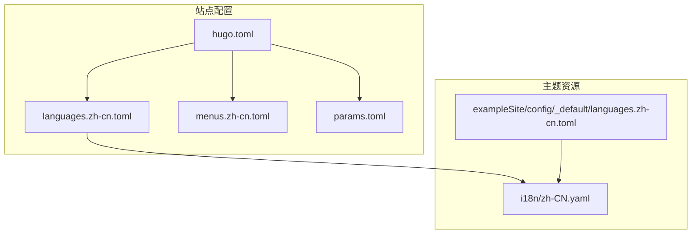
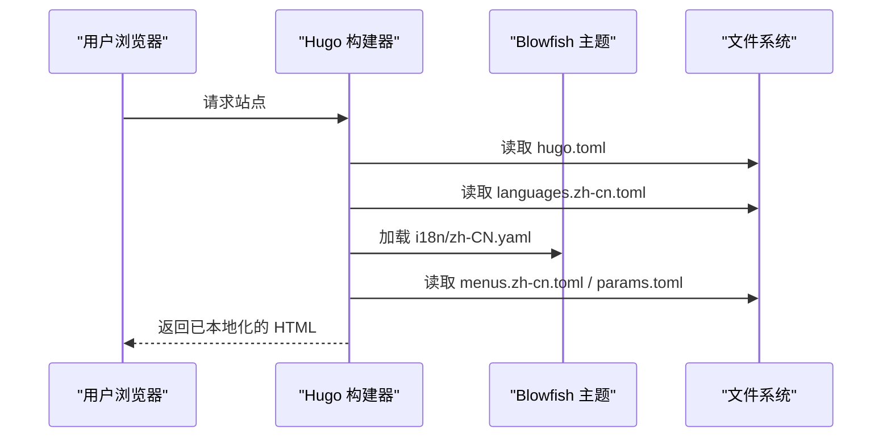
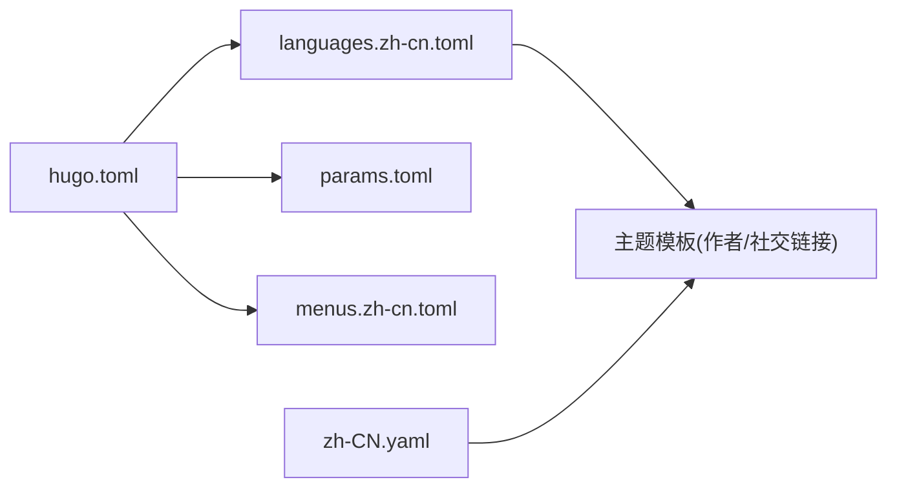

# 语言和本地化

<cite>
**本文引用的文件**   
- [hugo.toml](file://config/_default/hugo.toml)
- [languages.zh-cn.toml](file://config/_default/languages.zh-cn.toml)
- [menus.zh-cn.toml](file://config/_default/menus.zh-cn.toml)
- [params.toml](file://config/_default/params.toml)
- [zh-CN.yaml](file://themes/blowfish/i18n/zh-CN.yaml)
- [example languages.zh-cn.toml](file://themes/blowfish/exampleSite/config/_default/languages.zh-cn.toml)
</cite>

## 目录
1. [简介](#简介)
2. [项目结构](#项目结构)
3. [核心组件](#核心组件)
4. [架构总览](#架构总览)
5. [详细组件分析](#详细组件分析)
6. [依赖关系分析](#依赖关系分析)
7. [性能与可维护性](#性能与可维护性)
8. [故障排查指南](#故障排查指南)
9. [结论](#结论)
10. [附录：中文本地化配置示例与多语言站点搭建](#附录中文本地化配置示例与多语言站点搭建)

## 简介
本文件聚焦于 Hugo + Blowfish 主题下的语言与本地化配置，重点解析当前仓库中的中文界面配置（languages.zh-cn.toml），并系统说明作者信息、社交链接、版权与法律声明等本地化内容的组织方式。同时给出多语言支持的配置方法、翻译文件组织结构、语言切换的实现原理，以及完整的中文本地化配置示例和多语言站点搭建指南，帮助开发者构建国际化博客站点。

## 项目结构
本项目采用 Hugo 标准的多语言与主题扩展结构：
- 站点级配置位于 config/_default，包含 hugo.toml、languages.zh-cn.toml、menus.zh-cn.toml、params.toml 等。
- 主题 i18n 文案位于 themes/blowfish/i18n，其中 zh-CN.yaml 提供中文界面文案。
- 主题示例站提供了多语言参考，如 exampleSite/config/_default/languages.zh-cn.toml。

图表来源
- [hugo.toml:1-10](file://config/_default/hugo.toml#L1-L10)
- [languages.zh-cn.toml:1-21](file://config/_default/languages.zh-cn.toml#L1-L21)
- [menus.zh-cn.toml:1-39](file://config/_default/menus.zh-cn.toml#L1-L39)
- [params.toml:1-20](file://config/_default/params.toml#L1-L20)
- [zh-CN.yaml:1-20](file://themes/blowfish/i18n/zh-CN.yaml#L1-L20)
- [example languages.zh-cn.toml:1-23](file://themes/blowfish/exampleSite/config/_default/languages.zh-cn.toml#L1-L23)

章节来源
- [hugo.toml:1-10](file://config/_default/hugo.toml#L1-L10)
- [languages.zh-cn.toml:1-21](file://config/_default/languages.zh-cn.toml#L1-L21)
- [menus.zh-cn.toml:1-39](file://config/_default/menus.zh-cn.toml#L1-L39)
- [params.toml:1-20](file://config/_default/params.toml#L1-L20)
- [zh-CN.yaml:1-20](file://themes/blowfish/i18n/zh-CN.yaml#L1-L20)
- [example languages.zh-cn.toml:1-23](file://themes/blowfish/exampleSite/config/_default/languages.zh-cn.toml#L1-L23)

## 核心组件
- 站点主配置（hugo.toml）：定义默认语言、主题、基础 URL、内容类型、索引与输出格式等。
- 中文语言配置（languages.zh-cn.toml）：定义语言标识、显示名、权重、日期格式、站点描述与作者信息（含头像、标题、简介、社交链接）。
- 中文菜单（menus.zh-cn.toml）：定义顶部导航与页脚菜单的中文文案与路由。
- 主题参数（params.toml）：控制外观、搜索、目录、文章展示、列表布局、分类标签等主题行为。
- 中文界面文案（zh-CN.yaml）：提供全站 UI 文案（文章元数据、无障碍、搜索、分享、Cookie 提示等）。
- 示例语言配置（example languages.zh-cn.toml）：演示多语言下 author、logo、description 等字段的写法。

章节来源
- [hugo.toml:1-10](file://config/_default/hugo.toml#L1-L10)
- [languages.zh-cn.toml:1-21](file://config/_default/languages.zh-cn.toml#L1-L21)
- [menus.zh-cn.toml:1-39](file://config/_default/menus.zh-cn.toml#L1-L39)
- [params.toml:1-88](file://config/_default/params.toml#L1-L88)
- [zh-CN.yaml:1-112](file://themes/blowfish/i18n/zh-CN.yaml#L1-L112)
- [example languages.zh-cn.toml:1-23](file://themes/blowfish/exampleSite/config/_default/languages.zh-cn.toml#L1-L23)

## 架构总览
Hugo 在构建时按以下顺序加载与合并配置：
1. 读取 hugo.toml，确定默认语言与主题。
2. 根据 defaultContentLanguage 选择对应语言的配置文件（如 languages.zh-cn.toml）。
3. 加载主题 i18n 文案（zh-CN.yaml）用于渲染 UI 文本。
4. 渲染页面时，结合 menus.zh-cn.toml 与 params.toml 生成导航、侧边栏、页脚等。

图表来源
- [hugo.toml:1-10](file://config/_default/hugo.toml#L1-L10)
- [languages.zh-cn.toml:1-21](file://config/_default/languages.zh-cn.toml#L1-L21)
- [zh-CN.yaml:1-20](file://themes/blowfish/i18n/zh-CN.yaml#L1-L20)
- [menus.zh-cn.toml:1-39](file://config/_default/menus.zh-cn.toml#L1-L39)
- [params.toml:1-20](file://config/_default/params.toml#L1-L20)

## 详细组件分析

### 中文语言配置（languages.zh-cn.toml）
该文件是中文界面的核心配置，包含：
- 语言元信息：locale、label、weight。
- 站点级 params：displayName、isoCode、rtl、dateFormat、description。
- 作者信息 params.author：name、image、headline、bio、links（支持 GitHub、RSS 等键值对形式的社交链接）。

要点与建议：
- displayName 与 isoCode 需保持一致，便于前端语言切换与 SEO。
- dateFormat 建议与全站时间显示一致；如需仅显示日期，可参考示例配置。
- links 数组中每个对象以平台名为键（如 github、rss、x-twitter、bluesky 等），值为目标 URL。
- image 路径相对于站点静态资源根目录（assets/img 或 static/img，取决于主题与站点配置）。

章节来源
- [languages.zh-cn.toml:1-21](file://config/_default/languages.zh-cn.toml#L1-L21)
- [example languages.zh-cn.toml:1-23](file://themes/blowfish/exampleSite/config/_default/languages.zh-cn.toml#L1-L23)

### 站点主配置（hugo.toml）
关键项：
- theme = 'blowfish'：启用 Blowfish 主题。
- defaultContentLanguage = 'zh-cn'：默认语言为简体中文。
- hasCJKLanguage = true：启用 CJK 语言优化（分词、字数统计等）。
- taxonomies：定义 tag、category、author、series 等分类法。
- outputs：为每篇文章额外输出 Markdown 原文，便于“下载本文”功能。

章节来源
- [hugo.toml:1-10](file://config/_default/hugo.toml#L1-L10)
- [hugo.toml:23-27](file://config/_default/hugo.toml#L23-L27)
- [hugo.toml:34-47](file://config/_default/hugo.toml#L34-L47)

### 中文菜单（menus.zh-cn.toml）
- 顶部导航 main：首页、文章、备忘、分类、标签、关于。
- 页脚菜单 footer：RSS 订阅链接。
- 通过 pageRef 或 url 指定目标，weight 控制排序。

章节来源
- [menus.zh-cn.toml:1-39](file://config/_default/menus.zh-cn.toml#L1-L39)

### 主题参数（params.toml）
- 外观与交互：colorScheme、defaultAppearance、autoSwitchAppearance、enableSearch、enableCodeCopy、enableA11y。
- 首页布局：homepage.layout、showRecent、cardView 等。
- 文章展示：showDate、showAuthor、showHero、showBreadcrumbs、showReadingTime、showTableOfContents、showComments、showRelatedContent 等。
- 列表与分类：list.cardView、groupByYear、taxonomy.showTermCount 等。
- 页脚：showMenu、showCopyright、showThemeAttribution、showAppearanceSwitcher、showScrollToTop。

章节来源
- [params.toml:1-20](file://config/_default/params.toml#L1-L20)
- [params.toml:30-36](file://config/_default/params.toml#L30-L36)
- [params.toml:37-45](file://config/_default/params.toml#L37-L45)
- [params.toml:46-69](file://config/_default/params.toml#L46-L69)
- [params.toml:71-88](file://config/_default/params.toml#L71-L88)

### 中文界面文案（zh-CN.yaml）
覆盖范围：
- 全局与文章元数据：language、date、reading_time、word_count、views、likes、table_of_contents、related_articles 等。
- 无障碍与导航：a11y.*、nav.*。
- 搜索与分享：search.*、sharing.*。
- Cookie 通知：cookie_notice.*。
- 短代码与提示：shortcode.recent_articles、admonition.*。

使用方式：
- 模板中通过 i18n key 引用，例如 article.reading_time、footer.powered_by 等。
- 复数形式通过 one/other 处理，如 reading_time.one/other、word_count.one/other。

章节来源
- [zh-CN.yaml:1-20](file://themes/blowfish/i18n/zh-CN.yaml#L1-L20)
- [zh-CN.yaml:34-40](file://themes/blowfish/i18n/zh-CN.yaml#L34-L40)
- [zh-CN.yaml:62-81](file://themes/blowfish/i18n/zh-CN.yaml#L62-L81)
- [zh-CN.yaml:83-112](file://themes/blowfish/i18n/zh-CN.yaml#L83-L112)

## 依赖关系分析
- hugo.toml 决定默认语言与主题，进而影响 languages.zh-cn.toml 是否生效。
- languages.zh-cn.toml 中的 params.author.links 会被主题模板渲染为作者信息与社交图标。
- zh-CN.yaml 提供所有 UI 文案，若缺失 key，将回退到主题默认文案或英文文案。
- menus.zh-cn.toml 与 params.toml 共同决定导航与页面展示行为。

图表来源
- [hugo.toml:1-10](file://config/_default/hugo.toml#L1-L10)
- [languages.zh-cn.toml:12-21](file://config/_default/languages.zh-cn.toml#L12-L21)
- [zh-CN.yaml:1-20](file://themes/blowfish/i18n/zh-CN.yaml#L1-L20)
- [menus.zh-cn.toml:1-39](file://config/_default/menus.zh-cn.toml#L1-L39)
- [params.toml:1-20](file://config/_default/params.toml#L1-L20)

章节来源
- [hugo.toml:1-10](file://config/_default/hugo.toml#L1-L10)
- [languages.zh-cn.toml:12-21](file://config/_default/languages.zh-cn.toml#L12-L21)
- [zh-CN.yaml:1-20](file://themes/blowfish/i18n/zh-CN.yaml#L1-L20)
- [menus.zh-cn.toml:1-39](file://config/_default/menus.zh-cn.toml#L1-L39)
- [params.toml:1-20](file://config/_default/params.toml#L1-L20)

## 性能与可维护性
- 文案集中管理：所有 UI 文案集中在 zh-CN.yaml，便于统一维护与审计。
- 配置分层清晰：站点主配置、语言配置、菜单与主题参数分离，降低耦合度。
- 图片与静态资源：作者头像与站点背景图应置于静态资源目录，避免重复加载。
- 多语言扩展：新增语言时仅需复制 languages.*.toml 与 menus.*.toml，并在 hugo.toml 中注册。

[本节为通用指导，不直接分析具体文件]

## 故障排查指南
常见问题与定位思路：
- 中文未生效
  - 检查 hugo.toml 的 defaultContentLanguage 是否为 zh-cn。
  - 确认存在 languages.zh-cn.toml 且 locale 字段正确。
- 作者信息或社交链接不显示
  - 检查 languages.zh-cn.toml 中 params.author 与 params.author.links 是否存在且键名正确。
  - 确认 image 路径有效且可访问。
- 菜单文案未更新
  - 检查 menus.zh-cn.toml 是否正确引入，name 字段是否填写。
- UI 文案缺失或显示英文
  - 检查 zh-CN.yaml 是否包含对应 key；必要时补充缺失条目。
- 日期格式不符合预期
  - 调整 languages.zh-cn.toml 中 params.dateFormat。

章节来源
- [hugo.toml:1-10](file://config/_default/hugo.toml#L1-L10)
- [languages.zh-cn.toml:1-21](file://config/_default/languages.zh-cn.toml#L1-L21)
- [menus.zh-cn.toml:1-39](file://config/_default/menus.zh-cn.toml#L1-L39)
- [zh-CN.yaml:1-20](file://themes/blowfish/i18n/zh-CN.yaml#L1-L20)

## 结论
通过合理组织 hugo.toml、languages.zh-cn.toml、menus.zh-cn.toml、params.toml 与 zh-CN.yaml，可以构建一个稳定、可扩展的中文本地化站点。Blowfish 主题的 i18n 机制与丰富的主题参数进一步简化了多语言与界面定制工作。遵循本文的配置规范与维护策略，能够高效地扩展更多语言并保持站点一致性。

[本节为总结性内容，不直接分析具体文件]

## 附录：中文本地化配置示例与多语言站点搭建

### 中文本地化配置清单
- 站点主配置（hugo.toml）
  - 设置 theme、defaultContentLanguage、hasCJKLanguage、taxonomies、outputs 等。
- 中文语言配置（languages.zh-cn.toml）
  - 设置 locale、label、weight、params.displayName、params.isoCode、params.dateFormat、params.description。
  - 设置 params.author.name、image、headline、bio、links（github、rss、x-twitter、bluesky 等）。
- 中文菜单（menus.zh-cn.toml）
  - 定义 main 与 footer 菜单项，确保 name 与 pageRef/url 正确。
- 主题参数（params.toml）
  - 按需开启 search、code copy、a11y、TOC、comments、related content 等功能。
- 中文界面文案（zh-CN.yaml）
  - 补充或校验所需 key，尤其是 article.*、footer.*、search.*、sharing.*、cookie_notice.*。

章节来源
- [hugo.toml:1-10](file://config/_default/hugo.toml#L1-L10)
- [languages.zh-cn.toml:1-21](file://config/_default/languages.zh-cn.toml#L1-L21)
- [menus.zh-cn.toml:1-39](file://config/_default/menus.zh-cn.toml#L1-L39)
- [params.toml:1-88](file://config/_default/params.toml#L1-L88)
- [zh-CN.yaml:1-112](file://themes/blowfish/i18n/zh-CN.yaml#L1-L112)

### 多语言站点搭建步骤
1. 在 config/_default 下新增 languages.<lang>.toml 与 menus.<lang>.toml。
2. 在 hugo.toml 中保留 defaultContentLanguage 指向默认语言。
3. 为每种语言准备对应的 i18n 文案（可选，主题默认文案可作为回退）。
4. 在模板中使用 i18n key 渲染文案，确保所有语言均有对应翻译。
5. 在首页或导航中添加语言切换器（Blowfish 主题通常内置支持）。

章节来源
- [hugo.toml:1-10](file://config/_default/hugo.toml#L1-L10)
- [example languages.zh-cn.toml:1-23](file://themes/blowfish/exampleSite/config/_default/languages.zh-cn.toml#L1-L23)

### 翻译工作流程与维护策略
- 建立翻译规范
  - 统一 key 命名与层级，保持 zh-CN.yaml 与其他语言文件对齐。
  - 复数字段使用 one/other，避免运行时错误。
- 版本化管理
  - 每次主题升级后，对比 i18n 差异，补齐缺失 key。
  - 使用脚本或工具检测缺失翻译（主题示例中包含相关脚本）。
- 质量保障
  - 定期审查文案准确性与一致性。
  - 对敏感文案（隐私政策、Cookie 提示）进行法务审核。
- 持续集成
  - 在 CI 中检查 i18n 完整性与配置语法，防止遗漏。

[本节为流程性内容，不直接分析具体文件]