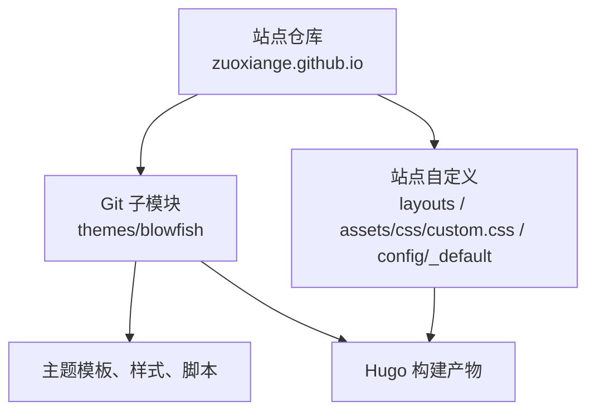
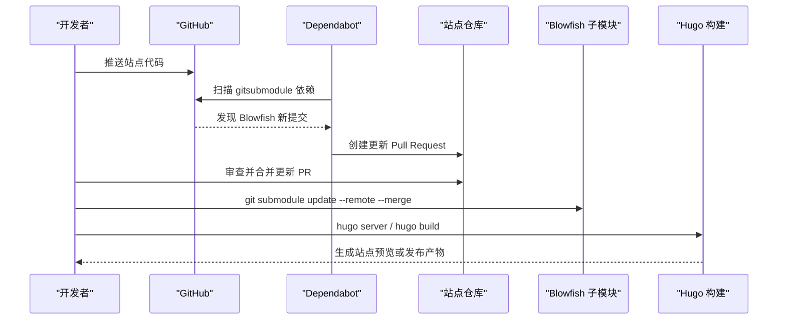
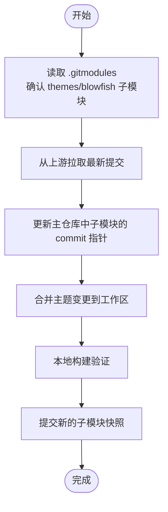
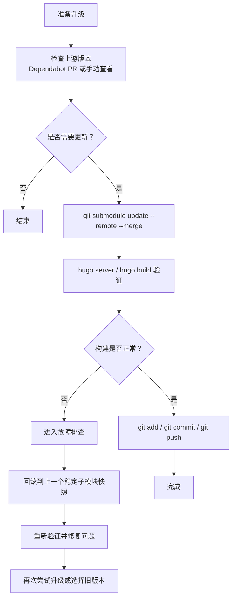
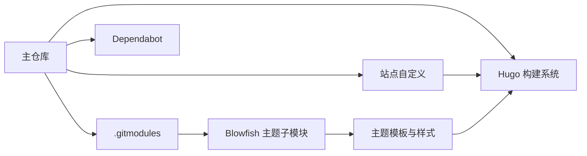

# 主题更新

<cite>
**本文引用的文件**   
- [.gitmodules](file://.gitmodules)
- [README.md](file://README.md)
- [.github/dependabot.yml](file://.github/dependabot.yml)
- [AGENTS.md](file://AGENTS.md)
</cite>

## 目录
1. [简介](#简介)
2. [项目结构中的主题位置](#项目结构中的主题位置)
3. [核心组件与职责](#核心组件与职责)
4. [架构总览：Blowfish 主题在站点中的角色](#架构总览blowfish-主题在站点中的角色)
5. [详细组件分析](#详细组件分析)
6. [依赖关系分析](#依赖关系分析)
7. [性能与稳定性考虑](#性能与稳定性考虑)
8. [故障排查指南](#故障排查指南)
9. [结论](#结论)
10. [附录：常用命令速查](#附录常用命令速查)

## 简介
本指南面向使用 Blowfish 主题的 Hugo 站点维护者，说明如何通过 `git submodule` 安全、可回滚地升级主题版本。文档重点包括：
- 为什么不能直接修改 `themes/blowfish/` 目录
- 如何检查新版本并执行更新
- 如何处理冲突和兼容性问题
- 如何在升级失败时快速回滚到稳定版本
- 推荐的定期更新、测试验证与备份策略

本项目中，Blowfish 主题以 Git 子模块方式引入，站点级自定义通过 `layouts/`、`assets/css/custom.css`、`config/_default/` 等路径实现，避免污染主题源码。

**章节来源**
- [README.md:1-159](file://README.md#L1-L159)

## 项目结构中的主题位置
Blowfish 主题位于仓库根目录下的 `themes/blowfish/`，但该目录不是普通文件夹，而是由 `.gitmodules` 管理的 Git 子模块。站点构建时，Hugo 会读取该子模块中的模板、样式、脚本等资源；站点自身的覆盖逻辑则放在 `layouts/` 和 `assets/` 下。

**图示来源**
- [README.md:14-40](file://README.md#L14-L40)
- [README.md:131-148](file://README.md#L131-L148)

**章节来源**
- [README.md:14-40](file://README.md#L14-L40)
- [README.md:131-148](file://README.md#L131-L148)

## 核心组件与职责
- `.gitmodules`：声明 Blowfish 主题子模块的路径与远程仓库地址，是主题版本控制的元数据入口。
- `themes/blowfish/`：实际的主题代码目录，由子模块管理，不应直接编辑。
- `layouts/`、`assets/css/custom.css`、`config/_default/`：站点级自定义位置，用于覆盖主题行为而不破坏主题源码。
- `.github/dependabot.yml`：配置 Dependabot 每周自动为 GitHub Actions 和 Git 子模块创建更新 Pull Request。
- `README.md`：记录主题以 submodule 引入、首次克隆初始化命令以及主题更新命令。

**章节来源**
- [.gitmodules:1-4](file://.gitmodules#L1-L4)
- [README.md:10-11](file://README.md#L10-L11)
- [README.md:49-57](file://README.md#L49-L57)
- [README.md:131-159](file://README.md#L131-L159)
- [.github/dependabot.yml:16-28](file://.github/dependabot.yml#L16-L28)

## 架构总览：Blowfish 主题在站点中的角色
下图展示站点、主题子模块与自动化更新之间的关系。Dependabot 负责发现上游新提交并生成 PR；开发者合并 PR 后，本地可通过 `git submodule update --remote --merge` 同步最新主题版本；Hugo 构建时将主题资源与站点自定义合并输出。

**图示来源**
- [.github/dependabot.yml:16-28](file://.github/dependabot.yml#L16-L28)
- [README.md:150-159](file://README.md#L150-L159)

## 详细组件分析

### 子模块定义与工作原理
`.gitmodules` 将 `themes/blowfish` 指向 Blowfish 官方仓库。这意味着：
- 子模块本身是一个独立的 Git 仓库，拥有自己的提交历史与分支。
- 主仓库只记录子模块的“快照”（具体 commit），不复制完整主题代码。
- 升级主题本质上是把主仓库记录的子模块 commit 指针移动到上游最新版本。

**图示来源**
- [.gitmodules:1-4](file://.gitmodules#L1-L4)
- [README.md:150-159](file://README.md#L150-L159)

**章节来源**
- [.gitmodules:1-4](file://.gitmodules#L1-L4)
- [README.md:150-159](file://README.md#L150-L159)

### 为什么不能直接修改 themes/blowfish/
直接修改 `themes/blowfish/` 会导致以下问题：
- 下次执行主题更新时，本地修改会被上游变更覆盖，造成不可预期的差异。
- 主题升级流程假设主题源码保持纯净，任何非站点级的定制都应放在 `layouts/`、`assets/css/custom.css`、`config/_default/` 等位置。
- 站点 README 明确建议：站点级定制应放在独立位置，避免修改主题 submodule。

推荐做法：
- 样式覆盖：优先使用 `assets/css/custom.css` 或主题提供的参数。
- 模板覆盖：使用 `layouts/partials/...` 覆盖主题 partials。
- 配置调整：使用 `config/_default/params.toml`、`languages.zh-cn.toml`、`menus.zh-cn.toml` 等站点配置文件。

**章节来源**
- [README.md:131-148](file://README.md#L131-L148)
- [README.md:150-159](file://README.md#L150-L159)

### 主题升级完整流程
推荐的标准升级流程如下：

1. **检查上游是否有新版本**
   - 查看 Dependabot 是否已为 Blowfish 子模块创建更新 PR。
   - 或者手动检查上游仓库的最新提交。

2. **执行更新命令**
   - 使用 `git submodule update --remote --merge` 拉取最新主题并提交新的子模块快照。

3. **本地构建验证**
   - 运行 `hugo server` 或 `hugo build`，确认页面渲染正常、样式与功能无异常。

4. **提交并推送**
   - 将子模块更新作为一次独立提交，便于后续回滚。

**图示来源**
- [README.md:150-159](file://README.md#L150-L159)
- [.github/dependabot.yml:16-28](file://.github/dependabot.yml#L16-L28)

**章节来源**
- [README.md:150-159](file://README.md#L150-L159)
- [.github/dependabot.yml:16-28](file://.github/dependabot.yml#L16-L28)

### 处理冲突与兼容性问题
主题升级可能遇到两类问题：

- **Git 合并冲突**
  - 如果主仓库对子模块相关路径存在未提交的本地改动，或上游主题变更与当前快照不一致，可能出现合并冲突。
  - 解决步骤：先保存本地重要改动，再执行更新命令；若出现冲突，按 Git 提示解决冲突后重新提交。

- **Hugo 构建或主题行为异常**
  - 某些主题大版本升级可能改变默认参数、模板结构或前端依赖。
  - 解决步骤：
    - 优先检查站点自定义是否仍符合新版主题期望。
    - 参考主题官方文档的参数变化与迁移说明。
    - 如无法立即适配，先回滚到上一个稳定版本，再逐步适配。

**章节来源**
- [README.md:131-159](file://README.md#L131-L159)

### 版本回滚与故障恢复
当升级失败或新主题导致站点不可用时，可按以下步骤快速恢复：

1. **查看子模块历史**
   - 使用 Git 日志查看 `themes/blowfish` 子模块的提交历史，找到上一个稳定版本的 commit。

2. **切换到稳定版本**
   - 将子模块指针恢复到已知稳定的 commit。

3. **重新构建验证**
   - 执行 `hugo server` 或 `hugo build`，确认站点恢复正常。

4. **提交回滚快照**
   - 将回滚后的子模块快照提交，确保团队其他成员也能恢复到相同状态。

注意：回滚的是“主仓库记录的子模块快照”，而不是删除主题目录。

**章节来源**
- [README.md:150-159](file://README.md#L150-L159)

### 最佳实践建议
- **定期更新**
  - 启用 Dependabot 的 `gitsubmodule` 更新规则，每周自动检查 Blowfish 主题的新提交。
  - 建议固定时间窗口集中审查与合并主题更新，降低突发变更风险。

- **测试验证**
  - 每次主题更新后必须执行本地构建与预览，重点检查首页、文章页、菜单、样式、搜索、图表等功能。
  - 如有多语言或多布局配置，应分别验证。

- **备份策略**
  - 在重大主题升级前，先创建一个临时分支或打一个标签，便于快速切换。
  - 保留最近几个稳定版本的子模块快照，以便必要时快速回滚。

- **站点自定义隔离**
  - 所有定制都放在 `layouts/`、`assets/css/custom.css`、`config/_default/`，不要直接修改 `themes/blowfish/`。
  - 这样主题升级时，站点自定义不会被覆盖。

**章节来源**
- [.github/dependabot.yml:16-28](file://.github/dependabot.yml#L16-L28)
- [README.md:131-159](file://README.md#L131-L159)

## 依赖关系分析
Blowfish 主题在本项目中的依赖关系可以概括为：
- 主仓库依赖 `.gitmodules` 定义的子模块路径与远程地址。
- 主仓库依赖 Hugo 读取主题模板与资源。
- 主仓库依赖 Dependabot 的 `gitsubmodule` 生态来自动发现主题更新。
- 站点自定义依赖主题提供的扩展点（partials、参数、CSS 覆盖机制）。

**图示来源**
- [.gitmodules:1-4](file://.gitmodules#L1-L4)
- [.github/dependabot.yml:16-28](file://.github/dependabot.yml#L16-L28)
- [README.md:131-159](file://README.md#L131-L159)

**章节来源**
- [.gitmodules:1-4](file://.gitmodules#L1-L4)
- [.github/dependabot.yml:16-28](file://.github/dependabot.yml#L16-L28)
- [README.md:131-159](file://README.md#L131-L159)

## 性能与稳定性考虑
- **增量更新**：`git submodule update --remote --merge` 只会拉取必要的变更，不会重复下载整个主题仓库。
- **构建缓存**：Hugo 会根据文件变更进行增量构建，主题升级后首次构建可能较慢，后续预览通常较快。
- **稳定性优先**：对于生产站点，建议先在开发分支验证主题升级，再通过 Pull Request 合并到主分支。
- **自动化辅助**：Dependabot 能减少遗漏更新的风险，但人工审查仍必要，因为主题变更可能影响站点行为。

[本节为通用指导，不直接分析具体文件]

## 故障排查指南
常见症状与对应处理方式：

| 现象 | 可能原因 | 处理方法 |
|---|---|---|
| 主题更新后样式错乱 | 主题大版本变更导致默认参数或模板结构变化 | 检查站点自定义是否符合新版主题；必要时回滚到上一版本 |
| 本地构建报错 | 主题依赖或 Hugo 版本不匹配 | 确认 Hugo 版本与主题要求一致；清理构建缓存后重试 |
| 合并冲突 | 主仓库对子模块相关路径存在未提交改动 | 先保存本地改动，再执行更新命令并解决冲突 |
| 新功能未生效 | 未正确更新子模块快照或未重新构建 | 执行 `git submodule update --remote --merge` 后重新构建 |

**章节来源**
- [README.md:131-159](file://README.md#L131-L159)

## 结论
Blowfish 主题通过 `git submodule` 引入，使站点能够稳定跟踪上游版本，同时保持站点自定义与主题源码分离。推荐采用 Dependabot 自动发现更新、人工审查合并、本地构建验证、必要时回滚的策略。只要遵循“不直接修改 `themes/blowfish/`”的原则，并在升级前后做好测试与备份，就能在保证站点稳定的前提下持续获得主题改进与安全修复。

[本节为总结性内容，不直接分析具体文件]

## 附录：常用命令速查
- 首次克隆并初始化主题子模块：`git submodule update --init --recursive`
- 更新主题到最新版本：`git submodule update --remote --merge`
- 启动本地预览：`hugo server`
- 构建站点：`hugo build`

**章节来源**
- [README.md:49-57](file://README.md#L49-L57)
- [README.md:67-73](file://README.md#L67-L73)
- [README.md:150-159](file://README.md#L150-L159)