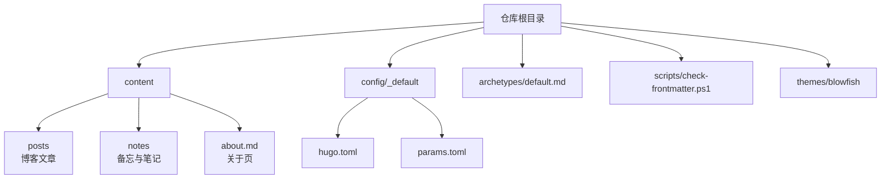
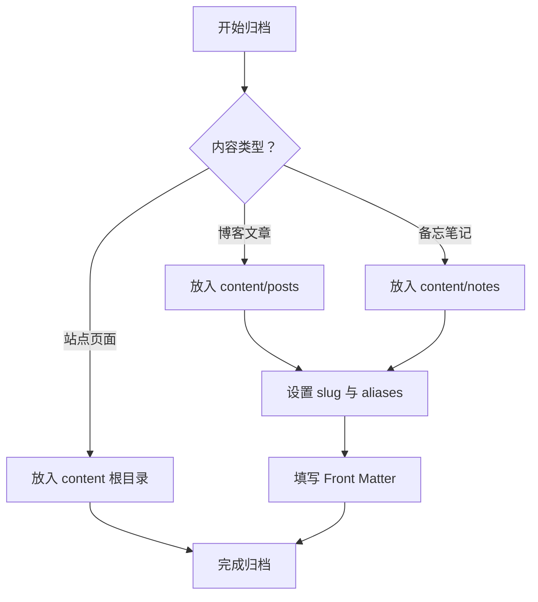
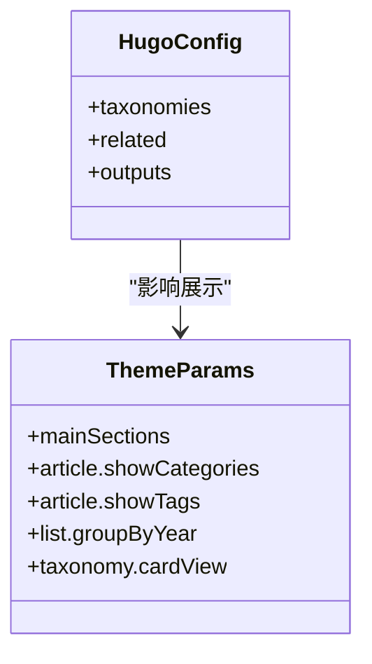
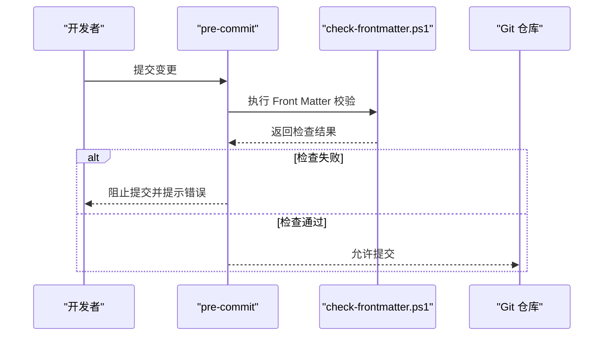
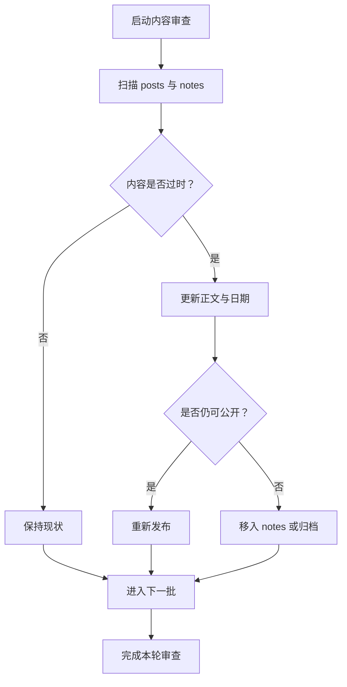
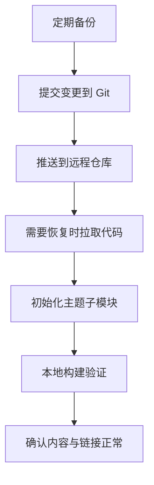
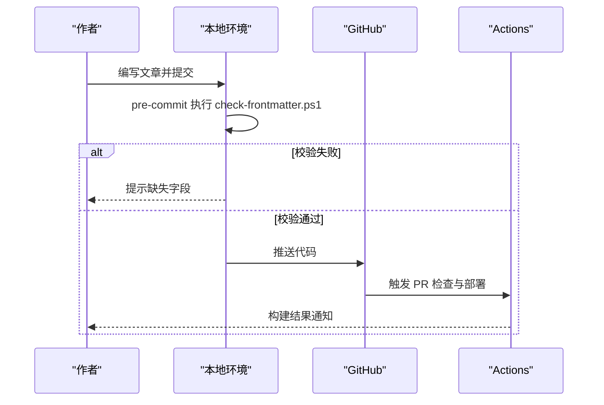

# 内容维护

<cite>
**本文引用的文件**   
- [README.md](file://README.md)
- [hugo.toml](file://config/_default/hugo.toml)
- [params.toml](file://config/_default/params.toml)
- [default.md](file://archetypes/default.md)
- [check-frontmatter.ps1](file://scripts/check-frontmatter.ps1)
- [_index.md（备忘）](file://content/notes/_index.md)
- [API路由命名规范.md](file://content/posts/API路由命名规范.md)
</cite>

## 目录
1. [引言](#引言)
2. [项目结构与内容定位](#项目结构与内容定位)
3. [核心维护目标与范围](#核心维护目标与范围)
4. [内容归档策略](#内容归档策略)
5. [分类、标签与索引维护](#分类标签与索引维护)
6. [链接检查与维护](#链接检查与维护)
7. [内容质量监控](#内容质量监控)
8. [过时内容审查与更新机制](#过时内容审查与更新机制)
9. [图片与资源管理](#图片与资源管理)
10. [备份与恢复策略](#备份与恢复策略)
11. [自动化流程与最佳实践](#自动化流程与最佳实践)
12. [故障排查指南](#故障排查指南)
13. [结论](#结论)

## 引言
本指南面向博客文章与技术笔记的日常维护，目标是建立一套可重复、可审计、可持续的内容治理流程。站点基于 Hugo 与 Blowfish 主题构建，内容以 Markdown 为主，通过 GitHub Actions 自动构建并部署到 GitHub Pages。日常维护应围绕“结构清晰、元数据完整、链接有效、内容准确、资源可控、版本可追溯”展开。

## 项目结构与内容定位
仓库采用按内容类型分目录的组织方式：
- `content/posts`：正式博客文章
- `content/notes`：备忘与技术笔记
- `content/about.md`：关于页
- `config/_default`：站点与主题配置
- `archetypes/default.md`：新文章模板
- `scripts/check-frontmatter.ps1`：Front Matter 必填字段校验脚本
- `themes/blowfish`：主题子模块，不建议直接修改

**图表来源**
- [README.md:14-39](file://README.md#L14-L39)
- [hugo.toml:1-27](file://config/_default/hugo.toml#L1-L27)
- [params.toml:1-13](file://config/_default/params.toml#L1-L13)
- [default.md:1-9](file://archetypes/default.md#L1-L9)
- [check-frontmatter.ps1:1-11](file://scripts/check-frontmatter.ps1#L1-L11)

**章节来源**
- [README.md:14-39](file://README.md#L14-L39)
- [hugo.toml:1-27](file://config/_default/hugo.toml#L1-L27)
- [params.toml:1-13](file://config/_default/params.toml#L1-L13)

## 核心维护目标与范围
- 内容归档：统一文章与笔记的存放位置，避免散落和重复
- 分类与标签：保持 taxonomy 一致，便于聚合与检索
- 内容索引：确保列表页、相关度、系列、作者等索引可用
- 链接健康：站内外部链接定期检查与修复
- 质量门禁：Front Matter 必填字段、SEO 基础项、图片资源规范
- 时效性：定期审查过时内容，标注更新时间或归档
- 数据安全：版本化备份与恢复演练

**章节来源**
- [README.md:75-127](file://README.md#L75-L127)
- [hugo.toml:23-77](file://config/_default/hugo.toml#L23-L77)
- [params.toml:46-87](file://config/_default/params.toml#L46-L87)

## 内容归档策略
### 目录划分原则
- 博客文章放入 `content/posts`
- 备忘与随手记录放入 `content/notes`
- 站点静态页面如“关于”放在 `content` 根目录

### 文件命名与 URL
- 使用英文 `slug` 生成稳定 URL，避免中文文件名导致 URL 不友好
- 可使用 `aliases` 保留旧路径，保证历史链接可访问

### 草稿与发布
- 新建文章默认 `draft = true`，发布前改为 `false`
- 本地预览草稿可使用开发服务器参数

**图表来源**
- [README.md:75-112](file://README.md#L75-L112)
- [default.md:1-9](file://archetypes/default.md#L1-L9)

**章节来源**
- [README.md:75-112](file://README.md#L75-L112)
- [default.md:1-9](file://archetypes/default.md#L1-L9)

## 分类、标签与索引维护
### Taxonomy 定义
站点启用以下分类体系：
- `tags`
- `categories`
- `authors`
- `series`

这些在站点配置中声明，并在主题参数中控制展示行为。

### 相关文章与权重
- 相关度计算基于 `tags`、`categories`、`series`、`authors`、`date`、`fragmentrefs`
- 权重越高越容易出现在相关文章中

### 列表与卡片展示
- 列表页支持卡片视图、按年分组、显示摘要
- 文章页可显示分类、标签、目录、阅读进度、评论、相关文章

**图表来源**
- [hugo.toml:23-77](file://config/_default/hugo.toml#L23-L77)
- [params.toml:46-87](file://config/_default/params.toml#L46-L87)

**章节来源**
- [hugo.toml:23-77](file://config/_default/hugo.toml#L23-L77)
- [params.toml:46-87](file://config/_default/params.toml#L46-L87)

## 链接检查与维护
### 站内链接
- 使用相对路径引用同站资源，避免硬编码域名
- 对历史文章使用 `aliases` 保留旧链接，减少 404

### 外部链接
- 定期检查外链是否失效，尤其是技术文档、工具官网、示例仓库
- 对外链增加 `rel="noopener"` 等安全属性（由主题渲染层处理时遵循主题实现）

### 建议的检查方法
- 本地构建后使用浏览器开发者工具检查控制台报错
- 使用第三方外链检测工具批量扫描
- 将常见外链纳入“待验证清单”，按月巡检

[本节为通用实践说明，不直接分析具体代码文件]

## 内容质量监控
### Front Matter 规范检查
脚本会检查 `content/posts` 下所有文章的 Front Matter 是否包含非空的必填字段：
- `slug`
- `description`
- `categories`
- `tags`

未通过检查会阻止提交与 CI 构建。

**图表来源**
- [check-frontmatter.ps1:1-37](file://scripts/check-frontmatter.ps1#L1-L37)
- [README.md:114-122](file://README.md#L114-L122)

**章节来源**
- [check-frontmatter.ps1:1-37](file://scripts/check-frontmatter.ps1#L1-L37)
- [README.md:114-122](file://README.md#L114-L122)

### SEO 优化验证
- 每篇文章必须填写 `description`，作为 SEO 描述
- 使用 `slug` 生成稳定且可读的 URL
- 合理使用 `categories` 与 `tags`，提升搜索引擎抓取与分类展示
- 社交分享图可通过主题参数设置默认图，或在文章中指定特色图

**章节来源**
- [README.md:87-100](file://README.md#L87-L100)
- [params.toml:15-19](file://config/_default/params.toml#L15-L19)

### 图片资源管理
- 站点级背景与社交分享图存放在 `assets/img`
- 文章内图片建议使用主题提供的 shortcode 或标准 Markdown 语法，并确保路径正确
- 图片压缩与格式优化建议在编辑阶段完成，避免增大站点体积

**章节来源**
- [README.md:18-20](file://README.md#L18-L20)
- [README.md:131-138](file://README.md#L131-L138)
- [params.toml:15-19](file://config/_default/params.toml#L15-L19)

## 过时内容审查与更新机制
### 审查周期
- 每季度进行一次全站内容健康检查
- 重点审查技术栈、依赖库、框架版本相关的文章

### 更新策略
- 若内容仍具参考价值但部分细节过期：更新正文并添加“最后更新时间”
- 若内容已完全过时：标记为归档或移至 notes，并在原 posts 中保留简短说明与跳转
- 对重要文章添加 `series`，形成知识体系，便于读者系统学习

### 时间维度展示
- 列表页支持按年分组，有助于发现长期未更新的文章
- 文章页可显示更新日期，帮助读者判断时效性

**图表来源**
- [params.toml:71-78](file://config/_default/params.toml#L71-L78)
- [params.toml:46-69](file://config/_default/params.toml#L46-L69)

**章节来源**
- [params.toml:71-78](file://config/_default/params.toml#L71-L78)
- [params.toml:46-69](file://config/_default/params.toml#L46-L69)

## 图片与资源管理
### 资源存放
- 站点背景、社交分享图等全局资源放在 `assets/img`
- 文章内图片建议统一管理，避免散落在多处

### 主题参数中的图片配置
- `defaultBackgroundImage`：全站背景图
- `defaultSocialImage`：OG/Twitter Card 默认图

### 最佳实践
- 使用现代图片格式（WebP/AVIF）并保留 PNG/JPG 兼容
- 图片尺寸适配不同屏幕，避免过大影响加载
- 对关键图片添加 alt 文本，提升可访问性与 SEO

**章节来源**
- [README.md:18-20](file://README.md#L18-L20)
- [README.md:131-138](file://README.md#L131-L138)
- [params.toml:15-19](file://config/_default/params.toml#L15-L19)

## 备份与恢复策略
### 版本化备份
- 利用 Git 进行版本控制，每次提交都构成一次快照
- 定期推送至远程仓库，避免本地丢失

### 恢复流程
- 从远程仓库克隆最新代码
- 初始化主题子模块
- 本地构建验证内容完整性

**图表来源**
- [README.md:49-65](file://README.md#L49-L65)
- [README.md:124-129](file://README.md#L124-L129)

**章节来源**
- [README.md:49-65](file://README.md#L49-L65)
- [README.md:124-129](file://README.md#L124-L129)

## 自动化流程与最佳实践
### 本地钩子与 CI
- pre-commit 钩子会在提交前执行 Front Matter 校验
- GitHub Actions 在 PR 与 main 分支上自动构建与部署

### 推荐工作流
- 写文章前先创建草稿，完善 Front Matter
- 本地运行校验脚本，确保必填字段齐全
- 提交前启用 hooks，避免遗漏检查
- PR 通过后自动部署，减少人工操作

**图表来源**
- [README.md:59-73](file://README.md#L59-L73)
- [README.md:114-129](file://README.md#L114-L129)
- [check-frontmatter.ps1:1-37](file://scripts/check-frontmatter.ps1#L1-L37)

**章节来源**
- [README.md:59-73](file://README.md#L59-L73)
- [README.md:114-129](file://README.md#L114-L129)
- [check-frontmatter.ps1:1-37](file://scripts/check-frontmatter.ps1#L1-L37)

## 故障排查指南
### Front Matter 校验失败
- 检查 `slug`、`description`、`categories`、`tags` 是否为空
- 确保数组不为空，字符串不为空
- 使用脚本输出错误信息定位问题文章

### 构建失败
- 检查 Hugo 版本是否与 `.hugo-version` 一致
- 确认主题子模块已初始化
- 查看 Actions 日志定位构建错误

### 链接 404
- 检查文章内链接路径是否正确
- 对历史路径使用 `aliases` 保留访问
- 外链失效及时替换或移除

**章节来源**
- [check-frontmatter.ps1:1-37](file://scripts/check-frontmatter.ps1#L1-L37)
- [README.md:49-73](file://README.md#L49-L73)
- [README.md:124-129](file://README.md#L124-L129)

## 结论
通过明确的内容归档策略、严格的 Front Matter 规范、完善的分类与索引配置、定期的链接与健康检查、以及自动化钩子与 CI 流程，可以显著提升博客与技术笔记的可维护性与可读性。建议将本指南纳入团队或个人的内容生产规范，持续迭代优化。