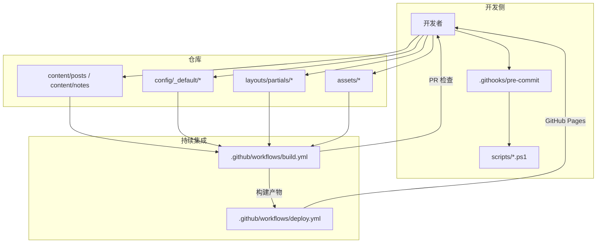
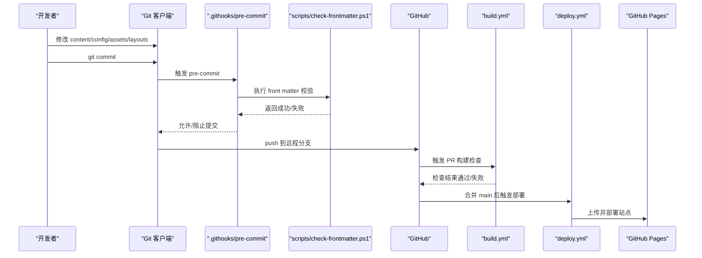
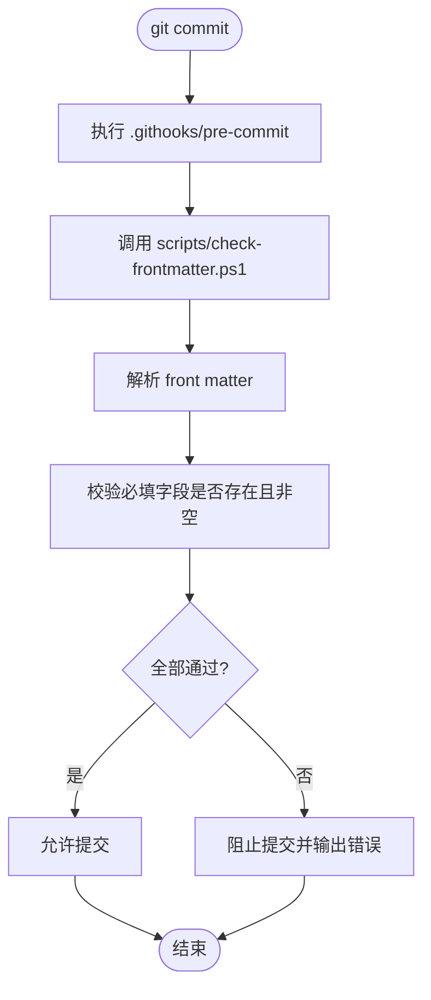
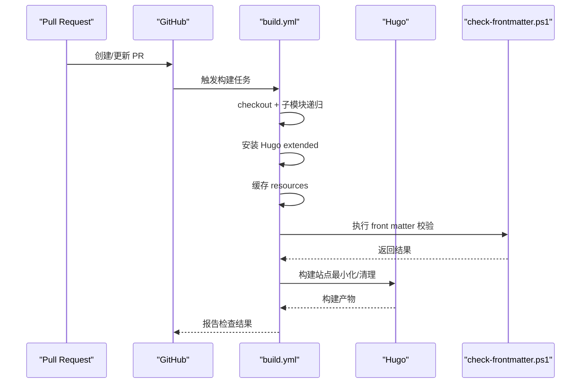
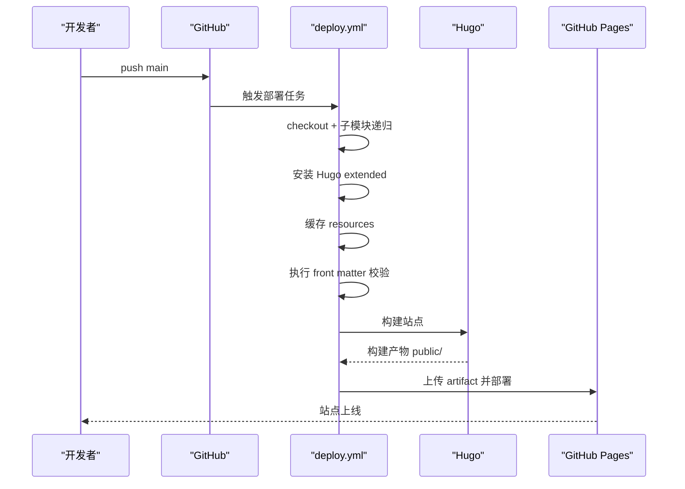
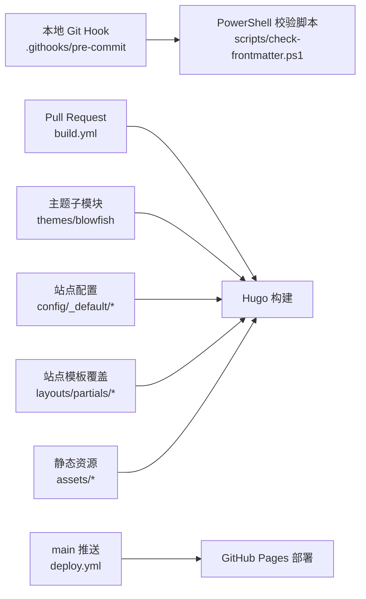

# 团队协作

<cite>
**本文引用的文件**   
- [README.md](file://README.md)
- [.github/workflows/build.yml](file://.github/workflows/build.yml)
- [.github/workflows/deploy.yml](file://.github/workflows/deploy.yml)
- [.githooks/pre-commit](file://.githooks/pre-commit)
- [scripts/setup-hooks.ps1](file://scripts/setup-hooks.ps1)
- [scripts/check-frontmatter.ps1](file://scripts/check-frontmatter.ps1)
- [AGENTS.md](file://AGENTS.md)
</cite>

## 目录
1. [简介](#简介)
2. [项目结构](#项目结构)
3. [核心组件](#核心组件)
4. [架构总览](#架构总览)
5. [详细组件分析](#详细组件分析)
6. [依赖关系分析](#依赖关系分析)
7. [性能与效率建议](#性能与效率建议)
8. [故障排查指南](#故障排查指南)
9. [结论](#结论)
10. [附录：新成员入职清单](#附录新成员入职清单)

## 简介
本团队协作指南面向多人协作场景，目标是保持代码质量与一致性。仓库基于 Hugo 静态站点生成器与 Blowfish 主题，通过 GitHub Actions 实现 PR 构建检查与 main 分支自动部署到 GitHub Pages。团队在本地通过 PowerShell 脚本启用 Git Hooks，确保每次提交前完成 front matter 必填字段校验；CI 中重复执行相同检查并构建站点，保证主分支始终可发布。

## 项目结构
仓库采用“内容驱动”的结构：配置集中在 `config/_default/`，文章内容位于 `content/posts/` 与 `content/notes/`，站点级模板覆盖放在 `layouts/partials/`，自动化脚本与钩子分别位于 `scripts/` 与 `.githooks/`，CI 工作流位于 `.github/workflows/`。主题以 git submodule 引入，避免直接修改主题源码。

图表来源
- [README.md:14-40](file://README.md#L14-L40)
- [.github/workflows/build.yml:1-40](file://.github/workflows/build.yml#L1-L40)
- [.github/workflows/deploy.yml:1-64](file://.github/workflows/deploy.yml#L1-L64)

章节来源
- [README.md:14-40](file://README.md#L14-L40)

## 核心组件
- 本地质量门禁：`.githooks/pre-commit` 调用 `scripts/check-frontmatter.ps1`，在提交前校验文章 front matter 必填字段（slug、description、categories、tags）。
- CI 构建检查：`.github/workflows/build.yml` 在 PR 触发时拉取主题子模块、安装 Hugo extended、缓存资源、执行 front matter 校验并构建站点。
- 自动部署：`.github/workflows/deploy.yml` 在推送到 main 分支或手动触发时构建并部署到 GitHub Pages。
- 环境初始化：`scripts/setup-hooks.ps1` 将 `core.hooksPath` 指向 `.githooks`，启用仓库内 hooks。

章节来源
- [.githooks/pre-commit:1-6](file://.githooks/pre-commit#L1-L6)
- [scripts/check-frontmatter.ps1:1-37](file://scripts/check-frontmatter.ps1#L1-L37)
- [.github/workflows/build.yml:1-40](file://.github/workflows/build.yml#L1-L40)
- [.github/workflows/deploy.yml:1-64](file://.github/workflows/deploy.yml#L1-L64)
- [scripts/setup-hooks.ps1:1-5](file://scripts/setup-hooks.ps1#L1-L5)

## 架构总览
下图展示从本地提交到线上发布的端到端流程：开发者在本地编写内容与配置，Git Hook 拦截提交并进行 front matter 校验；PR 触发 CI 构建检查；合并至 main 后自动部署到 GitHub Pages。

图表来源
- [.githooks/pre-commit:1-6](file://.githooks/pre-commit#L1-L6)
- [scripts/check-frontmatter.ps1:1-37](file://scripts/check-frontmatter.ps1#L1-L37)
- [.github/workflows/build.yml:1-40](file://.github/workflows/build.yml#L1-L40)
- [.github/workflows/deploy.yml:1-64](file://.github/workflows/deploy.yml#L1-L64)

## 详细组件分析

### 预提交钩子与质量检查
- 钩子入口：`.githooks/pre-commit` 使用 shell 脚本调用 PowerShell 执行校验逻辑。
- 校验规则：`scripts/check-frontmatter.ps1` 遍历 `content/posts` 下的 Markdown 文件，解析 front matter，检查 slug、description、categories、tags 是否非空且存在。
- 启用方式：运行 `scripts/setup-hooks.ps1` 设置 `core.hooksPath=.githooks`。

图表来源
- [.githooks/pre-commit:1-6](file://.githooks/pre-commit#L1-L6)
- [scripts/check-frontmatter.ps1:1-37](file://scripts/check-frontmatter.ps1#L1-L37)
- [scripts/setup-hooks.ps1:1-5](file://scripts/setup-hooks.ps1#L1-L5)

章节来源
- [.githooks/pre-commit:1-6](file://.githooks/pre-commit#L1-L6)
- [scripts/check-frontmatter.ps1:1-37](file://scripts/check-frontmatter.ps1#L1-L37)
- [scripts/setup-hooks.ps1:1-5](file://scripts/setup-hooks.ps1#L1-L5)

### Pull Request 构建检查
- 触发条件：对 main 分支的 pull_request。
- 关键步骤：
  - 递归拉取主题子模块。
  - 安装 Hugo extended（版本由配置文件锁定）。
  - 缓存 Hugo 资源目录以提升速度。
  - 执行 front matter 校验脚本。
  - 执行 hugo --minify --gc --cleanDestinationDir 构建站点。

图表来源
- [.github/workflows/build.yml:1-40](file://.github/workflows/build.yml#L1-L40)
- [scripts/check-frontmatter.ps1:1-37](file://scripts/check-frontmatter.ps1#L1-L37)

章节来源
- [.github/workflows/build.yml:1-40](file://.github/workflows/build.yml#L1-L40)

### 自动部署到 GitHub Pages
- 触发条件：push 到 main 分支或 workflow_dispatch 手动触发。
- 关键步骤：
  - 递归拉取主题子模块。
  - 安装 Hugo extended。
  - 缓存 Hugo 资源。
  - 执行 front matter 校验。
  - 构建站点并上传 artifact。
  - 部署到 GitHub Pages 环境。

图表来源
- [.github/workflows/deploy.yml:1-64](file://.github/workflows/deploy.yml#L1-L64)

章节来源
- [.github/workflows/deploy.yml:1-64](file://.github/workflows/deploy.yml#L1-L64)

### 开发环境与快速开始
- 环境要求：Hugo extended（版本由仓库锁定）、PowerShell 7+。
- 首次克隆：需初始化主题子模块。
- 启用 Git Hooks：执行 `scripts/setup-hooks.ps1`。
- 启动开发服务器：`hugo server`，支持热更新与草稿预览。

章节来源
- [README.md:42-73](file://README.md#L42-L73)

### 写文章与 Front Matter 规范
- 使用 `hugo new` 创建 posts 或 notes 文章。
- Front Matter 必填字段：slug、description、categories、tags。缺失或为空会被本地 Hook 与 CI 同时拦截。
- slug 用于生成英文 URL，避免中文文件名导致的 URL 问题。

章节来源
- [README.md:75-122](file://README.md#L75-L122)
- [scripts/check-frontmatter.ps1:1-37](file://scripts/check-frontmatter.ps1#L1-L37)

## 依赖关系分析
- 本地钩子依赖 PowerShell 与 Hugo 配置；CI 依赖 GitHub Actions、Hugo extended、主题子模块。
- 构建产物为静态站点目录，供 GitHub Pages 托管。
- 主题作为子模块引入，升级时需单独操作，避免覆盖站点级定制。

图表来源
- [.githooks/pre-commit:1-6](file://.githooks/pre-commit#L1-L6)
- [scripts/check-frontmatter.ps1:1-37](file://scripts/check-frontmatter.ps1#L1-L37)
- [.github/workflows/build.yml:1-40](file://.github/workflows/build.yml#L1-L40)
- [.github/workflows/deploy.yml:1-64](file://.github/workflows/deploy.yml#L1-L64)
- [README.md:14-40](file://README.md#L14-L40)

章节来源
- [README.md:14-40](file://README.md#L14-L40)
- [.github/workflows/build.yml:1-40](file://.github/workflows/build.yml#L1-L40)
- [.github/workflows/deploy.yml:1-64](file://.github/workflows/deploy.yml#L1-L64)

## 性能与效率建议
- 利用 CI 缓存 Hugo 资源目录以减少构建时间。
- 本地优先运行 Hook 与构建脚本，减少 PR 失败次数。
- 合理拆分 PR，聚焦单一变更，便于审查与回滚。
- 谨慎升级主题子模块，先验证站点级自定义不受影响。

[本节为通用建议，不直接分析具体文件]

## 故障排查指南
- Hook 未生效：确认已执行 `scripts/setup-hooks.ps1`，检查 `core.hooksPath` 是否为 `.githooks`。
- front matter 校验失败：根据错误提示补全 slug、description、categories、tags，并确保非空。
- CI 构建失败：检查主题子模块是否正确拉取、Hugo 版本是否匹配、front matter 是否完整。
- 部署失败：确认 main 分支推送触发了 deploy.yml，且 GitHub Pages 权限配置正确。

章节来源
- [scripts/setup-hooks.ps1:1-5](file://scripts/setup-hooks.ps1#L1-L5)
- [scripts/check-frontmatter.ps1:1-37](file://scripts/check-frontmatter.ps1#L1-L37)
- [.github/workflows/build.yml:1-40](file://.github/workflows/build.yml#L1-L40)
- [.github/workflows/deploy.yml:1-64](file://.github/workflows/deploy.yml#L1-L64)

## 结论
通过本地 Git Hook 与 CI 的双重保障，团队可在提交阶段即发现并修复 front matter 缺失等常见问题，降低 PR 失败率与返工成本。结合清晰的写文章规范与自动化部署流程，团队能高效协作并保持站点质量稳定。

[本节为总结性内容，不直接分析具体文件]

## 附录：新成员入职清单
- 安装 Hugo extended（版本见仓库锁定文件）与 PowerShell 7+。
- 克隆仓库并初始化主题子模块。
- 执行 `scripts/setup-hooks.ps1` 启用本地 Hook。
- 使用 `hugo new` 创建文章，填写必填 front matter 字段。
- 本地运行 `hugo server` 预览站点。
- 提交 PR 后关注 build.yml 检查结果，修复失败项后再合并。
- 合并 main 后等待 deploy.yml 完成部署，验证线上站点。

章节来源
- [README.md:42-128](file://README.md#L42-L128)
- [AGENTS.md:31-61](file://AGENTS.md#L31-L61)