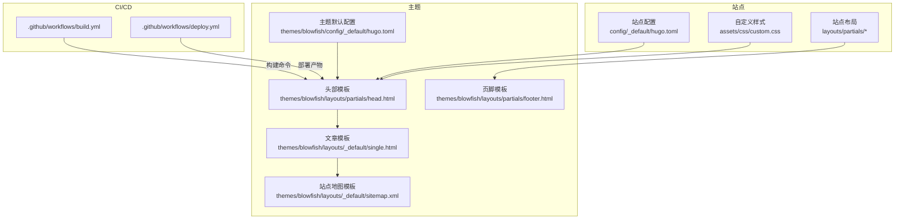
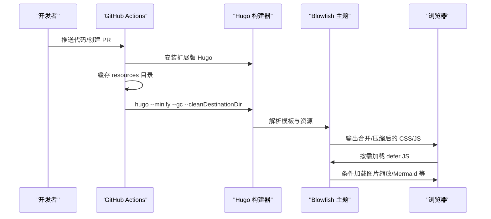
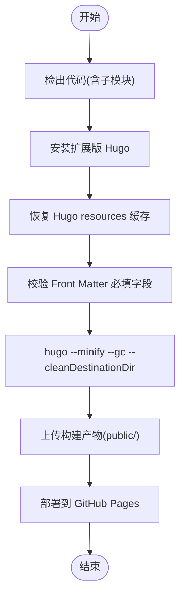
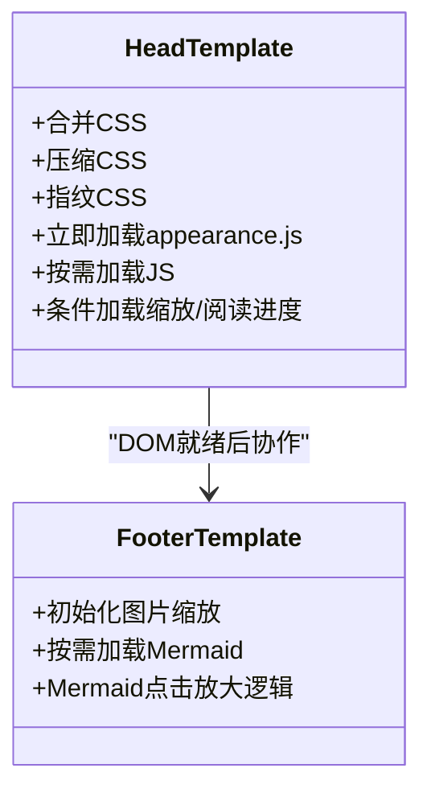
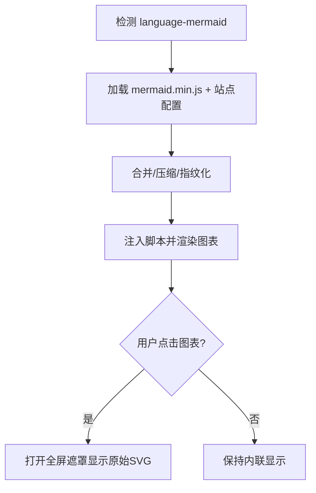
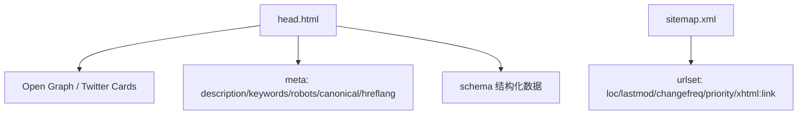
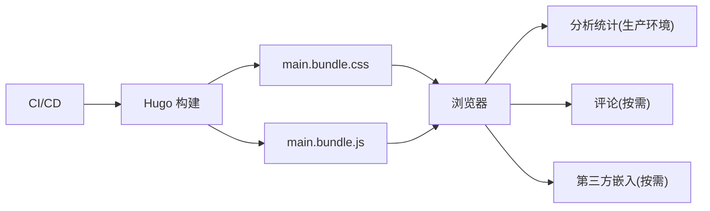

# 性能优化

<cite>
**本文引用的文件**   
- [config/_default/hugo.toml](file://config/_default/hugo.toml)
- [themes/blowfish/config/_default/hugo.toml](file://themes/blowfish/config/_default/hugo.toml)
- [.github/workflows/build.yml](file://.github/workflows/build.yml)
- [.github/workflows/deploy.yml](file://.github/workflows/deploy.yml)
- [themes/blowfish/layouts/partials/head.html](file://themes/blowfish/layouts/partials/head.html)
- [layouts/partials/footer.html](file://layouts/partials/footer.html)
- [assets/css/custom.css](file://assets/css/custom.css)
- [themes/blowfish/layouts/_default/sitemap.xml](file://themes/blowfish/layouts/_default/sitemap.xml)
- [themes/blowfish/layouts/_default/single.html](file://themes/blowfish/layouts/_default/single.html)
</cite>

## 目录
1. [简介](#简介)
2. [项目结构](#项目结构)
3. [核心组件](#核心组件)
4. [架构总览](#架构总览)
5. [详细组件分析](#详细组件分析)
6. [依赖分析](#依赖分析)
7. [性能考量](#性能考量)
8. [故障排查指南](#故障排查指南)
9. [结论](#结论)
10. [附录](#附录)

## 简介
本指南面向使用 Hugo + Blowfish 主题的站点，聚焦“构建期优化、前端资源优化、SEO 相关性能优化、监控与分析、持续优化与最佳实践”，帮助提升页面加载速度与用户体验。文档基于仓库现有配置与模板进行解读，并给出可落地的优化建议与流程图示。

## 项目结构
本项目采用标准 Hugo 站点结构：
- 站点配置位于 config/_default/
- 主题位于 themes/blowfish/
- 自定义样式在 assets/css/custom.css
- 布局与部分视图在 layouts/ 与 themes/blowfish/layouts/
- CI/CD 工作流在 .github/workflows/

图表来源
- [config/_default/hugo.toml:1-78](file://config/_default/hugo.toml#L1-L78)
- [themes/blowfish/config/_default/hugo.toml:1-70](file://themes/blowfish/config/_default/hugo.toml#L1-L70)
- [themes/blowfish/layouts/partials/head.html:1-250](file://themes/blowfish/layouts/partials/head.html#L1-L250)
- [layouts/partials/footer.html:1-205](file://layouts/partials/footer.html#L1-L205)
- [themes/blowfish/layouts/_default/single.html:1-139](file://themes/blowfish/layouts/_default/single.html#L1-L139)
- [themes/blowfish/layouts/_default/sitemap.xml:1-24](file://themes/blowfish/layouts/_default/sitemap.xml#L1-L24)
- [.github/workflows/build.yml:1-40](file://.github/workflows/build.yml#L1-L40)
- [.github/workflows/deploy.yml:1-64](file://.github/workflows/deploy.yml#L1-L64)

章节来源
- [config/_default/hugo.toml:1-78](file://config/_default/hugo.toml#L1-L78)
- [themes/blowfish/config/_default/hugo.toml:1-70](file://themes/blowfish/config/_default/hugo.toml#L1-L70)

## 核心组件
- 构建参数与缓存策略：通过 GitHub Actions 缓存 Hugo 资源目录 resources，并使用 hugo --minify --gc --cleanDestinationDir 生成最小化、清理无用资源的静态站点。
- 资源打包与压缩：主题 head 模板将 CSS/JS 资源合并、压缩并添加指纹；按需加载 JS（defer），条件加载图片缩放等库。
- SEO 与结构化数据：head 模板输出 Open Graph/Twitter Card、canonical、hreflang、验证标签；sitemap 模板支持多语言与优先级控制。
- 前端交互与体验：页脚实现 Mermaid 放大预览、图片缩放初始化；单页模板提供阅读进度条、目录等可选功能。

章节来源
- [.github/workflows/build.yml:26-39](file://.github/workflows/build.yml#L26-L39)
- [.github/workflows/deploy.yml:33-46](file://.github/workflows/deploy.yml#L33-L46)
- [themes/blowfish/layouts/partials/head.html:120-208](file://themes/blowfish/layouts/partials/head.html#L120-L208)
- [themes/blowfish/layouts/partials/head.html:223-229](file://themes/blowfish/layouts/partials/head.html#L223-L229)
- [themes/blowfish/layouts/_default/sitemap.xml:1-24](file://themes/blowfish/layouts/_default/sitemap.xml#L1-L24)
- [layouts/partials/footer.html:63-99](file://layouts/partials/footer.html#L63-L99)
- [themes/blowfish/layouts/_default/single.html:1-10](file://themes/blowfish/layouts/_default/single.html#L1-L10)

## 架构总览
下图展示从构建到渲染的关键路径：CI 触发构建 → Hugo 编译 → 主题 head 模板组装 CSS/JS 资源 → 浏览器加载与执行。

图表来源
- [.github/workflows/build.yml:21-39](file://.github/workflows/build.yml#L21-L39)
- [.github/workflows/deploy.yml:28-46](file://.github/workflows/deploy.yml#L28-L46)
- [themes/blowfish/layouts/partials/head.html:120-208](file://themes/blowfish/layouts/partials/head.html#L120-L208)

## 详细组件分析

### Hugo 构建优化与缓存策略
- 构建参数
  - --minify：对 HTML/CSS/JS 进行压缩，减少传输体积。
  - --gc：清理未使用的资源，降低最终产物大小。
  - --cleanDestinationDir：每次构建前清空输出目录，避免旧文件残留。
- 缓存策略
  - 使用 actions/cache 缓存 Hugo 的 resources 目录，以配置哈希作为 key，显著缩短二次构建时间。
- 版本一致性
  - 使用 peaceiris/actions-hugo@v3 并启用 extended 模式，确保本地与 CI 环境一致。

图表来源
- [.github/workflows/build.yml:15-39](file://.github/workflows/build.yml#L15-L39)
- [.github/workflows/deploy.yml:22-64](file://.github/workflows/deploy.yml#L22-L64)

章节来源
- [.github/workflows/build.yml:21-39](file://.github/workflows/build.yml#L21-L39)
- [.github/workflows/deploy.yml:28-46](file://.github/workflows/deploy.yml#L28-L46)

### 前端资源优化（CSS/JS）
- CSS 优化
  - 主题 head 模板将 scheme CSS、compiled/main.css 与 custom.css 合并为 main.bundle.css，并进行 Minify 与 Fingerprint。
  - 图片缩放样式仅在未禁用时引入，减少不必要开销。
- JS 优化
  - appearance.js 立即加载，用于主题外观初始化。
  - 其他脚本通过 defer 延迟执行，避免阻塞渲染。
  - 按需加载：搜索、代码复制、RTL、KaTeX、菜单无障碍、打印支持、邮件链接等按开关或页面类型加载。
  - 图片缩放与 Mermaid 按需加载，减少首屏负担。

图表来源
- [themes/blowfish/layouts/partials/head.html:120-208](file://themes/blowfish/layouts/partials/head.html#L120-L208)
- [layouts/partials/footer.html:63-99](file://layouts/partials/footer.html#L63-L99)

章节来源
- [themes/blowfish/layouts/partials/head.html:120-208](file://themes/blowfish/layouts/partials/head.html#L120-L208)
- [layouts/partials/footer.html:63-99](file://layouts/partials/footer.html#L63-L99)

### 图片与媒体优化
- 图片缩放
  - 通过 mediumZoom 在 DOMContentLoaded 后初始化，支持遮罩放大与滚动偏移控制。
  - 可通过 site.Params.disableImageZoom 关闭以节省带宽。
- Mermaid 图表
  - 当检测到 language-mermaid 代码块时，动态加载 mermaid.min.js 与站点配置脚本，合并压缩并指纹化。
  - 提供点击放大全屏预览，避免大图缩放模糊。

图表来源
- [layouts/partials/footer.html:78-99](file://layouts/partials/footer.html#L78-L99)
- [layouts/partials/footer.html:99-199](file://layouts/partials/footer.html#L99-L199)

章节来源
- [layouts/partials/footer.html:63-99](file://layouts/partials/footer.html#L63-L99)
- [layouts/partials/footer.html:78-199](file://layouts/partials/footer.html#L78-L199)

### 字体与排版优化
- 代码字体优先本地等宽字体，回退系统字体，减少外部字体请求。
- 文章宽度与目录布局优化，桌面端悬浮目录不挤占正文宽度，提升可读性。
- 相关文章卡片高度压缩，隐藏分类/标签胶囊以减少重排。

章节来源
- [assets/css/custom.css:5-11](file://assets/css/custom.css#L5-L11)
- [assets/css/custom.css:250-309](file://assets/css/custom.css#L250-L309)
- [assets/css/custom.css:260-270](file://assets/css/custom.css#L260-L270)

### SEO 相关性能优化
- Meta 与社交分享
  - head 模板自动输出 title、description、keywords、robots、canonical、hreflang、Open Graph/Twitter Cards。
  - 支持站点与页面级 robots 覆盖。
- 站点地图
  - sitemap 模板支持排除规则、lastmod、changefreq、priority 与多语言 hreflang。
- 结构化数据
  - head 模板调用 schema partial，便于搜索引擎理解内容。

图表来源
- [themes/blowfish/layouts/partials/head.html:10-59](file://themes/blowfish/layouts/partials/head.html#L10-L59)
- [themes/blowfish/layouts/partials/head.html:223-229](file://themes/blowfish/layouts/partials/head.html#L223-L229)
- [themes/blowfish/layouts/_default/sitemap.xml:1-24](file://themes/blowfish/layouts/_default/sitemap.xml#L1-L24)

章节来源
- [themes/blowfish/layouts/partials/head.html:10-59](file://themes/blowfish/layouts/partials/head.html#L10-L59)
- [themes/blowfish/layouts/partials/head.html:223-229](file://themes/blowfish/layouts/partials/head.html#L223-L229)
- [themes/blowfish/layouts/_default/sitemap.xml:1-24](file://themes/blowfish/layouts/_default/sitemap.xml#L1-L24)

### 阅读体验与交互优化
- 阅读进度条：可在文章级别开启，仅对文章页加载对应 JS。
- 目录（TOC）：根据文章内容自动生成，桌面端固定定位，移动端不受影响。
- 作者信息、系列导航、分享链接等按需渲染。

章节来源
- [themes/blowfish/layouts/_default/single.html:1-10](file://themes/blowfish/layouts/_default/single.html#L1-L10)
- [themes/blowfish/layouts/_default/single.html:40-51](file://themes/blowfish/layouts/_default/single.html#L40-L51)
- [themes/blowfish/layouts/_default/single.html:54-85](file://themes/blowfish/layouts/_default/single.html#L54-L85)

## 依赖分析
- 构建阶段
  - GitHub Actions 拉取主题子模块，安装扩展版 Hugo，缓存 resources，执行构建命令。
- 运行阶段
  - 主题 head 模板依赖 Tailwind 编译产物 main.css、scheme CSS 与 custom.css。
  - JS 依赖 appearance.js、zoom、search、katex 等可选库。
- 外部服务
  - 分析统计（analytics）、评论（giscus）、第三方嵌入（YouTube Lite）按需加载。

图表来源
- [.github/workflows/build.yml:21-39](file://.github/workflows/build.yml#L21-L39)
- [themes/blowfish/layouts/partials/head.html:120-208](file://themes/blowfish/layouts/partials/head.html#L120-L208)
- [themes/blowfish/layouts/partials/head.html:223-229](file://themes/blowfish/layouts/partials/head.html#L223-L229)

章节来源
- [.github/workflows/build.yml:21-39](file://.github/workflows/build.yml#L21-L39)
- [themes/blowfish/layouts/partials/head.html:120-208](file://themes/blowfish/layouts/partials/head.html#L120-L208)

## 性能考量
- 构建期
  - 始终启用 --minify --gc --cleanDestinationDir，确保产物最小且干净。
  - 利用 actions/cache 缓存 resources，加速重复构建。
- 资源加载
  - CSS 合并压缩+指纹；JS 按需 defer 加载；图片缩放与 Mermaid 按需加载。
  - 关闭不必要的功能（如 disableImageZoom、enableSearch=false）以减少包体。
- 缓存与复用
  - 指纹化资源利于浏览器缓存；CI 缓存减少构建时间。
- 可观测性
  - 在生产环境启用 analytics，结合 Lighthouse 等工具评估性能指标。

[本节为通用指导，无需特定文件引用]

## 故障排查指南
- 构建缓慢
  - 检查是否启用了 resources 缓存；确认 config/** 变更会刷新缓存键。
  - 确认 Hugo 版本一致（extended）。
- 资源未压缩或未缓存
  - 检查 head 模板是否正确 Concat/Minify/Fingerprint。
  - 确认 CDN/服务器已设置合适的缓存头（由托管平台负责）。
- Mermaid 不渲染或放大异常
  - 检查是否包含 language-mermaid 代码块；确认 footer 中 Mermaid 脚本注入逻辑存在。
- 图片缩放无效
  - 检查 disableImageZoom 是否被设置为 true；确认 DOMContentLoaded 后 mediumZoom 初始化成功。

章节来源
- [.github/workflows/build.yml:26-39](file://.github/workflows/build.yml#L26-L39)
- [themes/blowfish/layouts/partials/head.html:120-208](file://themes/blowfish/layouts/partials/head.html#L120-L208)
- [layouts/partials/footer.html:63-99](file://layouts/partials/footer.html#L63-L99)
- [layouts/partials/footer.html:78-199](file://layouts/partials/footer.html#L78-L199)

## 结论
通过合理的 Hugo 构建参数、CI 缓存、主题资源打包与按需加载策略，以及 SEO 元信息与结构化数据的完善，站点可获得更快的构建速度与更优的首屏加载表现。配合持续的性能监控与迭代优化，可长期稳定地提升用户体验。

[本节为总结性内容，无需特定文件引用]

## 附录
- 常用优化清单
  - 启用 hugo --minify --gc --cleanDestinationDir
  - 缓存 Hugo resources 目录
  - 关闭非必要功能（图片缩放、搜索、代码复制等）
  - 按需加载第三方脚本（Mermaid、YouTube Lite、分析统计）
  - 使用 canonical、hreflang、OG/Twitter Cards、Schema
  - 定期用 Lighthouse/WebPageTest 评估性能并修复瓶颈

[本节为补充说明，无需特定文件引用]