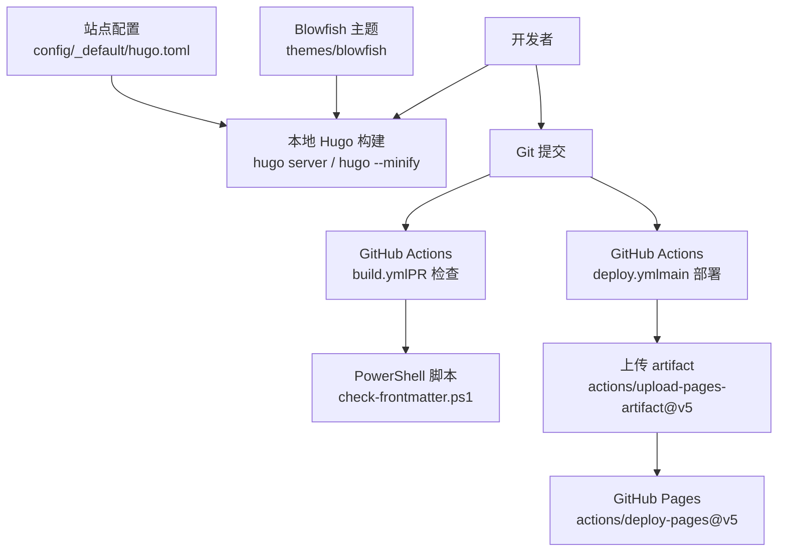
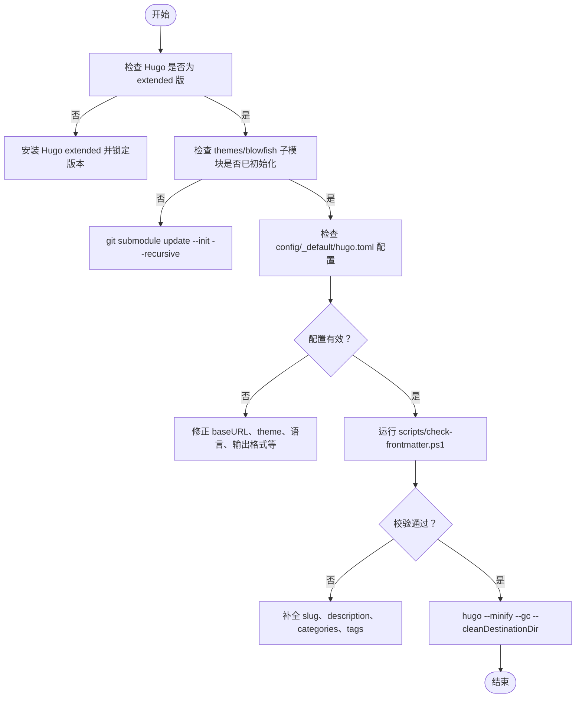

# 故障排除

<cite>
**本文引用的文件**   
- [README.md](file://README.md)
- [hugo.toml](file://config/_default/hugo.toml)
- [build.yml](file://.github/workflows/build.yml)
- [deploy.yml](file://.github/workflows/deploy.yml)
- [check-hugo-update.yml](file://.github/workflows/check-hugo-update.yml)
- [.gitmodules](file://.gitmodules)
- [check-frontmatter.ps1](file://scripts/check-frontmatter.ps1)
</cite>

## 目录
1. [引言](#引言)
2. [项目结构与排查范围](#项目结构与排查范围)
3. [核心组件与依赖关系](#核心组件与依赖关系)
4. [构建失败排查](#构建失败排查)
5. [部署失败排查](#部署失败排查)
6. [性能问题诊断](#性能问题诊断)
7. [日志分析方法](#日志分析方法)
8. [常见错误解决方案库](#常见错误解决方案库)
9. [预防措施与最佳实践](#预防措施与最佳实践)
10. [结论](#结论)

## 引言
本指南面向使用 Hugo 与 Blowfish 主题、并通过 GitHub Actions 自动构建和部署到 GitHub Pages 的个人博客仓库。目标是帮助你在本地开发、提交检查、持续集成、发布部署等阶段快速定位并解决常见问题，包括：
- 构建失败：Hugo 版本不匹配、扩展版缺失、子模块未初始化、配置错误、Front Matter 校验失败等
- 部署失败：GitHub Actions 权限不足、Pages 环境未启用、缓存污染、分支触发异常等
- 性能问题：构建时间过长、页面加载缓慢、资源体积过大、内存占用过高
- 日志分析：如何从 Actions 日志、Hugo 输出、脚本输出中定位根因
- 常见错误库与预防机制：减少重复问题发生

## 项目结构与排查范围
该仓库采用“站点 + 主题子模块”的结构：
- 站点配置位于 `config/_default/`，核心为 `hugo.toml`
- 内容位于 `content/`，包含文章与笔记
- 主题通过 Git Submodule 引入 `themes/blowfish`
- 自动化由 `.github/workflows/` 中的多个工作流负责：PR 构建检查、主分支部署、Hugo 版本更新检查
- 质量检查脚本位于 `scripts/check-frontmatter.ps1`，用于强制 Front Matter 必填字段

**图表来源**
- [README.md:14-39](file://README.md#L14-L39)
- [build.yml:10-39](file://.github/workflows/build.yml#L10-L39)
- [deploy.yml:17-63](file://.github/workflows/deploy.yml#L17-L63)
- [check-frontmatter.ps1:1-37](file://scripts/check-frontmatter.ps1#L1-L37)
- [hugo.toml:1-78](file://config/_default/hugo.toml#L1-L78)

**章节来源**
- [README.md:14-39](file://README.md#L14-L39)

## 核心组件与依赖关系
关键依赖与职责：
- Hugo extended：静态站点生成器，必须使用扩展版以支持主题样式编译
- Blowfish 主题：通过 Git Submodule 引入，不应直接修改
- GitHub Actions：
  - build.yml：在 PR 时执行 Front Matter 校验与最小化构建
  - deploy.yml：在 main 分支推送或手动触发时构建并部署到 GitHub Pages
  - check-hugo-update.yml：定期检查 Hugo 最新版本并创建更新 PR
- PowerShell 脚本：校验文章 Front Matter 必填字段

**图表来源**
- [build.yml:21-39](file://.github/workflows/build.yml#L21-L39)
- [deploy.yml:28-46](file://.github/workflows/deploy.yml#L28-L46)
- [check-frontmatter.ps1:4-36](file://scripts/check-frontmatter.ps1#L4-L36)
- [hugo.toml:1-78](file://config/_default/hugo.toml#L1-L78)

**章节来源**
- [README.md:42-73](file://README.md#L42-L73)
- [build.yml:10-39](file://.github/workflows/build.yml#L10-L39)
- [deploy.yml:17-63](file://.github/workflows/deploy.yml#L17-L63)
- [check-frontmatter.ps1:1-37](file://scripts/check-frontmatter.ps1#L1-L37)
- [hugo.toml:1-78](file://config/_default/hugo.toml#L1-L78)

## 构建失败排查
### 1. Hugo 版本不匹配或未使用扩展版
现象：
- 本地构建报错，提示缺少 CSS 类或样式为空
- CI 构建失败，提示无法解析主题样式或 SCSS/Tailwind 相关功能

原因：
- 未安装 Hugo extended 版
- 本地 Hugo 版本与 CI 不一致
- 版本锁定文件缺失或未被正确读取

处理步骤：
- 确认已安装 Hugo extended 版
- 确认工作流使用 peaceiris/actions-hugo@v3，并开启 extended: true
- 确保存在 `.hugo-version` 文件以锁定版本；若缺失，请根据 README 说明添加对应版本
- 若存在 `.hugo-version`，CI 会自动使用该版本；否则需补充该文件

参考依据：
- README 明确说明使用 Hugo extended，版本由 `.hugo-version` 锁定
- build.yml 与 deploy.yml 均使用 actions-hugo 并设置 extended: true
- check-hugo-update.yml 会读取 `.hugo-version` 并与最新发行版比较

**章节来源**
- [README.md:9,46:9-9](file://README.md#L9-L9)
- [README.md:46-47](file://README.md#L46-L47)
- [build.yml:21-24](file://.github/workflows/build.yml#L21-L24)
- [deploy.yml:28-31](file://.github/workflows/deploy.yml#L28-L31)
- [check-hugo-update.yml:25-49](file://.github/workflows/check-hugo-update.yml#L25-L49)

### 2. 主题子模块未初始化
现象：
- 构建时报错找不到 themes/blowfish
- 本地或 CI 无法加载主题模板与资源

原因：
- 克隆仓库后未执行 `git submodule update --init --recursive`
- .gitmodules 指向的远程地址不可达或被限制

处理步骤：
- 执行 `git submodule update --init --recursive`
- 检查 `.gitmodules` 是否正确指向 blowfish 主题仓库
- 如网络受限，可考虑更换镜像或代理

**章节来源**
- [README.md:49-57](file://README.md#L49-L57)
- [.gitmodules:1-4](file://.gitmodules#L1-L4)

### 3. Front Matter 校验失败
现象：
- PowerShell 脚本输出错误，指出某篇文章缺少必填字段
- PR 检查或 pre-commit 钩子阻止提交

原因：
- 文章 front matter 缺少 `slug`、`description`、`categories`、`tags`
- 字段值为空或仅包含引号/空白

处理步骤：
- 运行 `pwsh -NoProfile -File scripts/check-frontmatter.ps1` 查看具体错误
- 按脚本提示补全必填字段，并确保非空
- 如需批量修复，可先导出文章列表再逐一补齐

**章节来源**
- [scripts/check-frontmatter.ps1:4-36](file://scripts/check-frontmatter.ps1#L4-L36)
- [README.md:114-122](file://README.md#L114-L122)

### 4. 站点配置错误
现象：
- 构建成功但访问路径不正确
- 多语言或输出格式不符合预期
- 相关文章、标签、分类索引异常

原因：
- `baseURL`、`theme`、`defaultContentLanguage` 配置不正确
- `outputs`、`mediaTypes`、`outputFormats` 配置异常
- `taxonomies` 未定义或名称不一致

处理步骤：
- 检查 `config/_default/hugo.toml` 的核心配置项
- 确认 `baseURL` 与 GitHub Pages 域名一致
- 确认 `theme = 'blowfish'` 且主题子模块可用
- 确认 `outputs.home` 与 `outputs.page` 符合需求
- 确认 `taxonomies` 与文章内容中的分类、标签、系列、作者字段一致

**章节来源**
- [config/_default/hugo.toml:1-78](file://config/_default/hugo.toml#L1-L78)

## 部署失败排查
### 1. GitHub Actions 权限不足
现象：
- deploy.yml 报权限错误，无法写入 Pages 或 id-token
- PR 构建正常但部署失败

原因：
- workflow 未声明 `pages: write` 与 `id-token: write`
- 仓库未启用 GitHub Pages 环境

处理步骤：
- 确认 deploy.yml 的 permissions 包含 `contents: read`、`pages: write`、`id-token: write`
- 在仓库 Settings → Pages 中启用 GitHub Pages
- 确认 environment 名称为 `github-pages`，与 deploy.yml 一致

**章节来源**
- [deploy.yml:8-15](file://.github/workflows/deploy.yml#L8-L15)
- [deploy.yml:53-63](file://.github/workflows/deploy.yml#L53-L63)

### 2. 分支触发异常
现象：
- 推送到 main 未触发部署
- PR 未触发构建检查

原因：
- 分支名不一致
- workflow 触发条件未覆盖目标分支

处理步骤：
- 确认 deploy.yml 触发分支为 `main`
- 确认 build.yml 触发 PR 分支为 `main`
- 如需其他分支，请同步修改 workflow 的 on.push.branches 或 on.pull_request.branches

**章节来源**
- [build.yml:2-5](file://.github/workflows/build.yml#L2-L5)
- [deploy.yml:3-6](file://.github/workflows/deploy.yml#L3-L6)

### 3. 缓存污染导致构建不稳定
现象：
- 本地构建正常，CI 构建失败或结果不一致
- 清理缓存后恢复正常

原因：
- Hugo resources 缓存 key 基于 `config/**` 哈希，配置变更可能未命中旧缓存
- 缓存中包含损坏的资源或主题版本不一致

处理步骤：
- 在 Actions 中手动清理 cache（Actions → Cache）
- 调整 cache key 策略，例如加入主题版本或 Hugo 版本哈希
- 必要时在构建前删除 `resources` 目录

**章节来源**
- [build.yml:26-32](file://.github/workflows/build.yml#L26-L32)
- [deploy.yml:33-39](file://.github/workflows/deploy.yml#L33-L39)

### 4. 构建产物未上传或部署失败
现象：
- 构建成功但未生成 public 目录
- upload-pages-artifact 失败
- deploy-pages 失败

原因：
- 构建命令未执行或输出目录不是 `public`
- 上传 artifact 路径错误
- Pages 环境未就绪

处理步骤：
- 确认构建命令为 `hugo --minify --gc --cleanDestinationDir`
- 确认上传路径为 `./public`
- 确认 deploy 作业依赖 build 作业完成

**章节来源**
- [deploy.yml:45-51](file://.github/workflows/deploy.yml#L45-L51)
- [deploy.yml:53-63](file://.github/workflows/deploy.yml#L53-L63)

## 性能问题诊断
### 1. 构建时间过长
可能原因：
- 未启用资源缓存
- 图片、视频等大资源过多
- 主题或插件渲染复杂图表、数学公式
- 关联文章索引权重过高导致计算量大

优化建议：
- 保留 actions/cache 对 `resources` 的缓存
- 压缩图片、避免超大媒体文件
- 合理设置 related.indices 权重，降低无关索引影响
- 使用 `--gc` 与 `--cleanDestinationDir` 清理无用资源

**章节来源**
- [build.yml:26-39](file://.github/workflows/build.yml#L26-L39)
- [deploy.yml:33-46](file://.github/workflows/deploy.yml#L33-L46)
- [hugo.toml:49-78](file://config/_default/hugo.toml#L49-L78)

### 2. 页面加载速度慢
可能原因：
- 外部资源未缓存或跨域延迟高
- JS/CSS 未压缩或合并
- Mermaid、KaTeX 等重型库按需加载不当

优化建议：
- 使用 CDN 托管第三方资源
- 保持 Hugo 最小化构建（已在 workflow 中启用）
- 按需加载重型脚本，避免首屏阻塞
- 审查 assets/js 与 theme 提供的 JS 模块，移除未使用功能

**章节来源**
- [deploy.yml:45-46](file://.github/workflows/deploy.yml#L45-L46)
- [README.md:131-137](file://README.md#L131-L137)

### 3. 内存使用监控
建议方法：
- 在本地使用系统监控工具观察 Hugo 进程内存峰值
- 在 CI 中记录构建前后内存变化，识别异常增长
- 针对大资源或复杂模板进行分块构建测试

[本节为通用指导，不直接分析具体文件]

## 日志分析方法
### 1. GitHub Actions 日志
重点查看：
- Checkout 步骤是否拉取子模块
- Setup Hugo 是否成功安装 extended 版
- Cache 是否命中
- PowerShell 脚本输出
- Hugo 构建输出与错误堆栈
- Upload Artifact 与 Deploy Pages 状态

定位技巧：
- 搜索关键词：error、failed、permission、submodule、front matter、public
- 对比 build.yml 与 deploy.yml 的步骤顺序与参数差异

**章节来源**
- [build.yml:10-39](file://.github/workflows/build.yml#L10-L39)
- [deploy.yml:17-63](file://.github/workflows/deploy.yml#L17-L63)

### 2. PowerShell 脚本输出
重点查看：
- 哪些文章缺少必填字段
- 字段值是否为空或仅含引号/空白

处理技巧：
- 根据文件名快速定位文章
- 使用文本编辑器批量查找并补全字段

**章节来源**
- [scripts/check-frontmatter.ps1:15-36](file://scripts/check-frontmatter.ps1#L15-L36)

### 3. Hugo 构建输出
重点查看：
- 主题加载是否成功
- 资源编译是否报错
- 输出目录是否为 `public`
- 是否有警告信息（如未使用的资源、链接失效）

**章节来源**
- [deploy.yml:45-46](file://.github/workflows/deploy.yml#L45-L46)

## 常见错误解决方案库
### 错误一：Hugo 版本不匹配
症状：
- 本地与 CI 行为不一致
- 主题样式缺失或编译失败

解决：
- 安装 Hugo extended
- 确保 `.hugo-version` 存在且与 CI 一致
- 使用 check-hugo-update.yml 定期检测新版本

**章节来源**
- [README.md:9,46:9-9](file://README.md#L9-L9)
- [check-hugo-update.yml:25-49](file://.github/workflows/check-hugo-update.yml#L25-L49)

### 错误二：子模块未初始化
症状：
- 找不到 themes/blowfish
- 模板与资源缺失

解决：
- 执行 `git submodule update --init --recursive`
- 检查 `.gitmodules` 配置

**章节来源**
- [README.md:49-57](file://README.md#L49-L57)
- [.gitmodules:1-4](file://.gitmodules#L1-L4)

### 错误三：Front Matter 校验失败
症状：
- 脚本报错，指出缺字段
- PR 检查失败

解决：
- 运行 `scripts/check-frontmatter.ps1`
- 补全 slug、description、categories、tags

**章节来源**
- [scripts/check-frontmatter.ps1:4-36](file://scripts/check-frontmatter.ps1#L4-L36)
- [README.md:114-122](file://README.md#L114-L122)

### 错误四：部署权限不足
症状：
- deploy.yml 报权限错误
- Pages 未部署

解决：
- 确认 permissions 包含 pages: write 与 id-token: write
- 启用 GitHub Pages 环境

**章节来源**
- [deploy.yml:8-15](file://.github/workflows/deploy.yml#L8-L15)
- [deploy.yml:53-63](file://.github/workflows/deploy.yml#L53-L63)

### 错误五：缓存污染
症状：
- 构建结果不稳定
- 清理缓存后恢复

解决：
- 清理 Actions Cache
- 调整 cache key 策略
- 必要时删除 resources 目录

**章节来源**
- [build.yml:26-32](file://.github/workflows/build.yml#L26-L32)
- [deploy.yml:33-39](file://.github/workflows/deploy.yml#L33-L39)

## 预防措施与最佳实践
- 固定 Hugo 版本：通过 `.hugo-version` 锁定版本，配合 check-hugo-update.yml 自动检测更新
- 始终使用 Hugo extended：本地与 CI 保持一致
- 初始化子模块：克隆后务必执行 `git submodule update --init --recursive`
- 规范 Front Matter：使用 check-frontmatter.ps1 在提交前与 CI 双重校验
- 合理配置站点：确保 baseURL、theme、language、outputs、taxonomies 正确
- 控制资源体积：压缩图片、避免超大媒体、按需加载 JS/CSS
- 利用缓存：保留 resources 缓存，必要时清理旧缓存
- 监控构建性能：关注构建时间与内存峰值，逐步优化

**章节来源**
- [README.md:42-73](file://README.md#L42-L73)
- [README.md:114-122](file://README.md#L114-L122)
- [build.yml:21-39](file://.github/workflows/build.yml#L21-L39)
- [deploy.yml:28-46](file://.github/workflows/deploy.yml#L28-L46)
- [check-hugo-update.yml:25-49](file://.github/workflows/check-hugo-update.yml#L25-L49)
- [hugo.toml:1-78](file://config/_default/hugo.toml#L1-L78)

## 结论
通过本指南，你可以系统化地排查与解决 Hugo 与 Blowfish 主题在本地与 CI 中的常见问题。关键在于：
- 保证 Hugo extended 与版本锁定
- 正确初始化主题子模块
- 规范 Front Matter 与站点配置
- 合理使用 GitHub Actions 权限与缓存
- 持续监控构建性能与日志输出

这些措施能显著降低重复问题的发生率，提升开发与部署效率。