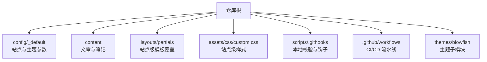
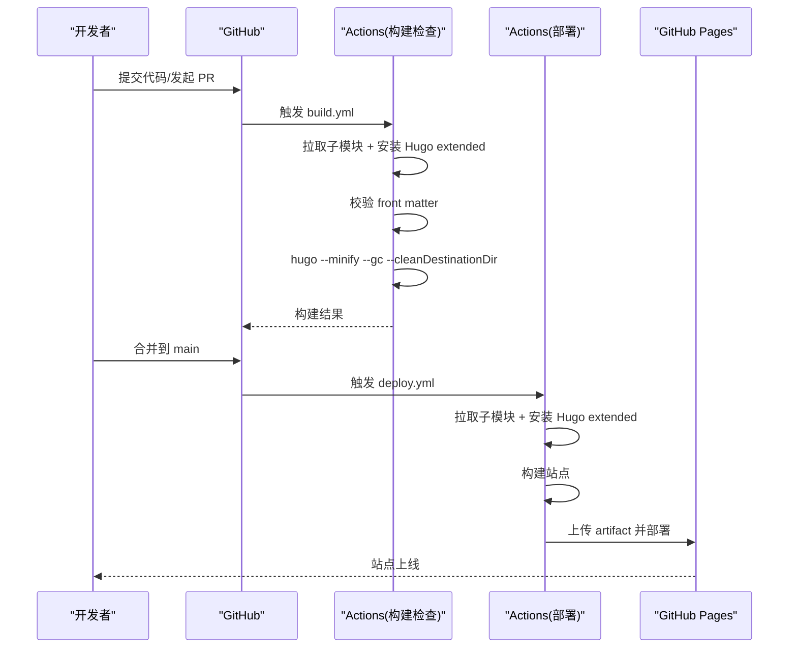
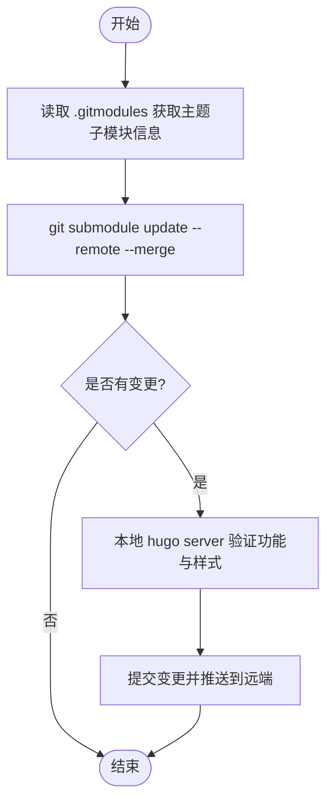
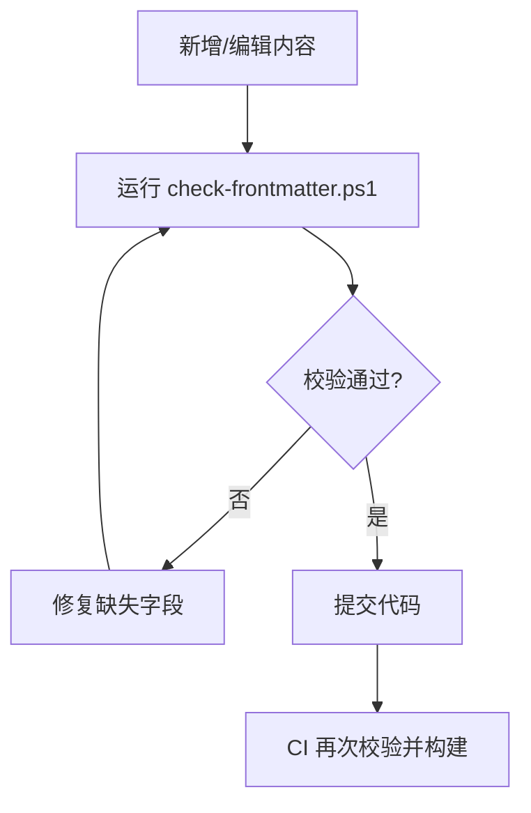
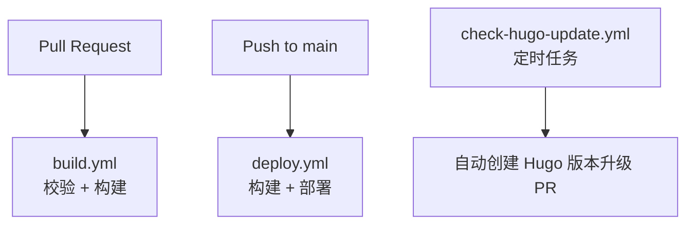
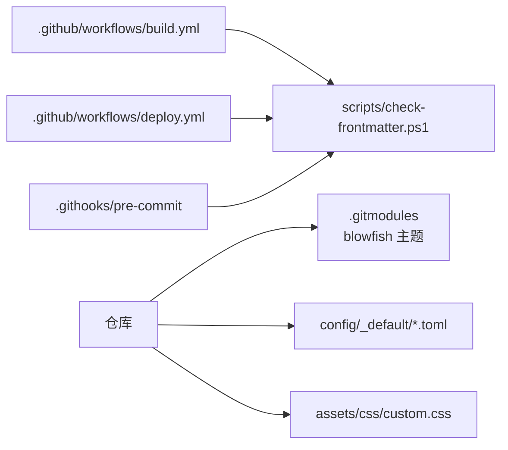

# 维护指南

<cite>
**本文引用的文件**   
- [README.md](file://README.md)
- [.gitmodules](file://.gitmodules)
- [config/_default/hugo.toml](file://config/_default/hugo.toml)
- [config/_default/params.toml](file://config/_default/params.toml)
- [assets/css/custom.css](file://assets/css/custom.css)
- [scripts/check-frontmatter.ps1](file://scripts/check-frontmatter.ps1)
- [.githooks/pre-commit](file://.githooks/pre-commit)
- [scripts/setup-hooks.ps1](file://scripts/setup-hooks.ps1)
- [.github/workflows/build.yml](file://.github/workflows/build.yml)
- [.github/workflows/deploy.yml](file://.github/workflows/deploy.yml)
- [.github/workflows/check-hugo-update.yml](file://.github/workflows/check-hugo-update.yml)
- [.github/dependabot.yml](file://.github/dependabot.yml)
</cite>

## 目录
1. [简介](#简介)
2. [项目结构](#项目结构)
3. [核心组件](#核心组件)
4. [架构总览](#架构总览)
5. [详细组件分析](#详细组件分析)
6. [依赖关系分析](#依赖关系分析)
7. [性能与优化](#性能与优化)
8. [故障排除](#故障排除)
9. [备份与恢复](#备份与恢复)
10. [监控与日志](#监控与日志)
11. [安全最佳实践](#安全最佳实践)
12. [团队协作规范](#团队协作规范)
13. [结论](#结论)

## 简介
本维护指南面向站点维护者，目标是保持站点健康、稳定与可演进。内容覆盖主题更新流程（含 git submodule 管理与版本升级注意事项）、内容维护策略（归档、链接检查、质量监控）、故障排除（技术问题与性能问题诊断）、备份与恢复、监控与日志分析方法、持续性能优化建议、安全最佳实践，以及多人协作的规范与流程。

## 项目结构
本项目基于 Hugo 静态站点生成器与 Blowfish 主题，通过 GitHub Actions 自动构建并部署到 GitHub Pages。关键目录与职责：
- config/_default：站点与主题参数配置
- content：文章与笔记等站点内容
- layouts/partials：站点级模板覆盖（不直接修改主题）
- assets/css/custom.css：站点级样式定制
- scripts：本地脚本（front matter 校验、启用 hooks）
- .githooks：本地 pre-commit 钩子
- .github/workflows：CI/CD 流水线（PR 构建检查、main 分支部署、Hugo 版本检测）
- themes/blowfish：Blowfish 主题（以 git submodule 引入）

图表来源
- [README.md:14-40](file://README.md#L14-L40)
- [config/_default/hugo.toml:1-78](file://config/_default/hugo.toml#L1-L78)
- [config/_default/params.toml:1-88](file://config/_default/params.toml#L1-L88)
- [assets/css/custom.css:1-397](file://assets/css/custom.css#L1-L397)
- [scripts/check-frontmatter.ps1:1-37](file://scripts/check-frontmatter.ps1#L1-L37)
- [.githooks/pre-commit:1-6](file://.githooks/pre-commit#L1-L6)
- [.github/workflows/build.yml:1-40](file://.github/workflows/build.yml#L1-L40)
- [.github/workflows/deploy.yml:1-64](file://.github/workflows/deploy.yml#L1-L64)

章节来源
- [README.md:14-40](file://README.md#L14-L40)

## 核心组件
- 站点配置：Hugo 核心参数、语言、分页、相关度索引、输出格式等
- 主题参数：外观、首页布局、导航、文章展示项、列表与分类页行为
- 内容组织：posts 与 notes 两类内容，统一 front matter 约定
- 质量门禁：pre-commit 与 CI 双重校验 front matter 必填字段
- 自动化：GitHub Actions 负责 PR 构建检查、main 分支部署、Hugo 版本检测与自动 PR

章节来源
- [config/_default/hugo.toml:1-78](file://config/_default/hugo.toml#L1-L78)
- [config/_default/params.toml:1-88](file://config/_default/params.toml#L1-L88)
- [scripts/check-frontmatter.ps1:1-37](file://scripts/check-frontmatter.ps1#L1-L37)
- [.githooks/pre-commit:1-6](file://.githooks/pre-commit#L1-L6)
- [.github/workflows/build.yml:1-40](file://.github/workflows/build.yml#L1-L40)
- [.github/workflows/deploy.yml:1-64](file://.github/workflows/deploy.yml#L1-L64)
- [.github/workflows/check-hugo-update.yml:1-67](file://.github/workflows/check-hugo-update.yml#L1-L67)

## 架构总览
站点在本地与 CI 中均使用 Hugo extended 版本进行构建；主题通过 git submodule 管理；GitHub Actions 在 PR 时执行构建检查，在 main 分支推送时自动部署到 GitHub Pages；另有定时任务检测 Hugo 新版本并自动创建 PR。

图表来源
- [.github/workflows/build.yml:1-40](file://.github/workflows/build.yml#L1-L40)
- [.github/workflows/deploy.yml:1-64](file://.github/workflows/deploy.yml#L1-L64)

## 详细组件分析

### 主题更新与 git submodule 管理
- 主题以 git submodule 方式引入，路径为 themes/blowfish，远程仓库地址由 .gitmodules 指定
- 推荐升级方式：先拉取远程最新提交再合并，避免冲突
- 升级后站点级自定义（layouts、assets/css/custom.css、config）不受影响；切勿直接修改 themes/blowfish 内部文件
- 可通过 Dependabot 每周自动检测主题子模块更新并创建 PR

图表来源
- [.gitmodules:1-4](file://.gitmodules#L1-L4)
- [README.md:150-159](file://README.md#L150-L159)

章节来源
- [.gitmodules:1-4](file://.gitmodules#L1-L4)
- [README.md:150-159](file://README.md#L150-L159)

### 内容维护策略
- 内容归档
  - posts 用于博客文章，notes 用于备忘与随手记录
  - 使用 Hugo 命令创建新内容，遵循统一的 front matter 约定
- 链接检查
  - 建议在本地开发阶段使用浏览器控制台或第三方工具检查外链有效性
  - 可在 CI 中扩展步骤增加断链扫描（当前未内置）
- 内容质量监控
  - 通过 scripts/check-frontmatter.ps1 强制要求 slug、description、categories、tags 非空
  - pre-commit 与 CI 双重拦截，确保提交与构建前质量达标

图表来源
- [scripts/check-frontmatter.ps1:1-37](file://scripts/check-frontmatter.ps1#L1-L37)
- [.githooks/pre-commit:1-6](file://.githooks/pre-commit#L1-L6)
- [.github/workflows/build.yml:34-39](file://.github/workflows/build.yml#L34-L39)

章节来源
- [scripts/check-frontmatter.ps1:1-37](file://scripts/check-frontmatter.ps1#L1-L37)
- [.githooks/pre-commit:1-6](file://.githooks/pre-commit#L1-L6)
- [.github/workflows/build.yml:34-39](file://.github/workflows/build.yml#L34-L39)

### 构建与部署流水线
- PR 构建检查
  - 拉取子模块、安装 Hugo extended、缓存 resources、校验 front matter、最小化构建
- 主分支部署
  - 拉取子模块、安装 Hugo extended、缓存 resources、校验 front matter、构建产物上传并部署到 GitHub Pages
- Hugo 版本检测
  - 定时任务对比 .hugo-version 与 GitHub Releases 最新版本，若存在更新则自动创建 PR

图表来源
- [.github/workflows/build.yml:1-40](file://.github/workflows/build.yml#L1-L40)
- [.github/workflows/deploy.yml:1-64](file://.github/workflows/deploy.yml#L1-L64)
- [.github/workflows/check-hugo-update.yml:1-67](file://.github/workflows/check-hugo-update.yml#L1-L67)

章节来源
- [.github/workflows/build.yml:1-40](file://.github/workflows/build.yml#L1-L40)
- [.github/workflows/deploy.yml:1-64](file://.github/workflows/deploy.yml#L1-L64)
- [.github/workflows/check-hugo-update.yml:1-67](file://.github/workflows/check-hugo-update.yml#L1-L67)

### 站点配置与主题参数
- Hugo 核心配置
  - 站点基础 URL、标题、主题、默认语言、摘要长度、CJK 支持、Git 信息、草稿与未来文章构建开关、表情、分页、图像锚点、分类法、Sitemap、媒体类型与输出格式、相关文章索引权重等
- 主题参数
  - 配色方案、外观模式、搜索、代码复制、无障碍、面包屑、主分区、背景图、社交分享图、菜单高亮、智能目录、头部/底部布局、首页布局、文章展示项、列表与分类页行为等

章节来源
- [config/_default/hugo.toml:1-78](file://config/_default/hugo.toml#L1-L78)
- [config/_default/params.toml:1-88](file://config/_default/params.toml#L1-L88)

### 站点级样式与交互
- 代码块美化
  - 字体、容器、滚动条、行号、语言标签栏、复制按钮等
- 语法高亮
  - 覆盖 Light+ 与 Dark+ 两套配色，补齐遗漏 token
- 评论框宽度适配
- 文章宽度放宽至 120ch
- 相关文章卡片高度压缩
- 桌面端悬浮目录面板
- Mermaid 点击放大预览

章节来源
- [assets/css/custom.css:1-397](file://assets/css/custom.css#L1-L397)

## 依赖关系分析
- 外部依赖
  - Hugo extended（版本由 .hugo-version 锁定，CI 自动读取）
  - Blowfish 主题（git submodule）
  - GitHub Actions（构建与部署）
- 内部依赖
  - workflows 依赖 scripts/check-frontmatter.ps1 进行 front matter 校验
  - pre-commit 钩子调用同一脚本保证本地一致性
  - 主题参数与站点配置共同决定渲染行为

图表来源
- [.github/workflows/build.yml:1-40](file://.github/workflows/build.yml#L1-L40)
- [.github/workflows/deploy.yml:1-64](file://.github/workflows/deploy.yml#L1-L64)
- [scripts/check-frontmatter.ps1:1-37](file://scripts/check-frontmatter.ps1#L1-L37)
- [.githooks/pre-commit:1-6](file://.githooks/pre-commit#L1-L6)
- [.gitmodules:1-4](file://.gitmodules#L1-L4)
- [config/_default/hugo.toml:1-78](file://config/_default/hugo.toml#L1-L78)
- [config/_default/params.toml:1-88](file://config/_default/params.toml#L1-L88)
- [assets/css/custom.css:1-397](file://assets/css/custom.css#L1-L397)

章节来源
- [.github/workflows/build.yml:1-40](file://.github/workflows/build.yml#L1-L40)
- [.github/workflows/deploy.yml:1-64](file://.github/workflows/deploy.yml#L1-L64)
- [scripts/check-frontmatter.ps1:1-37](file://scripts/check-frontmatter.ps1#L1-L37)
- [.githooks/pre-commit:1-6](file://.githooks/pre-commit#L1-L6)
- [.gitmodules:1-4](file://.gitmodules#L1-L4)

## 性能与优化
- 构建优化
  - 使用 hugo --minify --gc --cleanDestinationDir 减少产物体积并清理旧资源
  - 利用 actions/cache 缓存 Hugo resources，加速重复构建
- 渲染优化
  - 合理设置 related 索引权重，避免无关文章过多导致渲染开销
  - 控制列表页分组与卡片数量，避免首屏过重
- 前端优化
  - 复用站点级样式，避免重复加载
  - 合理使用图片尺寸与懒加载（主题已提供相关能力）
- 依赖更新
  - 通过 Dependabot 定期更新 Actions 与主题子模块，降低安全风险与兼容性问题
  - 通过 check-hugo-update.yml 自动检测 Hugo 新版本并创建 PR，便于评估与升级

章节来源
- [.github/workflows/build.yml:26-39](file://.github/workflows/build.yml#L26-L39)
- [.github/workflows/deploy.yml:33-46](file://.github/workflows/deploy.yml#L33-L46)
- [config/_default/hugo.toml:49-78](file://config/_default/hugo.toml#L49-L78)
- [.github/dependabot.yml:1-28](file://.github/dependabot.yml#L1-L28)
- [.github/workflows/check-hugo-update.yml:1-67](file://.github/workflows/check-hugo-update.yml#L1-L67)

## 故障排除
- 常见问题
  - 本地无法启动服务器：确认已安装 Hugo extended 且版本与 .hugo-version 一致
  - 子模块未初始化：首次克隆后需执行 git submodule update --init --recursive
  - 提交被拒绝：检查 front matter 是否包含必填字段且非空
  - 构建失败：查看 Actions 日志，确认 Hugo 版本与依赖正确
- 定位方法
  - 本地运行 scripts/check-frontmatter.ps1 快速定位 front matter 问题
  - 使用 hugo server 本地预览，逐步缩小问题范围
  - 查看 Actions 构建日志中的错误堆栈与警告
- 解决方案
  - 补全缺失字段（slug、description、categories、tags）
  - 修正主题参数或站点配置，确保与主题版本兼容
  - 必要时升级 Hugo 或主题版本，并在本地充分验证后再合并

章节来源
- [scripts/check-frontmatter.ps1:1-37](file://scripts/check-frontmatter.ps1#L1-L37)
- [README.md:49-73](file://README.md#L49-L73)
- [.github/workflows/build.yml:1-40](file://.github/workflows/build.yml#L1-L40)
- [.github/workflows/deploy.yml:1-64](file://.github/workflows/deploy.yml#L1-L64)

## 备份与恢复
- 备份范围
  - 代码仓库（含 .git 历史）
  - 站点配置（config/_default/*.toml）
  - 站点级样式与模板（assets/css/custom.css、layouts/partials/*）
  - 内容（content/*）
  - 脚本与钩子（scripts/*、.githooks/*）
- 备份策略
  - 将仓库托管于 GitHub，开启分支保护与常规提交
  - 定期导出 public 构建产物作为离线备份（可选）
- 恢复流程
  - 从 GitHub 克隆仓库并初始化子模块
  - 安装对应版本的 Hugo extended
  - 运行 hugo server 验证站点可正常构建与预览

章节来源
- [README.md:49-73](file://README.md#L49-L73)
- [config/_default/hugo.toml:1-78](file://config/_default/hugo.toml#L1-L78)
- [config/_default/params.toml:1-88](file://config/_default/params.toml#L1-L88)
- [assets/css/custom.css:1-397](file://assets/css/custom.css#L1-L397)

## 监控与日志
- 构建与部署监控
  - 关注 GitHub Actions 的运行状态与日志，及时发现构建失败与部署异常
- 版本更新监控
  - check-hugo-update.yml 每周检测 Hugo 新版本并自动创建 PR，便于及时评估与升级
- 依赖更新监控
  - Dependabot 每周检查 Actions 与主题子模块更新，自动创建 PR 并标注依赖标签
- 站点可用性监控
  - 可结合外部服务（如 UptimeRobot）对站点 URL 进行周期性探测（可选）

章节来源
- [.github/workflows/check-hugo-update.yml:1-67](file://.github/workflows/check-hugo-update.yml#L1-L67)
- [.github/dependabot.yml:1-28](file://.github/dependabot.yml#L1-L28)
- [.github/workflows/build.yml:1-40](file://.github/workflows/build.yml#L1-L40)
- [.github/workflows/deploy.yml:1-64](file://.github/workflows/deploy.yml#L1-L64)

## 安全最佳实践
- 权限最小化
  - Actions 仅授予必要权限（contents、pages、id-token），避免过度授权
- 依赖安全
  - 使用 Dependabot 自动更新 Actions 与主题子模块，降低已知漏洞风险
- 子模块安全
  - 仅信任上游主题仓库，升级前审阅变更日志与差异
- 敏感信息
  - 不在仓库中存放密钥或令牌；如需集成第三方服务，使用环境变量或 Secrets

章节来源
- [.github/workflows/build.yml:7-9](file://.github/workflows/build.yml#L7-L9)
- [.github/workflows/deploy.yml:8-12](file://.github/workflows/deploy.yml#L8-L12)
- [.github/dependabot.yml:1-28](file://.github/dependabot.yml#L1-L28)

## 团队协作规范
- 分支与提交
  - 新功能与修复通过 Pull Request 提交，禁止直接推送 main
  - 提交信息清晰描述变更目的与影响范围
- 代码质量
  - 所有提交必须通过 pre-commit 与 CI 的 front matter 校验
  - 涉及主题参数或站点配置的变更，需在本地充分验证
- 主题与依赖升级
  - 优先通过 Dependabot 与 check-hugo-update.yml 生成的 PR 进行升级
  - 升级后在本地运行 hugo server 验证功能与样式，再合并
- 钩子与脚本
  - 首次克隆后执行 scripts/setup-hooks.ps1 启用本地钩子，确保团队一致性

章节来源
- [scripts/setup-hooks.ps1:1-5](file://scripts/setup-hooks.ps1#L1-L5)
- [.githooks/pre-commit:1-6](file://.githooks/pre-commit#L1-L6)
- [scripts/check-frontmatter.ps1:1-37](file://scripts/check-frontmatter.ps1#L1-L37)
- [.github/workflows/build.yml:1-40](file://.github/workflows/build.yml#L1-L40)
- [.github/workflows/check-hugo-update.yml:1-67](file://.github/workflows/check-hugo-update.yml#L1-L67)
- [.github/dependabot.yml:1-28](file://.github/dependabot.yml#L1-L28)

## 结论
通过严格的 front matter 校验、完善的 CI/CD 流水线、自动化的依赖与版本检测、以及清晰的团队协作规范，本项目能够在保持内容质量的同时，实现稳定、高效的构建与部署。维护者应持续关注主题与 Hugo 版本更新，遵循站点级定制原则，确保升级过程平滑可控。