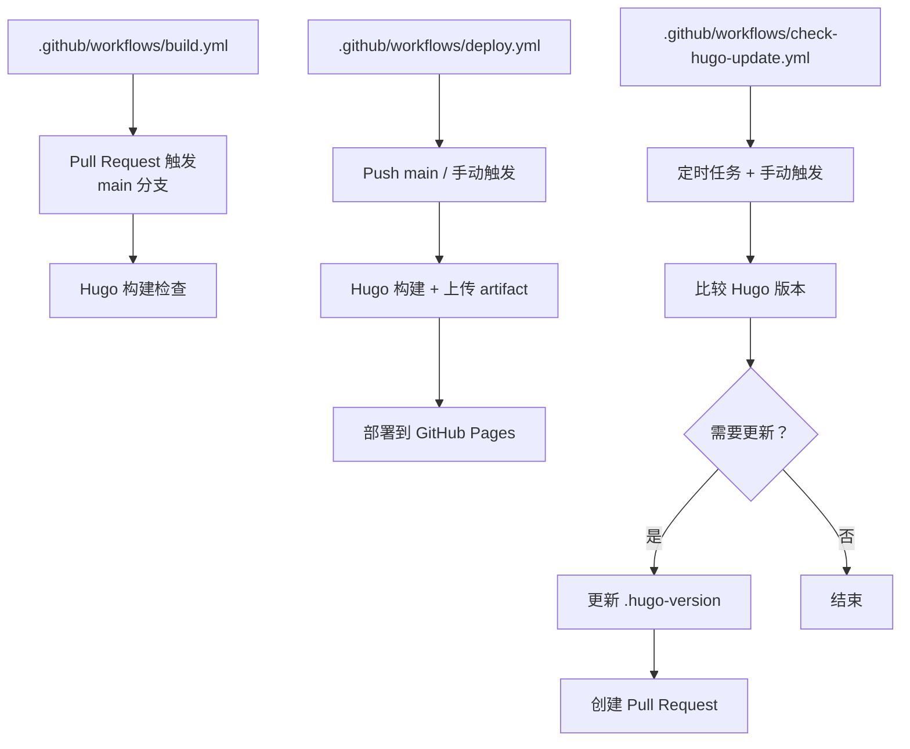
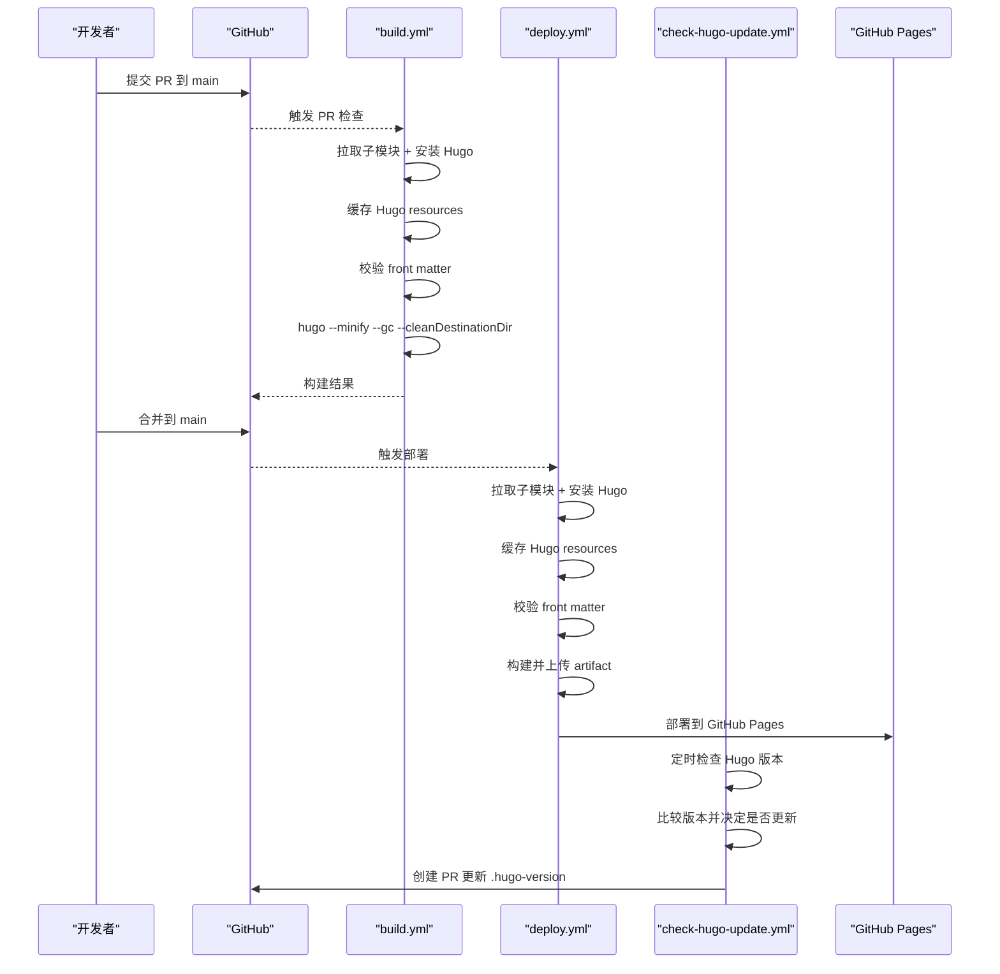
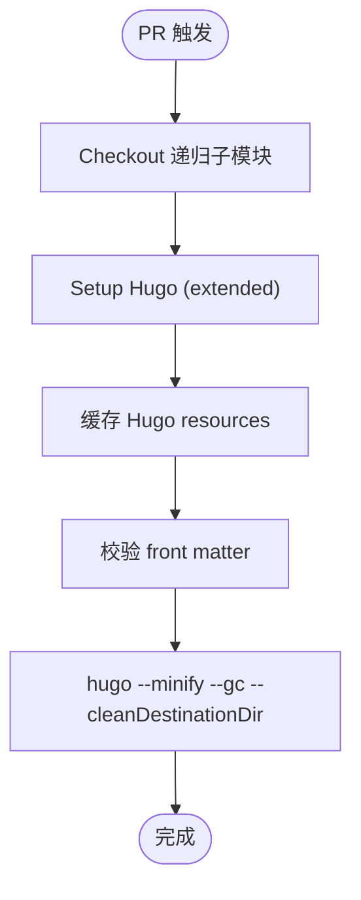
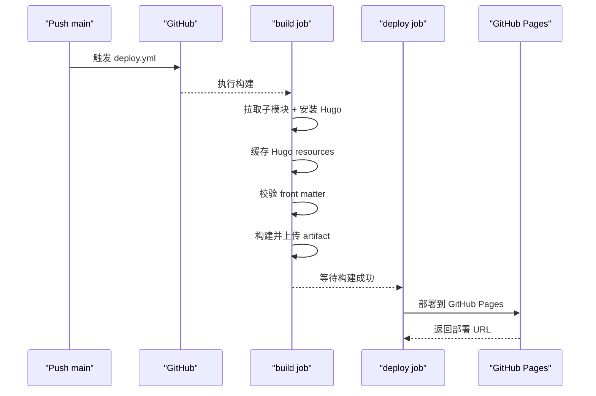
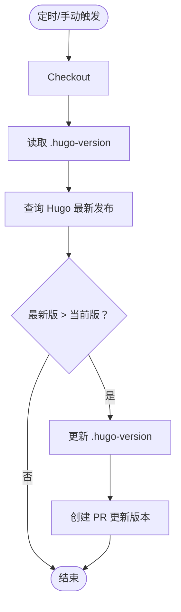
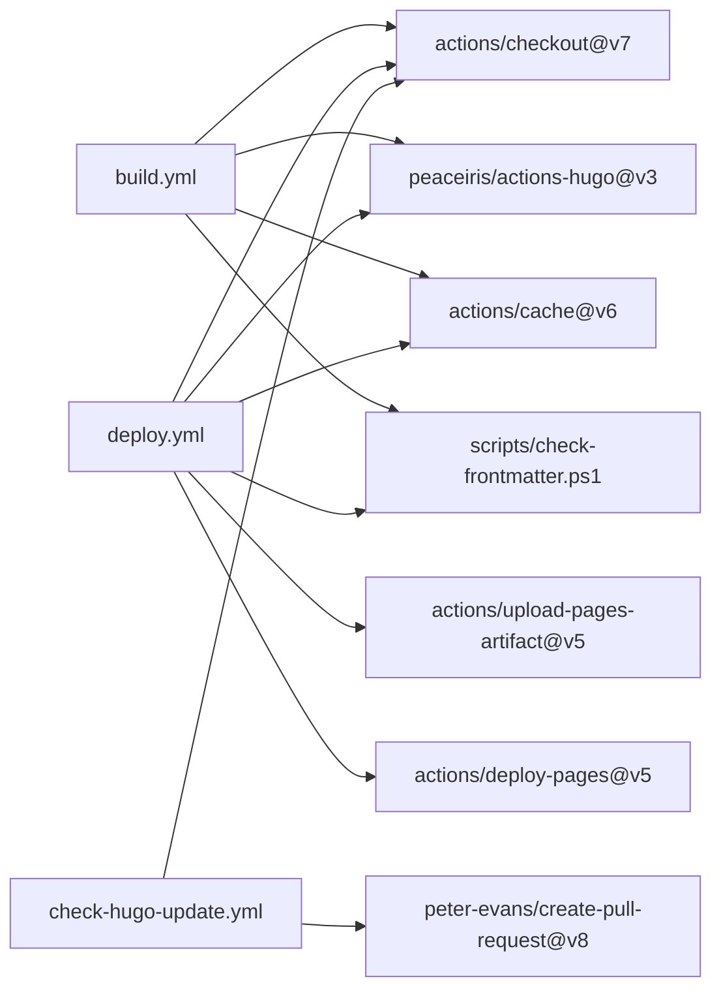

# GitHub Actions 配置

<cite>
**本文引用的文件**   
- [README.md](file://README.md)
- [.github/workflows/build.yml](file://.github/workflows/build.yml)
- [.github/workflows/deploy.yml](file://.github/workflows/deploy.yml)
- [.github/workflows/check-hugo-update.yml](file://.github/workflows/check-hugo-update.yml)
</cite>

## 目录
1. [简介](#简介)
2. [项目结构](#项目结构)
3. [核心组件](#核心组件)
4. [架构总览](#架构总览)
5. [详细组件分析](#详细组件分析)
6. [依赖关系分析](#依赖关系分析)
7. [性能与缓存优化](#性能与缓存优化)
8. [自定义与扩展指南](#自定义与扩展指南)
9. [故障排除指南](#故障排除指南)
10. [结论](#结论)

## 简介
本仓库是一个基于 Hugo 与 Blowfish 主题的个人技术博客，通过 GitHub Actions 实现自动化构建与部署。工作流覆盖三类场景：
- 构建检查流水线（build.yml）：在 Pull Request 到 main 分支时执行 front matter 校验与 Hugo 构建验证。
- 生产部署流水线（deploy.yml）：推送至 main 分支或手动触发后，自动构建并部署到 GitHub Pages。
- Hugo 版本检查工作流（check-hugo-update.yml）：定时检测 Hugo 新版本，必要时自动创建 PR 更新 .hugo-version。

这些工作流共同保证本地与 CI 环境一致、内容质量可控、站点可稳定发布。

## 项目结构
GitHub Actions 相关的工作流位于 .github/workflows 目录下，包含三个核心文件：
- build.yml：PR 构建检查
- deploy.yml：生产构建与 GitHub Pages 部署
- check-hugo-update.yml：Hugo 版本升级检查与自动 PR

**图表来源**
- [.github/workflows/build.yml:1-40](file://.github/workflows/build.yml#L1-L40)
- [.github/workflows/deploy.yml:1-64](file://.github/workflows/deploy.yml#L1-L64)
- [.github/workflows/check-hugo-update.yml:1-67](file://.github/workflows/check-hugo-update.yml#L1-L67)

**章节来源**
- [README.md:1-159](file://README.md#L1-L159)

## 核心组件
- 构建检查流水线（build.yml）
  - 触发条件：对 main 分支的 Pull Request
  - 权限：仅读取仓库内容
  - 关键步骤：拉取子模块、安装 Hugo extended、缓存 Hugo resources、front matter 校验、构建验证
- 生产部署流水线（deploy.yml）
  - 触发条件：push 到 main 分支或 workflow_dispatch 手动触发
  - 权限：读取仓库、写入 Pages、ID Token 写入
  - 关键步骤：拉取子模块、安装 Hugo extended、缓存 Hugo resources、front matter 校验、构建、上传 artifact、部署到 GitHub Pages
- Hugo 版本检查工作流（check-hugo-update.yml）
  - 触发条件：每周一 UTC 0 点定时任务或 workflow_dispatch 手动触发
  - 权限：读写仓库内容、读写 PR
  - 关键步骤：获取当前版本、查询最新 release、语义化版本比较、更新 .hugo-version、创建 PR

**章节来源**
- [.github/workflows/build.yml:1-40](file://.github/workflows/build.yml#L1-L40)
- [.github/workflows/deploy.yml:1-64](file://.github/workflows/deploy.yml#L1-L64)
- [.github/workflows/check-hugo-update.yml:1-67](file://.github/workflows/check-hugo-update.yml#L1-L67)

## 架构总览
整体 CI/CD 流程如下：
- 开发者提交代码或发起 PR
- build.yml 在 PR 阶段进行质量检查与构建验证
- 合并到 main 后，deploy.yml 自动构建并部署到 GitHub Pages
- check-hugo-update.yml 定期检测 Hugo 新版本，必要时自动创建 PR 提醒更新

**图表来源**
- [.github/workflows/build.yml:1-40](file://.github/workflows/build.yml#L1-L40)
- [.github/workflows/deploy.yml:1-64](file://.github/workflows/deploy.yml#L1-L64)
- [.github/workflows/check-hugo-update.yml:1-67](file://.github/workflows/check-hugo-update.yml#L1-L67)

## 详细组件分析

### 构建检查流水线（build.yml）
- 触发条件
  - pull_request 事件，目标分支为 main
- 权限设置
  - contents: read（仅读取仓库内容）
- 运行环境
  - ubuntu-latest，超时 15 分钟
- 关键步骤
  - Checkout：递归拉取子模块（themes/blowfish），fetch-depth: 0 以支持后续脚本或工具链
  - Setup Hugo：使用 peaceiris/actions-hugo@v3，extended: true，版本由 .hugo-version 锁定
  - Cache Hugo resources：缓存 resources 目录，key 基于 runner.os 与 config/** 哈希，restore-keys 提供回退匹配
  - Front matter 校验：调用 scripts/check-frontmatter.ps1（PowerShell）
  - 构建验证：hugo --minify --gc --cleanDestinationDir

**图表来源**
- [.github/workflows/build.yml:1-40](file://.github/workflows/build.yml#L1-L40)

**章节来源**
- [.github/workflows/build.yml:1-40](file://.github/workflows/build.yml#L1-L40)

### 生产部署流水线（deploy.yml）
- 触发条件
  - push 到 main 分支
  - workflow_dispatch 手动触发
- 权限设置
  - contents: read
  - pages: write
  - id-token: write（用于 GitHub Pages 部署认证）
- 并发控制
  - concurrency.group: pages，cancel-in-progress: false（避免重复部署冲突）
- 关键步骤
  - Checkout：递归拉取子模块，fetch-depth: 0
  - Setup Hugo：peaceiris/actions-hugo@v3，extended: true
  - Cache Hugo resources：同 build.yml 的缓存策略
  - Front matter 校验：scripts/check-frontmatter.ps1
  - 构建：hugo --minify --gc --cleanDestinationDir，输出到 public/
  - Upload artifact：actions/upload-pages-artifact@v5 上传 public/
  - Deploy：actions/deploy-pages@v5 部署到 GitHub Pages，environment: github-pages

**图表来源**
- [.github/workflows/deploy.yml:1-64](file://.github/workflows/deploy.yml#L1-L64)

**章节来源**
- [.github/workflows/deploy.yml:1-64](file://.github/workflows/deploy.yml#L1-L64)

### Hugo 版本检查工作流（check-hugo-update.yml）
- 触发条件
  - schedule: cron '0 0 * * 1'（每周一 UTC 0 点）
  - workflow_dispatch 手动触发
- 权限设置
  - contents: write（允许更新 .hugo-version）
  - pull-requests: write（允许创建 PR）
- 并发控制
  - concurrency.group: hugo-update，cancel-in-progress: false
- 关键步骤
  - Checkout：fetch-depth: 0
  - Get current version：读取 .hugo-version
  - Get latest Hugo release：调用 GitHub API 获取最新版本 tag_name，去除前缀 v
  - Compare versions：sort -V 语义化比较，若最新版大于当前版则标记 update=true
  - Update .hugo-version：当 update=true 时写入最新版本
  - Create Pull Request：peter-evans/create-pull-request@v8 创建 PR，标题和消息包含版本号与 Release Notes 链接

**图表来源**
- [.github/workflows/check-hugo-update.yml:1-67](file://.github/workflows/check-hugo-update.yml#L1-L67)

**章节来源**
- [.github/workflows/check-hugo-update.yml:1-67](file://.github/workflows/check-hugo-update.yml#L1-L67)

## 依赖关系分析
- 外部 Action 依赖
  - actions/checkout@v7：代码检出与子模块拉取
  - peaceiris/actions-hugo@v3：Hugo 环境安装（extended 模式）
  - actions/cache@v6：资源缓存（resources 目录）
  - actions/upload-pages-artifact@v5：上传 Pages artifact
  - actions/deploy-pages@v5：部署到 GitHub Pages
  - peter-evans/create-pull-request@v8：自动创建 PR
- 内部脚本依赖
  - scripts/check-frontmatter.ps1：front matter 必填字段校验（slug、description、categories、tags）
- 主题与子模块
  - themes/blowfish：通过 git submodule 引入，CI 中需递归拉取

**图表来源**
- [.github/workflows/build.yml:1-40](file://.github/workflows/build.yml#L1-L40)
- [.github/workflows/deploy.yml:1-64](file://.github/workflows/deploy.yml#L1-L64)
- [.github/workflows/check-hugo-update.yml:1-67](file://.github/workflows/check-hugo-update.yml#L1-L67)

**章节来源**
- [.github/workflows/build.yml:1-40](file://.github/workflows/build.yml#L1-L40)
- [.github/workflows/deploy.yml:1-64](file://.github/workflows/deploy.yml#L1-L64)
- [.github/workflows/check-hugo-update.yml:1-67](file://.github/workflows/check-hugo-update.yml#L1-L67)

## 性能与缓存优化
- Hugo resources 缓存
  - 路径：resources
  - key：runner.os-hugo-hash(config/**)，确保配置变更时重建缓存
  - restore-keys：runner.os-hugo-，提供部分匹配的回退缓存
- 子模块拉取
  - submodules: recursive，确保主题依赖完整
- 构建参数
  - hugo --minify --gc --cleanDestinationDir，减少产物体积并清理旧输出
- 并发控制
  - deploy.yml 使用 concurrency.group: pages，避免并行部署冲突

建议：
- 保持 config/** 稳定以减少缓存失效频率
- 如需加速，可在本地预构建并复用缓存键策略
- 对于大型站点，考虑将 Hugo binary 也加入缓存（需评估稳定性）

**章节来源**
- [.github/workflows/build.yml:26-32](file://.github/workflows/build.yml#L26-L32)
- [.github/workflows/deploy.yml:33-39](file://.github/workflows/deploy.yml#L33-L39)

## 自定义与扩展指南
- 环境变量配置
  - 可在仓库 Settings > Secrets and variables > Actions 中添加变量，并在工作流中使用 ${{ vars.X }} 引用
  - 常见变量：HUGO_VERSION、CACHE_KEY_PREFIX、DEPLOY_BRANCH
- 权限设置
  - 最小权限原则：仅授予必要权限（如 contents: read、pages: write、id-token: write）
  - 如需访问私有依赖，可添加 secrets.GITHUB_TOKEN 或其他第三方 token
- 缓存优化
  - 调整 cache key 以匹配更多上下文（如 Node.js 版本、Go 版本等）
  - 多阶段缓存：分别缓存 Hugo binary、Node modules、Go modules
- 错误处理
  - 在每个 step 添加 continue-on-error: true 以捕获非致命错误
  - 使用 if: failure() 发送通知（邮件、Slack、Discord）
- 新增工作流
  - 复制现有模板并根据需求修改 triggers、permissions、jobs
  - 使用 reusable workflows 抽取公共步骤（如 Setup Hugo、Cache）

**章节来源**
- [.github/workflows/build.yml:7-9](file://.github/workflows/build.yml#L7-L9)
- [.github/workflows/deploy.yml:8-15](file://.github/workflows/deploy.yml#L8-L15)
- [.github/workflows/check-hugo-update.yml:7-13](file://.github/workflows/check-hugo-update.yml#L7-L13)

## 故障排除指南
- 子模块未拉取
  - 现象：构建失败，缺少 themes/blowfish
  - 解决：确认 checkout 步骤中 submodules: recursive 已启用
  - 参考：[build.yml:17-19](file://.github/workflows/build.yml#L17-L19), [deploy.yml:24-26](file://.github/workflows/deploy.yml#L24-L26)
- Hugo 版本不一致
  - 现象：本地构建成功，CI 构建失败
  - 解决：确保 .hugo-version 与本地 Hugo 版本一致；CI 使用 peaceiris/actions-hugo@v3 extended: true
  - 参考：[build.yml:21-25](file://.github/workflows/build.yml#L21-L25), [deploy.yml:28-31](file://.github/workflows/deploy.yml#L28-L31)
- front matter 校验失败
  - 现象：CI 阻断，提示缺少 slug/description/categories/tags
  - 解决：编辑文章 front matter，确保必填字段非空
  - 参考：[build.yml:34-36](file://.github/workflows/build.yml#L34-L36), [deploy.yml:41-43](file://.github/workflows/deploy.yml#L41-L43)
- GitHub Pages 部署失败
  - 现象：deploy job 报错，无法部署到 Pages
  - 解决：检查 permissions 是否包含 pages: write 与 id-token: write；确认 environment: github-pages 已配置
  - 参考：[deploy.yml:8-11](file://.github/workflows/deploy.yml#L8-L11), [deploy.yml:54-63](file://.github/workflows/deploy.yml#L54-L63)
- Hugo 版本更新 PR 未创建
  - 现象：check-hugo-update.yml 运行但未生成 PR
  - 解决：检查 permissions 是否包含 contents: write 与 pull-requests: write；确认 compare 步骤逻辑正确
  - 参考：[check-hugo-update.yml:7-13](file://.github/workflows/check-hugo-update.yml#L7-L13), [check-hugo-update.yml:35-45](file://.github/workflows/check-hugo-update.yml#L35-L45)

**章节来源**
- [.github/workflows/build.yml:17-36](file://.github/workflows/build.yml#L17-L36)
- [.github/workflows/deploy.yml:24-63](file://.github/workflows/deploy.yml#L24-L63)
- [.github/workflows/check-hugo-update.yml:7-45](file://.github/workflows/check-hugo-update.yml#L7-L45)

## 结论
本项目通过三个 GitHub Actions 工作流实现了完整的 CI/CD 闭环：
- build.yml 保障 PR 质量与构建一致性
- deploy.yml 实现从代码到 GitHub Pages 的自动化部署
- check-hugo-update.yml 主动维护 Hugo 版本，降低安全与兼容性风险

建议团队遵循最小权限原则、合理使用缓存、完善错误处理与通知机制，以提升 CI/CD 的稳定性和可维护性。