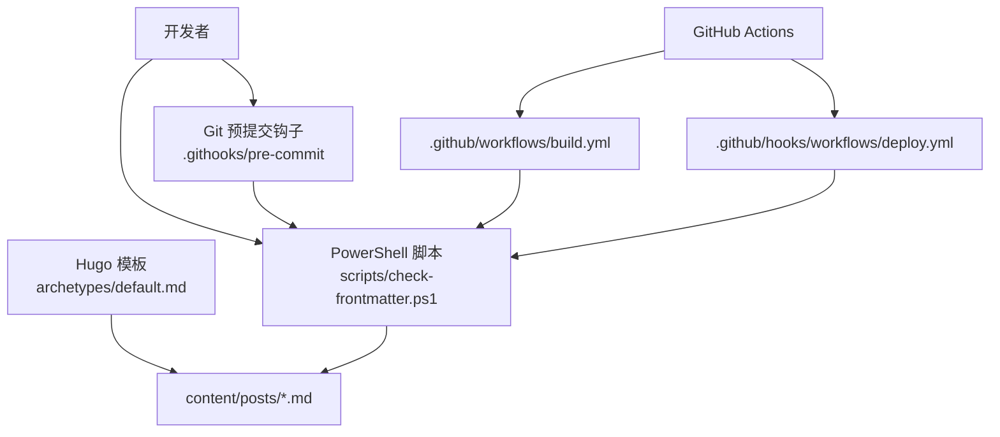
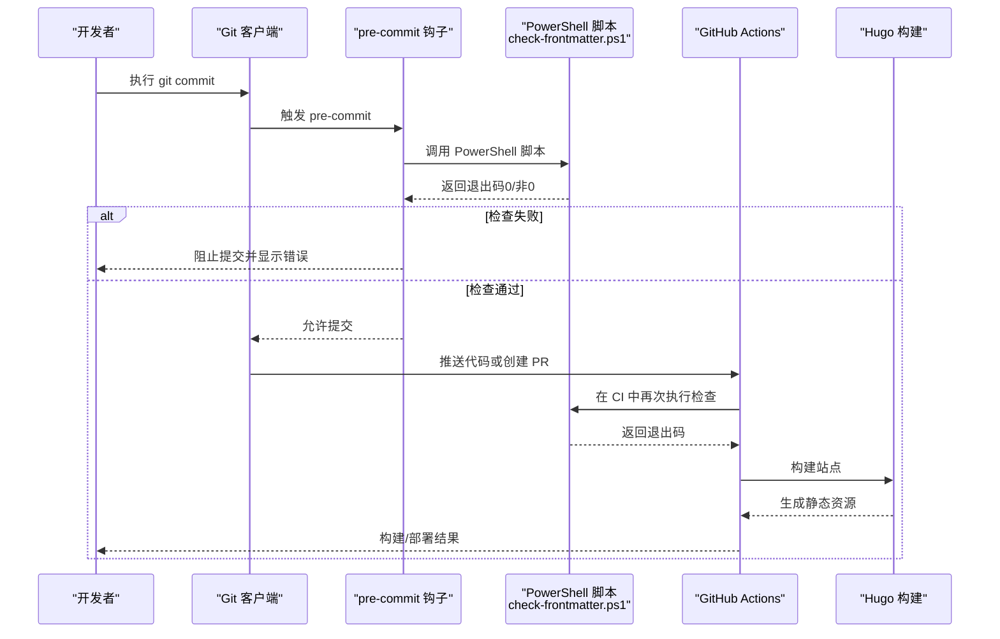
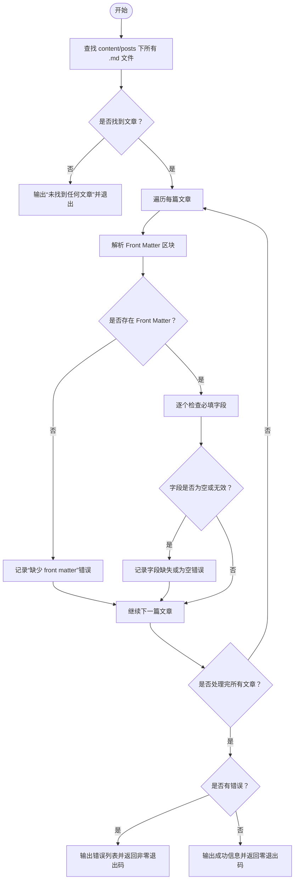
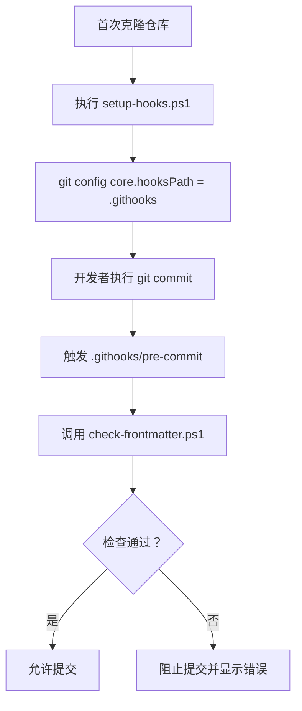
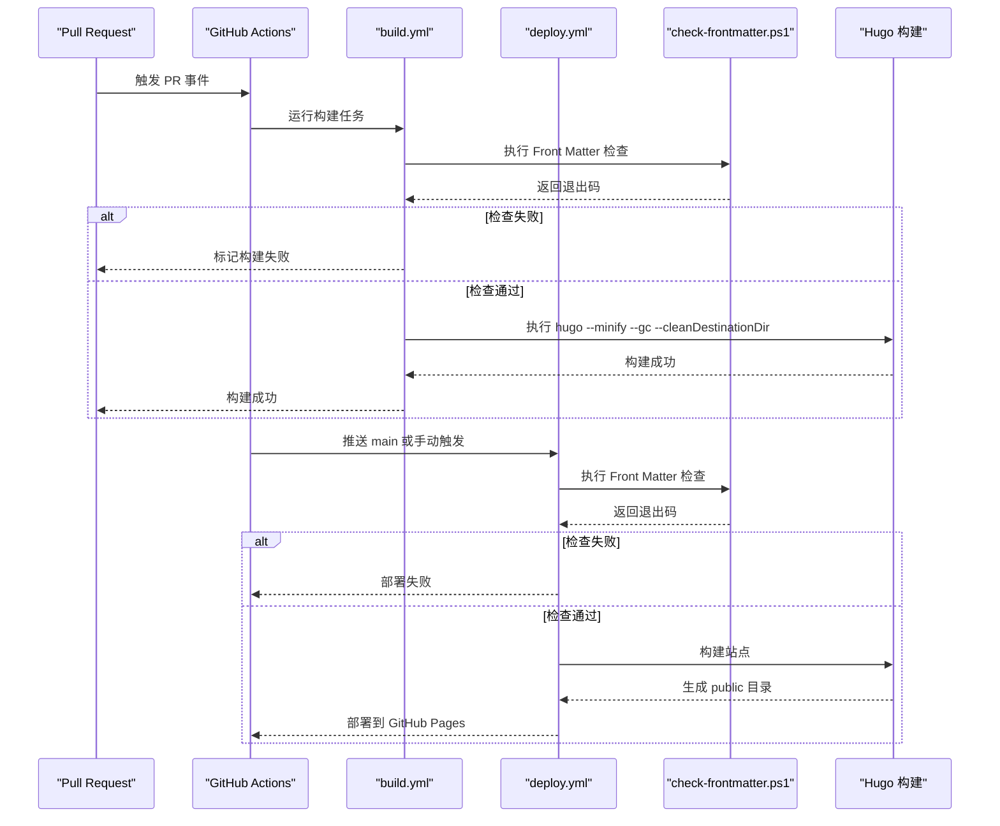
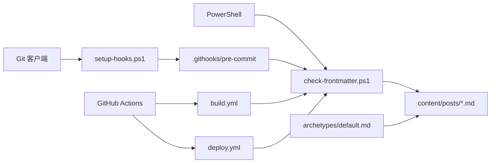

# 代码质量检查

<cite>
**本文引用的文件**   
- [check-frontmatter.ps1](file://scripts/check-frontmatter.ps1)
- [setup-hooks.ps1](file://scripts/setup-hooks.ps1)
- [build.yml](file://.github/workflows/build.yml)
- [deploy.yml](file://.github/workflows/deploy.yml)
- [default.md](file://archetypes/default.md)
- [README.md](file://README.md)
</cite>

## 目录
1. [引言](#引言)
2. [项目结构](#项目结构)
3. [核心组件](#核心组件)
4. [架构总览](#架构总览)
5. [详细组件分析](#详细组件分析)
6. [依赖关系分析](#依赖关系分析)
7. [性能与执行特性](#性能与执行特性)
8. [故障排查指南](#故障排查指南)
9. [最佳实践](#最佳实践)
10. [结论](#结论)

## 引言
本文件面向开发者与维护者，系统化说明本项目中的自动化代码质量检查机制。重点包括：
- Front Matter 验证脚本 check-frontmatter.ps1 的功能、规则与行为
- 预提交钩子 pre-commit 的配置、安装方式与扩展方法
- 如何在 GitHub Actions 中集成该检查
- 如何新增检查规则、定制错误提示
- 常见问题定位与修复建议
- 保证内容规范一致性的最佳实践

## 项目结构
与质量检查直接相关的目录与文件如下：
- scripts/check-frontmatter.ps1：Front Matter 必填字段校验脚本
- scripts/setup-hooks.ps1：启用仓库内 Git hooks 的辅助脚本
- .githooks/pre-commit：预提交钩子（由 setup-hooks.ps1 指向）
- .github/workflows/build.yml：PR 构建时运行检查
- .github/workflows/deploy.yml：发布流程中运行检查
- archetypes/default.md：Hugo 新文章模板，定义默认 Front Matter 字段
- README.md：文档中对检查与钩子的使用说明

图表来源
- [check-frontmatter.ps1:1-37](file://scripts/check-frontmatter.ps1#L1-L37)
- [setup-hooks.ps1:1-5](file://scripts/setup-hooks.ps1#L1-L5)
- [build.yml:34-39](file://.github/workflows/build.yml#L34-L39)
- [deploy.yml:41-46](file://.github/workflows/deploy.yml#L41-L46)
- [default.md:1-10](file://archetypes/default.md#L1-L10)

章节来源
- [README.md:34-40](file://README.md#L34-L40)
- [README.md:59-65](file://README.md#L59-L65)
- [README.md:114-122](file://README.md#L114-L122)

## 核心组件
- Front Matter 校验脚本：scripts/check-frontmatter.ps1
  - 扫描 content/posts 下的所有 Markdown 文章
  - 解析每篇文章的 Front Matter
  - 校验必填字段是否存在且非空
  - 输出检查结果并返回退出码（成功为 0，失败为非 0）
- 预提交钩子：.githooks/pre-commit
  - 通过 git config core.hooksPath 指向 .githooks
  - 在每次提交前自动执行 Front Matter 校验
- 辅助脚本：scripts/setup-hooks.ps1
  - 一键启用仓库内 Git hooks
- CI 集成：
  - build.yml：在 PR 构建阶段执行检查
  - deploy.yml：在 main 分支部署前执行检查

章节来源
- [check-frontmatter.ps1:1-37](file://scripts/check-frontmatter.ps1#L1-L37)
- [setup-hooks.ps1:1-5](file://scripts/setup-hooks.ps1#L1-L5)
- [build.yml:34-39](file://.github/workflows/build.yml#L34-L39)
- [deploy.yml:41-46](file://.github/workflows/deploy.yml#L41-L46)

## 架构总览
下图展示从开发者到最终部署的全链路质量检查流程：

图表来源
- [check-frontmatter.ps1:1-37](file://scripts/check-frontmatter.ps1#L1-L37)
- [setup-hooks.ps1:1-5](file://scripts/setup-hooks.ps1#L1-L5)
- [build.yml:34-39](file://.github/workflows/build.yml#L34-L39)
- [deploy.yml:41-46](file://.github/workflows/deploy.yml#L41-L46)

## 详细组件分析

### Front Matter 校验脚本（check-frontmatter.ps1）
功能要点：
- 目标目录：content/posts
- 必填字段：slug、description、categories、tags
- 校验规则：
  - 必须存在 Front Matter 区块
  - 每个必填字段必须存在且值非空
  - 空字符串、仅引号、空数组 [] 均视为无效
- 输出：
  - 未找到任何文章：提示并退出
  - 检查失败：列出具体文件与问题，返回非零退出码
  - 检查通过：统计文章数量并提示成功

图表来源
- [check-frontmatter.ps1:1-37](file://scripts/check-frontmatter.ps1#L1-L37)

章节来源
- [check-frontmatter.ps1:1-37](file://scripts/check-frontmatter.ps1#L1-L37)

### 预提交钩子（pre-commit）配置与使用
- 钩子位置：.githooks/pre-commit
- 启用方式：
  - 在仓库根目录执行 scripts/setup-hooks.ps1
  - 该脚本设置 git config core.hooksPath = .githooks
- 执行时机：
  - 每次 git commit 前自动触发
  - 若检查失败，将阻止提交
- 自定义扩展：
  - 可在 .githooks/pre-commit 中追加其他检查命令
  - 建议保持幂等与快速反馈，避免阻塞提交体验

图表来源
- [setup-hooks.ps1:1-5](file://scripts/setup-hooks.ps1#L1-L5)
- [check-frontmatter.ps1:1-37](file://scripts/check-frontmatter.ps1#L1-L37)

章节来源
- [setup-hooks.ps1:1-5](file://scripts/setup-hooks.ps1#L1-L5)
- [README.md:59-65](file://README.md#L59-L65)

### GitHub Actions 集成
- build.yml：
  - 在 pull_request 事件中对 main 分支进行构建检查
  - 步骤顺序：检出代码 → 安装 Hugo → 缓存资源 → 执行 Front Matter 检查 → 构建站点
- deploy.yml：
  - 在 push 到 main 分支或手动触发时执行
  - 步骤顺序：检出代码 → 安装 Hugo → 缓存资源 → 执行 Front Matter 检查 → 构建站点 → 上传 artifact → 部署到 GitHub Pages

图表来源
- [build.yml:1-40](file://.github/workflows/build.yml#L1-L40)
- [deploy.yml:1-64](file://.github/workflows/deploy.yml#L1-L64)
- [check-frontmatter.ps1:1-37](file://scripts/check-frontmatter.ps1#L1-L37)

章节来源
- [build.yml:34-39](file://.github/workflows/build.yml#L34-L39)
- [deploy.yml:41-46](file://.github/workflows/deploy.yml#L41-L46)

### Hugo 模板与默认字段
- archetypes/default.md 定义了 Hugo new 生成的默认 Front Matter
- 包含 slug、description、categories、tags 等字段，但初始值为空或空数组
- 建议在写文章后补充这些必填字段，以满足检查要求

章节来源
- [default.md:1-10](file://archetypes/default.md#L1-L10)

## 依赖关系分析
- 脚本依赖：
  - check-frontmatter.ps1 依赖 PowerShell 环境
  - setup-hooks.ps1 依赖 git 客户端
- 工作流依赖：
  - build.yml 与 deploy.yml 依赖 GitHub Actions 环境
  - 两者都调用 check-frontmatter.ps1 作为前置检查
- 内容依赖：
  - 检查对象为 content/posts 下的 Markdown 文件
  - 模板 default.md 提供默认字段结构

图表来源
- [check-frontmatter.ps1:1-37](file://scripts/check-frontmatter.ps1#L1-L37)
- [setup-hooks.ps1:1-5](file://scripts/setup-hooks.ps1#L1-L5)
- [build.yml:34-39](file://.github/workflows/build.yml#L34-L39)
- [deploy.yml:41-46](file://.github/workflows/deploy.yml#L41-L46)
- [default.md:1-10](file://archetypes/default.md#L1-L10)

章节来源
- [README.md:114-122](file://README.md#L114-L122)

## 性能与执行特性
- 本地执行：
  - 脚本对 content/posts 下所有 .md 文件进行逐行正则匹配
  - 对于小型博客，开销可忽略；随着文章数量增长，建议批量优化（如并行读取）
- CI 执行：
  - 在 Ubuntu Runner 上通过 pwsh 执行 PowerShell 脚本
  - 与 Hugo 构建步骤串联，确保内容质量先于构建
- 钩子执行：
  - 预提交钩子应尽可能快速，避免长时间阻塞提交
  - 当前脚本逻辑简单，适合在本地频繁触发

[本节为通用指导，不直接分析具体文件]

## 故障排查指南
常见失败原因与解决方案：
- 缺少 Front Matter
  - 现象：脚本报告“缺少 front matter”
  - 解决：在文章开头添加合法的 Front Matter 区块（以 +++ 包裹）
- 必填字段缺失或为空
  - 现象：脚本报告 slug、description、categories、tags 缺失或为空
  - 解决：
    - 填写 slug 为英文 URL 友好标识
    - 填写 description 作为 SEO 描述
    - 填写 categories 与 tags 为非空数组
- 模板生成的空值
  - 现象：使用 hugo new 生成的文章默认字段为空
  - 解决：根据 archetypes/default.md 的结构，补充必填字段
- 钩子未生效
  - 现象：提交未触发检查
  - 解决：执行 scripts/setup-hooks.ps1 启用 .githooks
- CI 检查失败
  - 现象：PR 或部署失败
  - 解决：参考本地检查错误信息，修正 Front Matter 后重新提交

章节来源
- [check-frontmatter.ps1:1-37](file://scripts/check-frontmatter.ps1#L1-L37)
- [default.md:1-10](file://archetypes/default.md#L1-L10)
- [setup-hooks.ps1:1-5](file://scripts/setup-hooks.ps1#L1-L5)
- [README.md:114-122](file://README.md#L114-L122)

## 最佳实践
- 内容规范
  - 所有 posts 文章必须包含 slug、description、categories、tags
  - slug 建议使用英文小写与连字符，便于生成稳定 URL
  - description 应简洁准确，利于 SEO
  - categories 与 tags 应保持语义清晰、分类合理
- 开发流程
  - 首次克隆后执行 scripts/setup-hooks.ps1 启用预提交钩子
  - 写文章后立即补全 Front Matter 必填字段
  - 在提交前可手动运行 scripts/check-frontmatter.ps1 自检
- 扩展检查
  - 如需新增检查规则，可在 .githooks/pre-commit 中追加命令
  - 建议将复杂逻辑封装为独立 PowerShell 脚本，并在钩子中调用
  - 错误提示应明确指向文件与字段，便于快速修复
- CI 一致性
  - 保持本地与 CI 的检查规则一致，避免“本地通过、CI 失败”
  - 在 PR 中优先关注 Front Matter 检查失败的原因

[本节为通用指导，不直接分析具体文件]

## 结论
本项目通过 PowerShell 脚本与 Git 预提交钩子、GitHub Actions 的组合，构建了覆盖本地与 CI 的代码质量检查闭环。Front Matter 校验确保了文章内容元数据的一致性与完整性，预提交钩子在提交前拦截不规范内容，CI 则在合并与部署前再次保障质量。遵循本文档的规则与实践，可有效提升团队协作效率与内容质量稳定性。

[本节为总结性内容，不直接分析具体文件]