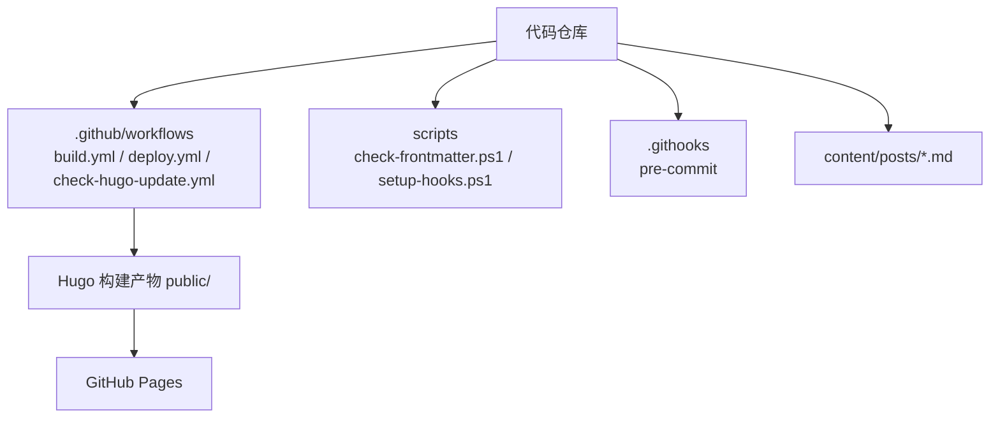
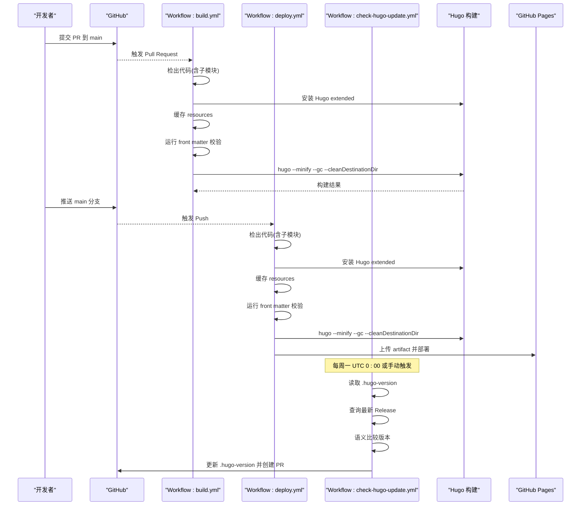
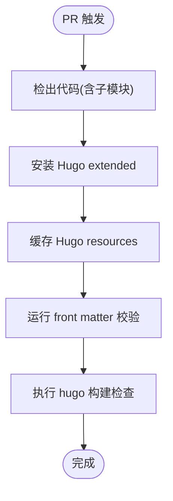
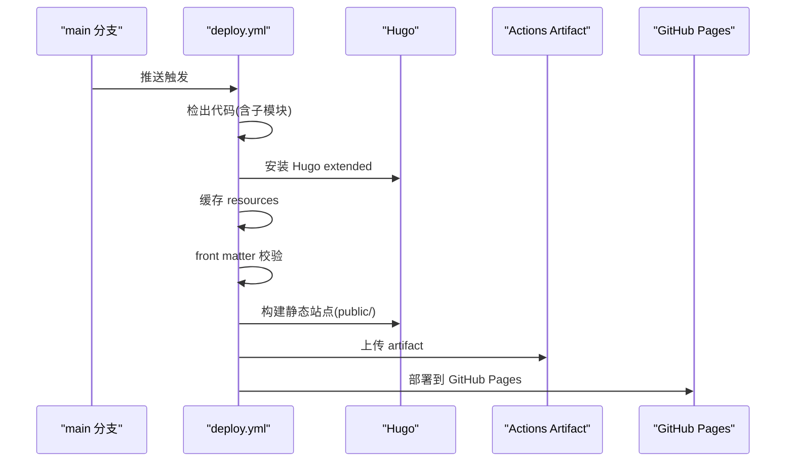
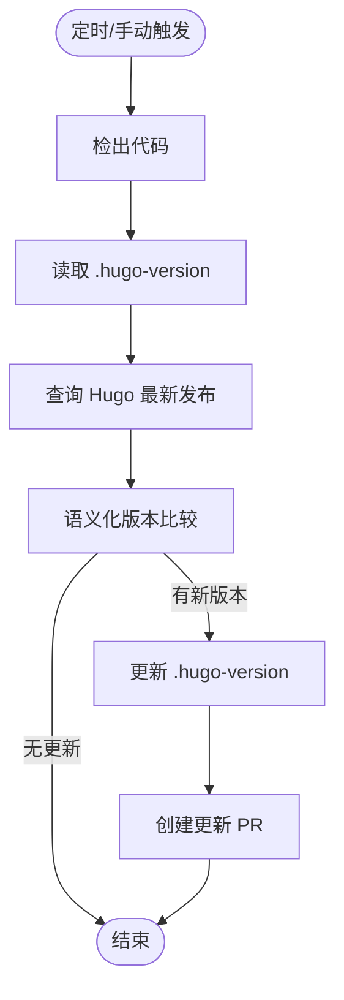
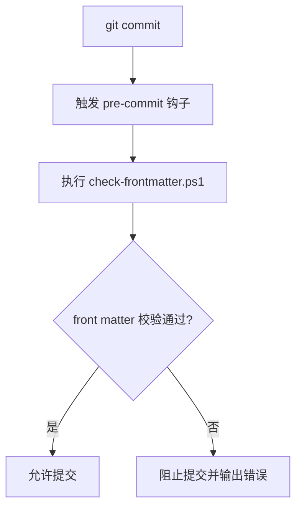
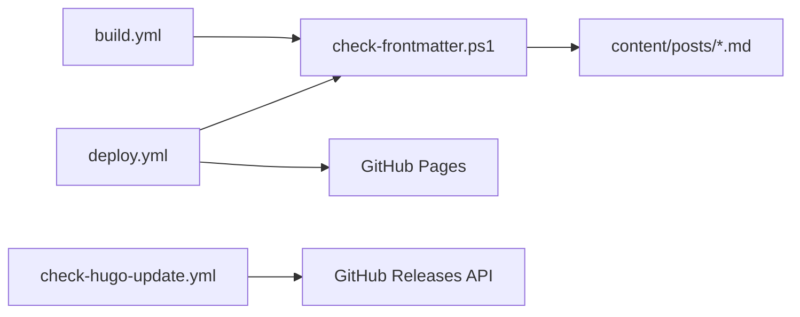

# 自动化工作流

<cite>
**本文引用的文件**   
- [README.md](file://README.md)
- [.github/workflows/build.yml](file://.github/workflows/build.yml)
- [.github/workflows/deploy.yml](file://.github/workflows/deploy.yml)
- [.github/workflows/check-hugo-update.yml](file://.github/workflows/check-hugo-update.yml)
- [scripts/check-frontmatter.ps1](file://scripts/check-frontmatter.ps1)
- [scripts/setup-hooks.ps1](file://scripts/setup-hooks.ps1)
</cite>

## 目录
1. [简介](#简介)
2. [项目结构](#项目结构)
3. [核心组件](#核心组件)
4. [架构总览](#架构总览)
5. [详细组件分析](#详细组件分析)
6. [依赖关系分析](#依赖关系分析)
7. [性能与缓存](#性能与缓存)
8. [自定义与扩展](#自定义与扩展)
9. [故障排除指南](#故障排除指南)
10. [结论](#结论)

## 简介
本仓库是一个基于 Hugo 与 Blowfish 主题的个人技术博客，使用 GitHub Actions 实现自动化构建、检查与部署。工作流覆盖以下场景：
- Pull Request 到 main 分支时执行构建检查（front matter 校验 + Hugo 构建）
- 推送 main 分支或手动触发时，自动构建并部署到 GitHub Pages
- 定时检查 Hugo 新版本，并在有新版本时自动创建更新 PR
- 本地通过 Git hooks 在提交前进行 front matter 必填字段校验

## 项目结构
与自动化相关的关键目录与文件：
- .github/workflows：GitHub Actions 工作流定义
- scripts：PowerShell 脚本，用于 front matter 校验与启用 Git hooks
- .githooks：本地 Git hooks 目录（pre-commit 钩子）
- content/posts：博客文章目录，front matter 校验的目标范围

图表来源
- [.github/workflows/build.yml:1-40](file://.github/workflows/build.yml#L1-L40)
- [.github/workflows/deploy.yml:1-64](file://.github/workflows/deploy.yml#L1-L64)
- [.github/workflows/check-hugo-update.yml:1-67](file://.github/workflows/check-hugo-update.yml#L1-L67)
- [scripts/check-frontmatter.ps1:1-37](file://scripts/check-frontmatter.ps1#L1-L37)
- [scripts/setup-hooks.ps1:1-5](file://scripts/setup-hooks.ps1#L1-L5)

章节来源
- [README.md:1-159](file://README.md#L1-L159)

## 核心组件
- 构建检查流水线（build.yml）
  - 触发条件：对 main 分支的 Pull Request
  - 主要步骤：检出代码（含子模块）、安装 Hugo extended、缓存 Hugo 资源、运行 front matter 校验、执行 hugo --minify --gc --cleanDestinationDir 构建
- 生产部署流水线（deploy.yml）
  - 触发条件：push 到 main 分支或 workflow_dispatch 手动触发
  - 主要步骤：检出代码（含子模块）、安装 Hugo extended、缓存 Hugo 资源、front matter 校验、构建静态站点、上传 artifact、部署到 GitHub Pages
- Hugo 版本检查工作流（check-hugo-update.yml）
  - 触发条件：每周一 UTC 0:00 定时任务或手动触发
  - 主要步骤：读取当前 .hugo-version、查询 GitHub Releases 最新版本、语义比较、必要时更新 .hugo-version 并创建 PR
- 本地 Git hooks
  - pre-commit 钩子：调用 scripts/check-frontmatter.ps1 校验 content/posts 下文章的 front matter 必填字段
  - setup-hooks.ps1：设置 core.hooksPath 为 .githooks，启用仓库内 hooks

章节来源
- [.github/workflows/build.yml:1-40](file://.github/workflows/build.yml#L1-L40)
- [.github/workflows/deploy.yml:1-64](file://.github/workflows/deploy.yml#L1-L64)
- [.github/workflows/check-hugo-update.yml:1-67](file://.github/workflows/check-hugo-update.yml#L1-L67)
- [scripts/check-frontmatter.ps1:1-37](file://scripts/check-frontmatter.ps1#L1-L37)
- [scripts/setup-hooks.ps1:1-5](file://scripts/setup-hooks.ps1#L1-L5)

## 架构总览
整体 CI/CD 流程如下：

图表来源
- [.github/workflows/build.yml:1-40](file://.github/workflows/build.yml#L1-L40)
- [.github/workflows/deploy.yml:1-64](file://.github/workflows/deploy.yml#L1-L64)
- [.github/workflows/check-hugo-update.yml:1-67](file://.github/workflows/check-hugo-update.yml#L1-L67)

## 详细组件分析

### 构建检查流水线（build.yml）
- 触发器
  - pull_request，目标分支 main
- 权限
  - contents: read
- 关键步骤
  - 检出代码，递归拉取子模块，full history
  - 安装 Hugo extended（版本由 .hugo-version 控制）
  - 缓存 Hugo 资源目录 resources，加速后续构建
  - 运行 PowerShell 脚本校验 front matter 必填字段
  - 执行 hugo --minify --gc --cleanDestinationDir 构建检查

图表来源
- [.github/workflows/build.yml:1-40](file://.github/workflows/build.yml#L1-L40)

章节来源
- [.github/workflows/build.yml:1-40](file://.github/workflows/build.yml#L1-L40)

### 生产部署流水线（deploy.yml）
- 触发器
  - push 到 main 分支；workflow_dispatch 支持手动触发
- 权限
  - contents: read, pages: write, id-token: write
- 并发控制
  - group: pages，避免重复部署冲突
- 关键步骤
  - 检出代码，递归拉取子模块
  - 安装 Hugo extended
  - 缓存 Hugo resources
  - 运行 front matter 校验
  - 构建静态站点到 public/
  - 上传 artifact 至 actions/upload-pages-artifact
  - 使用 actions/deploy-pages 部署到 GitHub Pages

图表来源
- [.github/workflows/deploy.yml:1-64](file://.github/workflows/deploy.yml#L1-L64)

章节来源
- [.github/workflows/deploy.yml:1-64](file://.github/workflows/deploy.yml#L1-L64)

### Hugo 版本检查工作流（check-hugo-update.yml）
- 触发器
  - schedule: cron '0 0 * * 1'（每周一 UTC 0:00）
  - workflow_dispatch 支持手动触发
- 权限
  - contents: write, pull-requests: write
- 关键步骤
  - 检出代码
  - 读取 .hugo-version 作为当前版本
  - 调用 GitHub API 获取 Hugo 最新发布标签
  - 使用 sort -V 进行语义化版本比较
  - 若存在更新，写入 .hugo-version
  - 使用 peter-evans/create-pull-request 创建 PR，包含变更说明与链接

图表来源
- [.github/workflows/check-hugo-update.yml:1-67](file://.github/workflows/check-hugo-update.yml#L1-L67)

章节来源
- [.github/workflows/check-hugo-update.yml:1-67](file://.github/workflows/check-hugo-update.yml#L1-L67)

### 本地 Git hooks（pre-commit）
- 启用方式
  - 在仓库根目录执行 scripts/setup-hooks.ps1，设置 core.hooksPath 为 .githooks
- 校验逻辑
  - pre-commit 钩子调用 scripts/check-frontmatter.ps1
  - 校验 content/posts 下所有 .md 文件的 front matter 是否包含非空的 slug、description、categories、tags
  - 未通过则阻止提交

图表来源
- [scripts/setup-hooks.ps1:1-5](file://scripts/setup-hooks.ps1#L1-L5)
- [scripts/check-frontmatter.ps1:1-37](file://scripts/check-frontmatter.ps1#L1-L37)

章节来源
- [scripts/setup-hooks.ps1:1-5](file://scripts/setup-hooks.ps1#L1-L5)
- [scripts/check-frontmatter.ps1:1-37](file://scripts/check-frontmatter.ps1#L1-L37)

## 依赖关系分析
- 工作流之间的耦合
  - build.yml 与 deploy.yml 共享相同的 Hugo 安装与 front matter 校验逻辑，确保本地与 CI 行为一致
  - check-hugo-update.yml 独立于构建与部署，仅负责版本升级与 PR 创建
- 外部依赖
  - peaceiris/actions-hugo@v3：安装 Hugo extended
  - actions/cache@v6：缓存 Hugo resources
  - actions/upload-pages-artifact@v5：上传构建产物
  - actions/deploy-pages@v5：部署到 GitHub Pages
  - peter-evans/create-pull-request@v8：创建版本更新 PR
- 脚本依赖
  - scripts/check-frontmatter.ps1：被 build.yml、deploy.yml 与本地 pre-commit 共同调用
  - scripts/setup-hooks.ps1：仅在本地初始化时使用

图表来源
- [.github/workflows/build.yml:1-40](file://.github/workflows/build.yml#L1-L40)
- [.github/workflows/deploy.yml:1-64](file://.github/workflows/deploy.yml#L1-L64)
- [.github/workflows/check-hugo-update.yml:1-67](file://.github/workflows/check-hugo-update.yml#L1-L67)
- [scripts/check-frontmatter.ps1:1-37](file://scripts/check-frontmatter.ps1#L1-L37)

章节来源
- [.github/workflows/build.yml:1-40](file://.github/workflows/build.yml#L1-L40)
- [.github/workflows/deploy.yml:1-64](file://.github/workflows/deploy.yml#L1-L64)
- [.github/workflows/check-hugo-update.yml:1-67](file://.github/workflows/check-hugo-update.yml#L1-L67)
- [scripts/check-frontmatter.ps1:1-37](file://scripts/check-frontmatter.ps1#L1-L37)

## 性能与缓存
- Hugo 资源缓存
  - 两个工作流均使用 actions/cache@v6 缓存 resources 目录，key 基于 runner.os 与 config/** 的哈希值，restore-keys 提供回退键，显著减少重复构建时间
- 构建优化参数
  - hugo --minify --gc --cleanDestinationDir：压缩输出、清理无用资源、清理目标目录，提升部署质量与体积
- 并发控制
  - deploy.yml 使用 concurrency group: pages，避免并行部署导致的状态冲突

建议
- 保持 config/** 稳定以利用缓存命中
- 如需进一步加速，可考虑缓存 Go 模块或 Node 依赖（如未来引入前端工具链）

章节来源
- [.github/workflows/build.yml:26-32](file://.github/workflows/build.yml#L26-L32)
- [.github/workflows/deploy.yml:33-39](file://.github/workflows/deploy.yml#L33-L39)
- [.github/workflows/deploy.yml:13-15](file://.github/workflows/deploy.yml#L13-L15)

## 自定义与扩展
- 新增内容类型校验
  - 在 scripts/check-frontmatter.ps1 中扩展 $postsDir 与遍历逻辑，支持 notes 或其他目录
  - 在 required 字典中添加新字段与提示语
- 调整触发条件
  - build.yml：增加其他分支或事件类型（如 push、schedule）
  - deploy.yml：限制发布分支或添加环境保护规则
  - check-hugo-update.yml：调整 cron 表达式或增加其他依赖项的版本检查
- 集成更多质量检查
  - 在 build.yml 中增加 Markdown lint、图片压缩、SEO 检查等步骤
- 多环境部署
  - 在 deploy.yml 中增加 preview/staging 环境，使用 environment 与不同的 URL 配置
- 通知与报告
  - 在失败时发送 Slack/邮件通知，或在 PR 中留下评论总结检查结果

章节来源
- [scripts/check-frontmatter.ps1:1-37](file://scripts/check-frontmatter.ps1#L1-L37)
- [.github/workflows/build.yml:1-40](file://.github/workflows/build.yml#L1-L40)
- [.github/workflows/deploy.yml:1-64](file://.github/workflows/deploy.yml#L1-L64)
- [.github/workflows/check-hugo-update.yml:1-67](file://.github/workflows/check-hugo-update.yml#L1-L67)

## 故障排除指南
常见问题与解决思路：
- 主题子模块未拉取
  - 现象：构建失败，找不到主题模板或资源
  - 排查：确认 checkout 步骤设置了 submodules: recursive
  - 参考：[.github/workflows/build.yml:15-19](file://.github/workflows/build.yml#L15-L19)、[.github/workflows/deploy.yml:22-26](file://.github/workflows/deploy.yml#L22-L26)
- Hugo 版本不一致
  - 现象：本地构建成功但 CI 失败，或反之
  - 排查：确认 .hugo-version 与 peaceiris/actions-hugo 的 extended 配置一致
  - 参考：[.github/workflows/build.yml:21-24](file://.github/workflows/build.yml#L21-L24)、[.github/workflows/deploy.yml:28-31](file://.github/workflows/deploy.yml#L28-L31)
- front matter 校验失败
  - 现象：CI 或 pre-commit 拦截提交/构建
  - 排查：检查 content/posts 下 .md 文件是否包含非空的 slug、description、categories、tags
  - 参考：[scripts/check-frontmatter.ps1:4-27](file://scripts/check-frontmatter.ps1#L4-L27)
- GitHub Pages 部署失败
  - 现象：deploy 作业失败或页面无法访问
  - 排查：确认 permissions 包含 pages: write 与 id-token: write；检查 upload artifact 路径是否为 ./public
  - 参考：[.github/workflows/deploy.yml:8-11](file://.github/workflows/deploy.yml#L8-L11)、[.github/workflows/deploy.yml:48-51](file://.github/workflows/deploy.yml#L48-L51)
- Hugo 版本更新未生效
  - 现象：check-hugo-update.yml 创建了 PR 但未合并
  - 排查：查看 PR 状态与评论内容；确认 compare 逻辑是否正确识别新版本
  - 参考：[.github/workflows/check-hugo-update.yml:35-45](file://.github/workflows/check-hugo-update.yml#L35-L45)、[.github/workflows/check-hugo-update.yml:51-66](file://.github/workflows/check-hugo-update.yml#L51-L66)
- 本地 hooks 未生效
  - 现象：提交未触发校验
  - 排查：执行 scripts/setup-hooks.ps1 并确认 core.hooksPath 指向 .githooks
  - 参考：[scripts/setup-hooks.ps1:1-5](file://scripts/setup-hooks.ps1#L1-L5)

章节来源
- [.github/workflows/build.yml:15-24](file://.github/workflows/build.yml#L15-L24)
- [.github/workflows/deploy.yml:8-11](file://.github/workflows/deploy.yml#L8-L11)
- [.github/workflows/deploy.yml:48-51](file://.github/workflows/deploy.yml#L48-L51)
- [.github/workflows/check-hugo-update.yml:35-45](file://.github/workflows/check-hugo-update.yml#L35-L45)
- [.github/workflows/check-hugo-update.yml:51-66](file://.github/workflows/check-hugo-update.yml#L51-L66)
- [scripts/check-frontmatter.ps1:4-27](file://scripts/check-frontmatter.ps1#L4-L27)
- [scripts/setup-hooks.ps1:1-5](file://scripts/setup-hooks.ps1#L1-L5)

## 结论
本项目的自动化工作流围绕 Hugo 构建与 GitHub Pages 部署展开，覆盖了从代码提交到线上发布的完整闭环。通过统一的 front matter 校验、Hugo 资源缓存与版本自动更新机制，既保证了构建质量，又提升了维护效率。建议在团队内统一遵循 front matter 规范，并根据业务需求对工作流进行适度扩展与定制。