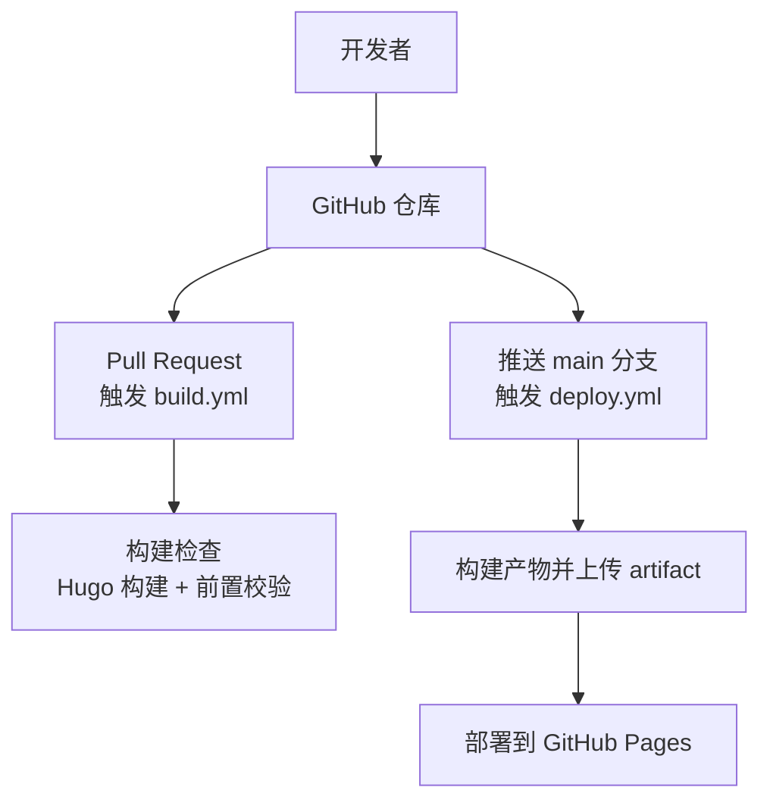
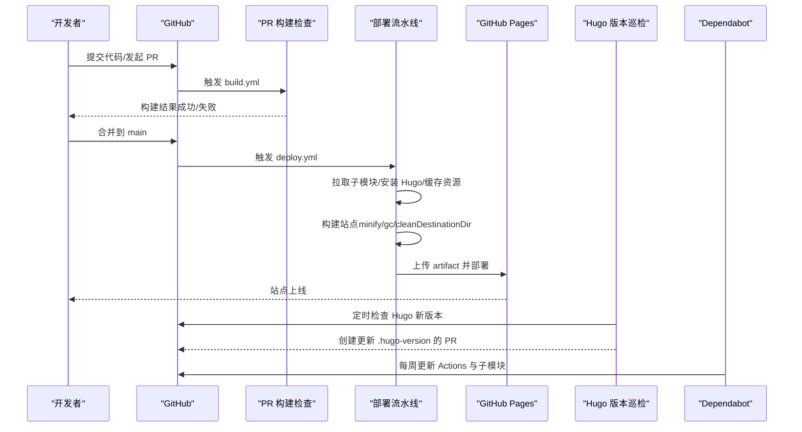
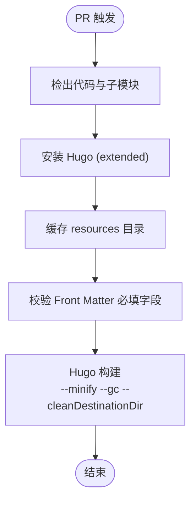
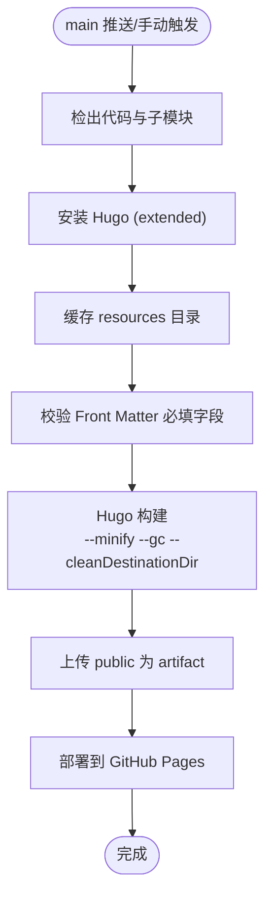
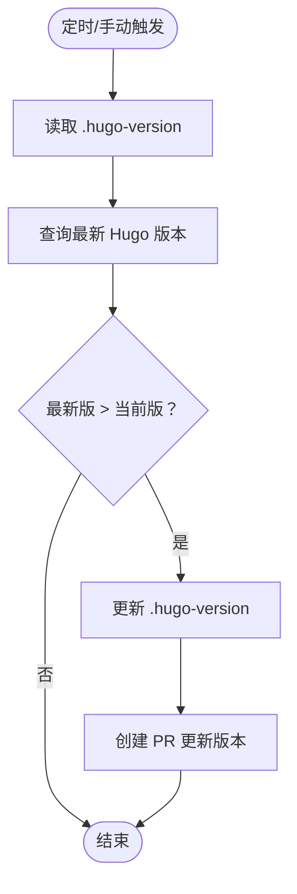
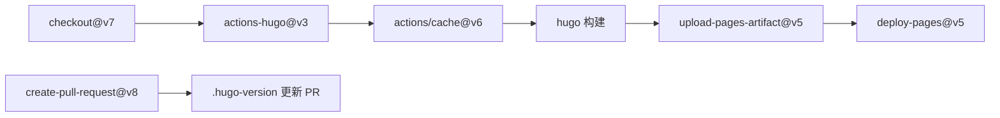

# 部署策略

<cite>
**本文引用的文件**   
- [deploy.yml](file://.github/workflows/deploy.yml)
- [build.yml](file://.github/workflows/build.yml)
- [check-hugo-update.yml](file://.github/workflows/check-hugo-update.yml)
- [dependabot.yml](file://.github/dependabot.yml)
- [hugo.toml](file://config/_default/hugo.toml)
</cite>

## 目录
1. [简介](#简介)
2. [项目结构](#项目结构)
3. [核心组件](#核心组件)
4. [架构总览](#架构总览)
5. [详细组件分析](#详细组件分析)
6. [依赖关系分析](#依赖关系分析)
7. [性能与缓存优化](#性能与缓存优化)
8. [多环境部署配置](#多环境部署配置)
9. [回滚与错误处理](#回滚与错误处理)
10. [监控与日志](#监控与日志)
11. [结论](#结论)

## 简介
本部署策略文档面向 GitHub Pages + Hugo 的静态站点自动化发布，覆盖分支策略、构建参数、缓存机制、回滚与错误处理、多环境差异化配置、监控与日志以及性能优化建议。目标是让开发者在本地与 CI 保持一致体验，同时保证生产环境的稳定性与可恢复性。

## 项目结构
本项目采用 Hugo 主题模式（blowfish），通过 GitHub Actions 实现 PR 构建检查与 main 分支自动部署到 GitHub Pages。关键目录与职责：
- .github/workflows：CI/CD 流水线定义
- config/_default：Hugo 默认站点配置
- content：站点内容
- themes/blowfish：主题资源与模板
- scripts：本地脚本（如 front matter 校验）

图表来源
- [build.yml:1-40](file://.github/workflows/build.yml#L1-L40)
- [deploy.yml:1-64](file://.github/workflows/deploy.yml#L1-L64)

章节来源
- [build.yml:1-40](file://.github/workflows/build.yml#L1-L40)
- [deploy.yml:1-64](file://.github/workflows/deploy.yml#L1-L64)

## 核心组件
- 构建检查流水线（PR）：对 main 分支的 PR 执行 Hugo 构建与前文校验，确保代码质量与可构建性。
- 部署流水线（main）：拉取子模块、安装 Hugo、缓存资源、构建站点、上传 artifact 并部署到 GitHub Pages。
- Hugo 版本巡检：定时检测 Hugo 新版本并自动创建 PR 更新 .hugo-version。
- Dependabot：每周自动更新 GitHub Actions 与 git 子模块依赖。

章节来源
- [build.yml:1-40](file://.github/workflows/build.yml#L1-L40)
- [deploy.yml:1-64](file://.github/workflows/deploy.yml#L1-L64)
- [check-hugo-update.yml:1-67](file://.github/workflows/check-hugo-update.yml#L1-L67)
- [dependabot.yml:1-28](file://.github/dependabot.yml#L1-L28)

## 架构总览
下图展示从代码提交到站点上线的整体流程，包括 PR 检查、main 分支构建与部署、Hugo 版本巡检与依赖更新。

图表来源
- [build.yml:1-40](file://.github/workflows/build.yml#L1-L40)
- [deploy.yml:1-64](file://.github/workflows/deploy.yml#L1-L64)
- [check-hugo-update.yml:1-67](file://.github/workflows/check-hugo-update.yml#L1-L67)
- [dependabot.yml:1-28](file://.github/dependabot.yml#L1-L28)

## 详细组件分析

### 构建检查流水线（PR）
- 触发条件：对 main 分支的 Pull Request。
- 关键步骤：
  - 拉取代码与子模块（含主题）。
  - 安装 Hugo（extended 模式）。
  - 缓存 Hugo 资源目录 resources。
  - 运行前文字段校验脚本。
  - 执行 Hugo 构建（minify、gc、cleanDestinationDir）。
- 目标：在合并前验证站点可构建且内容元数据完整。

图表来源
- [build.yml:1-40](file://.github/workflows/build.yml#L1-L40)

章节来源
- [build.yml:1-40](file://.github/workflows/build.yml#L1-L40)

### 部署流水线（main）
- 触发条件：推送到 main 分支或手动触发。
- 权限与并发：
  - 授予 pages 写入与 id-token 写入权限。
  - 使用 concurrency group 控制并发任务。
- 关键步骤：
  - 拉取代码与子模块（recursive）。
  - 安装 Hugo（extended，版本来自 .hugo-version）。
  - 缓存 Hugo 资源目录 resources。
  - 校验 Front Matter。
  - 构建站点并上传 artifact。
  - 部署到 GitHub Pages。
- 环境变量与环境对象：
  - 使用 environment github-pages 记录部署 URL。

图表来源
- [deploy.yml:1-64](file://.github/workflows/deploy.yml#L1-L64)

章节来源
- [deploy.yml:1-64](file://.github/workflows/deploy.yml#L1-L64)

### Hugo 版本巡检
- 触发条件：每周一 UTC 0 点定时任务或手动触发。
- 逻辑：
  - 读取当前 .hugo-version。
  - 查询 GitHub Releases 获取最新版本。
  - 语义比较版本号，若新版更高则更新 .hugo-version。
  - 自动创建 PR 以合并版本更新。
- 目的：保持 Hugo 版本及时升级，减少安全与兼容性问题。

图表来源
- [check-hugo-update.yml:1-67](file://.github/workflows/check-hugo-update.yml#L1-L67)

章节来源
- [check-hugo-update.yml:1-67](file://.github/workflows/check-hugo-update.yml#L1-L67)

### Dependabot 依赖管理
- 更新范围：
  - GitHub Actions 工作流依赖。
  - git 子模块（blowfish 主题）。
- 调度：每周一 09:00（Asia/Shanghai）。
- 输出：自动创建 PR，便于审阅与合并。

章节来源
- [dependabot.yml:1-28](file://.github/dependabot.yml#L1-L28)

## 依赖关系分析
- 工作流依赖：
  - checkout@v7：拉取代码与子模块。
  - peaceiris/actions-hugo@v3：安装 Hugo（extended）。
  - actions/cache@v6：缓存 Hugo 资源。
  - actions/upload-pages-artifact@v5：上传 Pages 构建产物。
  - actions/deploy-pages@v5：部署到 GitHub Pages。
  - peter-evans/create-pull-request@v8：创建版本更新 PR。
- 运行时依赖：
  - Hugo extended 版本由 .hugo-version 指定（由版本巡检维护）。
  - 主题子模块 blowfish 由 git submodule 管理。

图表来源
- [build.yml:1-40](file://.github/workflows/build.yml#L1-L40)
- [deploy.yml:1-64](file://.github/workflows/deploy.yml#L1-L64)
- [check-hugo-update.yml:1-67](file://.github/workflows/check-hugo-update.yml#L1-L67)

章节来源
- [build.yml:1-40](file://.github/workflows/build.yml#L1-L40)
- [deploy.yml:1-64](file://.github/workflows/deploy.yml#L1-L64)
- [check-hugo-update.yml:1-67](file://.github/workflows/check-hugo-update.yml#L1-L67)

## 性能与缓存优化
- 构建参数优化：
  - --minify：压缩 HTML/CSS/JS，减小体积。
  - --gc：清理未使用的资源，减少产出大小。
  - --cleanDestinationDir：每次构建清理输出目录，避免脏数据。
- 资源缓存：
  - 使用 actions/cache 缓存 resources 目录，键基于操作系统与 config/** 哈希，提升重复构建速度。
- 子模块与主题：
  - 使用 recursive 拉取子模块，确保主题资源完整。
- 建议：
  - 将大型静态资源（图片、视频）置于 CDN 或外部存储，减少仓库体积。
  - 按需启用相关 Hugo 扩展（如 SCSS/KaTeX/Mermaid），避免不必要的编译开销。
  - 定期清理未引用资源，配合 --gc 降低产物体积。

章节来源
- [build.yml:1-40](file://.github/workflows/build.yml#L1-L40)
- [deploy.yml:1-64](file://.github/workflows/deploy.yml#L1-L64)

## 多环境部署配置
- 当前状态：
  - 仅存在默认环境配置（config/_default/hugo.toml），用于生产站点基础设置。
  - 未定义 development/test/prod 多环境差异配置。
- 推荐实践：
  - 使用 Hugo 的多配置能力，按环境拆分配置文件（如 hugo.dev.toml、hugo.prod.toml），并通过环境变量或构建参数选择。
  - 在 CI 中根据分支或标签选择对应配置：
    - develop 分支：使用开发配置（禁用 minify、开启调试输出等）。
    - main 分支：使用生产配置（启用 minify、gc、cleanDestinationDir）。
  - 将敏感信息（API Key、Analytics ID）放入环境变量或 Secrets，不在代码中硬编码。
- 注意事项：
  - 确保各环境 baseURL 与域名一致，避免跨域问题。
  - 针对不同环境启用不同的功能开关（如评论系统、统计埋点）。

章节来源
- [hugo.toml:1-78](file://config/_default/hugo.toml#L1-L78)

## 回滚与错误处理
- 回滚策略：
  - GitHub Pages 支持历史版本回滚，可在 Pages 设置中选择之前的部署快照进行回滚。
  - 建议在合并前通过 PR 构建检查拦截错误，减少回滚概率。
- 错误处理：
  - 构建失败时，查看 Actions 日志定位问题（Hugo 构建错误、Front Matter 缺失字段等）。
  - 部署失败时，检查 permissions、environment 配置与 artifact 路径是否正确。
- 最佳实践：
  - 为每个重要变更保留清晰的 commit message 与 PR 描述，便于快速定位与回滚。
  - 在 main 分支保护规则中要求至少一名审查者通过后再合并。

章节来源
- [build.yml:1-40](file://.github/workflows/build.yml#L1-L40)
- [deploy.yml:1-64](file://.github/workflows/deploy.yml#L1-L64)

## 监控与日志
- 构建与部署日志：
  - 在 GitHub Actions 页面查看每一步的执行日志，包括 checkout、setup、cache、build、deploy。
- 站点可用性监控：
  - 可使用第三方服务（如 UptimeRobot、Pingdom）对 https://zuoxiange.github.io/ 进行健康检查。
- 访问统计：
  - 在 Hugo 配置中集成统计服务（如 GA、Umami），并在前端模板中注入相应脚本。
- 告警与通知：
  - 在 Actions 中配置邮件或 Slack 通知，当构建或部署失败时及时提醒。

章节来源
- [deploy.yml:1-64](file://.github/workflows/deploy.yml#L1-L64)

## 结论
本项目通过 GitHub Actions 实现了从 PR 检查到 main 分支自动部署的完整闭环，结合 Hugo 构建优化与资源缓存，提升了构建效率与站点性能。建议后续引入多环境配置、完善监控与告警机制，并持续通过 Dependabot 与 Hugo 版本巡检保持依赖与安全更新。