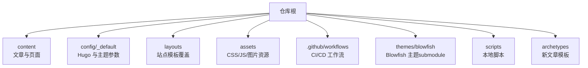
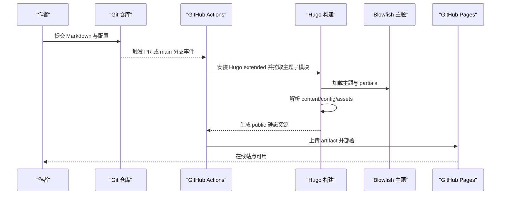
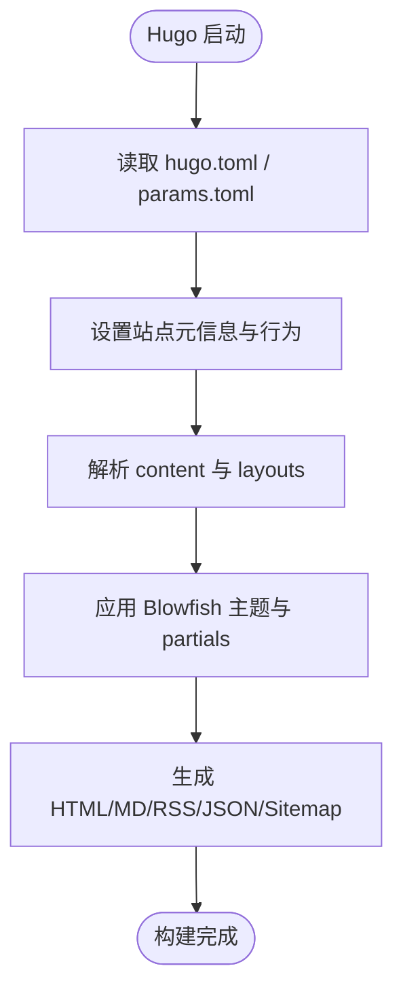
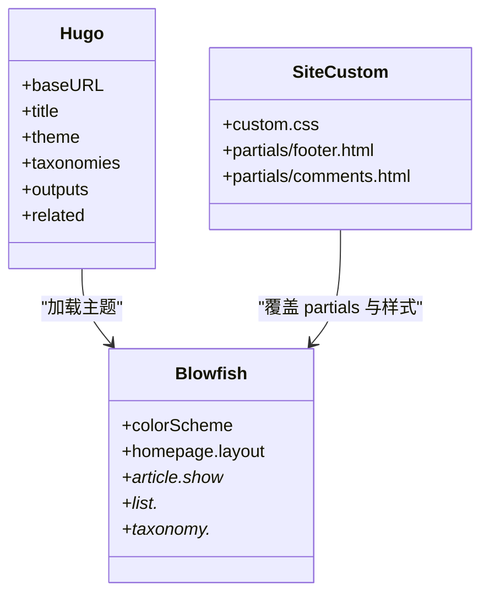
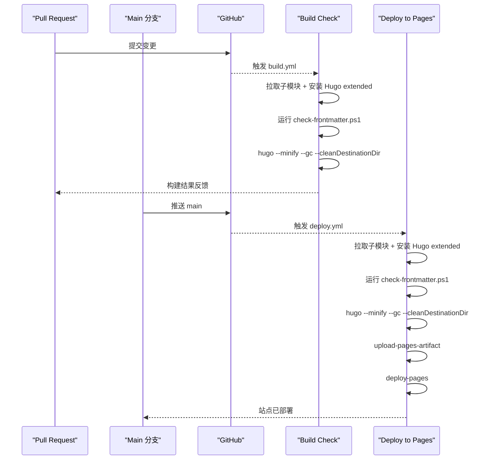
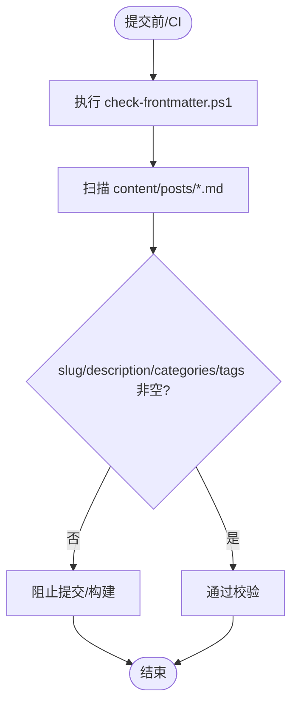
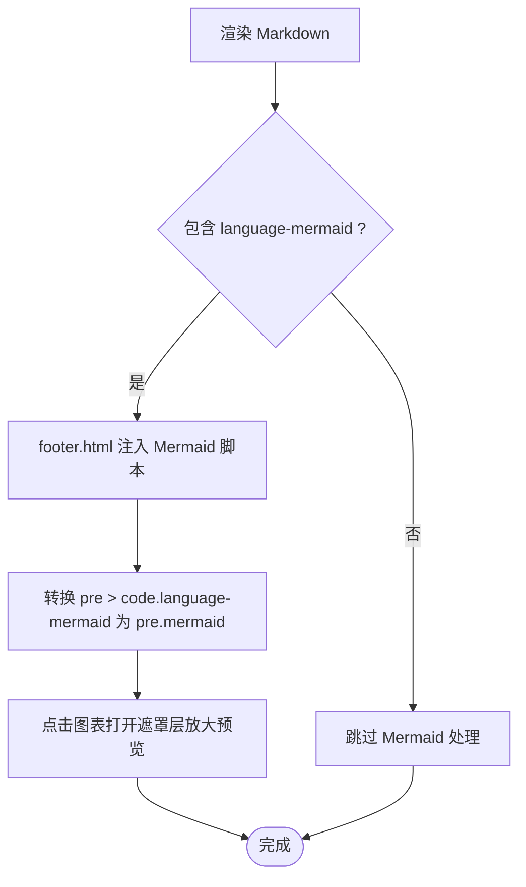
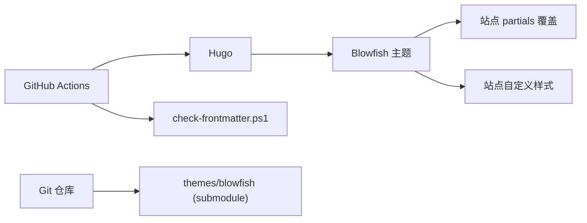

# 项目概述

<cite>
**本文引用的文件**   
- [README.md](file://README.md)
- [hugo.toml](file://config/_default/hugo.toml)
- [params.toml](file://config/_default/params.toml)
- [build.yml](file://.github/workflows/build.yml)
- [deploy.yml](file://.github/workflows/deploy.yml)
- [theme.toml](file://themes/blowfish/theme.toml)
- [footer.html](file://layouts/partials/footer.html)
- [custom.css](file://assets/css/custom.css)
</cite>

## 目录
1. [简介](#简介)
2. [项目结构](#项目结构)
3. [核心组件](#核心组件)
4. [架构总览](#架构总览)
5. [详细组件分析](#详细组件分析)
6. [依赖关系分析](#依赖关系分析)
7. [性能与构建优化](#性能与构建优化)
8. [故障排查指南](#故障排查指南)
9. [结论](#结论)
10. [附录：快速开始与最佳实践](#附录快速开始与最佳实践)

## 简介
本项目是一个基于 Hugo 静态站点生成器与 Blowfish 主题的个人技术博客。内容以 Markdown 编写，通过 GitHub Actions 在推送 main 分支时自动构建并部署到 GitHub Pages。在线访问地址为 https://zuoxiange.github.io/。

项目目标：
- 提供稳定、可维护的技术博客基础设施
- 使用现代主题特性（响应式、暗色模式、Mermaid 图表、代码高亮等）
- 通过 CI/CD 自动化保证内容与构建质量
- 保持主题升级安全，将站点级定制与主题解耦

适合读者：
- 初学者：了解如何从零搭建一个 Hugo + Blowfish 博客
- 有经验的开发者：理解构建流程、主题覆盖策略与自动化部署

## 项目结构
仓库采用“站点配置 + 内容 + 主题子模块”的结构。站点级定制集中在 `layouts`、`assets`、`config`，主题本身作为 git submodule 引入，避免直接修改被覆盖。



**图示来源**
- [README.md:14-40](file://README.md#L14-L40)
- [hugo.toml:1-78](file://config/_default/hugo.toml#L1-L78)
- [params.toml:1-88](file://config/_default/params.toml#L1-L88)

关键目录说明：
- content/posts：博客文章
- content/notes：备忘与笔记
- config/_default：Hugo 核心配置与主题参数
- layouts/partials：站点级模板覆盖（如 footer、toc、comments）
- assets/css/custom.css：站点级样式（代码块美化、Mermaid 放大预览等）
- .github/workflows：PR 构建检查与 main 分支部署
- themes/blowfish：Blowfish 主题（通过 git submodule 管理）

**章节来源**
- [README.md:14-40](file://README.md#L14-L40)

## 核心组件
- Hugo 静态站点生成器：读取 Markdown 内容与配置，生成静态 HTML/CSS/JS 资源
- Blowfish 主题：现代化 Hugo 主题，支持 Tailwind CSS、暗色模式、丰富 shortcode、Mermaid 图表、搜索与结构化数据
- GitHub Actions：PR 构建校验与 main 分支自动部署到 GitHub Pages
- PowerShell 脚本：front matter 必填字段校验与 git hooks 初始化

Hugo 与主题职责划分：
- Hugo 负责站点元信息、输出格式、相关度索引、分页、Sitemap 等
- Blowfish 负责 UI 渲染、交互逻辑、主题参数、内置 shortcode 与布局

**章节来源**
- [hugo.toml:1-78](file://config/_default/hugo.toml#L1-L78)
- [theme.toml:1-22](file://themes/blowfish/theme.toml#L1-L22)
- [README.md:7-12](file://README.md#L7-L12)

## 架构总览
下图展示从内容到最终站点的整体流程：作者提交 Markdown → Hugo 解析内容与配置 → 应用 Blowfish 主题渲染 → GitHub Actions 构建并部署到 GitHub Pages。



**图示来源**
- [build.yml:1-40](file://.github/workflows/build.yml#L1-L40)
- [deploy.yml:1-64](file://.github/workflows/deploy.yml#L1-L64)
- [hugo.toml:1-78](file://config/_default/hugo.toml#L1-L78)
- [theme.toml:1-22](file://themes/blowfish/theme.toml#L1-L22)

## 详细组件分析

### Hugo 站点配置
- 站点基础信息：标题、默认语言、主题名、baseURL
- 功能开关：robots.txt、摘要长度、CJK 支持、Git 信息、草稿与未来文章构建控制
- 输出与媒体：启用 emoji、分页大小、图像锚点、sitemap
- 扩展输出：额外输出 Markdown 原文（用于“下载本文”）
- 相关文章索引：按 tags、categories、series、authors、date、fragmentrefs 加权计算



**图示来源**
- [hugo.toml:1-78](file://config/_default/hugo.toml#L1-L78)
- [params.toml:1-88](file://config/_default/params.toml#L1-L88)

**章节来源**
- [hugo.toml:1-78](file://config/_default/hugo.toml#L1-L78)
- [params.toml:1-88](file://config/_default/params.toml#L1-L88)

### Blowfish 主题与站点定制
- 主题元信息：名称、许可证、描述、主页、标签与特性
- 站点级定制原则：不直接修改主题 submodule，所有定制放在 `layouts`、`assets`、`config`
- 主题参数：首页布局、配色方案、外观切换、背景图、社交分享图、导航与页脚行为、文章显示项、列表与分类视图等

站点级定制要点：
- 代码块美化与 VS Code 风格配色：assets/css/custom.css
- Mermaid 图表点击放大预览：layouts/partials/footer.html 注入脚本
- 评论系统：layouts/partials/comments.html（giscus）
- 目录悬浮面板与相关文章卡片高度压缩：assets/css/custom.css



**图示来源**
- [theme.toml:1-22](file://themes/blowfish/theme.toml#L1-L22)
- [params.toml:1-88](file://config/_default/params.toml#L1-L88)
- [custom.css:1-397](file://assets/css/custom.css#L1-L397)
- [footer.html:1-205](file://layouts/partials/footer.html#L1-L205)

**章节来源**
- [theme.toml:1-22](file://themes/blowfish/theme.toml#L1-L22)
- [params.toml:1-88](file://config/_default/params.toml#L1-L88)
- [custom.css:1-397](file://assets/css/custom.css#L1-L397)
- [footer.html:1-205](file://layouts/partials/footer.html#L1-L205)

### GitHub Actions 自动化构建与部署
- build.yml：对 PR 到 main 的变更执行 front matter 校验与 hugo --minify 构建检查
- deploy.yml：main 分支推送或手动触发，执行完整构建并部署到 GitHub Pages



**图示来源**
- [build.yml:1-40](file://.github/workflows/build.yml#L1-L40)
- [deploy.yml:1-64](file://.github/workflows/deploy.yml#L1-L64)

**章节来源**
- [build.yml:1-40](file://.github/workflows/build.yml#L1-L40)
- [deploy.yml:1-64](file://.github/workflows/deploy.yml#L1-L64)

### Front Matter 校验与写作规范
- 必填字段：slug、description、categories、tags
- 校验工具：scripts/check-frontmatter.ps1
- 触发时机：pre-commit 钩子与 GitHub Actions（PR 与 main 分支）



**图示来源**
- [README.md:114-122](file://README.md#L114-L122)
- [build.yml:34-39](file://.github/workflows/build.yml#L34-L39)
- [deploy.yml:41-46](file://.github/workflows/deploy.yml#L41-L46)

**章节来源**
- [README.md:114-122](file://README.md#L114-L122)

### Mermaid 图表与代码块体验增强
- Mermaid 支持：无需 shortcode，直接在 Markdown 中使用 ```mermaid
围栏即可渲染
- 点击放大预览：footer.html 注入脚本，将 pre.mermaid 转换为可交互元素，并提供全屏遮罩查看
- 代码块美化：custom.css 实现 VS Code 风格窗口、行号、语言标签栏与复制按钮


**图示来源**
- [footer.html:78-198](file://layouts/partials/footer.html#L78-L198)
- [custom.css:311-397](file://assets/css/custom.css#L311-L397)

**章节来源**
- [footer.html:78-198](file://layouts/partials/footer.html#L78-L198)
- [custom.css:311-397](file://assets/css/custom.css#L311-L397)

## 依赖关系分析
- Hugo 与主题：站点通过 theme = 'blowfish' 指定主题；Blowfish 通过 Tailwind CSS 提供样式与交互
- 主题与站点定制：站点通过 layouts/partials 与 assets/css 覆盖主题默认行为
- CI 与工作流：Actions 依赖 hugo extended 版本与 PowerShell 脚本；主题以 git submodule 方式拉取



**图示来源**
- [hugo.toml:1-78](file://config/_default/hugo.toml#L1-L78)
- [build.yml:1-40](file://.github/workflows/build.yml#L1-L40)
- [deploy.yml:1-64](file://.github/workflows/deploy.yml#L1-L64)

**章节来源**
- [hugo.toml:1-78](file://config/_default/hugo.toml#L1-L78)
- [build.yml:1-40](file://.github/workflows/build.yml#L1-L40)
- [deploy.yml:1-64](file://.github/workflows/deploy.yml#L1-L64)

## 性能与构建优化
- 构建优化：CI 中启用 hugo --minify --gc --cleanDestinationDir，减少产物体积并清理旧文件
- 缓存策略：actions/cache 缓存 Hugo resources，加速重复构建
- 资源输出：除 HTML 外，额外输出 MD、RSS、JSON，便于下载与聚合
- 主题特性：Tailwind CSS 按需编译，减少冗余样式；Mermaid 按需加载与重渲染

建议：
- 保持主题与 Hugo 版本一致（CI 使用 extended 版，版本由 .hugo-version 锁定）
- 合理使用 related 索引权重，避免过多无关推荐影响阅读体验
- 谨慎扩展 partials，避免破坏主题升级兼容性

[本节为通用指导，不直接分析具体文件]

## 故障排查指南
常见问题与定位方法：
- 构建失败（front matter 缺失必填字段）：检查 scripts/check-frontmatter.ps1 与 README 中的必填字段约定
- 主题未生效：确认 hugo.toml 中 theme = 'blowfish'，并确保 git submodule 已正确初始化
- Mermaid 图表未渲染：确认 Markdown 中使用 ```mermaid 围栏，且 footer.html 已注入脚本
- 样式异常：检查 assets/css/custom.css 是否被正确打包，以及 partials/footer.html 是否覆盖主题默认行为
- 部署失败：检查 deploy.yml 权限（pages write、id-token write）与 GitHub Pages 环境配置

**章节来源**
- [README.md:114-128](file://README.md#L114-L128)
- [build.yml:34-39](file://.github/workflows/build.yml#L34-L39)
- [deploy.yml:41-64](file://.github/workflows/deploy.yml#L41-L64)
- [footer.html:78-198](file://layouts/partials/footer.html#L78-L198)
- [custom.css:1-397](file://assets/css/custom.css#L1-L397)

## 结论
本项目通过 Hugo 与 Blowfish 主题构建了现代化、可维护的个人技术博客。借助 GitHub Actions，实现了从内容提交到在线发布的自动化闭环。站点级定制与主题解耦，确保主题升级不受影响。对于初学者，可按快速开始指南搭建；对于有经验的开发者，可参考本概述深入理解构建流程、主题覆盖策略与自动化部署的最佳实践。

[本节为总结性内容，不直接分析具体文件]

## 附录：快速开始与最佳实践

### 在线访问
- 站点地址：https://zuoxiange.github.io/

### 首次克隆与本地开发
- 初始化主题子模块：git submodule update --init --recursive
- 启用 git hooks：pwsh -NoProfile -File scripts/setup-hooks.ps1
- 启动开发服务器：hugo server（草稿模式：hugo server -D）

### 写文章与发布
- 创建文章：hugo new content/posts/标题.md 或 hugo new content/notes/标题.md
- Front Matter 必填字段：slug、description、categories、tags
- 发布：将 draft 改为 false，提交到 main 分支后自动部署

### 主题与样式定制
- 主题参数：config/_default/params.toml
- 站点样式：assets/css/custom.css
- 模板覆盖：layouts/partials/*（优先覆盖而非修改主题）

### 更新主题
- 升级命令：git submodule update --remote --merge
- 注意：不要直接修改 themes/blowfish 内的文件，站点级定制应放在 layouts 与 assets

**章节来源**
- [README.md:42-159](file://README.md#L42-L159)