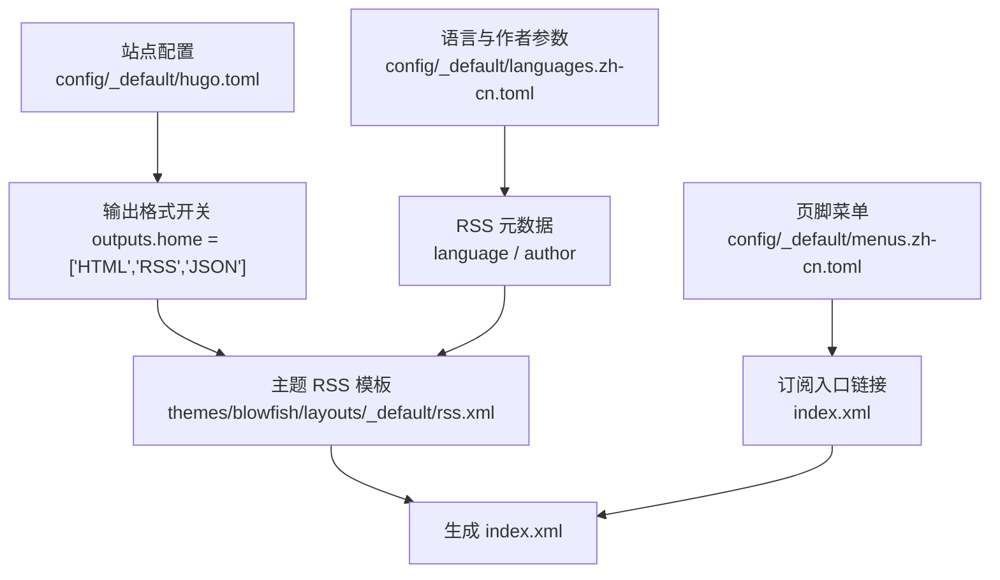
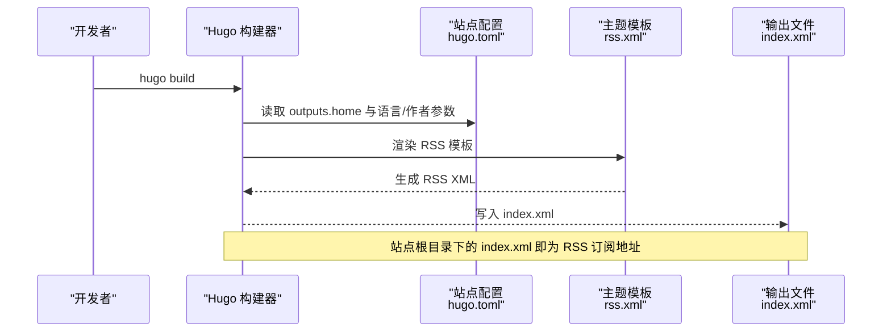
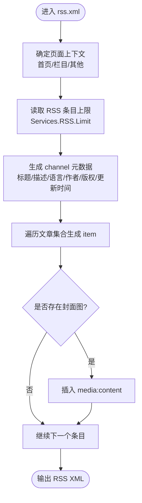
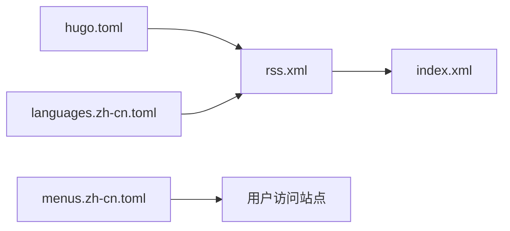

# RSS 订阅

<cite>
**本文引用的文件**   
- [hugo.toml](file://config/_default/hugo.toml)
- [menus.zh-cn.toml](file://config/_default/menus.zh-cn.toml)
- [languages.zh-cn.toml](file://config/_default/languages.zh-cn.toml)
- [rss.xml](file://themes/blowfish/layouts/_default/rss.xml)
</cite>

## 目录
1. [简介](#简介)
2. [项目结构](#项目结构)
3. [核心组件](#核心组件)
4. [架构总览](#架构总览)
5. [详细组件分析](#详细组件分析)
6. [依赖关系分析](#依赖关系分析)
7. [性能与兼容性](#性能与兼容性)
8. [使用与推广指南](#使用与推广指南)
9. [常见问题排查](#常见问题排查)
10. [结论](#结论)

## 简介
本文件面向在 Hugo 站点中启用、配置与扩展 RSS 订阅的读者，结合当前仓库的实际实现，说明：
- Hugo 如何自动生成 RSS feed 以及输出位置
- RSS XML 结构与字段含义
- 站点级与主题级配置项对 RSS 的影响
- 如何自定义 RSS 模板以添加字段、格式化内容或嵌入媒体
- 如何在站点中暴露订阅入口并推广
- 阅读器订阅方式与最佳实践

## 项目结构
RSS 相关的关键路径与职责如下：
- 站点配置：控制是否输出 RSS、语言、作者信息、菜单等
- 主题模板：定义 RSS XML 的结构与字段填充逻辑
- 导航/页脚菜单：提供用户可见的订阅入口链接

图表来源
- [hugo.toml:45-47](file://config/_default/hugo.toml#L45-L47)
- [languages.zh-cn.toml:12-20](file://config/_default/languages.zh-cn.toml#L12-L20)
- [menus.zh-cn.toml:35-38](file://config/_default/menus.zh-cn.toml#L35-L38)
- [rss.xml:1-56](file://themes/blowfish/layouts/_default/rss.xml#L1-L56)

章节来源
- [hugo.toml:1-78](file://config/_default/hugo.toml#L1-L78)
- [menus.zh-cn.toml:1-39](file://config/_default/menus.zh-cn.toml#L1-L39)
- [languages.zh-cn.toml:1-21](file://config/_default/languages.zh-cn.toml#L1-L21)
- [rss.xml:1-56](file://themes/blowfish/layouts/_default/rss.xml#L1-L56)

## 核心组件
- 站点配置（Hugo）
  - 启用 RSS 输出：通过 outputs.home 包含 RSS
  - 语言与区域：影响 RSS 中的 language 字段
  - 摘要长度、分页等间接影响条目展示
- 主题 RSS 模板
  - 决定 channel 与 item 的字段
  - 支持 Atom link、版权、最后构建时间、作者、媒体资源等
  - 支持 rssnext follow_challenge 扩展
- 站点菜单与语言参数
  - 在页脚菜单中暴露 RSS 链接
  - 在作者信息中提供 RSS 链接

章节来源
- [hugo.toml:17-47](file://config/_default/hugo.toml#L17-L47)
- [rss.xml:1-56](file://themes/blowfish/layouts/_default/rss.xml#L1-L56)
- [menus.zh-cn.toml:35-38](file://config/_default/menus.zh-cn.toml#L35-L38)
- [languages.zh-cn.toml:12-20](file://config/_default/languages.zh-cn.toml#L12-L20)

## 架构总览
下图展示了从配置到最终输出的端到端流程。

图表来源
- [hugo.toml:45-47](file://config/_default/hugo.toml#L45-L47)
- [rss.xml:1-56](file://themes/blowfish/layouts/_default/rss.xml#L1-L56)

## 详细组件分析

### RSS 模板与输出结构
主题提供的 RSS 模板定义了以下关键行为：
- 页面上下文选择：首页与栏目页取 RegularPages，其他页面取 Pages
- 条目数量限制：优先使用 .Site.Config.Services.RSS.Limit；未设置则不限制
- 标准字段：title、link、description、generator、language、managingEditor、webMaster、copyright、lastBuildDate、atom self link
- 条目字段：title、link、pubDate、author、guid、description
- 媒体资源：尝试匹配 feature/cover/thumbnail 图片，并以 media:content 输出
- 扩展字段：当配置了 rssnext.feedId 与 rssnext.userId 时，输出 follow_challenge

图表来源
- [rss.xml:1-56](file://themes/blowfish/layouts/_default/rss.xml#L1-L56)

章节来源
- [rss.xml:1-56](file://themes/blowfish/layouts/_default/rss.xml#L1-L56)

### 站点配置项与 RSS 的关系
- 是否输出 RSS
  - outputs.home 包含 RSS 才会生成首页 RSS
- 语言与区域
  - site.Language.Locale 用于 RSS 的 language 字段
- 作者信息
  - Site.Params.Author.email/name 用于 managingEditor/webMaster/author
- 版权信息
  - Site.Params.copyright 与 footer.showCopyright 控制 copyright 输出
- 摘要长度与分页
  - summaryLength 影响 Summary 的长度
  - pagination.pagerSize 影响列表页分页，但不直接限制 RSS 条目数（RSS 由 Services.RSS.Limit 控制）

章节来源
- [hugo.toml:1-47](file://config/_default/hugo.toml#L1-L47)
- [languages.zh-cn.toml:12-20](file://config/_default/languages.zh-cn.toml#L12-L20)
- [rss.xml:16-25](file://themes/blowfish/layouts/_default/rss.xml#L16-L25)

### 订阅入口与推广
- 页脚菜单已内置 RSS 链接，指向站点根目录的 index.xml
- 语言参数中的作者链接也包含 RSS 地址，便于在作者卡片中展示

章节来源
- [menus.zh-cn.toml:35-38](file://config/_default/menus.zh-cn.toml#L35-L38)
- [languages.zh-cn.toml:12-20](file://config/_default/languages.zh-cn.toml#L12-L20)

## 依赖关系分析
- 模板依赖站点配置：
  - .Site.Config.Services.RSS.Limit
  - .Site.Params.Author.*
  - .Site.Params.copyright
  - .Site.Params.footer.showCopyright
  - .Site.Params.rssnext.*
- 模板依赖 Hugo 内置函数与变量：
  - .IsHome/.IsSection、.RegularPages、.Permalink、.Summary
  - transform.XMLEscape、safeHTML、now.Format
- 输出产物：
  - 首页输出 RSS 后，站点根目录会生成 index.xml

图表来源
- [hugo.toml:45-47](file://config/_default/hugo.toml#L45-L47)
- [languages.zh-cn.toml:12-20](file://config/_default/languages.zh-cn.toml#L12-L20)
- [menus.zh-cn.toml:35-38](file://config/_default/menus.zh-cn.toml#L35-L38)
- [rss.xml:1-56](file://themes/blowfish/layouts/_default/rss.xml#L1-L56)

章节来源
- [hugo.toml:45-47](file://config/_default/hugo.toml#L45-L47)
- [rss.xml:1-56](file://themes/blowfish/layouts/_default/rss.xml#L1-L56)

## 性能与兼容性
- 性能
  - 合理设置 Services.RSS.Limit 避免生成过大的 RSS
  - 合理使用 Summary 与图片资源，减少 XML 体积
- 兼容性
  - 遵循 RSS 2.0 规范，同时包含 Atom self link
  - 日期格式符合 RFC 822/2822
  - 媒体扩展采用 Yahoo Media RSS 命名空间

[本节为通用建议，无需具体文件引用]

## 使用与推广指南

### 启用与验证
- 确认 outputs.home 包含 RSS
- 构建站点后访问 https://你的域名/index.xml 验证可解析

章节来源
- [hugo.toml:45-47](file://config/_default/hugo.toml#L45-L47)

### 调整条目数量
- 在站点配置中添加 Services.RSS.Limit 以限制条目数
- 示例键位：services.rss.limit

章节来源
- [rss.xml:9-12](file://themes/blowfish/layouts/_default/rss.xml#L9-L12)

### 自定义 RSS 模板
常见定制方向：
- 添加额外字段：如 series、custom tags、外部 ID 等
- 格式化文章内容：将 .Content 或 .Summary 进行清洗/截断/转义
- 嵌入媒体资源：按规则匹配图片并输出 media:content
- 增加扩展协议：如 follow_challenge、Podcast 扩展等

步骤要点：
- 复制主题的 rss.xml 至站点 layouts/_default/rss.xml 进行覆盖
- 按需修改 channel/item 字段与逻辑
- 重新构建并校验 XML 合法性

章节来源
- [rss.xml:1-56](file://themes/blowfish/layouts/_default/rss.xml#L1-L56)

### 在站点中暴露订阅入口
- 在页脚菜单中添加 RSS 链接（仓库已内置）
- 在作者信息中提供 RSS 链接（仓库已内置）
- 可在首页或文章页添加“订阅”按钮，链接到 index.xml

章节来源
- [menus.zh-cn.toml:35-38](file://config/_default/menus.zh-cn.toml#L35-L38)
- [languages.zh-cn.toml:12-20](file://config/_default/languages.zh-cn.toml#L12-L20)

### 社交媒体分享
- 在社交平台的分享卡片中，可将 RSS 地址作为补充渠道
- 在博客签名或侧边栏放置 RSS 图标与链接

[本节为通用建议，无需具体文件引用]

### 使用 RSS 阅读器订阅
- 主流阅读器（如 Inoreader、Feedly、NetNewsWire、Reeder）均支持订阅
- 将 https://你的域名/index.xml 添加到阅读器即可
- 建议在阅读器中按标签/分类建立文件夹，提升阅读体验

[本节为通用建议，无需具体文件引用]

## 常见问题排查
- 未生成 index.xml
  - 检查 outputs.home 是否包含 RSS
- RSS 缺少作者或语言
  - 检查 Site.Params.Author 与 site.Language.Locale
- 版权显示异常
  - 检查 Site.Params.copyright 与 footer.showCopyright
- 媒体图片未出现
  - 检查文章资源命名是否匹配 feature/cover/thumbnail
- 条目过多导致加载缓慢
  - 设置 services.rss.limit 限制条目数量

章节来源
- [hugo.toml:45-47](file://config/_default/hugo.toml#L45-L47)
- [rss.xml:20-25](file://themes/blowfish/layouts/_default/rss.xml#L20-L25)
- [rss.xml:44-51](file://themes/blowfish/layouts/_default/rss.xml#L44-L51)

## 结论
本仓库通过 Hugo 的默认机制与 Blowfish 主题的 RSS 模板，提供了开箱即用的 RSS 订阅能力。你可以通过站点配置控制输出与元数据，通过主题模板扩展字段与媒体，并通过菜单与作者信息向读者暴露订阅入口。建议在生产环境开启 RSS 条目限制、保持 XML 简洁合规，并在多平台推广订阅链接以获得更好的传播效果。