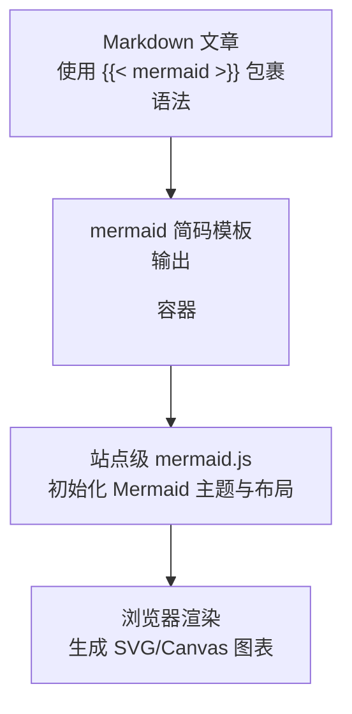
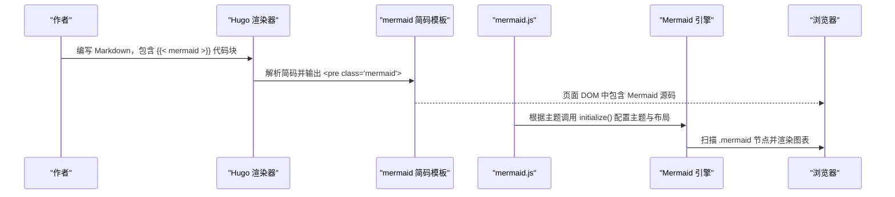
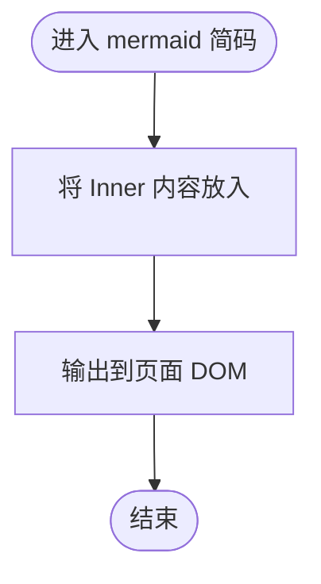
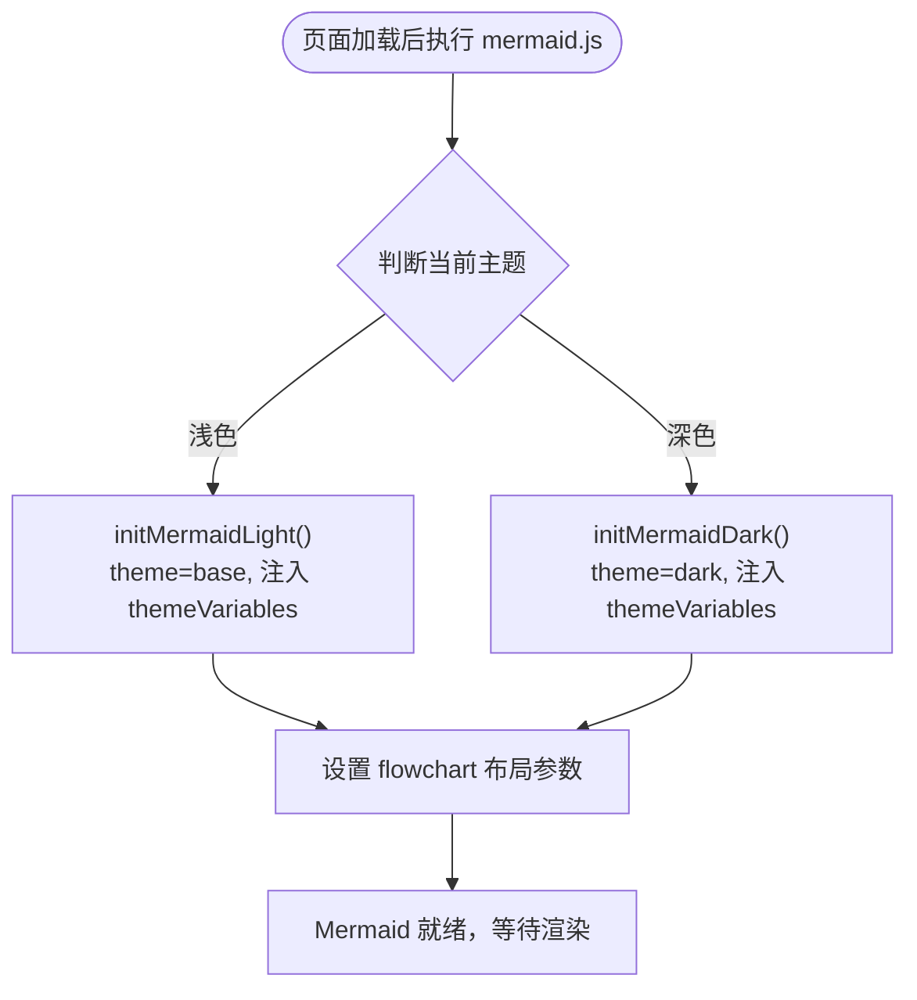
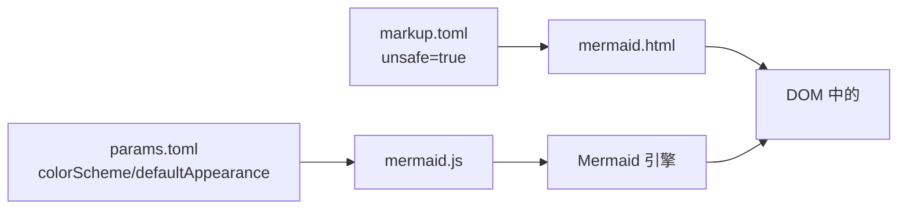

# 图表渲染

<cite>
**本文引用的文件**   
- [mermaid.html](file://themes/blowfish/layouts/shortcodes/mermaid.html)
- [mermaid.js](file://assets/js/mermaid.js)
- [index.zh-cn.md（流程图与思维导图示例）](file://themes/blowfish/exampleSite/content/samples/diagrams-flowcharts/index.zh-cn.md)
- [index.zh-cn.md（Chart.js 图表示例）](file://themes/blowfish/exampleSite/content/samples/charts/index.zh-cn.md)
- [markup.toml](file://config/_default/markup.toml)
- [params.toml](file://config/_default/params.toml)
</cite>

## 目录
1. [简介](#简介)
2. [项目结构](#项目结构)
3. [核心组件](#核心组件)
4. [架构总览](#架构总览)
5. [详细组件分析](#详细组件分析)
6. [依赖关系分析](#依赖关系分析)
7. [性能与可读性优化](#性能与可读性优化)
8. [主题与样式定制](#主题与样式定制)
9. [flowchart 布局参数详解](#flowchart-布局参数详解)
10. [常见问题与调试技巧](#常见问题与调试技巧)
11. [结论](#结论)

## 简介
本文面向在文章中使用 Mermaid.js 渲染各类图表的读者，涵盖流程图、时序图、类图、实体关系图等常见类型，并说明如何在当前站点中启用、配置与优化 Mermaid 渲染效果。文档同时给出主题适配、字号与间距调整、复杂图表可读性优化以及常见问题排查方法。

## 项目结构
在本项目中，Mermaid 的渲染由“简码模板 + 站点级 JS 初始化”共同完成：
- 简码模板负责将文章内容中的 Mermaid 代码块包装为可被 Mermaid 识别的容器。
- 站点级 JS 负责加载 Mermaid 库并进行主题与布局参数的初始化。
- 示例内容展示了如何在 Markdown 中使用 mermaid 简码编写不同图表。

**图示来源**
- [mermaid.html:1-2](file://themes/blowfish/layouts/shortcodes/mermaid.html#L1-L2)
- [mermaid.js:1-48](file://assets/js/mermaid.js#L1-L48)

**章节来源**
- [mermaid.html:1-2](file://themes/blowfish/layouts/shortcodes/mermaid.html#L1-L2)
- [mermaid.js:1-48](file://assets/js/mermaid.js#L1-L48)

## 核心组件
- mermaid 简码模板：将文章内容中的 Mermaid 源码输出到具有特定 CSS 类的容器中，供 Mermaid 引擎扫描并渲染。
- 站点级 Mermaid 初始化脚本：根据明暗主题分别调用 mermaid.initialize，设置主题变量、字体、字号以及 flowchart 布局参数。
- 示例内容：提供流程图、时序图、类图、实体关系图的写法参考。

**章节来源**
- [mermaid.html:1-2](file://themes/blowfish/layouts/shortcodes/mermaid.html#L1-L2)
- [mermaid.js:1-48](file://assets/js/mermaid.js#L1-L48)
- [index.zh-cn.md（流程图与思维导图示例）:16-94](file://themes/blowfish/exampleSite/content/samples/diagrams-flowcharts/index.zh-cn.md#L16-L94)

## 架构总览
下图展示从 Markdown 到最终图表渲染的关键流程，包括主题切换对 Mermaid 初始化的影响。

**图示来源**
- [mermaid.html:1-2](file://themes/blowfish/layouts/shortcodes/mermaid.html#L1-L2)
- [mermaid.js:1-48](file://assets/js/mermaid.js#L1-L48)

## 详细组件分析

### mermaid 简码模板
- 作用：将包裹在  ...  中的内容原样输出到一个带有 mermaid CSS 类的 pre 标签中，便于 Mermaid 引擎识别和渲染。
- 关键点：
  - 不修改内容，仅添加容器标记。
  - 保持 unsafe HTML 能力，以支持 Mermaid 所需的内部结构。

**图示来源**
- [mermaid.html:1-2](file://themes/blowfish/layouts/shortcodes/mermaid.html#L1-L2)

**章节来源**
- [mermaid.html:1-2](file://themes/blowfish/layouts/shortcodes/mermaid.html#L1-L2)

### 站点级 Mermaid 初始化脚本
- 作用：
  - 根据站点主题（浅色/深色）分别初始化 Mermaid。
  - 设置主题变量（背景色、边框色、线条色、字体族等）。
  - 统一设置 fontSize 与 fontFamily，提升可读性。
  - 配置 flowchart 布局参数（nodeSpacing、rankSpacing、curve、padding），改善复杂流程图的可读性。
- 关键逻辑：
  - 浅色主题使用 base 主题，并通过 CSS 变量注入颜色。
  - 深色主题使用 dark 主题，同样注入字体与字号。
  - 两者均设置一致的 flowchart 布局参数，保证视觉一致性。

**图示来源**
- [mermaid.js:1-48](file://assets/js/mermaid.js#L1-L48)

**章节来源**
- [mermaid.js:1-48](file://assets/js/mermaid.js#L1-L48)

### 示例内容：Mermaid 图表类型
- 流程图：使用 graph TD 定义节点与连线，支持分支、子图。
- 时序图：使用 sequenceDiagram，支持并行、循环、注释等。
- 类图：使用 classDiagram，定义类、继承、聚合关系与方法属性。
- 实体关系图：使用 erDiagram，定义实体与关系。

这些示例展示了如何在 Markdown 中以 mermaid 简码组织不同类型的图表。

**章节来源**
- [index.zh-cn.md（流程图与思维导图示例）:16-94](file://themes/blowfish/exampleSite/content/samples/diagrams-flowcharts/index.zh-cn.md#L16-L94)

### 示例内容：Chart.js 图表（对比参考）
- 本仓库还提供 Chart.js 的 chart 简码示例，用于柱形图、折线图、扇形图等数据可视化。
- 虽然不属于 Mermaid，但可作为站点内图表能力的补充参考。

**章节来源**
- [index.zh-cn.md（Chart.js 图表示例）:1-88](file://themes/blowfish/exampleSite/content/samples/charts/index.zh-cn.md#L1-L88)

## 依赖关系分析
- 简码模板依赖 Hugo 的 shortcodes 机制，将 Mermaid 源码输出到 DOM。
- 站点级 JS 依赖 Mermaid 库（由主题或站点引入），并在页面加载后初始化。
- 主题参数 params.toml 控制外观模式（light/dark），JS 据此选择对应初始化路径。
- markup.toml 开启 Goldmark 的 unsafe renderer，确保 Mermaid 所需 HTML 结构不被过滤。

**图示来源**
- [params.toml:1-88](file://config/_default/params.toml#L1-L88)
- [markup.toml:1-31](file://config/_default/markup.toml#L1-L31)
- [mermaid.html:1-2](file://themes/blowfish/layouts/shortcodes/mermaid.html#L1-L2)
- [mermaid.js:1-48](file://assets/js/mermaid.js#L1-L48)

**章节来源**
- [params.toml:1-88](file://config/_default/params.toml#L1-L88)
- [markup.toml:1-31](file://config/_default/markup.toml#L1-L31)
- [mermaid.html:1-2](file://themes/blowfish/layouts/shortcodes/mermaid.html#L1-L2)
- [mermaid.js:1-48](file://assets/js/mermaid.js#L1-L48)

## 性能与可读性优化
- 字号与字体：
  - 通过 themeVariables.fontSize 统一增大默认字号，提高可读性。
  - 通过 themeVariables.fontFamily 指定跨平台字体栈，保证中英文显示一致。
- 节点与层级间距：
  - nodeSpacing 与 rankSpacing 增大节点间与层级间的距离，避免密集布局导致的重叠。
  - curve 设置为更平滑的曲线，提升连线美观度。
  - padding 增加节点内边距，使文本与边框之间留有呼吸空间。
- 主题适配：
  - 浅色与深色主题分别初始化，确保在不同外观模式下均有良好的对比度与可读性。
- 复杂图表建议：
  - 拆分大图为多个小图，减少单次渲染复杂度。
  - 合理命名节点，避免过长文本导致布局拥挤。
  - 使用 subgraph 分组，降低整体复杂度。

[本节为通用优化建议，无需具体文件引用]

## 主题与样式定制
- 主题选择：
  - 浅色主题：使用 base 主题，并通过 CSS 变量注入背景、主色、辅色、边框色、线条色等。
  - 深色主题：使用 dark 主题，并注入字体与字号。
- 字体与字号：
  - 通过 themeVariables.fontFamily 指定字体族。
  - 通过 themeVariables.fontSize 调整全局字号。
- 颜色变量：
  - 浅色主题下，通过 css("--color-*") 读取 CSS 变量，实现与站点主题联动。
- 扩展建议：
  - 如需进一步定制，可在 mermaid.js 中扩展 themeVariables，例如增加 linkColor、edgeLabelBackground 等。
  - 若需动态切换主题时重新初始化 Mermaid，可在主题切换事件中调用对应的 initMermaidLight/initMermaidDark。

**章节来源**
- [mermaid.js:1-48](file://assets/js/mermaid.js#L1-L48)

## flowchart 布局参数详解
- nodeSpacing：节点之间的水平/垂直间距，值越大节点越分散。
- rankSpacing：层级之间的间距，值越大层级越疏朗。
- curve：连线曲线类型，如 basis 提供更平滑的曲线。
- padding：节点内边距，值越大节点内文本与边框留白越多。

这些参数在浅色与深色主题的初始化中保持一致，确保不同主题下的布局体验统一。

**章节来源**
- [mermaid.js:23-28](file://assets/js/mermaid.js#L23-L28)
- [mermaid.js:40-45](file://assets/js/mermaid.js#L40-L45)

## 常见问题与调试技巧
- 图表未渲染：
  - 检查是否使用了 mermaid 简码包裹 Mermaid 源码。
  - 确认页面中存在 <pre class="mermaid"> 容器。
  - 检查浏览器控制台是否有 Mermaid 初始化错误。
- 主题颜色异常：
  - 确认站点 theme 切换逻辑已触发 mermaid.js 的初始化函数。
  - 检查 CSS 变量是否正确注入到 document.documentElement。
- 布局拥挤或重叠：
  - 增大 nodeSpacing 与 rankSpacing。
  - 调整 padding 与 fontSize。
  - 简化图表结构或使用 subgraph 分组。
- 中文显示问题：
  - 确认 themeVariables.fontFamily 包含中文字体。
  - 检查站点字体加载是否正常。

**章节来源**
- [mermaid.html:1-2](file://themes/blowfish/layouts/shortcodes/mermaid.html#L1-L2)
- [mermaid.js:1-48](file://assets/js/mermaid.js#L1-L48)

## 结论
本项目通过 mermaid 简码模板与站点级初始化脚本，实现了 Mermaid 图表在文章中的稳定渲染与主题适配。通过统一的字体、字号与 flowchart 布局参数，提升了复杂图表的可读性与美观度。结合示例内容，读者可以快速上手流程图、时序图、类图与实体关系图的编写，并根据需要进一步定制主题与样式。

[本节为总结性内容，无需具体文件引用]