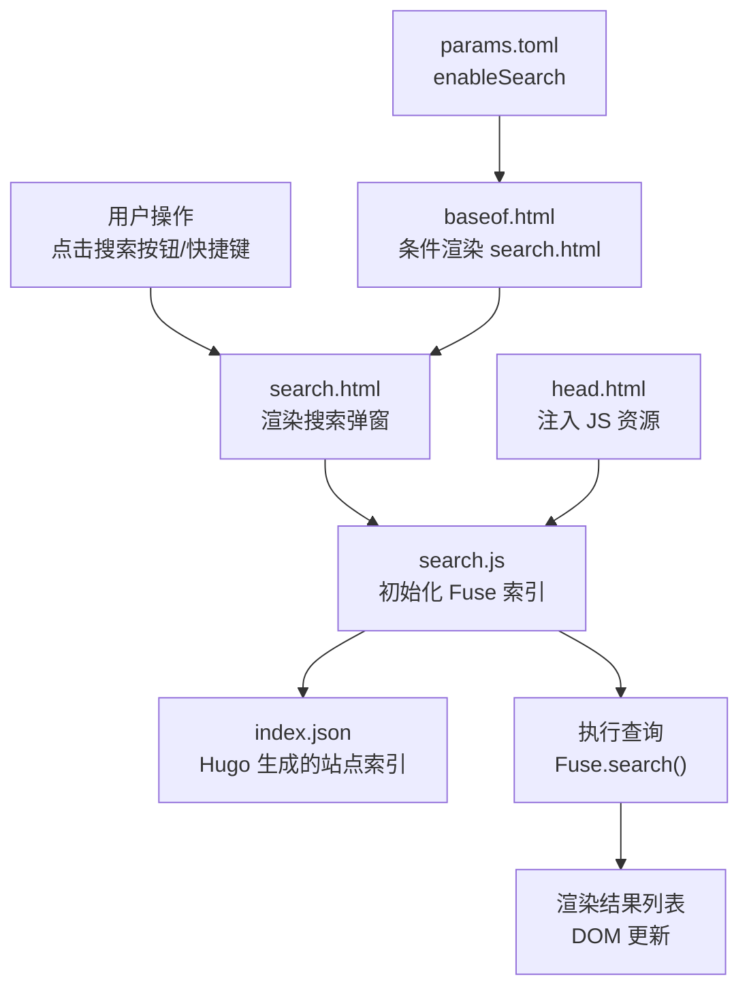
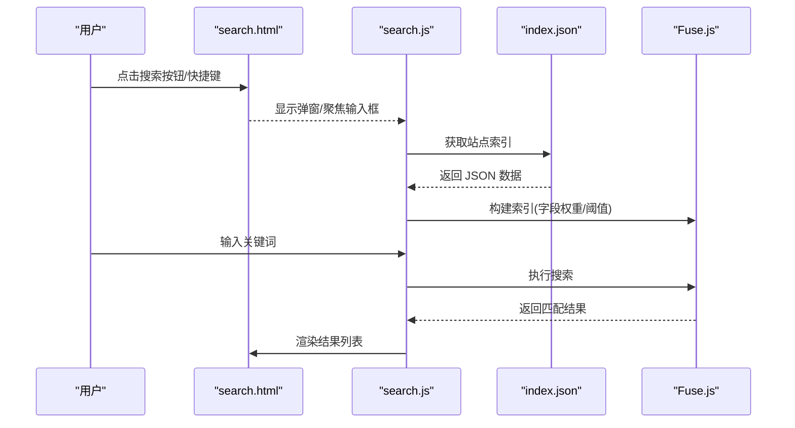
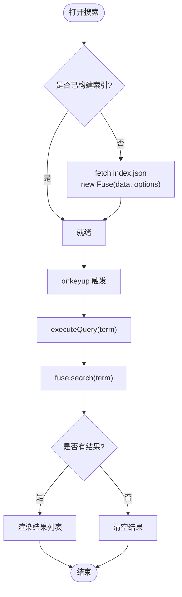
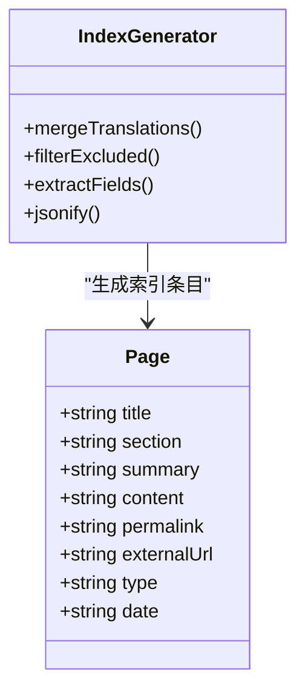
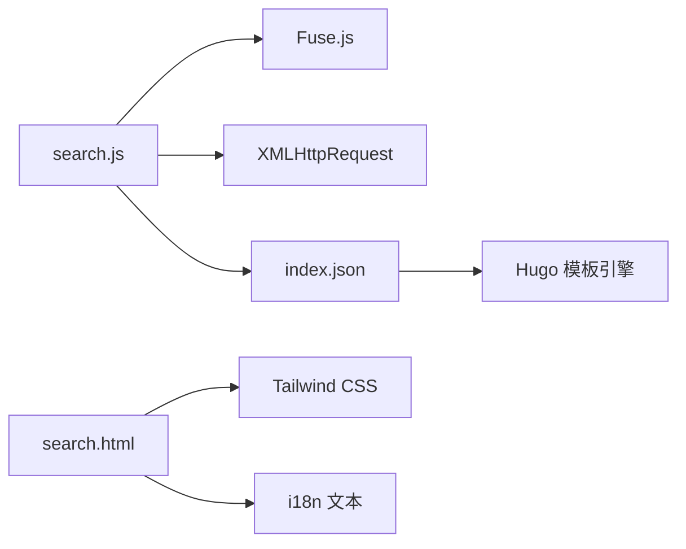
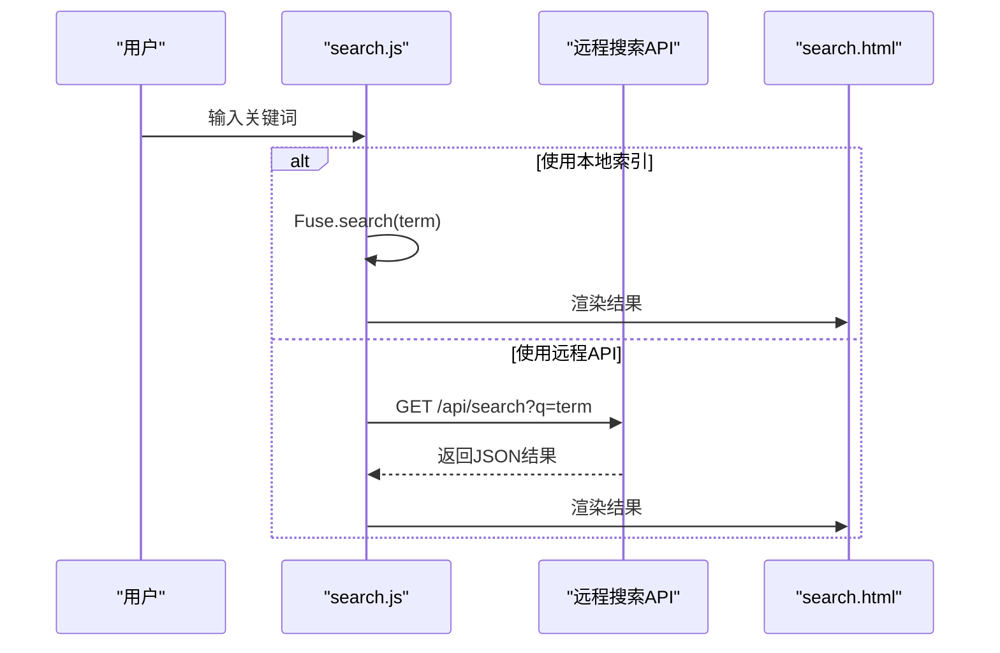

# 搜索功能

<cite>
**本文引用的文件**   
- [search.js](file://themes/blowfish/assets/js/search.js)
- [search.html](file://themes/blowfish/layouts/partials/search.html)
- [index.json](file://themes/blowfish/layouts/_default/index.json)
- [params.toml](file://config/_default/params.toml)
- [baseof.html](file://themes/blowfish/layouts/_default/baseof.html)
- [head.html](file://themes/blowfish/layouts/partials/head.html)
- [desktop-menu.html](file://themes/blowfish/layouts/partials/header/components/desktop-menu.html)
- [mobile-menu.html](file://themes/blowfish/layouts/partials/header/components/mobile-menu.html)
</cite>

## 目录
1. [简介](#简介)
2. [项目结构](#项目结构)
3. [核心组件](#核心组件)
4. [架构总览](#架构总览)
5. [详细组件分析](#详细组件分析)
6. [依赖关系分析](#依赖关系分析)
7. [性能与准确性优化](#性能与准确性优化)
8. [第三方搜索引擎集成方案](#第三方搜索引擎集成方案)
9. [常见问题与排障](#常见问题与排障)
10. [结论](#结论)

## 简介
本文件面向使用 Blowfish 主题的 Hugo 站点，系统性说明内置前端搜索的实现原理、配置项、界面定制方法以及性能与准确性优化策略。该搜索基于浏览器端索引构建与模糊匹配（Fuse.js），在用户输入时即时检索并渲染结果列表，支持键盘导航与无障碍访问。同时提供扩展点与最佳实践，帮助你在不改动主题内核的前提下完成样式定制、字段权重调整与外部链接处理，并为未来接入 Algolia、Elasticsearch 等后端服务预留路径。

## 项目结构
搜索相关代码分布在以下位置：
- 前端交互逻辑：themes/blowfish/assets/js/search.js
- 搜索弹窗 UI 模板：themes/blowfish/layouts/partials/search.html
- 站点内容索引生成：themes/blowfish/layouts/_default/index.json
- 开关与全局参数：config/_default/params.toml
- 入口挂载与资源加载：themes/blowfish/layouts/_default/baseof.html、themes/blowfish/layouts/partials/head.html
- 搜索按钮入口：themes/blowfish/layouts/partials/header/components/desktop-menu.html、mobile-menu.html

图表来源
- [search.js:1-248](file://themes/blowfish/assets/js/search.js#L1-L248)
- [search.html:1-48](file://themes/blowfish/layouts/partials/search.html#L1-L48)
- [index.json:1-33](file://themes/blowfish/layouts/_default/index.json#L1-L33)
- [head.html:183-186](file://themes/blowfish/layouts/partials/head.html#L183-L186)
- [baseof.html:38-39](file://themes/blowfish/layouts/_default/baseof.html#L38-L39)
- [params.toml:8](file://config/_default/params.toml#L8)

章节来源
- [search.js:1-248](file://themes/blowfish/assets/js/search.js#L1-L248)
- [search.html:1-48](file://themes/blowfish/layouts/partials/search.html#L1-L48)
- [index.json:1-33](file://themes/blowfish/layouts/_default/index.json#L1-L33)
- [params.toml:8](file://config/_default/params.toml#L8)
- [baseof.html:38-39](file://themes/blowfish/layouts/_default/baseof.html#L38-L39)
- [head.html:183-186](file://themes/blowfish/layouts/partials/head.html#L183-L186)

## 核心组件
- 前端交互脚本 search.js：负责打开/关闭搜索弹窗、监听键盘事件、构建 Fuse 索引、执行查询与渲染结果。
- 搜索弹窗模板 search.html：定义搜索框、遮罩层、结果容器与无障碍属性。
- 站点索引 index.json：由 Hugo 在构建期生成，聚合全站页面元数据供前端检索。
- 全局参数 params.toml：控制是否启用搜索功能。
- 入口与资源加载 baseof.html、head.html：条件渲染搜索弹窗并注入 JS 资源。
- 搜索按钮入口 desktop-menu.html、mobile-menu.html：提供桌面与移动端触发入口。

章节来源
- [search.js:1-248](file://themes/blowfish/assets/js/search.js#L1-L248)
- [search.html:1-48](file://themes/blowfish/layouts/partials/search.html#L1-L48)
- [index.json:1-33](file://themes/blowfish/layouts/_default/index.json#L1-L33)
- [params.toml:8](file://config/_default/params.toml#L8)
- [baseof.html:38-39](file://themes/blowfish/layouts/_default/baseof.html#L38-L39)
- [head.html:183-186](file://themes/blowfish/layouts/partials/head.html#L183-L186)
- [desktop-menu.html:31-39](file://themes/blowfish/layouts/partials/header/components/desktop-menu.html#L31-L39)
- [mobile-menu.html:23-29](file://themes/blowfish/layouts/partials/header/components/mobile-menu.html#L23-L29)

## 架构总览
搜索流程分为三个阶段：
1. 构建阶段（Hugo 构建期）
   - 根据 index.json 模板遍历站点页面，提取标题、摘要、正文、链接、日期、类型等信息，生成 JSON 索引。
   - 通过 excludeFromSearch 可排除特定页面不参与搜索。
2. 运行阶段（浏览器）
   - 用户触发搜索后，search.js 动态拉取 index.json，使用 Fuse.js 构建本地索引。
   - 用户输入关键词时，调用 Fuse.search 进行模糊匹配，按权重排序返回结果。
3. 展示阶段（UI 渲染）
   - 将搜索结果渲染为列表项，包含标题、分区、日期与摘要；若存在 externalUrl，则跳转外链。

图表来源
- [search.js:167-248](file://themes/blowfish/assets/js/search.js#L167-L248)
- [index.json:1-33](file://themes/blowfish/layouts/_default/index.json#L1-L33)
- [search.html:1-48](file://themes/blowfish/layouts/partials/search.html#L1-L48)

## 详细组件分析

### 前端交互脚本 search.js
职责与关键点：
- 打开/关闭弹窗：管理可见性、滚动锁定、焦点恢复。
- 键盘导航：支持 /、Cmd/Ctrl+K、Esc、Tab、方向键、Enter 的完整交互。
- 索引构建：首次打开时从 index.json 拉取数据，使用 Fuse 构建索引，设置字段权重与匹配选项。
- 查询执行：每次按键触发 executeQuery，调用 Fuse.search 并渲染结果。
- 结果渲染：根据是否有 externalUrl 决定跳转行为，展示标题、分区、日期与摘要。

图表来源
- [search.js:119-248](file://themes/blowfish/assets/js/search.js#L119-L248)

章节来源
- [search.js:1-248](file://themes/blowfish/assets/js/search.js#L1-L248)

### 搜索弹窗模板 search.html
职责与关键点：
- 提供遮罩层与模态框容器，设置 aria-modal、aria-label 等无障碍属性。
- 包含搜索输入框与关闭按钮，结果区域以 ul#search-results 承载。
- data-url 用于 JS 计算 index.json 的相对路径。

章节来源
- [search.html:1-48](file://themes/blowfish/layouts/partials/search.html#L1-L48)

### 站点索引 index.json
职责与关键点：
- 合并多语言站点页面集合。
- 过滤 excludeFromSearch 标记的页面。
- 提取字段：date、title、section、summary、content、permalink、externalUrl、type。
- 输出 JSON 供前端 Fuse 使用。

图表来源
- [index.json:1-33](file://themes/blowfish/layouts/_default/index.json#L1-L33)

章节来源
- [index.json:1-33](file://themes/blowfish/layouts/_default/index.json#L1-L33)

### 全局参数与入口挂载
- enableSearch：控制是否启用搜索功能。
- baseof.html：当 enableSearch 为真时，渲染 search.html。
- head.html：注入 Fuse 库与 search.js。
- desktop-menu.html/mobile-menu.html：提供搜索按钮入口。

章节来源
- [params.toml:8](file://config/_default/params.toml#L8)
- [baseof.html:38-39](file://themes/blowfish/layouts/_default/baseof.html#L38-L39)
- [head.html:183-186](file://themes/blowfish/layouts/partials/head.html#L183-L186)
- [desktop-menu.html:31-39](file://themes/blowfish/layouts/partials/header/components/desktop-menu.html#L31-L39)
- [mobile-menu.html:23-29](file://themes/blowfish/layouts/partials/header/components/mobile-menu.html#L23-L29)

## 依赖关系分析
- search.js 依赖：
  - DOM API（getElementById、addEventListener、innerHTML 等）
  - Fuse.js（构建索引与模糊匹配）
  - XMLHttpRequest（拉取 index.json）
- search.html 依赖：
  - Tailwind CSS 类名（布局与样式）
  - i18n 文本（placeholder、title 等）
- index.json 依赖：
  - Hugo 模板函数（range、dict、time.Format、safeJS、plainify、htmlUnescape、jsonify）
  - 站点配置（Language.Params.dateFormat）

图表来源
- [search.js:153-191](file://themes/blowfish/assets/js/search.js#L153-L191)
- [index.json:1-33](file://themes/blowfish/layouts/_default/index.json#L1-L33)
- [search.html:1-48](file://themes/blowfish/layouts/partials/search.html#L1-L48)

章节来源
- [search.js:153-191](file://themes/blowfish/assets/js/search.js#L153-L191)
- [index.json:1-33](file://themes/blowfish/layouts/_default/index.json#L1-L33)
- [search.html:1-48](file://themes/blowfish/layouts/partials/search.html#L1-L48)

## 性能与准确性优化

### 索引大小控制
- 使用 excludeFromSearch 在前端排除不需要参与搜索的页面，减少 index.json 体积。
- 合理拆分站点内容，避免单页过长导致 content 字段过大。
- 对大型站点考虑分页或按需加载索引（需自行扩展）。

章节来源
- [index.json:7-31](file://themes/blowfish/layouts/_default/index.json#L7-L31)

### 关键词权重与字段选择
- 当前默认权重：title 0.8、section 0.2、summary 0.6、content 0.4。
- 可通过修改 search.js 中 Fuse 的 keys 配置调整权重，提升标题与摘要的优先级。
- 若需要更细粒度控制，可在 index.json 中增加自定义字段（如 tags、keywords），并在 search.js 中注册对应 key。

章节来源
- [search.js:171-182](file://themes/blowfish/assets/js/search.js#L171-L182)
- [index.json:10-29](file://themes/blowfish/layouts/_default/index.json#L10-L29)

### 模糊匹配策略
- 当前 threshold 设为 0.0，表示严格匹配；如需容错拼写错误，可适当提高阈值（例如 0.2~0.3）。
- ignoreLocation 为 true，忽略匹配位置对评分的影响，适合短文本场景。
- includeMatches 为 true，便于后续高亮匹配片段（可扩展到结果渲染）。

章节来源
- [search.js:171-182](file://themes/blowfish/assets/js/search.js#L171-L182)

### 结果排序与去重
- shouldSort 为 true，Fuse 会按匹配分数排序。
- 如需自定义排序（如按日期、权重），可在 executeQuery 中对 results 进行二次排序。

章节来源
- [search.js:171-182](file://themes/blowfish/assets/js/search.js#L171-L182)
- [search.js:201-246](file://themes/blowfish/assets/js/search.js#L201-L246)

### 前端 UI 定制要点
- 搜索框样式：通过 Tailwind 类名在 search.html 中调整输入框外观与响应式布局。
- 结果列表布局：在 search.js 的 executeQuery 中拼接 HTML，可替换为组件化渲染或引入虚拟列表以提升长列表性能。
- 分页处理：当前无分页；如需分页，可在 executeQuery 中实现切片与“加载更多”逻辑。
- 无障碍与键盘导航：已实现 Tab 循环、方向键移动、Enter 选择、Esc 关闭，保持良好可访问性。

章节来源
- [search.html:1-48](file://themes/blowfish/layouts/partials/search.html#L1-L48)
- [search.js:119-248](file://themes/blowfish/assets/js/search.js#L119-L248)

## 第三方搜索引擎集成方案

### 总体思路
- 保留现有 search.html 与 search.js 的交互外壳，将本地 Fuse 索引替换为远程 API 查询。
- 在 search.js 中新增一个切换开关（例如 useRemoteSearch），根据配置决定是否走远程接口。
- 将 index.json 的构建逻辑迁移至服务端（Algolia/Elasticsearch 客户端 SDK），仅暴露查询接口。

图表来源
- [search.js:194-248](file://themes/blowfish/assets/js/search.js#L194-L248)

### 接入 Algolia
- 步骤：
  1. 在服务端使用 Algolia 客户端 SDK 索引 Hugo 站点内容（参考 Algolia 官方 Hugo 集成指南）。
  2. 暴露一个轻量查询接口或直接在前端使用 Algoliasearch（注意密钥安全，建议通过后端代理）。
  3. 在 search.js 中替换 executeQuery 的逻辑，调用 Algolia 查询并渲染结果。
- 优势：
  - 强大的分词与中文支持（结合 Algolia 的分词器）。
  - 高性能、可扩展的搜索体验。
- 注意事项：
  - 前端密钥泄露风险，建议使用后端代理。
  - 索引同步策略（增量/全量）与缓存。

### 接入 Elasticsearch/OpenSearch
- 步骤：
  1. 在服务端使用 ES 客户端或 Logstash/Beats 同步 Hugo 站点内容。
  2. 暴露查询接口（RESTful），支持高亮、聚合、过滤等能力。
  3. 在 search.js 中替换 executeQuery 逻辑，调用 ES 查询并渲染结果。
- 优势：
  - 灵活的分词与复杂查询。
  - 可与日志、监控等其他系统整合。
- 注意事项：
  - 部署与维护成本较高。
  - 需要关注分词器配置（中文 IK 分词器等）。

### 混合模式
- 小站使用本地 Fuse，大站切换到远程 API。
- 通过 params.toml 新增 searchEngine 配置项（如 local/algolia/es），在 search.js 中读取并分支处理。

章节来源
- [search.js:194-248](file://themes/blowfish/assets/js/search.js#L194-L248)
- [params.toml:8](file://config/_default/params.toml#L8)

## 常见问题与排障

- 搜索未生效
  - 检查 params.toml 中的 enableSearch 是否为 true。
  - 确认 baseof.html 是否正确渲染 search.html。
  - 确认 head.html 是否注入了 search.js 与 Fuse 资源。

章节来源
- [params.toml:8](file://config/_default/params.toml#L8)
- [baseof.html:38-39](file://themes/blowfish/layouts/_default/baseof.html#L38-L39)
- [head.html:183-186](file://themes/blowfish/layouts/partials/head.html#L183-L186)

- 无法拉取 index.json
  - 检查站点根路径下是否存在 index.json。
  - 检查 CORS 与静态资源托管配置。
  - 在浏览器控制台查看 fetch 请求状态码。

章节来源
- [search.js:153-191](file://themes/blowfish/assets/js/search.js#L153-L191)

- 结果不准确
  - 调整 search.js 中 Fuse 的 threshold、keys 权重。
  - 在 index.json 中增加或剔除字段，优化匹配范围。

章节来源
- [search.js:171-182](file://themes/blowfish/assets/js/search.js#L171-L182)
- [index.json:10-29](file://themes/blowfish/layouts/_default/index.json#L10-L29)

- 键盘导航异常
  - 检查 search.js 中的键盘事件监听与焦点管理逻辑。
  - 确保 modal 内可聚焦元素正确设置 tabindex。

章节来源
- [search.js:31-117](file://themes/blowfish/assets/js/search.js#L31-L117)
- [search.html:1-48](file://themes/blowfish/layouts/partials/search.html#L1-L48)

## 结论
Blowfish 的内置搜索提供了开箱即用的前端模糊检索能力，适用于中小型站点。通过合理配置字段权重、阈值与索引字段，可以在保证性能的同时提升搜索准确性。对于大型站点或需要高级功能的场景，推荐逐步迁移至 Algolia 或 Elasticsearch 等后端搜索引擎，并通过统一的前端交互外壳保持用户体验一致。建议在实施过程中遵循无障碍与键盘导航的最佳实践，确保搜索体验对所有用户友好。