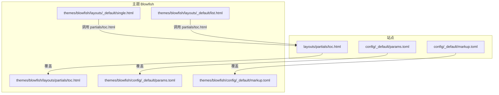
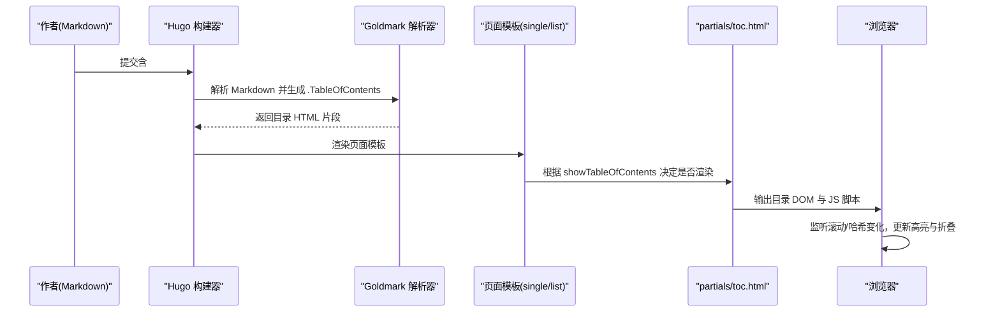
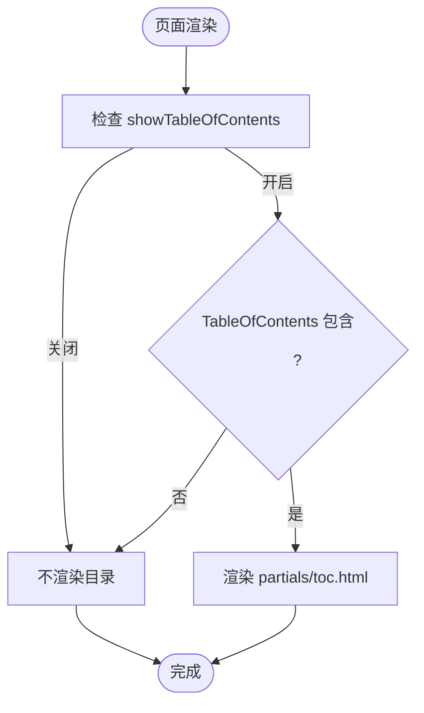
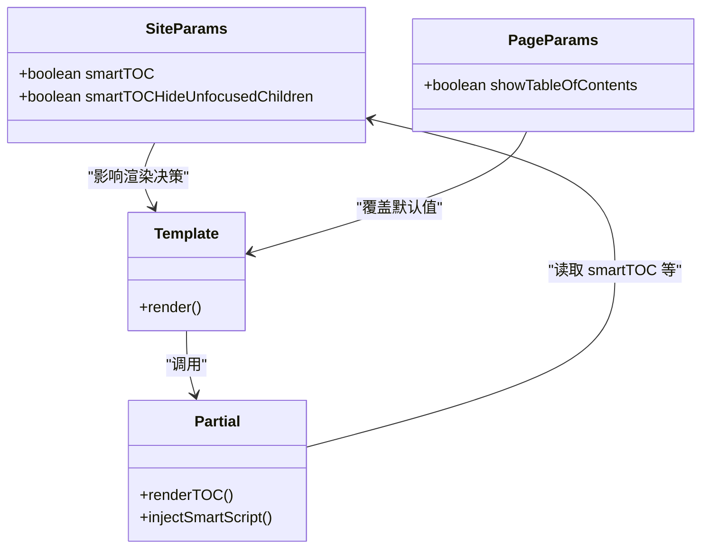
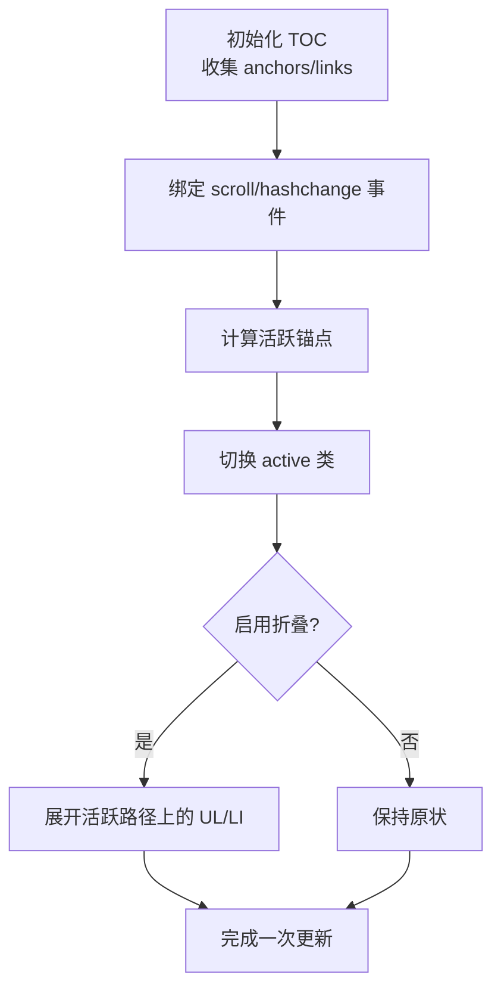
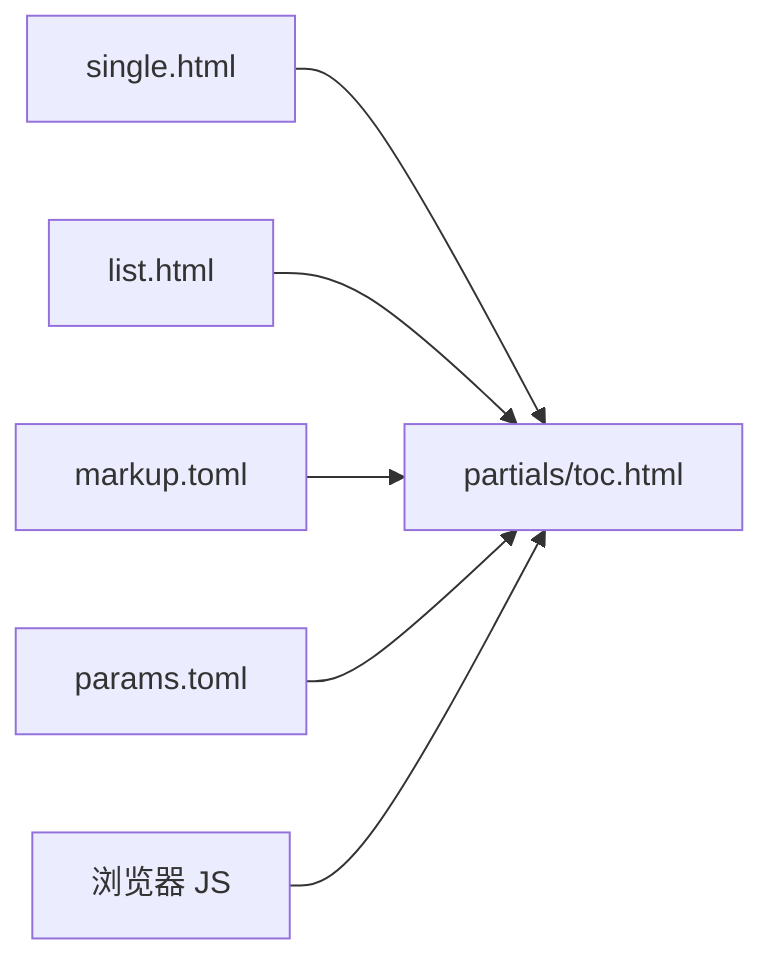

# 目录生成

<cite>
**本文引用的文件**   
- [layouts/partials/toc.html](file://layouts/partials/toc.html)
- [themes/blowfish/layouts/partials/toc.html](file://themes/blowfish/layouts/partials/toc.html)
- [config/_default/markup.toml](file://config/_default/markup.toml)
- [themes/blowfish/config/_default/markup.toml](file://themes/blowfish/config/_default/markup.toml)
- [config/_default/params.toml](file://config/_default/params.toml)
- [themes/blowfish/config/_default/params.toml](file://themes/blowfish/config/_default/params.toml)
- [themes/blowfish/layouts/_default/single.html](file://themes/blowfish/layouts/_default/single.html)
- [themes/blowfish/layouts/_default/list.html](file://themes/blowfish/layouts/_default/list.html)
</cite>

## 目录
1. [简介](#简介)
2. [项目结构](#项目结构)
3. [核心组件](#核心组件)
4. [架构总览](#架构总览)
5. [详细组件分析](#详细组件分析)
6. [依赖关系分析](#依赖关系分析)
7. [性能与优化](#性能与优化)
8. [故障排查](#故障排查)
9. [结论](#结论)
10. [附录](#附录)

## 简介
本文聚焦于站点中“自动目录（Table of Contents，简称 TOC）”的生成、渲染与交互机制。内容涵盖：
- 自动目录生成的工作原理与触发条件
- 基于 Markdown 标题层级自动生成目录的结构
- TOC 的配置项：显示层级、默认展开状态、滚动高亮等
- 自定义目录模板的方法：HTML 结构、CSS 样式、JS 交互增强
- 控制特定文章的目录显示：隐藏目录、自定义目录标题等
- 响应式适配方案与最佳实践

## 项目结构
本仓库采用 Hugo 主题 Blowsfish 的标准布局方式，TOC 相关逻辑主要分布在以下位置：
- 站点层覆盖的主题片段：`layouts/partials/toc.html`
- 主题内置片段：`themes/blowfish/layouts/partials/toc.html`
- 目录生成配置：`config/_default/markup.toml` 与主题默认 `themes/blowfish/config/_default/markup.toml`
- 全局参数开关：`config/_default/params.toml` 与主题默认 `themes/blowfish/config/_default/params.toml`
- 页面模板中对 TOC 的启用判断：`themes/blowfish/layouts/_default/single.html`、`themes/blowfish/layouts/_default/list.html`

**图表来源**
- [layouts/partials/toc.html:1-126](file://layouts/partials/toc.html#L1-L126)
- [themes/blowfish/layouts/partials/toc.html:1-126](file://themes/blowfish/layouts/partials/toc.html#L1-L126)
- [config/_default/params.toml:21-24](file://config/_default/params.toml#L21-L24)
- [themes/blowfish/config/_default/params.toml:37-39](file://themes/blowfish/config/_default/params.toml#L37-L39)
- [config/_default/markup.toml:28-30](file://config/_default/markup.toml#L28-L30)
- [themes/blowfish/config/_default/markup.toml:24-26](file://themes/blowfish/config/_default/markup.toml#L24-L26)
- [themes/blowfish/layouts/_default/single.html:41-43](file://themes/blowfish/layouts/_default/single.html#L41-L43)
- [themes/blowfish/layouts/_default/list.html:3-4](file://themes/blowfish/layouts/_default/list.html#L3-L4)

**章节来源**
- [layouts/partials/toc.html:1-126](file://layouts/partials/toc.html#L1-L126)
- [themes/blowfish/layouts/partials/toc.html:1-126](file://themes/blowfish/layouts/partials/toc.html#L1-L126)
- [config/_default/markup.toml:28-30](file://config/_default/markup.toml#L28-L30)
- [themes/blowfish/config/_default/markup.toml:24-26](file://themes/blowfish/config/_default/markup.toml#L24-L26)
- [config/_default/params.toml:21-24](file://config/_default/params.toml#L21-L24)
- [themes/blowfish/config/_default/params.toml:37-39](file://themes/blowfish/config/_default/params.toml#L37-L39)
- [themes/blowfish/layouts/_default/single.html:41-43](file://themes/blowfish/layouts/_default/single.html#L41-L43)
- [themes/blowfish/layouts/_default/list.html:3-4](file://themes/blowfish/layouts/_default/list.html#L3-L4)

## 核心组件
- 目录片段（Partial）：负责渲染目录 HTML 与智能交互脚本
- 目录生成配置：控制 Markdown 解析器生成目录的层级范围
- 全局参数：控制是否启用智能目录、是否折叠非活跃子目录
- 页面模板：根据文章或列表页类型决定是否渲染目录

**章节来源**
- [layouts/partials/toc.html:1-126](file://layouts/partials/toc.html#L1-L126)
- [themes/blowfish/layouts/partials/toc.html:1-126](file://themes/blowfish/layouts/partials/toc.html#L1-L126)
- [config/_default/markup.toml:28-30](file://config/_default/markup.toml#L28-L30)
- [config/_default/params.toml:21-24](file://config/_default/params.toml#L21-L24)

## 架构总览
下图展示了从 Markdown 到最终页面目录的完整流程，包括 Hugo 构建期生成目录与浏览器运行期交互两部分。

**图表来源**
- [themes/blowfish/layouts/_default/single.html:41-43](file://themes/blowfish/layouts/_default/single.html#L41-L43)
- [themes/blowfish/layouts/_default/list.html:3-4](file://themes/blowfish/layouts/_default/list.html#L3-L4)
- [layouts/partials/toc.html:1-126](file://layouts/partials/toc.html#L1-L126)
- [themes/blowfish/layouts/partials/toc.html:1-126](file://themes/blowfish/layouts/partials/toc.html#L1-L126)
- [config/_default/markup.toml:28-30](file://config/_default/markup.toml#L28-L30)

## 详细组件分析

### 自动目录生成与触发条件
- 生成阶段
  - Hugo 使用 Goldmark 解析 Markdown，依据 `[tableOfContents]` 配置生成 `.TableOfContents`。
  - 当前站点配置为从第 2 级标题开始，到第 4 级标题结束。
- 渲染阶段
  - 在单页模板中，若 `showTableOfContents` 为真且 `.TableOfContents` 包含 `<ul>`，则渲染目录片段。
  - 在列表页模板中，同样通过 `showTableOfContents` 与 `.TableOfContents` 内容判断是否渲染。
- 触发条件总结
  - 开启全局/页面级 `showTableOfContents`
  - 文章内容存在符合层级范围的标题（例如 `##`、`###`、`####`）
  - 模板判定 `.TableOfContents` 不为空

**图表来源**
- [themes/blowfish/layouts/_default/single.html:41-43](file://themes/blowfish/layouts/_default/single.html#L41-L43)
- [themes/blowfish/layouts/_default/list.html:3-4](file://themes/blowfish/layouts/_default/list.html#L3-L4)

**章节来源**
- [config/_default/markup.toml:28-30](file://config/_default/markup.toml#L28-L30)
- [themes/blowfish/layouts/_default/single.html:41-43](file://themes/blowfish/layouts/_default/single.html#L41-L43)
- [themes/blowfish/layouts/_default/list.html:3-4](file://themes/blowfish/layouts/_default/list.html#L3-L4)

### 目录结构与层级控制
- 层级范围由 `[tableOfContents]` 的 `startLevel` 与 `endLevel` 决定。
- 当前站点设置为 2 至 4 级标题纳入目录。
- 该设置影响 Hugo 生成的目录节点数量与深度，从而影响右侧导航的可读性与信息密度。

**章节来源**
- [config/_default/markup.toml:28-30](file://config/_default/markup.toml#L28-L30)

### 目录显示控制与默认展开
- 全局开关
  - `smartTOC`：启用后注入智能交互脚本（滚动高亮、可选折叠）。
  - `smartTOCHideUnfocusedChildren`：启用后初始折叠非活跃子目录，并在滚动时按需展开。
- 页面级开关
  - `article.showTableOfContents`：控制文章页是否显示目录。
  - `list.showTableOfContents`：控制列表页是否显示目录。
- 默认行为
  - 桌面端目录以 `
` 默认展开；移动端目录以可折叠形式呈现。

**图表来源**
- [config/_default/params.toml:21-24](file://config/_default/params.toml#L21-L24)
- [themes/blowfish/config/_default/params.toml:37-39](file://themes/blowfish/config/_default/params.toml#L37-L39)
- [themes/blowfish/layouts/_default/single.html:41-43](file://themes/blowfish/layouts/_default/single.html#L41-L43)
- [themes/blowfish/layouts/_default/list.html:3-4](file://themes/blowfish/layouts/_default/list.html#L3-L4)
- [layouts/partials/toc.html:1-126](file://layouts/partials/toc.html#L1-L126)

**章节来源**
- [config/_default/params.toml:21-24](file://config/_default/params.toml#L21-L24)
- [themes/blowfish/config/_default/params.toml:37-39](file://themes/blowfish/config/_default/params.toml#L37-L39)
- [themes/blowfish/layouts/_default/single.html:41-43](file://themes/blowfish/layouts/_default/single.html#L41-L43)
- [themes/blowfish/layouts/_default/list.html:3-4](file://themes/blowfish/layouts/_default/list.html#L3-L4)
- [layouts/partials/toc.html:1-126](file://layouts/partials/toc.html#L1-L126)

### 智能目录交互（滚动高亮与折叠）
- 滚动高亮
  - 监听滚动事件，计算当前视口阈值，匹配最近进入视口的锚点，为其 TOC 链接添加激活类。
  - 支持点击跳转时的特殊处理，避免误判。
- 折叠非活跃子目录
  - 当 `smartTOCHideUnfocusedChildren` 为真时，初始化时折叠所有嵌套列表；滚动时仅展开当前活跃路径上的父级与子级。
- 选择器与常量
  - 目录容器 ID：`#TableOfContents`
  - 锚点选择器：`.anchor`
  - TOC 链接选择器：`a[href^="#"]`
  - 嵌套列表选择器：`li ul`

**图表来源**
- [layouts/partials/toc.html:25-125](file://layouts/partials/toc.html#L25-L125)
- [themes/blowfish/layouts/partials/toc.html:25-125](file://themes/blowfish/layouts/partials/toc.html#L25-L125)

**章节来源**
- [layouts/partials/toc.html:25-125](file://layouts/partials/toc.html#L25-L125)
- [themes/blowfish/layouts/partials/toc.html:25-125](file://themes/blowfish/layouts/partials/toc.html#L25-L125)

### 自定义目录模板（HTML/CSS/JS）
- HTML 结构定制
  - 站点可通过覆盖 `layouts/partials/toc.html` 完全替换目录渲染逻辑。
  - 主题默认片段同时提供桌面端与移动端两个 `
` 区块，分别注入不同 ID 与 aria-label。
- CSS 样式调整
  - 目录容器使用 Tailwind 工具类进行间距、边框、滚动条等样式控制。
  - 深色模式通过 dark: 前缀类名适配。
- JS 交互增强
  - 通过 `smartTOC` 参数控制是否注入智能脚本。
  - 可在覆盖文件中扩展事件监听、动画效果或无障碍增强。

建议做法：
- 保留主题默认片段的语义化结构与可访问性属性（如 aria-label）。
- 优先通过 CSS 变量或 Tailwind 自定义类进行样式扩展，避免直接修改主题源码。
- 如需复杂交互，建议在站点层新增独立 JS 模块，并通过事件委托与现有 TOC 容器协作。

**章节来源**
- [layouts/partials/toc.html:1-24](file://layouts/partials/toc.html#L1-L24)
- [themes/blowfish/layouts/partials/toc.html:1-24](file://themes/blowfish/layouts/partials/toc.html#L1-L24)

### 控制特定文章的目录显示
- 文章页
  - 通过 front matter 中的 `showTableOfContents` 覆盖全局 `article.showTableOfContents`。
  - 若值为 false，即使有目录也不会渲染。
- 列表页
  - 通过 front matter 中的 `showTableOfContents` 覆盖全局 `list.showTableOfContents`。
- 自定义目录标题
  - 目录标题来源于国际化键 `article.table_of_contents`，可在 i18n 文件中调整文案。
  - 也可在覆盖的 partial 中替换标题文本或增加额外说明。

**章节来源**
- [themes/blowfish/layouts/_default/single.html:41-43](file://themes/blowfish/layouts/_default/single.html#L41-L43)
- [themes/blowfish/layouts/_default/list.html:3-4](file://themes/blowfish/layouts/_default/list.html#L3-L4)
- [layouts/partials/toc.html:5-8](file://layouts/partials/toc.html#L5-L8)

### 响应式设计适配
- 桌面端
  - 目录常驻右侧，具备滚动条与内边距，便于快速定位。
- 移动端
  - 目录以可折叠面板形式出现，节省屏幕空间。
- 可访问性
  - 为目录容器添加 aria-label，提升屏幕阅读器体验。
- 视觉一致性
  - 使用统一的颜色与边框风格，支持浅色/深色主题。

**章节来源**
- [layouts/partials/toc.html:1-23](file://layouts/partials/toc.html#L1-L23)
- [themes/blowfish/layouts/partials/toc.html:1-23](file://themes/blowfish/layouts/partials/toc.html#L1-L23)

## 依赖关系分析
- 模板依赖
  - 单页与列表模板均依赖 `partials/toc.html` 渲染目录。
- 配置依赖
  - 目录层级受 `[tableOfContents]` 控制。
  - 智能交互受 `smartTOC` 与 `smartTOCHideUnfocusedChildren` 控制。
  - 目录可见性受 `article.showTableOfContents` 与 `list.showTableOfContents` 控制。
- 运行时依赖
  - 浏览器环境需支持 DOM API（querySelector、addEventListener 等）。

**图表来源**
- [themes/blowfish/layouts/_default/single.html:41-43](file://themes/blowfish/layouts/_default/single.html#L41-L43)
- [themes/blowfish/layouts/_default/list.html:3-4](file://themes/blowfish/layouts/_default/list.html#L3-L4)
- [layouts/partials/toc.html:1-126](file://layouts/partials/toc.html#L1-L126)
- [config/_default/markup.toml:28-30](file://config/_default/markup.toml#L28-L30)
- [config/_default/params.toml:21-24](file://config/_default/params.toml#L21-L24)

**章节来源**
- [themes/blowfish/layouts/_default/single.html:41-43](file://themes/blowfish/layouts/_default/single.html#L41-L43)
- [themes/blowfish/layouts/_default/list.html:3-4](file://themes/blowfish/layouts/_default/list.html#L3-L4)
- [layouts/partials/toc.html:1-126](file://layouts/partials/toc.html#L1-L126)
- [config/_default/markup.toml:28-30](file://config/_default/markup.toml#L28-L30)
- [config/_default/params.toml:21-24](file://config/_default/params.toml#L21-L24)

## 性能与优化
- 构建期优化
  - 合理设置 `startLevel` 与 `endLevel`，避免生成过深目录导致 DOM 过大。
- 运行期优化
  - 使用被动事件监听（passive: true）减少滚动抖动。
  - 仅在需要时注入智能脚本（通过 `smartTOC`），降低无交互页面的开销。
  - 折叠非活跃子目录可减少初始渲染节点数，提升首屏性能。
- 可访问性与 SEO
  - 保留 aria-label 与语义化标签，提升可访问性。
  - 目录结构清晰有助于搜索引擎理解内容层次。

[本节为通用指导，不直接分析具体文件]

## 故障排查
- 目录未显示
  - 检查 `article.showTableOfContents` 或 `list.showTableOfContents` 是否为真。
  - 确认文章内容包含符合层级范围的标题（例如 `##`、`###`、`####`）。
  - 查看 `.TableOfContents` 是否包含 `<ul>`。
- 智能高亮不生效
  - 确认 `smartTOC` 已启用。
  - 检查是否存在 `.anchor` 元素与正确的锚点 ID。
  - 确认没有 JS 错误阻止脚本执行。
- 目录标题语言不正确
  - 检查 i18n 文件中 `article.table_of_contents` 的翻译键值。
- 移动端目录不可用
  - 确认移动端 `
` 区块未被 CSS 隐藏。
  - 检查是否有第三方脚本干扰 DOM 结构。

**章节来源**
- [themes/blowfish/layouts/_default/single.html:41-43](file://themes/blowfish/layouts/_default/single.html#L41-L43)
- [themes/blowfish/layouts/_default/list.html:3-4](file://themes/blowfish/layouts/_default/list.html#L3-L4)
- [layouts/partials/toc.html:25-125](file://layouts/partials/toc.html#L25-L125)
- [themes/blowfish/layouts/partials/toc.html:25-125](file://themes/blowfish/layouts/partials/toc.html#L25-L125)

## 结论
本项目的目录生成功能基于 Hugo 的 Goldmark 解析器与 Blowsfish 主题的模板体系，实现了从 Markdown 标题到交互式目录的完整链路。通过合理的配置与模板覆盖，可以在保证可访问性的前提下，灵活定制目录的层级、外观与交互行为，并针对不同设备提供良好的响应式体验。

[本节为总结性内容，不直接分析具体文件]

## 附录
- 关键配置项速查
  - `[tableOfContents].startLevel`：目录起始层级
  - `[tableOfContents].endLevel`：目录结束层级
  - `smartTOC`：启用智能目录交互
  - `smartTOCHideUnfocusedChildren`：折叠非活跃子目录
  - `article.showTableOfContents`：文章页目录开关
  - `list.showTableOfContents`：列表页目录开关

**章节来源**
- [config/_default/markup.toml:28-30](file://config/_default/markup.toml#L28-L30)
- [config/_default/params.toml:21-24](file://config/_default/params.toml#L21-L24)
- [themes/blowfish/config/_default/params.toml:37-39](file://themes/blowfish/config/_default/params.toml#L37-L39)