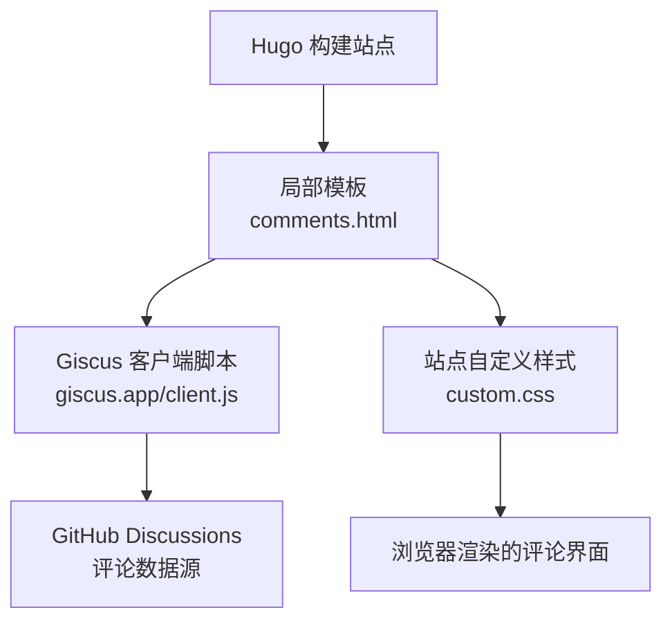
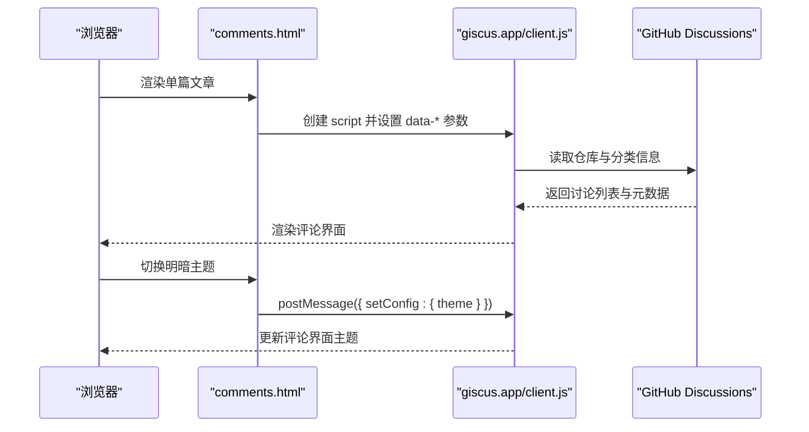
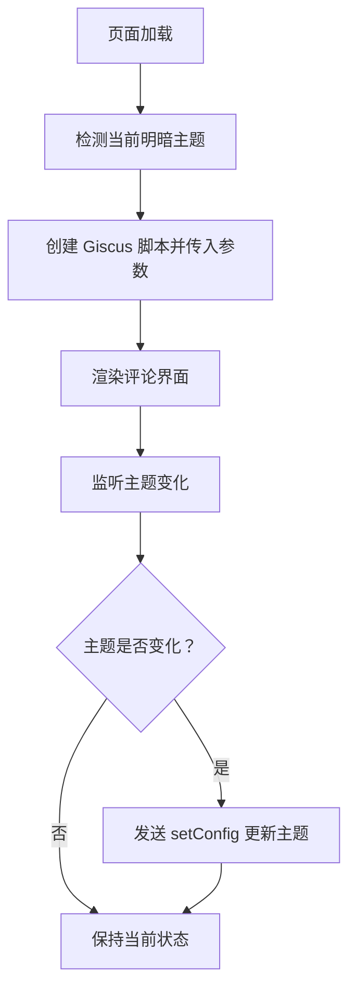
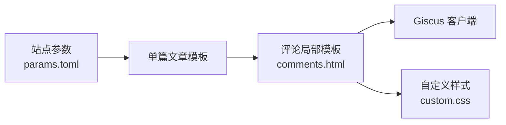
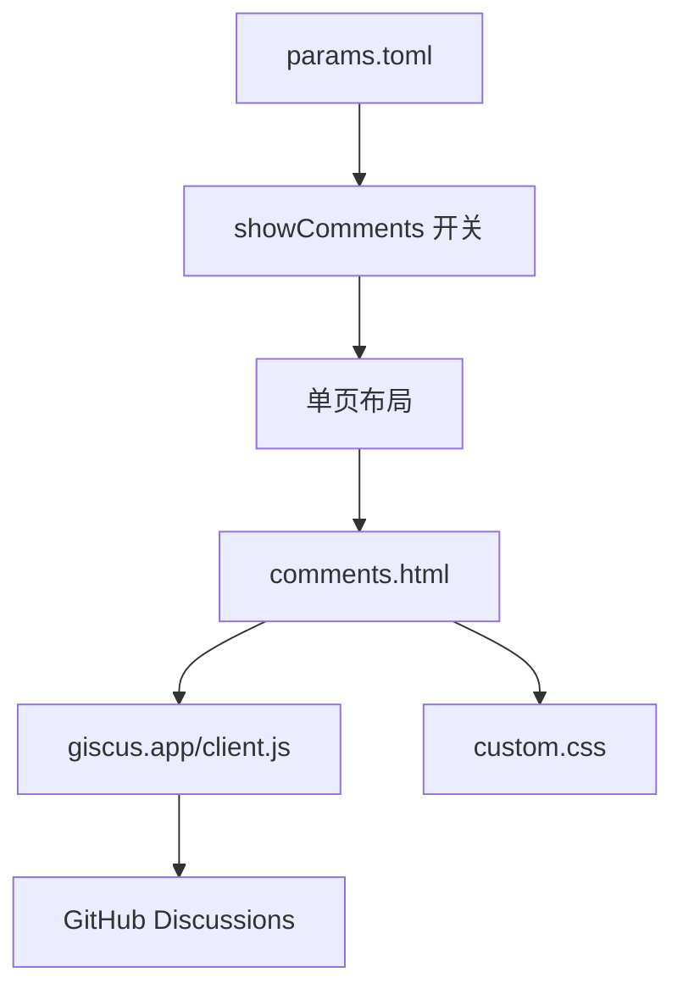

# 评论系统

<cite>
**本文引用的文件**   
- [layouts/partials/comments.html](file://layouts/partials/comments.html)
- [config/_default/params.toml](file://config/_default/params.toml)
- [assets/css/custom.css](file://assets/css/custom.css)
</cite>

## 目录
1. [简介](#简介)
2. [项目结构中的评论集成位置](#项目结构中的评论集成位置)
3. [核心组件与数据流](#核心组件与数据流)
4. [GitHub Discussions 前置配置](#github-discussions-前置配置)
5. [Giscus 参数配置说明](#giscus-参数配置说明)
6. [个性化设置：主题、语言与输入体验](#个性化设置主题语言与输入体验)
7. [与 Hugo 静态站点的集成方式](#与-hugo-静态站点的集成方式)
8. [依赖关系分析](#依赖关系分析)
9. [常见问题排查指南](#常见问题排查指南)
10. [结论](#结论)

## 简介
本仓库使用 Giscus 将 GitHub Discussions 作为评论后端，并在 Hugo + Blowfish 主题中嵌入评论组件。站点通过一个局部模板动态创建 Giscus 脚本标签，监听主题明暗切换事件，自动同步评论框主题；同时通过自定义样式让评论区域与文章内容宽度对齐，提升阅读体验。

## 项目结构中的评论集成位置
- 评论渲染入口位于站点主题的局部模板，负责注入 Giscus 客户端脚本并初始化参数。
- 站点级主题参数控制是否显示文章评论。
- 站点级自定义样式调整评论容器宽度，使其与正文列对齐。

**图表来源**
- [layouts/partials/comments.html:1-55](file://layouts/partials/comments.html#L1-L55)
- [assets/css/custom.css:241-248](file://assets/css/custom.css#L241-L248)

**章节来源**
- [layouts/partials/comments.html:1-55](file://layouts/partials/comments.html#L1-L55)
- [config/_default/params.toml:46-69](file://config/_default/params.toml#L46-L69)
- [assets/css/custom.css:241-248](file://assets/css/custom.css#L241-L248)

## 核心组件与数据流
- 局部模板在页面加载时创建一个 script 元素，指向 Giscus 官方客户端地址，并通过 data-* 属性传递仓库、分类、映射策略、语言等配置。
- 主题明暗切换时，模板通过 MutationObserver 监听 html 元素的 class 变化，调用 postMessage 向 Giscus iframe 发送 setConfig 消息，实现主题同步。
- 站点样式将评论容器宽度设为 100%，配合主题正文最大宽度，使评论区域与文章内容对齐。

**图表来源**
- [layouts/partials/comments.html:4-34](file://layouts/partials/comments.html#L4-L34)
- [layouts/partials/comments.html:36-52](file://layouts/partials/comments.html#L36-L52)

**章节来源**
- [layouts/partials/comments.html:4-34](file://layouts/partials/comments.html#L4-L34)
- [layouts/partials/comments.html:36-52](file://layouts/partials/comments.html#L36-L52)

## GitHub Discussions 前置配置
在启用 Giscus 前，需要确保目标仓库已开启 Discussions，并创建用于承载评论的分类。当前站点将评论绑定到指定分类名称与分类 ID，因此请确认：
- 仓库已启用 GitHub Discussions。
- 存在与脚本中 category 和 categoryId 对应的 Discussion 分类。
- 若更换仓库或分类，需要同步更新脚本中的 repository、repoId、category、categoryId。

常见注意事项：
- 如果评论无法加载，优先检查 Discussions 是否开启、分类是否存在、分类 ID 是否与脚本一致。
- 如果评论出现在错误的页面，检查 mapping 策略与 URL 路径是否匹配。

**章节来源**
- [layouts/partials/comments.html:40-43](file://layouts/partials/comments.html#L40-L43)

## Giscus 参数配置说明
以下参数在当前站点中以 data-* 属性的形式传递给 Giscus 客户端脚本：

| 参数 | 含义与用法 | 当前站点行为 |
|---|---|---|
| repository | 指定承载 Discussions 的 GitHub 仓库名 | 绑定到当前站点仓库 |
| repoId | 指定仓库的 GitHub 内部 ID | 使用当前仓库的 ID |
| category | 指定 Discussion 分类名称 | 使用预设分类名称 |
| categoryId | 指定 Discussion 分类 ID | 使用预设分类 ID |
| mapping | 决定如何把页面与 Discussion 关联 | 使用 pathname 模式，按页面路径匹配 |
| strict | 是否严格匹配页面路径 | 关闭严格模式 |
| reactionsEnabled | 是否启用表情反应 | 启用表情反应 |
| emitMetadata | 是否发送页面元数据 | 不发送元数据 |
| inputPosition | 评论输入框位置 | 输入框位于顶部 |
| theme | 初始主题 | 根据站点明暗状态选择 |
| lang | 评论界面语言 | 中文简体 |
| loading | 脚本加载策略 | 懒加载 |

这些参数共同决定了评论数据的来源、展示方式、交互能力以及本地化表现。

**章节来源**
- [layouts/partials/comments.html:40-51](file://layouts/partials/comments.html#L40-L51)

## 个性化设置：主题、语言与输入体验
### 主题适配
站点通过检测 html 元素上的 dark 类判断当前主题，并在切换时向 Giscus 发送 setConfig 消息，从而同步评论框主题。该机制与 Blowfish 主题的明暗切换保持一致，包括系统自动切换与手动切换。

### 语言本地化
评论界面语言通过 lang 参数设置为中文简体，使按钮、提示语、占位文本等使用中文显示。

### 输入框体验
输入框位置被设置为顶部，便于用户在阅读文章后直接发表评论。表情反应默认启用，用户可以对评论进行快速反馈。

**图表来源**
- [layouts/partials/comments.html:4-34](file://layouts/partials/comments.html#L4-L34)
- [layouts/partials/comments.html:36-52](file://layouts/partials/comments.html#L36-L52)

**章节来源**
- [layouts/partials/comments.html:4-34](file://layouts/partials/comments.html#L4-L34)
- [layouts/partials/comments.html:36-52](file://layouts/partials/comments.html#L36-L52)

## 与 Hugo 静态站点的集成方式
- 在站点主题参数中启用文章评论开关，使单篇文章模板可以渲染评论区域。
- 在单篇文章模板中引入评论局部模板，由该模板负责注入 Giscus 脚本。
- 站点自定义样式将评论容器宽度设为 100%，并与主题正文最大宽度保持一致，避免评论区域出现错位。

**图表来源**
- [config/_default/params.toml:46-69](file://config/_default/params.toml#L46-L69)
- [layouts/partials/comments.html:1-55](file://layouts/partials/comments.html#L1-L55)
- [assets/css/custom.css:241-248](file://assets/css/custom.css#L241-L248)

**章节来源**
- [config/_default/params.toml:46-69](file://config/_default/params.toml#L46-L69)
- [layouts/partials/comments.html:1-55](file://layouts/partials/comments.html#L1-L55)
- [assets/css/custom.css:241-248](file://assets/css/custom.css#L241-L248)

## 依赖关系分析
- 评论功能依赖 Giscus 官方客户端脚本，该脚本从 GitHub Discussions 拉取数据并渲染界面。
- 站点通过局部模板与样式文件对评论进行二次定制，包括主题同步与宽度对齐。
- 站点参数控制评论是否显示，属于 Hugo 主题层面的开关。

**图表来源**
- [config/_default/params.toml:46-69](file://config/_default/params.toml#L46-L69)
- [layouts/partials/comments.html:1-55](file://layouts/partials/comments.html#L1-L55)
- [assets/css/custom.css:241-248](file://assets/css/custom.css#L241-L248)

**章节来源**
- [config/_default/params.toml:46-69](file://config/_default/params.toml#L46-L69)
- [layouts/partials/comments.html:1-55](file://layouts/partials/comments.html#L1-L55)
- [assets/css/custom.css:241-248](file://assets/css/custom.css#L241-L248)

## 常见问题排查指南
### 权限问题
- 现象：评论无法加载或提交失败。
- 可能原因：仓库未启用 Discussions，或当前用户没有写入权限。
- 处理建议：
  - 确认仓库已启用 GitHub Discussions。
  - 确认评论分类存在且名称与脚本一致。
  - 如果是私有仓库，确认访问令牌或登录态具备读写权限。

### 加载失败
- 现象：评论区域空白或报错。
- 可能原因：
  - repository 或 repoId 不正确。
  - category 或 categoryId 不匹配。
  - 网络请求被拦截或跨域受限。
- 处理建议：
  - 核对脚本中的 repository、repoId、category、categoryId。
  - 检查浏览器控制台是否有跨域错误或 404。
  - 尝试更换 mapping 策略，例如从 pathname 改为其他更宽松的策略。

### 评论错乱或重复
- 现象：不同页面共享同一条评论，或评论不随页面变化。
- 可能原因：mapping 策略与 URL 路径不匹配。
- 处理建议：
  - 检查 mapping 是否为 pathname。
  - 确认 Hugo 生成的页面 URL 与 GitHub Discussions 中的页面标识一致。
  - 如需更宽松匹配，可调整 strict 参数。

### 主题不同步
- 现象：切换站点明暗主题后，评论框主题未变化。
- 可能原因：MutationObserver 未检测到 class 变化，或 postMessage 未成功发送。
- 处理建议：
  - 确认 html 元素上存在 dark 类变化。
  - 检查浏览器控制台是否有 postMessage 相关错误。
  - 确认 Giscus 客户端脚本已成功加载。

### 输入框位置不符合预期
- 现象：输入框不在顶部。
- 可能原因：inputPosition 参数未设置为 top。
- 处理建议：检查脚本中的 inputPosition 参数。

**章节来源**
- [layouts/partials/comments.html:40-51](file://layouts/partials/comments.html#L40-L51)
- [layouts/partials/comments.html:4-34](file://layouts/partials/comments.html#L4-L34)

## 结论
本仓库通过 Giscus 将 GitHub Discussions 作为评论后端，结合 Hugo 与 Blowfish 主题实现了开箱即用的评论体验。关键配置集中在局部模板的参数设置与站点主题参数开关，样式层则保证评论区域与正文对齐。实际部署时，应重点校验 Discussions 权限、分类配置、仓库与分类 ID、映射策略以及主题同步逻辑，以确保评论稳定可用。