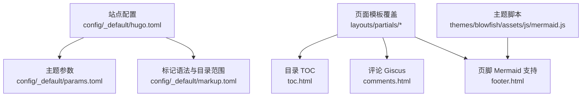
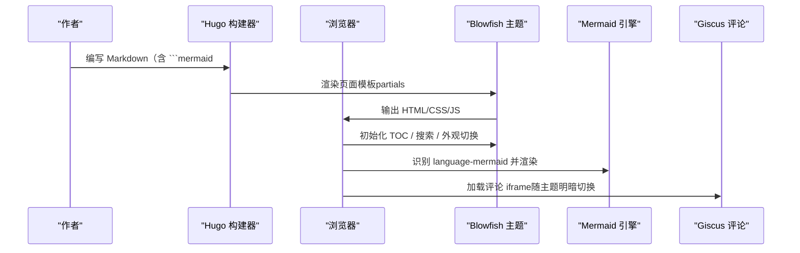
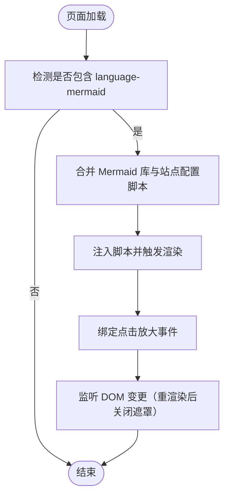
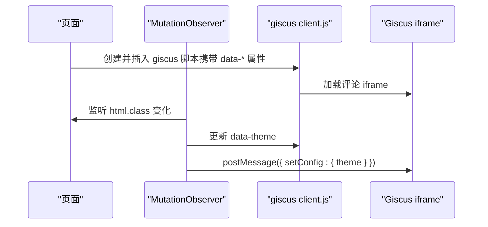
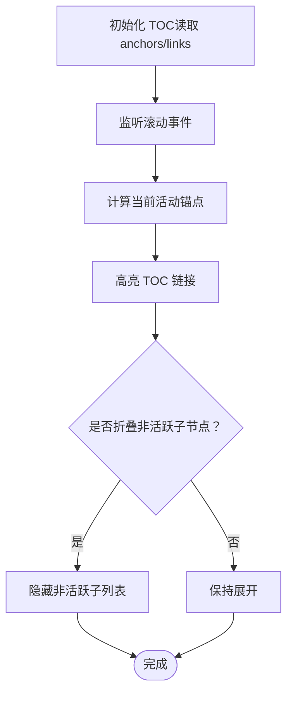
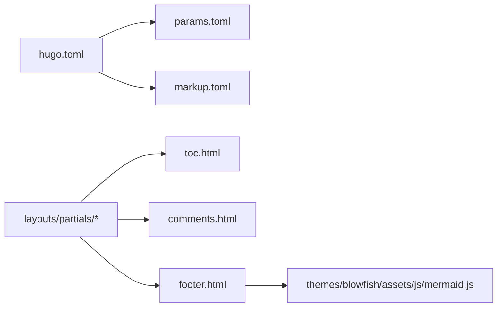

# 高级功能

<cite>
**本文引用的文件**   
- [README.md](file://README.md)
- [hugo.toml](file://config/_default/hugo.toml)
- [params.toml](file://config/_default/params.toml)
- [markup.toml](file://config/_default/markup.toml)
- [mermaid.js（主题）](file://themes/blowfish/assets/js/mermaid.js)
- [toc.html](file://layouts/partials/toc.html)
- [comments.html](file://layouts/partials/comments.html)
- [footer.html](file://layouts/partials/footer.html)
</cite>

## 目录
1. [简介](#简介)
2. [项目结构](#项目结构)
3. [核心组件](#核心组件)
4. [架构总览](#架构总览)
5. [详细组件分析](#详细组件分析)
6. [依赖关系分析](#依赖关系分析)
7. [性能优化与调试](#性能优化与调试)
8. [故障排查指南](#故障排查指南)
9. [结论](#结论)

## 简介
本章节面向希望深入使用站点高级能力的开发者，聚焦以下能力：Mermaid.js 图表渲染、Giscus 评论系统、目录生成（TOC）、搜索、RSS 订阅、第三方服务集成（分析与社交分享），以及性能优化与调试方法。本项目基于 Hugo + Blowfish 主题，采用站点级 partials 覆盖方式扩展主题能力，避免直接修改主题子模块。

## 项目结构
站点将“行为参数”集中在 params.toml，“内容处理规则”集中在 markup.toml，“站点基础配置”集中在 hugo.toml；前端交互逻辑通过 layouts/partials 覆盖主题默认实现，如 TOC、评论、页脚等。



**图示来源**
- [hugo.toml:1-78](file://config/_default/hugo.toml#L1-L78)
- [params.toml:1-88](file://config/_default/params.toml#L1-L88)
- [markup.toml:1-31](file://config/_default/markup.toml#L1-L31)
- [toc.html:1-126](file://layouts/partials/toc.html#L1-L126)
- [comments.html:1-55](file://layouts/partials/comments.html#L1-L55)
- [footer.html:1-205](file://layouts/partials/footer.html#L1-L205)
- [mermaid.js（主题）:1-34](file://themes/blowfish/assets/js/mermaid.js#L1-L34)

**章节来源**
- [README.md:14-39](file://README.md#L14-L39)
- [hugo.toml:1-78](file://config/_default/hugo.toml#L1-L78)
- [params.toml:1-88](file://config/_default/params.toml#L1-L88)
- [markup.toml:1-31](file://config/_default/markup.toml#L1-L31)

## 核心组件
- Mermaid.js 图表渲染：在文章中使用 ```mermaid
代码围栏即可渲染，无需 shortcode；页脚自动检测并注入 Mermaid 资源与放大预览逻辑。
- Giscus 评论系统：基于 GitHub Discussions，动态跟随站点明暗主题，支持多语言与懒加载。
- 目录生成TOC：支持智能滚动高亮、折叠非活跃子节点、移动端与桌面端双布局。
- 搜索：由主题提供，站点通过参数开关启用。
- RSS 订阅：Hugo 输出 RSS，站点首页同时输出 HTML/RSS/JSON。
- 第三方服务集成：分析主题 analytics partials、社交分享主题 sharing-links partials。
**章节来源**
- [footer.html:78-199](file://layouts/partials/footer.html#L78-L199)
- [comments.html:1-55](file://layouts/partials/comments.html#L1-L55)
- [toc.html:1-126](file://layouts/partials/toc.html#L1-L126)
- [params.toml:8-24](file://config/_default/params.toml#L8-L24)
- [hugo.toml:45-47](file://config/_default/hugo.toml#L45-L47)
## 架构总览
下图展示从 Markdown 到最终页面的关键流程：Hugo 编译时根据 markup 设置解析内容，运行时由浏览器执行 TOC、Mermaid、Giscus 等脚本。


**图示来源**
- [footer.html:78-199](file://layouts/partials/footer.html#L78-L199)
- [toc.html:25-125](file://layouts/partials/toc.html#L25-L125)
- [comments.html:3-52](file://layouts/partials/comments.html#L3-L52)

## 详细组件分析

### Mermaid.js 图表渲染
- 使用方法：在文章内容中使用 ```mermaid
代码围栏即可渲染，无需 shortcode。
- 资源注入：当检测到 content 包含 mermaid 代码块时，页脚会合并并指纹化 Mermaid 库与站点自定义配置脚本，按需加载。
- 样式定制：站点级 mermaid.js 通过 CSS 变量映射主题色板，分别初始化 light/dark 两套主题变量，确保与站点外观一致。
- 交互增强：点击图表可打开全屏遮罩查看原始尺寸 SVG，避免缩放模糊；监听 DOM 变化以在重渲染时关闭遮罩。


**图示来源**
- [footer.html:78-199](file://layouts/partials/footer.html#L78-L199)
- [mermaid.js（主题）:1-34](file://themes/blowfish/assets/js/mermaid.js#L1-L34)

**章节来源**
- [README.md:102-105](file://README.md#L102-L105)
- [footer.html:78-199](file://layouts/partials/footer.html#L78-L199)
- [mermaid.js（主题）:1-34](file://themes/blowfish/assets/js/mermaid.js#L1-L34)

### Giscus 评论系统（GitHub Discussions）
- 连接配置：通过 data-repo、data-repo-id、data-category、data-category-id 指定仓库与讨论分类。
- 页面映射：data-mapping=pathname 使每篇文章对应一个讨论串。
- 主题同步：监听 html 元素的 class 变化，动态更新 Giscus 的 data-theme 并通过 postMessage 通知 iframe 切换主题。
- 个性化：支持 reactions、输入位置、语言、懒加载等属性。



**图示来源**
- [comments.html:3-52](file://layouts/partials/comments.html#L3-L52)

**章节来源**
- [comments.html:1-55](file://layouts/partials/comments.html#L1-L55)

### 目录生成（TOC）
- 生成范围：由 markup.toml 控制 startLevel/endLevel（默认 2-4）。
- 显示控制：params.toml 中 showTableOfContents 控制是否显示；smartTOC 开启智能滚动高亮与可选的折叠非活跃子节点。
- 交互逻辑：监听滚动与 hashchange，计算当前可见锚点并高亮对应链接；支持移动端与桌面端两种布局。



**图示来源**
- [markup.toml:28-31](file://config/_default/markup.toml#L28-L31)
- [params.toml:22-24](file://config/_default/params.toml#L22-L24)
- [toc.html:25-125](file://layouts/partials/toc.html#L25-L125)

**章节来源**
- [markup.toml:28-31](file://config/_default/markup.toml#L28-L31)
- [params.toml:22-24](file://config/_default/params.toml#L22-L24)
- [toc.html:1-126](file://layouts/partials/toc.html#L1-L126)

### 搜索功能
- 开关：params.toml 中 enableSearch=true 启用主题内置搜索。
- 行为：由主题侧 JS 实现，站点无需额外配置；可通过主题参数进一步调整搜索行为（参考主题文档）。

**章节来源**
- [params.toml:8-11](file://config/_default/params.toml#L8-L11)

### RSS 订阅
- 输出：hugo.toml 中 outputs.home 包含 RSS，站点首页会同时输出 HTML/RSS/JSON。
- 使用：访问站点根路径下的 RSS 地址即可订阅最新文章。

**章节来源**
- [hugo.toml:45-47](file://config/_default/hugo.toml#L45-L47)

### 第三方服务集成最佳实践
- 分析工具：主题提供 analytics partials（如 GA、Fathom、Umami、Seline），可在站点层 partials 或主题参数中启用对应方案。
- 社交分享：主题提供 sharing-links partials，结合 params.toml 中的社交图片与 OG/Twitter Card 配置，提升分享效果。
- 建议：优先通过主题提供的 partials 接入，避免直接引入外部脚本造成冲突；对隐私敏感的分析方案，建议在 CI 或环境变量中管理密钥。

[本节为通用指导，不直接分析具体文件]

## 依赖关系分析
- 站点配置依赖主题参数与标记语法设置。
- 页面模板覆盖依赖主题 partials 的结构约定。
- Mermaid 渲染依赖 footer 的条件注入与主题 mermaid.js 的配置。
- Giscus 依赖页面挂载点与 MutationObserver 的主题同步。



**图示来源**
- [hugo.toml:1-78](file://config/_default/hugo.toml#L1-L78)
- [params.toml:1-88](file://config/_default/params.toml#L1-L88)
- [markup.toml:1-31](file://config/_default/markup.toml#L1-L31)
- [toc.html:1-126](file://layouts/partials/toc.html#L1-L126)
- [comments.html:1-55](file://layouts/partials/comments.html#L1-L55)
- [footer.html:1-205](file://layouts/partials/footer.html#L1-L205)
- [mermaid.js（主题）:1-34](file://themes/blowfish/assets/js/mermaid.js#L1-L34)

**章节来源**
- [hugo.toml:1-78](file://config/_default/hugo.toml#L1-L78)
- [params.toml:1-88](file://config/_default/params.toml#L1-L88)
- [markup.toml:1-31](file://config/_default/markup.toml#L1-L31)

## 性能优化与调试
- Mermaid 渲染
  - 仅在需要时注入资源：footer 检测 content 中是否存在 mermaid 代码块再加载，减少首屏开销。
  - 使用资源压缩与指纹化：合并与 Minify 脚本，配合指纹提升缓存命中率。
  - 大图预览：点击放大使用原生 SVG 尺寸，避免缩放模糊；重渲染时自动关闭遮罩。
- TOC 交互
  - 使用 passive 事件监听滚动与 hashchange，降低主线程阻塞。
  - 可选折叠非活跃子节点，减少初始渲染复杂度。
- Giscus 评论
  - 懒加载 iframe，减少首屏压力。
  - 通过 MutationObserver 同步主题，避免重复请求。
- 搜索
  - 由主题侧实现，建议仅启用必要索引字段，避免过大索引影响性能。
- 调试建议
  - 检查 footer 是否正确注入 Mermaid 脚本与事件绑定。
  - 检查 comments.html 的 data-repo/data-category 是否与 GitHub Discussions 一致。
  - 检查 markup.toml 的 tableOfContents 层级是否符合预期。
  - 使用浏览器开发者工具观察网络面板与控制台错误，确认第三方脚本加载状态。

**章节来源**
- [footer.html:78-199](file://layouts/partials/footer.html#L78-L199)
- [toc.html:100-125](file://layouts/partials/toc.html#L100-L125)
- [comments.html:19-52](file://layouts/partials/comments.html#L19-L52)
- [markup.toml:28-31](file://config/_default/markup.toml#L28-L31)

## 故障排查指南
- Mermaid 未渲染
  - 确认文章内使用了 ```mermaid 代码围栏。
  - 检查 footer 是否检测到 language-mermaid 并注入脚本。
  - 检查浏览器控制台是否有脚本加载错误或 CSP 限制。
- Giscus 无评论或主题不同步
  - 核对 data-repo、data-repo-id、data-category、data-category-id 是否正确。
  - 确认 data-mapping=pathname 与页面 URL 匹配。
  - 检查 MutationObserver 是否监听到 html.class 变化并发送 setConfig。
- TOC 高亮异常
  - 检查 markup.toml 的 startLevel/endLevel 是否包含目标标题层级。
  - 确认 toc.html 中锚点选择器与页面实际结构一致。
- RSS 无法订阅
  - 确认 hugo.toml 中 outputs.home 包含 RSS。
  - 检查站点根路径下是否生成 RSS 文件。

**章节来源**
- [footer.html:78-199](file://layouts/partials/footer.html#L78-L199)
- [comments.html:36-52](file://layouts/partials/comments.html#L36-L52)
- [markup.toml:28-31](file://config/_default/markup.toml#L28-L31)
- [hugo.toml:45-47](file://config/_default/hugo.toml#L45-L47)

## 结论
本项目通过站点级 partials 覆盖与主题参数集中配置，实现了 Mermaid 图表渲染、Giscus 评论、智能 TOC、搜索与 RSS 等高级能力。借助条件注入、被动事件监听与懒加载策略，兼顾了功能丰富性与性能体验。开发者可按需扩展第三方服务，遵循主题提供的 partials 与参数约定，以获得更稳定、易维护的站点体验。